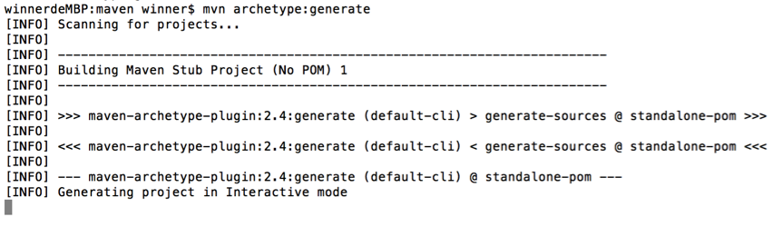
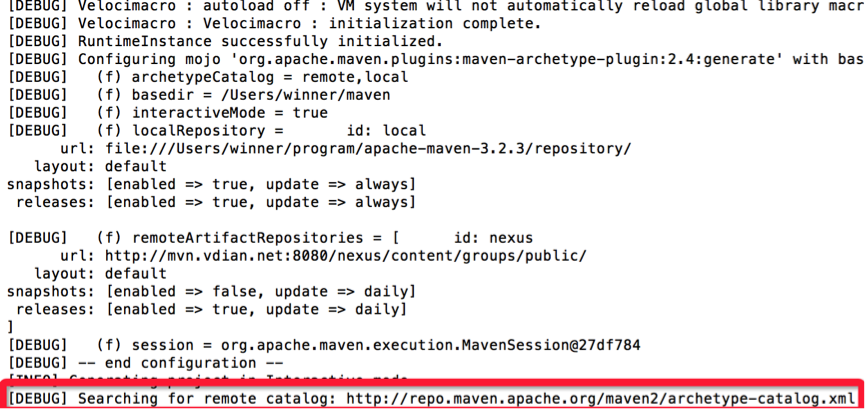
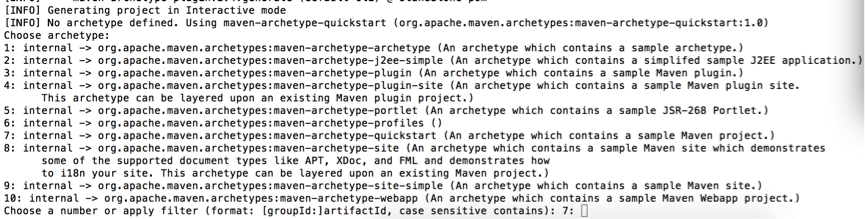
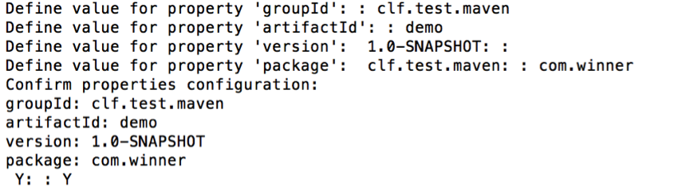
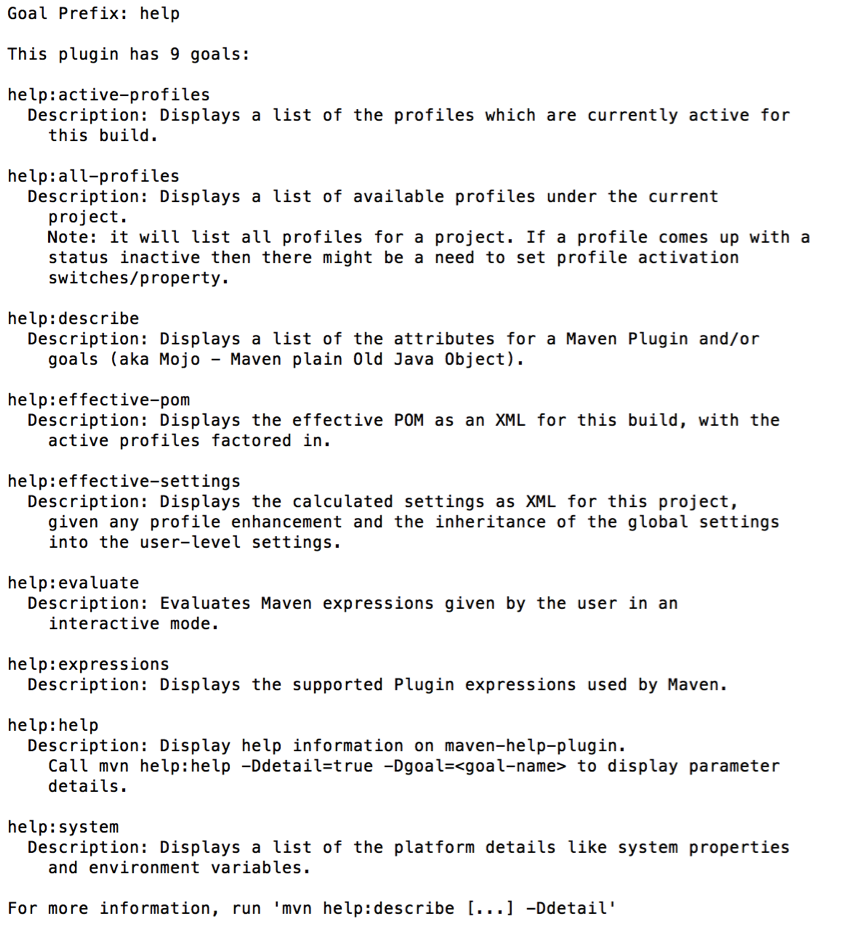
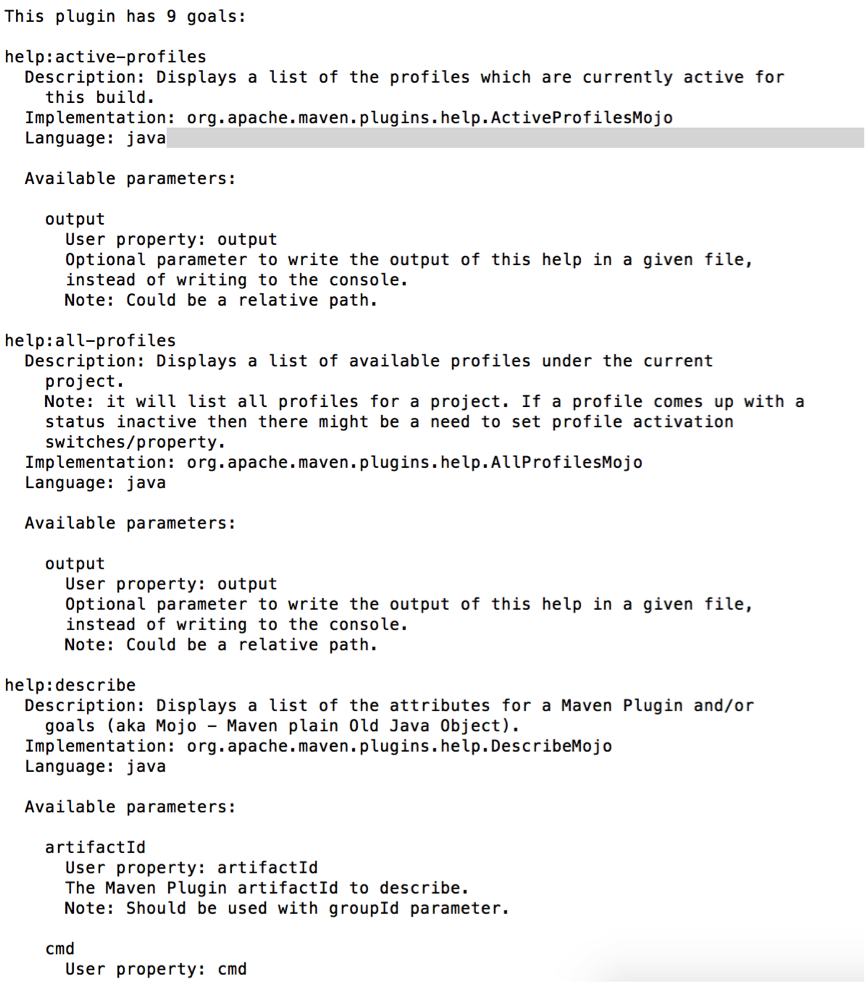

# Maven 基础与命令

# 1 Maven 是什么

首先，Maven 的正确发音是 `/ˈmeɪvən/`，而不是“马瘟”以及其他什么瘟。Maven 在美国是一个口语化的词语，代表专家、内行的意思，约等于北京话中的“老炮儿”。

一个对 Maven 比较正式的定义是这么说的：

> Maven 是一个项目管理工具，它包含了一个项目对象模型（POM，Project Object Model）、一组标准、一个项目生命周期（Project Lifecycle）、一个依赖管理系统（Dependency Management System），以及用来运行定义在生命周期阶段（phase）中的插件（plugin）目标（goal）的逻辑。

不过，这段话对于完全没有 Maven 实践经验的人来说，看了等于没看，并没有什么用。

Maven 到底是什么，能做什么，可以用更通俗的方式来说明。我们知道，项目开发不仅仅是写写代码而已，期间会伴随着各种必不可少的事情要做，下面列举几个感受一下：

- 我们需要引用各种 jar 包，尤其是比较大的工程，引用的 jar 包往往有几十个乃至上百个，每用到一种 jar 包，都需要手动引入工程目录，而且经常遇到各种让人抓狂的 jar 包冲突、版本冲突。
- 我们辛辛苦苦写好了 Java 文件，可是只懂 0 和 1 的电脑却完全读不懂，需要将它编译成二进制字节码。好在现在这项工作可以由各种集成开发工具帮我们完成，Eclipse、IDEA 等都可以将代码即时编译。当然，如果你嫌生命漫长，何不铺张，也可以用记事本来敲代码，然后用 javac 命令一个个地去编译，逗电脑玩。
- 世界上没有不存在 bug 的代码，正如世界上没有不喜欢美女的男人一样。写完了代码，我们还要写一些单元测试，然后一个个地运行来检验代码质量。
- 再优雅的代码最终也要交付运行。我们后面还需要把代码与各种配置文件、资源整合到一起，定型打包，如果是 Web 项目，还需要将之发布到服务器，供用户访问。

试想，如果现在有一种工具，可以把你从上面的繁琐工作中解放出来，能帮你构建工程、管理 jar 包、编译代码，还能帮你自动运行单元测试、打包、生成报表，甚至能帮你部署项目、生成 Web 站点，你会心动吗？傻子才不会。


负责任地告诉你，以上的一切 Maven 都可以办到。概括地说，Maven 可以简化和标准化项目构建过程，将编译、分发、文档、团队协作等各项任务无缝衔接起来。

截至目前，Maven 的最新稳定版本是 3.10.0，下一代 Maven 4 仍处于候选发布（RC）阶段，官方明确提示尚不适合生产使用。Maven 4 的主要变化包括：运行需要 JDK 17 及以上；区分本地构建用的 POM 与发布到仓库的消费者 POM（Consumer POM）；引入 4.1.0 版本的 POM 模型，用 `<subprojects>` 取代 `<modules>` 等。常被一并提及的构建缓存（Build Cache）则是一个独立扩展，Maven 3.9 起即可使用，并非 Maven 4 的内置功能。

# 2 目录结构

Maven 默认的文件存放结构如下：

- /项目目录
  - pom.xml 用于 Maven 的配置文件
  - /src 源代码目录
    - /src/main 工程源代码目录
      - /src/main/java 工程 Java 源代码目录
      - /src/main/resources 工程的资源目录
    - /src/test 单元测试目录
      - /src/test/java
      - /src/test/resources
  - /target 输出目录，所有的输出物都存放在这个目录下
    - /target/classes 编译之后的 class 文件

每一个阶段的任务都知道怎么正确完成自己的工作，比如 compile 任务就知道从 src/main/java 下编译所有的 Java 文件，并把它输出的 class 文件存放到 target/classes 中。

对 Maven 来说，采用“约定优于配置”的策略可以减少修改配置的工作量，也可以降低学习成本，更重要的是，给项目引入了统一的规范。

# 3 生命周期

我们在开发项目的时候，不断地重复着编译、测试、打包、部署等过程，Maven 的生命周期就是对所有构建过程进行抽象与统一，生命周期包含项目的清理、初始化、编译、测试、打包、集成测试、验证、部署、站点生成等几乎所有的过程。

Maven 有三套相互独立的生命周期，请注意这里说的是“三套”，而且“相互独立”，初学者容易将 Maven 的生命周期看成一个整体，其实不然。这三套生命周期分别是：

- Clean Lifecycle：在进行真正的构建之前进行一些清理工作
- Default Lifecycle：构建的核心部分，包括编译、测试、打包、部署等
- Site Lifecycle：生成项目报告、站点，发布站点


再次强调一下它们是相互独立的，可以仅仅调用 `clean` 来清理工作目录，仅仅调用 `site` 来生成站点。当然也可以直接运行 `mvn clean install site` 运行所有这三套生命周期。

每套生命周期都由一组**阶段（Phase）**组成，我们平时在命令行输入的命令总会对应于一个特定的阶段。Maven 中所有的执行**动作（goal）**都需要指明自己在这个过程中的执行位置，然后 Maven 执行的时候，就依照过程的发展依次调用这些 goal 进行各种处理。这也是 Maven 的一个基本调度机制。

## 3.1 Clean 生命周期

| 阶段           | 动作                                  |
| -------------- | ------------------------------------- |
| **pre-clean**  | 执行一些需要在 clean 之前完成的工作     |
| **clean**      | 移除所有上一次构建生成的文件          |
| **post-clean** | 执行一些需要在 clean 之后立刻完成的工作 |

命令 `mvn clean` 中的 clean 就是代表执行上面的 clean 阶段。**在一个生命周期中，运行某个阶段的时候，它之前的所有阶段都会被运行**，也就是说，`mvn clean` 等同于 `mvn pre-clean clean`；如果我们运行 `mvn post-clean`，那么 `pre-clean`、`clean` 都会被运行。这是 Maven 很重要的一个规则，可以大大简化命令行的输入。

## 3.2 Default 生命周期

Maven 最重要的就是 Default 生命周期，也称构建生命周期，绝大部分工作都发生在这个生命周期中，每个阶段的名称与功能如下：

| 阶段                       | 动作                                                         |
| -------------------------- | ------------------------------------------------------------ |
| validate                   | 验证项目是否正确，以及所有为了完整构建必要的信息是否可用     |
| initialize                 | 初始化构建状态，例如设置属性、创建目录                       |
| generate-sources           | 生成所有需要包含在编译过程中的源代码                         |
| process-sources            | 处理源代码，比如过滤一些值                                   |
| generate-resources         | 生成所有需要包含在打包过程中的资源文件                       |
| **process-resources**      | 复制并处理资源文件至目标目录，准备打包                       |
| **compile**                | 编译项目的源代码                                             |
| process-classes            | 后处理编译生成的文件，例如对 Java 类进行字节码增强（bytecode enhancement） |
| generate-test-sources      | 生成所有包含在测试编译过程中的测试源码                       |
| process-test-sources       | 处理测试源码，比如过滤一些值                                 |
| generate-test-resources    | 生成测试需要的资源文件                                       |
| **process-test-resources** | 复制并处理测试资源文件至测试目标目录                         |
| test-compile               | 编译测试源码至测试目标目录                                   |
| process-test-classes       | 后处理测试编译生成的文件                                     |
| **test**                   | 使用合适的单元测试框架运行测试。这些测试应该不需要代码被打包或发布 |
| prepare-package            | 在真正的打包之前，执行一些准备打包必要的操作                 |
| **package**                | 将编译好的代码打包成可分发的格式，如 JAR、WAR 或者 EAR       |
| pre-integration-test       | 执行一些在集成测试运行之前需要的动作，如建立集成测试需要的环境 |
| integration-test           | 如果有必要的话，处理包并发布至集成测试可以运行的环境         |
| post-integration-test      | 执行一些在集成测试运行之后需要的动作，如清理集成测试环境     |
| verify                     | 执行所有检查，验证包是有效的，符合质量规范                   |
| **install**                | 安装包至本地仓库，以备本地的其他项目作为依赖使用             |
| **deploy**                 | 复制最终的包至远程仓库，共享给其他开发人员和项目（通常和一次正式的发布相关） |

可见，构建生命周期被细分成了 23 个阶段，但是我们没必要对每个阶段都了如指掌，经常关联使用的只有 `test`、`package`、`install`、`deploy` 等几个阶段而已。

一般来说，位置稍后的过程都会依赖于之前的过程。这也就是为什么我们运行 `mvn install` 的时候，代码会被编译、测试、打包。当然，Maven 同样提供了相应的配置，可以依照用户要求跳过某些步骤。比如有时候希望跳过测试而直接 `install`，因为单元测试如果有任何一条没通过，Maven 就会终止后续的工作。

## 3.3 Site 生命周期

| 阶段            | 动作                                                       |
| --------------- | ---------------------------------------------------------- |
| **pre-site**    | 执行一些需要在生成站点文档之前完成的工作                   |
| **site**        | 生成项目的站点文档                                         |
| **post-site**   | 执行一些需要在生成站点文档之后完成的工作，并且为部署做准备 |
| **site-deploy** | 将生成的站点文档部署到特定的服务器上                       |

这里经常用到的是 site 阶段和 site-deploy 阶段，用以生成和发布 Maven 站点，这是 Maven 相当强大的功能，但是，据我观察，业界内几乎没人使用。如今项目文档更多采用 MkDocs、Docusaurus、VitePress 等静态站点工具，或者直接放在 GitHub、GitLab 的 README 与 Wiki 中。

# 4 插件

Maven 本质上是一个插件框架，它的核心并不执行任何具体的构建任务，所有这些任务都交给插件来完成，像编译是通过 `maven-compiler-plugin` 实现的、测试是通过 `maven-surefire-plugin` 实现的。Maven 也内置了很多插件，所以我们在对项目进行编译、测试、打包的过程中感觉不到插件的存在。

进一步说，每个任务对应了一个插件目标（goal），每个插件会有一个或者多个目标，例如 `maven-compiler-plugin` 的 `compile` 目标用来编译位于 src/main/java/ 目录下的主源码，`testCompile` 目标用来编译位于 src/test/java/ 目录下的测试源码。

认识上述 Maven 插件的基本概念有助于理解 Maven 的工作机制，不过要想更高效地使用 Maven，了解一些常用的插件还是很有必要的，这可以帮助你避免一不小心重新发明轮子。多年来 Maven 社区积累了大量的经验，并随之形成了一个成熟的插件生态圈。常用的插件列表有两个：

- 第一个列表的 GroupId 为 org.apache.maven.plugins，这里的插件最为成熟，具体地址为：https://maven.apache.org/plugins/index.html
- 第二个列表的 GroupId 为 org.codehaus.mojo，这里的插件没有那么核心，但也有不少十分有用。该项目原托管于 Codehaus，Codehaus 关闭后迁移为 MojoHaus，地址为：https://www.mojohaus.org/plugins.html

一个插件通常提供了一组目标，可使用以下语法直接调用：

`mvn [plugin-name]:[goal-name]`

例如，一个 Java 项目使用了编译器插件，通过运行以下命令编译：

`mvn compiler:compile`

这是直接调用插件目标的方式。日常更常用的是 `mvn compile`、`mvn install` 这类通过生命周期阶段间接调用插件目标的方式，两者的区别见 5.1 节。

Maven 提供以下两种类型的插件：

- 构建插件：在构建过程中执行，应在 pom.xml 中的 `<build/>` 元素进行配置
- 报告插件：在站点生成期间执行，应在 pom.xml 中的 `<reporting/>` 元素进行配置

这里仅列举几个常用的核心插件，每个插件如何进行个性化配置，官网都有详细的介绍（以下版本号仅为示例，实际使用时请选用较新的版本）。

```xml
<plugins> 
  
  <plugin> 
    <!-- 编译插件 -->  
    <groupId>org.apache.maven.plugins</groupId>  
    <artifactId>maven-compiler-plugin</artifactId>  
    <version>3.16.0</version>  
    <configuration> 
      <release>17</release> 
    </configuration> 
  </plugin>  
  
  <plugin> 
    <!-- 发布插件 -->  
    <groupId>org.apache.maven.plugins</groupId>  
    <artifactId>maven-deploy-plugin</artifactId>  
    <version>3.2.0</version> 
  </plugin> 
  
  <plugin> 
    <!-- 打包插件 -->  
    <groupId>org.apache.maven.plugins</groupId>  
    <artifactId>maven-jar-plugin</artifactId>  
    <version>3.5.1</version> 
  </plugin> 
  
  <plugin> 
    <!-- 安装插件 -->  
    <groupId>org.apache.maven.plugins</groupId>  
    <artifactId>maven-install-plugin</artifactId>  
    <version>3.2.0</version> 
  </plugin>  
  
  <plugin> 
    <!-- 单元测试插件 -->  
    <groupId>org.apache.maven.plugins</groupId>  
    <artifactId>maven-surefire-plugin</artifactId>  
    <version>3.6.0</version>  
    <configuration> 
      <skip>true</skip> 
    </configuration> 
  </plugin>  
  
  <plugin> 
    <!-- 源码插件 -->  
    <groupId>org.apache.maven.plugins</groupId>  
    <artifactId>maven-source-plugin</artifactId>  
    <version>3.4.0</version>  
    <!-- 发布时自动将源码同时发布的配置 -->  
    <executions> 
      <execution> 
        <id>attach-sources</id>  
        <goals> 
          <goal>jar</goal> 
        </goals> 
      </execution> 
    </executions> 
  </plugin> 
  
</plugins>

```

编译插件使用 `<release>` 指定 Java 版本（JDK 9 及以上可用），它比传统的 `<source>` 和 `<target>` 更严格：除了指定字节码版本，还会按目标版本的 API 进行编译检查，避免误用高版本才有的 API 而导致运行时出错。

除了这些核心插件之外，还有很多优秀的第三方插件，可以帮助我们快捷、方便地构建项目。当使用到某些功能或者特性的时候多加搜索，往往能得到让你惊喜的效果。

例如，项目中使用了 MyBatis，就有一款神奇的 Maven 插件，运行一个命令，就可以根据数据库的表，自动生成 MyBatis 的 Mapper 配置文件以及 DAO 层接口模板。

在 pom.xml 中添加 plugin：

```xml
<plugin> 
  <groupId>org.mybatis.generator</groupId>  
  <artifactId>mybatis-generator-maven-plugin</artifactId>  
  <version>1.4.2</version>  
  <configuration> 
    <configurationFile>src/main/resources/mybatis-generator/generatorConfig.xml</configurationFile>  
    <verbose>true</verbose>  
    <overwrite>true</overwrite> 
  </configuration>  
  <executions> 
    <execution> 
      <id>Generate MyBatis Artifacts</id>  
      <goals> 
        <goal>generate</goal> 
      </goals> 
    </execution> 
  </executions>  
  <dependencies> 
    <dependency> 
      <groupId>org.mybatis.generator</groupId>  
      <artifactId>mybatis-generator-core</artifactId>  
      <version>1.4.2</version> 
    </dependency> 
    <!-- 数据库驱动作为插件依赖引入，无须在 generatorConfig.xml 中写死 jar 包路径 -->  
    <dependency> 
      <groupId>com.mysql</groupId>  
      <artifactId>mysql-connector-j</artifactId>  
      <version>9.7.0</version> 
    </dependency> 
  </dependencies> 
</plugin>
```

定义 generatorConfig.xml 配置文件：

```xml
<generatorConfiguration> 
  <context id="DB2Tables" targetRuntime="MyBatis3"> 
    <!-- 去掉自动生成的注解 -->  
    <commentGenerator> 
      <property name="suppressAllComments" value="true"/> 
    </commentGenerator>  
    <jdbcConnection driverClass="com.mysql.cj.jdbc.Driver" connectionURL="jdbc:mysql://localhost:3306/db?characterEncoding=utf8" userId="id" password="password"></jdbcConnection>  
    <!-- 默认false，把JDBC DECIMAL 和 NUMERIC 类型解析为 Integer true，把JDBC DECIMAL 和
            NUMERIC 类型解析为java.math.BigDecimal -->  
    <javaTypeResolver> 
      <property name="forceBigDecimals" value="false"/> 
    </javaTypeResolver>  
    <!-- 生成映射类-->  
    <javaModelGenerator targetPackage="com.clf.model" targetProject="src/main/java"> 
      <!-- enableSubPackages:是否让schema作为包的后缀 -->  
      <property name="enableSubPackages" value="true"/>  
      <property name="trimStrings" value="true"/> 
    </javaModelGenerator>  
    <!-- 生成xml文件-->  
    <sqlMapGenerator targetPackage="com.clf.mapper" targetProject="src/main/resources"> 
      <property name="enableSubPackages" value="true"/>  
      <property name="trimStrings" value="true"/> 
    </sqlMapGenerator>  
    <!-- 生成mapper interface-->  
    <javaClientGenerator type="XMLMAPPER" targetPackage="com.clf.mapper" targetProject="src/main/java"> 
      <property name="enableSubPackages" value="true"/>  
      <property name="trimStrings" value="true"/> 
    </javaClientGenerator>  
    <table tableName="table_name" domainObjectName="object_name" enableCountByExample="false" enableUpdateByExample="false" enableDeleteByExample="false" enableSelectByExample="false" selectByExampleQueryId="false"/> 
  </context> 
</generatorConfiguration>
```

然后定位到 pom.xml 所在的路径下面，运行：

`mvn mybatis-generator:generate`

所有的文件就会自动生成，怎一个爽字了得。

# 5 命令

## 5.1 常用命令

从某种意义上来说，软件是帮助不懂程序的人来操作计算机的，图形化界面尤其如此。在上个世纪，比尔·盖茨之所以成为世界首富，微软之所以成为 IT 界的巨鳄，就是因为 Windows 开图形化操作之先河，并抢先占领了全球市场，笑傲江湖数十年，至今依然宝刀未老。

诚然，现在几乎每种软件都有图形化界面，用鼠标点击几下就可以完成操作。Maven 也不例外，在各类 IDE 中都有成熟的插件来简化操作。

但是作为开发人员，应该时刻保持着一种职业神圣感，我们拥有上帝之手，借助程序来操纵着计算机世界的一切。我们与计算机交流的正途是通过命令，而不是图形化界面。

总而言之，图形化界面不是不能用，因为它确实有好处，可以提高开发效率，规避操作失误。我的观点是，用它，但是不要依赖它。

作为开发利器的 Maven，为我们提供了十分丰富的命令，了解 Maven 的命令行操作并熟练运用常见的 Maven 命令还是十分必要的。无论多先进多炫的图形化界面，底层都得靠 Maven 命令来驱动。知其然，知其所以然，方能百战不殆。

在上文讲解插件时已经说过，Maven 的所有任务都是通过插件来完成的，它本身只是一个空空如也的框架，不具备执行具体任务的能力。

用户可以通过两种方式调用 Maven 插件目标。

第一种方式是将插件目标与生命周期阶段（lifecycle phase）绑定，这样用户在命令行只需输入生命周期阶段即可。例如 Maven 默认将 maven-compiler-plugin 的 compile 目标与 compile 生命周期阶段绑定，因此命令 `mvn compile` 实际上是先定位到 compile 这一生命周期阶段，然后再根据绑定关系调用 maven-compiler-plugin 的 compile 目标。

第二种方式是直接在命令行以 `mvn [plugin-name]:[goal-name]` 的形式指定要执行的插件目标，例如 `mvn archetype:generate` 就表示调用 maven-archetype-plugin 的 generate 目标，这种带冒号的调用方式与生命周期无关。

常用的 Maven 命令如下：

| 命令                       | 动作                                                         |
| -------------------------- | ------------------------------------------------------------ |
| **mvn --version**          | 显示版本信息                                                 |
| **mvn clean**              | 清理项目产生的临时文件，一般是模块下的 target 目录           |
| **mvn compile**            | 编译源代码，一般编译模块下的 src/main/java 目录              |
| **mvn package**            | 项目打包，会在模块下的 target 目录生成 jar 或 war 等文件     |
| **mvn test**               | 测试命令，执行 src/test/java/ 下 JUnit 的测试用例            |
| **mvn install**            | 将打包的 jar/war 文件复制到你的本地仓库中，供其他模块使用    |
| **mvn deploy**             | 将打包的文件发布到远程仓库，供其他人员下载依赖               |
| **mvn site**               | 生成项目相关信息的网站                                       |
| **mvn dependency:tree**    | 打印出项目的整个依赖树                                       |
| **mvn archetype:generate** | 创建 Maven 的普通 Java 项目                                  |
| **mvn jetty:run**          | 调用 Jetty 插件的 run 目标，在 Jetty Servlet 容器中启动 Web 应用 |

早年常用的 `mvn eclipse:eclipse`（生成 Eclipse 项目文件）和 `mvn tomcat:run`（在 Tomcat 容器中运行 Web 应用）已经过时：maven-eclipse-plugin 早已退役，如今 Eclipse（内置 m2e）和 IDEA 都可以直接导入 Maven 项目；Tomcat 的 Maven 插件多年未更新，仅支持到 Tomcat 7，现在的 Java Web 项目大多基于 Spring Boot，通过内嵌容器直接运行。

**注意：**运行 Maven 命令的时候，首先需要定位到 Maven 项目的目录，也就是项目的 pom.xml 文件所在的目录。否则，必须通过参数（如 `-f`）来指定项目的 pom.xml 文件。

## 5.2 命令参数

上面列举的只是比较通用的命令，其实很多命令都可以携带参数以执行更精准的任务。

Maven 命令可携带的参数类型如下：

- `-D`：传入属性参数

比如命令：

`mvn package -Dmaven.test.skip=true`

以 `-D` 开头，将 maven.test.skip 的值设为 true，就是告诉 Maven 打包的时候跳过单元测试。同理，`mvn deploy -Dmaven.test.skip=true` 代表部署项目并跳过单元测试。

- `-P`：使用指定的 Profile 配置

比如项目开发需要有多个环境，一般为开发、测试、预发、正式 4 个环境，在 pom.xml 中的配置如下：

```xml
  <profiles> 
    
    <profile> 
      <id>dev</id>  
      <properties> 
        <env>dev</env> 
      </properties>  
      <activation> 
        <activeByDefault>true</activeByDefault> 
      </activation> 
    </profile>  
    
    <profile> 
      <id>qa</id>  
      <properties> 
        <env>qa</env> 
      </properties> 
    </profile> 
    
    <profile> 
      <id>pre</id>  
      <properties> 
        <env>pre</env> 
      </properties> 
    </profile>  
    
    <profile> 
      <id>prod</id>  
      <properties> 
        <env>prod</env> 
      </properties> 
    </profile> 
    
  </profiles>  


  <build> 
    <filters> 
      <filter>config/${env}.properties</filter> 
    </filters>  
    <resources> 
      <resource> 
        <directory>src/main/resources</directory>  
        <filtering>true</filtering> 
      </resource> 
    </resources> 
  </build> 

```

profiles 定义了各个环境的变量 id，filters 中定义了变量配置文件的地址，其中地址中的环境变量就是上面 profile 中定义的值，resources 中定义的是哪些目录下的文件会被配置文件中定义的变量替换。

通过 Maven 可以实现按不同环境进行打包部署，命令为：

`mvn package -P dev`

其中“dev”为环境的变量 id，代表使用 ID 为“dev”的 profile。profile 的完整配置与激活方式见《Maven 仓库与配置》。

此外，常用的命令参数还有：

- `-e`：显示 Maven 运行出错的信息
- `-o`：离线执行命令，即不去远程仓库更新包
- `-X`：显示 Maven 运行的 debug 信息
- `-U`：强制去远程更新 snapshot 的插件或依赖，默认每天只更新一次

## 5.3 实例

下面结合几个实例来看看 Maven 命令的使用方法。

### 5.3.1 archetype:create & archetype:generate

“archetype”是“原型”的意思，Maven 可以根据各种原型来快速创建一个 Maven 项目。

`archetype:create` 是 Maven 3.0.5 之前创建项目的命令，例如创建一个普通的 Java 项目：

`mvn archetype:create -DgroupId=packageName -DartifactId=projectName -Dversion=1.0.0-SNAPSHOT`

后面的三个参数用于指定项目的 groupId、artifactId 以及 version。

创建 Maven 的 Web 项目：

`mvn archetype:create -DgroupId=packageName -DartifactId=projectName -DarchetypeArtifactId=maven-archetype-webapp`

archetypeArtifactId 参数用于指定使用哪个 Maven 原型，这里使用的是 maven-archetype-webapp，Maven 会按照 Web 应用的目录结构生成项目。

需要注意的是，在 Maven 3.0.5 之后，`archetype:create` 命令不再使用，取而代之的是 `archetype:generate` 命令。

该命令会以交互的模式创建 Maven 项目，不需要像 `archetype:create` 那样在后面跟一堆容易出错的参数。

但是，在命令行直接运行 `archetype:generate`，往往会出现下面的结果：



程序卡在了“Generating project in Interactive mode”这一步，加入“-X”参数显示详细信息：

`mvn -X archetype:generate`

运行结果如下：



可见，最终是卡在这一行。Maven 默认会从远程服务器上获取 catalog，archetypeCatalog 表示插件使用的 archetype 元数据，默认值为 remote,local，即中央仓库 archetype 元数据（当时为 http://repo1.maven.org/maven2/archetype-catalog.xml，现在中央仓库只支持 HTTPS，地址为 https://repo.maven.apache.org/maven2/archetype-catalog.xml）加上插件内置元数据，由于中央仓库的 archetype 太多（几千个）而造成程序的阻滞。实际上我们使用不了那么多的原型，加入 `-DarchetypeCatalog=internal` 参数就可以避免这种情况，只使用内置的原型就够了：

`mvn archetype:generate -DarchetypeCatalog=internal`

然后 Maven 会告诉你，archetype 没有指定，默认使用 maven-archetype-quickstart，或者你从下面的列表中选择一个可用的原型：



截图所示版本中可用的内置原型共有 10 个（不同插件版本的数量和序号可能不同），我们选择使用 maven-archetype-quickstart 原型（相当于一个“Hello World”模板）来创建项目，输入对应的序号即可，图中为“7”。

然后会依次提醒你输入 groupId、artifactId、version（默认 1.0-SNAPSHOT）以及创建的第一个包名。



### 5.3.2 help:describe

Maven 有各种插件，插件又有各种目标，我们不可能记得每个插件的命令。Maven 提供了查询各类插件参数的命令：`mvn help:describe`。

例如：`mvn help:describe -Dplugin=help`

代表查询 help 插件的命令规范，然后 Maven 就会告诉你该插件有几个 goal，以及各种参数的意义和配置方法：



下面的命令则代表查询该插件的详细命令参数：

`mvn help:describe -Dplugin=help -Dfull`



Maven 会告诉你该命令有什么参数，以及怎么使用。
