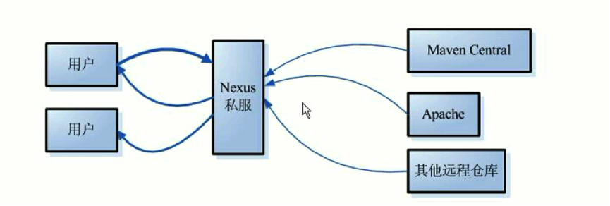
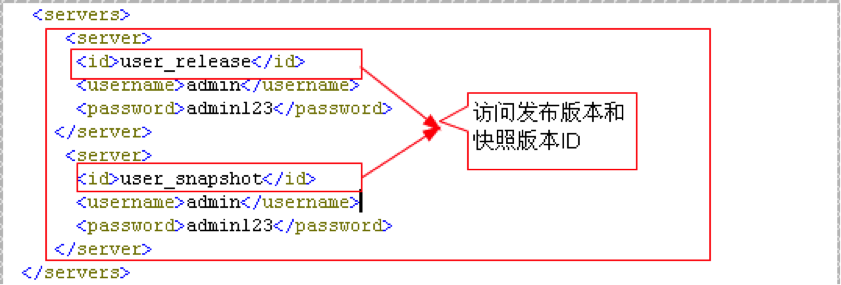

# Maven 仓库与配置

Maven 的配置文件看似很复杂，其实只需要根据项目的实际背景，设置个别的几个配置项而已。Maven 有自己的一套默认配置，使用者除非必要，并不需要去修改那些约定内容。这就是所谓的“**约定优于配置**”。

# 1 仓库

## 1.1 本地仓库

Maven 一个很突出的功能就是 jar 包管理，一旦工程需要依赖某些 jar 包，只需要在 Maven 的 pom.xml 里配置一下，该 jar 包就会自动引入工程目录。初次听来会觉得很神奇，下面我们来探究一下它的实现原理。

首先，这些 jar 包并不是凭空出现的，它们有来处，也有去处。集中存储这些 jar 包（还有插件等）的地方被称为**仓库**（Repository）。

不管这些 jar 包是从哪里来的，必须存储在自己的电脑里之后，你的工程才能引用它们。类似于电脑里有个客栈，专门款待这些远道而来的客人，这个客栈就叫作本地仓库。

比如，工程中需要依赖 spring-core 这个 jar 包，在 pom.xml 中声明之后，Maven 会首先在本地仓库中找，如果找到了就很好办，自动引入工程的依赖 lib 库即可。可是，万一找不到呢？实际上这种情况经常发生，尤其初次使用 Maven 的时候，本地仓库肯定是空无一物的，这时候就要靠 Maven 大展神通，去远程仓库下载。

## 1.2 远程仓库

说到远程仓库，先从最核心的**中央仓库**开始。中央仓库是默认的远程仓库，Maven 在安装的时候，自带的默认中央仓库地址为 https://repo.maven.apache.org/maven2/（早期为 http://repo1.maven.org/maven2/，自 2020 年起中央仓库已不再支持 HTTP 访问），此仓库由 Maven 社区管理，包含了绝大多数流行的开源 Java 构件，以及源码、作者信息、SCM 信息、许可证信息等。一般来说，简单的 Java 项目依赖的构件都可以在这里下载到。中央仓库的官方搜索地址为 https://central.sonatype.com/（原 search.maven.org），可以查询到所有可用的库文件。

除了中央仓库，还有其他很多公共的远程仓库，如中央仓库的镜像仓库。全世界都从中央仓库请求资源，压力巨大，所以在世界各地还有很多中央仓库的镜像仓库来分担访问压力。镜像仓库可以理解为仓库的副本，会从原仓库定期更新资源，以保持与原仓库的一致性。从原仓库中可以找到的构件，从镜像仓库中也可以找到，直接访问镜像仓库，更快更稳定。

除此之外，还有很多各具特色的公共仓库，如果需要都可以在网上找到，比如 Apache Snapshots 仓库，包含了来自于 Apache 软件基金会的快照版本。

实际开发中，国内开发者一般会配置国内的镜像仓库来加速下载，例如阿里云的 https://maven.aliyun.com/repository/public。另外，https://mvnrepository.com/ 是一个使用很广泛的构件搜索网站，可以方便地查询构件的各个版本及其依赖坐标（它本身是索引站点，并不是仓库），谁用谁知道。

下面就是 spring-core 在该网站上的信息（截图为撰写时的版本）：


一般来讲，公司都会通过自己的私有服务器在局域网内架设一个仓库代理。**私服可以看作一种特殊的远程仓库**，代理广域网上的远程仓库，供局域网内的 Maven 用户使用。当 Maven 需要下载构件的时候，先从私服请求，如果私服上不存在该构件，则从外部的远程仓库下载，缓存在私服上之后，再为 Maven 的下载请求提供服务。



Maven 私服有很多好处：

- 可以把公司的私有 jar 包，以及无法从外部仓库下载到的构件上传到私服上，供公司内部使用
- 节省自己的外网带宽：减少重复请求造成的外网带宽消耗
- 加速 Maven 构建：如果项目配置了很多外部远程仓库，构建速度就会大大降低
- 提高稳定性，增强控制：Internet 不稳定的时候，Maven 构建也会变得不稳定，一些私服软件还提供了其他的功能

当前主流的 Maven 私服有 JFrog 的 Artifactory 以及 Sonatype 的 Nexus，此外还有 Apache 的 Archiva（已于 2024 年退役）。

上面提到的中央仓库、中央仓库的镜像仓库、其他公共仓库、私服都属于远程仓库的范畴。


如果 Maven 没有在本地仓库找到想要的东西，就会自动去配置文件中指定的远程仓库寻找，找到后将它下载到你的本地仓库。如果连远程仓库都找不到想要的东西，Maven 就会构建失败并报错，这时多半是依赖坐标或仓库配置写错了。

## 1.3 仓库的配置

仓库配置要做两件事，一是告诉 Maven 你的本地仓库在哪里，二是你的远程仓库在哪里。

顾名思义，settings.xml 的第一个节点 `<localRepository>` 就是配置本地仓库的地方，不用赘言。

远程仓库的配置有些复杂，因为会涉及很多附属特性。下面一切从实际出发，看看使用私服的情况下如何配置远程仓库。稍微像样的公司都会建立自己的私服，如果一个公司连自己的私服都没有（别管是因为买不起服务器还是技术上做不到），你可以考虑一下跳槽的问题了。

现在最流行的 Maven 仓库管理器就是大名鼎鼎的 Nexus（发音 [ˈnɛksəs]，英文中代表“中心、枢纽”的意思），它极大地简化了内部仓库的维护和外部仓库的访问。利用 Nexus，只在一个地方就能够完全控制访问和部署在你所维护仓库中的每个 Artifact。目前使用的都是 Nexus 3，早年的 Nexus 2 已于 2025 年 6 月 30 日正式停止维护。Nexus 3 使用内嵌数据库存储元数据（早期为 OrientDB，新版本为 H2 或外部 PostgreSQL），除了 Maven 仓库，还支持 Docker、npm、PyPI 等多种制品格式。

至于 Nexus 怎么部署，怎么维护仓库，作为开发人员是不需要关心的，只需要把 Nexus 私服的局域网地址写入 Maven 的本地配置文件即可。具体的配置方法如下：

### 1.3.1 设置镜像

```xml
<mirrors>
    <mirror>
        <!--该镜像的唯一标识符。id用来区分不同的mirror元素。 -->
        <id>nexus</id>
        <!-- 镜像名，起注解作用，应做到见文知意。可以不配置  -->
        <name>Human Readable Name </name>
        <!--  所有仓库的构件都要从镜像下载  -->
        <mirrorOf>*</mirrorOf>
        <!-- 私服的局域网地址（Nexus 3 的仓库组地址格式），建议使用 HTTPS -->
        <url>https://192.168.0.1:8081/repository/maven-public/</url>
    </mirror>
</mirrors>
```

节点 `<mirrors>` 下面可以配置多个镜像，`<mirrorOf>` 用于指明是哪个仓库的镜像，上例中使用通配符“*”表明该私服是所有仓库的镜像，不管本地使用了多少种远程仓库，需要下载构件时都会从私服请求。

如果只想将私服设置成某一个远程仓库的镜像，使用 `<mirrorOf>` 指定该远程仓库的 ID 即可。

需要注意的是，从 Maven 3.8.1 开始，出于安全考虑，Maven 默认会屏蔽使用 HTTP 协议的外部仓库，因此私服地址建议使用 HTTPS。

### 1.3.2 设置远程仓库

远程仓库的设置是在 `<profile>` 节点下面：

```xml
<repositories>
    <repository>
        <!--仓库唯一标识 -->
        <id> repoId </id>
        <!--远程仓库名称  -->
        <name>repoName</name>
        <!--远程仓库URL，如果该仓库配置了镜像，这里的URL就没有意义了，
			因为任何下载请求都会交由镜像仓库处理，
			前提是镜像（也就是设置好的私服）需要确保该远程仓库里的任何构件都能通过它下载到 -->
        <url>http://……</url>
        <!--如何处理远程仓库里发布版本的下载 -->
        <releases>
            <!--true或者false表示该仓库是否为下载某种类型构件（发布版，快照版）开启。   -->
            <enabled>false</enabled>
            <!--该元素指定更新发生的频率。Maven会比较本地POM和远程POM的时间戳。这里的选项是：
				always（一直），daily（默认，每日），interval：X（这里X是以分钟为单位的时间间隔），或者never（从不）-->
            <updatePolicy>always</updatePolicy>
            <!--当Maven验证构件校验文件失败时该怎么做:
				ignore（忽略），fail（失败），或者warn（警告）。 -->
            <checksumPolicy>warn</checksumPolicy>
        </releases>
        <!--如何处理远程仓库里快照版本的下载，与发布版的配置类似 -->
        <snapshots>
            <enabled />
            <updatePolicy />
            <checksumPolicy />
        </snapshots>
    </repository>
</repositories>
```

可以配置多个远程仓库，用 `<id>` 加以区分。

除此之外，还有一个与 `<repositories>` 并列存在的 `<pluginRepositories>` 节点，用来配置插件的远程仓库。

仓库主要存储两种构件。第一种构件被用作其他构件的依赖，最常见的就是各类 jar 包，这是中央仓库中存储的大部分构件类型。另外一种构件类型是插件，Maven 插件是一种特殊类型的构件。由于这个原因，插件仓库独立于其他仓库。`<pluginRepositories>` 节点与 `<repositories>` 节点除了根节点的名字不一样，子元素的结构与配置方法完全一样：

```xml
<pluginRepositories>
    <pluginRepository>
        <id />
        <name />
        <url />
        <releases>
            <enabled />
            <updatePolicy />
            <checksumPolicy />
        </releases>
        <snapshots>
            <enabled />
            <updatePolicy />
            <checksumPolicy />
        </snapshots>
    </pluginRepository>
</pluginRepositories>

```

远程仓库有 releases 和 snapshots 两组配置，这样就可以在每个单独的仓库中，为每种类型的构件采取不同的策略。例如，有时候会只为开发目的开启对快照版本下载的支持，就需要把 `<releases>` 中的 `<enabled>` 设为“false”，而 `<snapshots>` 中的 `<enabled>` 设为“true”。

由于远程仓库的配置是挂在 `<profile>` 节点下面，如果配置有多个 `<profile>` 节点，那么就可能有多种远程仓库的设置方案，该方案是否生效是由它的父节点 `<profile>` 是否被激活决定的。

### 1.3.3 设置发布权限

私服的作用除了可以给全公司的人提供 Maven 构件的下载，还有一个非常重要的功能，就是开发者之间的资源共享。

一个大的项目往往是分模块进行开发的，各个模块之间存在依赖关系，比如一个交易系统，分为下单模块、支付模块、购物车模块等。现在开发下单模块的同学需要调用支付模块中的接口来完成支付功能，就需要将支付模块的某些 jar 包引入本地工程，才能调用它的接口；同时，开发购物车模块的同学需要调用下单模块的接口，来完成下单功能，他就需要依赖下单模块的某些 jar 包。这三个模块都在持续开发中，不可能将各自的源码传来传去支持对方的依赖。

解决的方式是这样，每个模块完成了某个阶段性的功能，都会将提供对外服务的接口打成 jar 包，传到公司的私服当中，谁要使用该模块的功能，只需要在 pom.xml 文件中声明一下，Maven 就会像下载其他 jar 包那样把它引入你的工程。

在开发过程中，在 pom 中声明的构件版本一般是快照版：

```xml
<dependency>
	<groupId>com.yourCompany.trade</groupId>
	<artifactId>trade-pay</artifactId>
	<version>1.0.2-SNAPSHOT</version>
</dependency>
```

各个模块会不断地上传新的 jar 包，如果本地项目依赖的是快照版，那么 Maven 一旦发现该 jar 包有新的发布，就会将它下载下来替代以前的旧版本。比如，支付模块在测试的时候发现有个 bug，修复了一下，然后将快照版发布到私服。而你只需要专注于下单模块的开发，所依赖的支付模块的更新由 Maven 处理，不需要关心。一旦你开发的模块修复了一个 bug，或者添加了一个新功能等修改，只需要发布一次快照版本到私服即可，谁需要依赖你的接口谁自然会去私服下载，你也不用关心。

一般私服建立完毕之后不需要认证就可以访问，这会带来很大的安全隐患：任何人都可能上传被篡改的构件，污染全公司的依赖（供应链攻击），或者误删、覆盖核心构件，导致大量项目构建失败。所以私服的权限设置还是很有必要的。

这时就需要使用 settings.xml 中的 servers 元素了。需要注意的是，**配置私服的信息是在 pom 文件中，但是认证信息则是在 settings.xml 中**，这是因为 pom 文件往往是被提交到代码仓库中供所有成员访问的，而 settings.xml 是存放在本地的，这样是安全的。

在 settings.xml 中，配置具有部署发布版本和快照版本权限的用户：



上面的 id 是 server 的 id，不是用户登录的 id，该 id 与 distributionManagement 中 repository 元素的 id 相匹配。Maven 是根据 pom 中的 repository 和 distributionManagement 元素来找到匹配的发布地址：


**注意：**pom 中的 id 必须与 settings.xml 中配置好的 id 一致。

另外，在 settings.xml 中明文书写密码并不安全。Maven 3 提供了密码加密功能：先执行 `mvn --encrypt-master-password` 生成主密码，存入 `~/.m2/settings-security.xml`；再执行 `mvn --encrypt-password` 加密服务器密码，把得到的密文（形如 `{COQLCE6DU6GtcS5P=}`）填入 `<password>`。不过官方明确说明，这种加密只是“混淆级”的，主密码本身用硬编码的密钥加密，只能避免密码出现在日志和截图里，挡不住拿到文件的攻击者。Maven 4 改用专门的 `mvnenc` 工具，提供了更强的加密方式。在 CI 环境中，更常见的做法是通过 `${env.变量名}` 从环境变量或密钥管理系统中读取密码。

然后运行 `mvn clean deploy` 命令，将自己开发的构件部署在私服上供组织内其他用户使用。

`mvn clean deploy` 和 `mvn clean install` 的区别：deploy 是将该构件部署在私服中，而 install 是将构件存入自己的本地仓库中。

在这里有人可能会有一个疑问，所有的仓库设置不是已经在 settings.xml 中配置好了吗，为什么在 pom 的发布管理节点当中还要配置一个 url？

settings.xml 中配置的是你从哪里下载构件，而这里配置的是你要将构件发布到哪里。有时候可能下载用的仓库与上传用的仓库是两个地址，但是绝大多数情况下，两者都是由私服充当，就是说两者是同一个地址。

# 2 settings.xml

Maven 的配置文件 settings.xml 存在于两个地方：

- 安装目录：`${maven.home}/conf/settings.xml`（`${maven.home}` 即 Maven 安装目录，旧资料中常写作 `${M2_HOME}`，但 Maven 3.5 起启动脚本已不再使用 M2_HOME 环境变量）
- 用户目录：`${user.home}/.m2/settings.xml`

前者又被叫做**全局配置**，对操作系统的所有使用者生效；后者被称为**用户配置**，只对当前操作系统的使用者生效。如果两者都存在，它们的内容将被合并，并且用户范围的 settings.xml 会覆盖全局的 settings.xml。

Maven 安装后，用户目录下不会自动生成 settings.xml，只有全局配置文件。如果需要创建用户范围的 settings.xml，可以将安装目录下的 settings.xml 复制到 `${user.home}/.m2/` 目录。Maven 默认的 settings.xml 是一个包含了注释和例子的模板，可以快速地修改它来满足自己的需求。

全局配置一旦更改，所有的用户都会受到影响；而且 Maven 升级时通常会使用新的安装目录，原有的全局配置不会被保留，所以要提前复制和备份 `${maven.home}/conf/settings.xml` 文件。一般情况下不推荐修改全局的 settings.xml。

下面的配置文件对各个节点的含义及作用都有注释。实际应用中，经常使用的只有 `<localRepository>`、`<servers>`、`<mirrors>`、`<profiles>` 等有限几个节点，其他节点使用默认值足以应对大部分的应用场景。

```xml
<?xml version="1.0" encoding="UTF-8"?>
<settings
    xmlns="http://maven.apache.org/SETTINGS/1.2.0"
    xmlns:xsi="http://www.w3.org/2001/XMLSchema-instance"  
	xsi:schemaLocation="http://maven.apache.org/SETTINGS/1.2.0 https://maven.apache.org/xsd/settings-1.2.0.xsd">
	
    <!--本地仓库。该值表示构建系统本地仓库的路径。其默认值为${user.home}/.m2/repository。  -->
    <localRepository>usr/local/maven</localRepository>
	
    <!--Maven是否需要和用户交互以获得输入。如果Maven需要和用户交互以获得输入，则设置成true，反之则应为false。默认为true。 -->
    <interactiveMode>true</interactiveMode>
	
    <!--Maven是否需要使用plugin-registry.xml文件来管理插件版本。
		如果设置为true，则在{user.home}/.m2下需要有一个plugin-registry.xml来对plugin的版本进行管理
		默认为false。 -->
    <usePluginRegistry>false</usePluginRegistry>
	
    <!--表示Maven是否需要在离线模式下运行。如果构建系统需要在离线模式下运行，则为true，默认为false。
		当由于网络设置原因或者安全因素，构建服务器不能连接远程仓库的时候，该配置就十分有用。  -->
    <offline>false</offline>
	
    <!--当插件的组织Id（groupId）没有显式提供时，供搜寻插件组织Id（groupId）的列表。
		该元素包含一个pluginGroup元素列表，每个子元素包含了一个组织Id（groupId）。
		当我们使用某个插件，并且没有在命令行为其提供组织Id（groupId）的时候，Maven就会使用该列表。
		默认情况下该列表包含了org.apache.maven.plugins。 -->
    
	<pluginGroups>
        <!--plugin的组织Id（groupId）-->
        <pluginGroup>org.codehaus.mojo</pluginGroup>
    </pluginGroups>
    
	<!--用来配置不同的代理，多代理profiles可以应对笔记本或移动设备的工作环境：通过简单的设置profile id就可以很容易的更换整个代理配置 -->
    <proxies>
        <!--代理元素包含配置代理时需要的信息 -->
        <proxy>
            <!--代理的唯一定义符，用来区分不同的代理元素。 -->
            <id>myproxy</id>
            <!--该代理是否是激活的那个。true则激活代理。当我们声明了一组代理，而某个时候只需要激活一个代理的时候，该元素就可以派上用处 -->
            <active>true</active>
            <!--代理的协议。 协议://主机名:端口，分隔成离散的元素以方便配置。 -->
            <protocol>http://…</protocol>
            <!--代理的主机名。协议://主机名:端口，分隔成离散的元素以方便配置。   -->
            <host>proxy.somewhere.com</host>
            <!--代理的端口。协议://主机名:端口，分隔成离散的元素以方便配置。  -->
            <port>8080</port>
            <!--代理的用户名，用户名和密码表示代理服务器认证的登录名和密码。  -->
            <username>proxyuser</username>
            <!--代理的密码，用户名和密码表示代理服务器认证的登录名和密码。  -->
            <password>somepassword</password>
            <!--不该被代理的主机名列表。该列表的分隔符由代理服务器指定；例子中使用了竖线分隔符，使用逗号分隔也很常见。 -->
            <nonProxyHosts>*.google.com|ibiblio.org</nonProxyHosts>
        </proxy>
    </proxies>
	
    <!--配置服务端的一些设置。一些设置如安全证书不应该和pom.xml一起分发。这种类型的信息应该存在于构建服务器上的settings.xml文件中。 -->
    <servers>
        <!--服务器元素包含配置服务器时需要的信息  -->
        <server>
            <!--这是server的id（注意不是用户登录的id），该id与distributionManagement中repository元素的id相匹配。 -->
            <id>server001</id>
            <!--鉴权用户名。鉴权用户名和鉴权密码表示服务器认证所需要的登录名和密码。  -->
            <username>my_login</username>
            <!--鉴权密码 。鉴权用户名和鉴权密码表示服务器认证所需要的登录名和密码。  -->
            <password>my_password</password>
            <!--鉴权时使用的私钥位置。和前两个元素类似，私钥位置和私钥密码指定了一个私钥的路径
				（默认是/home/hudson/.ssh/id_dsa）以及如果需要的话，一个密语。
				password和passphrase默认以明文书写，可以使用Maven的密码加密功能（见1.3.3节）避免明文存储 -->
            <privateKey>${user.home}/.ssh/id_dsa</privateKey>
            <!--鉴权时使用的私钥密码。 -->
            <passphrase>some_passphrase</passphrase>
            <!--文件被创建时的权限。如果在部署的时候会创建一个仓库文件或者目录，这时候就可以使用权限（permission）。
				这两个元素合法的值是一个三位数字，其对应了unix文件系统的权限，如664，或者775。  -->
            <filePermissions>664</filePermissions>
            <!--目录被创建时的权限。  -->
            <directoryPermissions>775</directoryPermissions>
            <!--传输层额外的配置项  -->
            <configuration></configuration>
        </server>
    </servers>
	
    <!--为仓库列表配置的下载镜像列表。  -->
    <mirrors>
        <!--给定仓库的下载镜像。  -->
        <mirror>
            <!--该镜像的唯一标识符。id用来区分不同的mirror元素。  -->
            <id>planetmirror.com</id>
            <!--镜像名称  -->
            <name>PlanetMirror Australia</name>
            <!--该镜像的URL。构建系统会优先考虑使用该URL，而非使用默认的服务器URL。  -->
            <url>http://downloads.planetmirror.com/pub/maven2</url>
            <!--被镜像的服务器的id。例如，如果我们要设置了一个Maven中央仓库（http://repo1.maven.org/maven2）的镜像，就需要将该元素设置成central。这必须和中央仓库的id central完全一致。 -->
            <mirrorOf>central</mirrorOf>
        </mirror>
    </mirrors>
	
    <!--根据环境参数来调整构建配置的列表。settings.xml中的profile元素是pom.xml中profile元素的裁剪版本。
		它包含了id，activation, repositories, pluginRepositories和 properties元素。
		这里的profile元素只包含这五个子元素是因为这里只关心构建系统这个整体（这正是settings.xml文件的角色定位），而非单独的项目对象模型设置。
		如果一个settings中的profile被激活，它的值会覆盖任何其它定义在POM中的带有相同id的profile。  -->
    <profiles>
		
        <!--根据环境参数来调整的构件的配置 -->
        <profile>
            <!--该配置的唯一标识符。  -->
            <id>test</id>
			
            <!--自动触发profile的条件逻辑。Activation是profile的开启钥匙。
				如POM中的profile一样，profile的力量来自于它能够在某些特定的环境中自动使用某些特定的值；这些环境通过activation元素指定。
				activation元素并不是激活profile的唯一方式。settings.xml文件中的activeProfile元素可以包含profile的id。
				profile也可以通过在命令行，使用-P标记和逗号分隔的列表来显式的激活（如，-P test）。 -->
            <activation>
                <!--profile默认是否激活的标识 -->
                <activeByDefault>false</activeByDefault>
                <!--activation有一个内建的java版本检测，如果检测到jdk版本与期待的一样，profile被激活。 -->
                <jdk>1.7</jdk>
				
                <!--当匹配的操作系统属性被检测到，profile被激活。os元素可以定义一些操作系统相关的属性。 -->
                <os>
                    <!--激活profile的操作系统的名字  -->
                    <name>Windows XP</name>
                    <!--激活profile的操作系统所属家族(如 'windows')   -->
                    <family>Windows</family>
                    <!--激活profile的操作系统体系结构   -->
                    <arch>x86</arch>
                    <!--激活profile的操作系统版本 -->
                    <version>5.1.2600</version>
                </os>
				
                <!--如果Maven检测到某一个属性（其值可以在POM中通过${名称}引用），其拥有对应的名称和值，Profile就会被激活。
					如果值字段是空的，那么存在属性名称字段就会激活profile，否则按区分大小写方式匹配属性值字段 -->
                <property>
                    <!--激活profile的属性的名称 -->
                    <name>mavenVersion</name>
                    <!--激活profile的属性的值  -->
                    <value>2.0.3</value>
                </property>
				
                <!--提供一个文件名，通过检测该文件的存在或不存在来激活profile。missing检查文件是否存在，如果不存在则激活profile。
					另一方面，exists则会检查文件是否存在，如果存在则激活profile。 -->
                <file>
                    <!--如果指定的文件存在，则激活profile。  -->
                    <exists>/usr/local/hudson/hudson-home/jobs/maven-guide-zh-to-production/workspace/</exists>
                    <!--如果指定的文件不存在，则激活profile。 -->
                    <missing>/usr/local/hudson/hudson-home/jobs/maven-guide-zh-to-production/workspace/</missing>
                </file>
            </activation>
			
            <!--对应profile的扩展属性列表。Maven属性和Ant中的属性一样，可以用来存放一些值。这些值可以在POM中的任何地方使用标记${X}来使用，这里X是指属性的名称。
				属性有五种不同的形式，并且都能在settings.xml文件中访问。   
				   1. env.X: 在一个变量前加上"env."的前缀，会返回一个shell环境变量。例如,"env.PATH"指代了$path环境变量（在Windows上是%PATH%）。   
				   2. project.x：指代了POM中对应的元素值。      
				   3. settings.x: 指代了settings.xml中对应元素的值。   
				   4. Java System Properties: 所有可通过java.lang.System.getProperties()访问的属性都能在POM中使用该形式访问，   
				    如/usr/lib/jvm/java-1.6.0-openjdk-1.6.0.0/jre。      
				   5. x: 在<properties/>元素中，或者外部文件中设置，以${someVar}的形式使用。  -->
            <properties>
                <!-- 如果这个profile被激活，那么属性${user.install}就可以被访问了 -->
                <user.install>usr/local/winner/jobs/maven-guide</user.install>
            </properties>
            
			<!--远程仓库列表，它是Maven用来填充构建系统本地仓库所使用的一组远程项目。  -->
            <repositories>
                <!--包含需要连接到远程仓库的信息  -->
                <repository>
                    <!--远程仓库唯一标识 -->
                    <id>codehausSnapshots</id>
                    <!--远程仓库名称  -->
                    <name>Codehaus Snapshots</name>
					
                    <!--如何处理远程仓库里发布版本的下载 -->
                    <releases>
                        <!--true或者false表示该仓库是否为下载某种类型构件（发布版，快照版）开启。   -->
                        <enabled>false</enabled>
                        <!--该元素指定更新发生的频率。Maven会比较本地POM和远程POM的时间戳。这里的选项是：
							always（一直），daily（默认，每日），interval：X（这里X是以分钟为单位的时间间隔），或者never（从不）。  -->
                        <updatePolicy>always</updatePolicy>
                        <!--当Maven验证构件校验文件失败时该怎么做:
							ignore（忽略），fail（失败），或者warn（警告）。 -->
                        <checksumPolicy>warn</checksumPolicy>
                    </releases>
					
                    <!--如何处理远程仓库里快照版本的下载。有了releases和snapshots这两组配置，POM就可以在每个单独的仓库中，为每种类型的构件采取不同的策略。
						例如，可能有人会决定只为开发目的开启对快照版本下载的支持。参见repositories/repository/releases元素 -->
                    <snapshots>
                        <enabled />
                        <updatePolicy />
                        <checksumPolicy />
                    </snapshots>
					
                    <!--远程仓库URL，按protocol://hostname/path形式  -->
                    <url>http://snapshots.maven.codehaus.org/maven2</url>
					
                    <!--用于定位和排序构件的仓库布局类型-可以是default（默认）或者legacy（遗留）。
						Maven 2为其仓库提供了一个默认的布局；然而，Maven 1.x有一种不同的布局。我们可以使用该元素指定布局是default（默认）还是legacy（遗留）。  -->
                    <layout>default</layout>
                </repository>
            </repositories>
			
            <!--发现插件的远程仓库列表。仓库是两种主要构件的家。第一种构件被用作其它构件的依赖。这是中央仓库中存储的大部分构件类型。另外一种构件类型是插件。
				Maven插件是一种特殊类型的构件。由于这个原因，插件仓库独立于其它仓库。pluginRepositories元素的结构和repositories元素的结构类似。
				每个pluginRepository元素指定一个Maven可以用来寻找新插件的远程地址。 -->
            <pluginRepositories>
                <!--包含需要连接到远程插件仓库的信息.参见profiles/profile/repositories/repository元素的说明 -->
                <pluginRepository>
                    <releases>
                        <enabled />
                        <updatePolicy />
                        <checksumPolicy />
                    </releases>
                    <snapshots>
                        <enabled />
                        <updatePolicy />
                        <checksumPolicy />
                    </snapshots>
                    <id />
                    <name />
                    <url />
                    <layout />
                </pluginRepository>
            </pluginRepositories>
        </profile>
    </profiles>

    <!--手动激活profiles的列表，是settings的直接子元素，按照profile被应用的顺序定义activeProfile。该元素包含了一组activeProfile元素，每个activeProfile都含有一个profile id。
		任何在activeProfile中定义的profile id，不论环境设置如何，其对应的 profile都会被激活。
		如果没有匹配的profile，则什么都不会发生。例如，env-test是一个activeProfile，则在pom.xml或settings.xml中对应id的profile会被激活。
		如果运行过程中找不到这样一个profile，Maven则会像往常一样运行。  -->
    <activeProfiles>
        <activeProfile>env-test</activeProfile>
    </activeProfiles>
</settings>
```

# 3 pom.xml

settings.xml 主要用于配置 Maven 的运行环境等一系列通用的属性，是全局级别的配置文件；而 pom.xml 主要描述了项目的 Maven 坐标、依赖关系、开发者需要遵循的规则、缺陷管理系统、组织和许可证（licenses），以及其他所有与项目相关的因素，是项目级别的配置文件。

Maven 4（目前仍处于候选发布阶段）把 POM 区分为构建 POM（Build POM）和消费者 POM（Consumer POM）。构建 POM 就是项目里的 pom.xml，可以使用 4.1.0 模型的新特性；发布到仓库时，Maven 会另外生成一份去掉构建专用信息、与 4.0.0 模型兼容的消费者 POM，这样下游项目只拿到依赖所需的信息，用 Maven 3 等旧工具也能正常读取。

## 3.1 基础配置

一个典型的 pom.xml 文件配置如下：

```xml
<project
    xmlns="http://maven.apache.org/POM/4.0.0"
    xmlns:xsi="http://www.w3.org/2001/XMLSchema-instance"
	xsi:schemaLocation="http://maven.apache.org/POM/4.0.0 http://maven.apache.org/xsd/maven-4.0.0.xsd">
	
    <!-- 模型版本。Maven 2 和 Maven 3 只支持 4.0.0，Maven 4 新增了 4.1.0 -->
    <modelVersion>4.0.0</modelVersion>
	
    <!-- 公司或者组织的唯一标志，并且配置时生成的路径也是由此生成，
		如com.winner.trade，maven会将该项目打成的jar包放本地路径：/com/winner/trade -->
    <groupId>com.winner.trade</groupId>
	
    <!-- 本项目的唯一ID，一个groupId下面可能多个项目，就是靠artifactId来区分的 -->
    <artifactId>trade-core</artifactId>
	
    <!-- 本项目目前所处的版本号 -->
    <version>1.0.0-SNAPSHOT</version>
	
    <!-- 打包的机制，如pom, jar, maven-plugin, ejb, war, ear, rar, par，默认为jar -->
    <packaging>jar</packaging>
	
    <!-- 定义本项目的依赖关系 -->
    <dependencies>
		
        <!-- 每个dependency都对应着一个jar包 -->
        <dependency>
			
            <!-- 一般情况下，maven是通过groupId、artifactId、version这三个元素值（俗称坐标）来检索该构件，
			 	然后引入你的工程。如果别人想引用你现在开发的这个项目（前提是已开发完毕并发布到了远程仓库），
			 	就需要在他的pom文件中新建一个dependency节点，将本项目的groupId、artifactId、version写入，
			 	maven就会把你上传的jar包下载到他的本地 -->
            <groupId>com.winner.trade</groupId>
            <artifactId>trade-test</artifactId>
            <version>1.0.0-SNAPSHOT</version>
			
            <!-- maven认为，程序对外部的依赖会随着程序的所处阶段和应用场景而变化，所以maven中的依赖关系有作用域(scope)的限制。
		      	scope包含如下的取值：compile（编译范围）、provided（已提供范围）、runtime（运行时范围）、test（测试范围）、system（系统范围） -->
            <scope>test</scope>
			
            <!-- 设置指依赖是否可选，默认为false,即子项目默认都继承:为true,则子项目必须显式地引入，与dependencyManagement里定义的依赖类似 。 -->
            <optional>false</optional>
			
            <!-- 屏蔽依赖关系。
				比如项目中使用的libA依赖某个库的1.0版，libB依赖某个库的2.0版，现在想统一使用2.0版，就应该屏蔽掉对1.0版的依赖 -->
            <exclusions>
                <exclusion>
                    <groupId>org.slf4j</groupId>
                    <artifactId>slf4j-api</artifactId>
                </exclusion>
            </exclusions>
        </dependency>
    </dependencies>
	
    <!-- 为pom定义一些常量，在pom中的其它地方可以直接引用
		使用方式 如下 ：${file.encoding} -->
    <properties>
        <file.encoding>UTF-8</file.encoding>
        <maven.compiler.release>17</maven.compiler.release>
    </properties>

	...

</project>
```

一般来说，上面的几个配置项对任何项目都是必不可少的，它们定义了项目的基本属性。

这里有必要对一个不太常用的属性 `classifier` 做一下解释，因为有时候引用某个 jar 包时，不写 classifier 会报错。

classifier 元素用来帮助定义构件输出的一些附属构件。附属构件与主构件对应，比如主构件是 `kimi-app-2.0.0.jar`，该项目可能还会通过一些插件生成 `kimi-app-2.0.0-javadoc.jar`（Java 文档）、`kimi-app-2.0.0-sources.jar`（Java 源代码）这样两个附属构件。这时候，javadoc、sources 就是这两个附属构件的 classifier，这样附属构件也就拥有了自己唯一的坐标。

classifier 的用途在于：

- Maven 下载 javadoc/sources jar 包的时候，需要借助 classifier 指明要下载哪个附属构件
- 引入依赖的时候，有时候仅凭 groupId、artifactId、version 无法唯一地确定某个构件，需要借助 classifier 来进一步明确目标。比如 Netty 的 epoll 本地传输库，同一个版本会针对不同的操作系统和 CPU 架构分别提供原生库，引用时就要用 classifier 注明平台，否则 Maven 不知道你到底需要哪一个：

```xml
<dependency>
            <groupId>io.netty</groupId>
            <artifactId>netty-transport-native-epoll</artifactId>
            <version>4.2.19.Final</version>
            <classifier>linux-x86_64</classifier> 
</dependency>
```

## 3.2 构建配置

```xml
<build>

	<!-- 产生的构件的文件名，默认值是${artifactId}-${version}。 --> 
	<finalName>myProjectName</finalName> 

	<!-- 构建产生的所有文件存放的目录,默认为${basedir}/target，即项目根目录下的target --> 
	<directory>${basedir}/target</directory> 
	
	<!-- 当项目没有规定目标（Maven2 叫做阶段（phase））时的默认值，
		必须跟命令行上的参数相同例如jar:jar，或者与某个阶段（phase）相同例如install、compile等 --> 
	<defaultGoal>install</defaultGoal>
		
	<!-- 当filtering开关打开时，使用到的过滤器属性文件列表。
		项目配置信息中诸如${spring.version}之类的占位符会被属性文件中的实际值替换掉 --> 
	<filters>
            <filter>../filter.properties</filter>
    </filters> 
    
    <!-- 项目相关的所有资源路径列表，例如和项目相关的配置文件、属性文件，这些资源被包含在最终的打包文件里。 --> 
	<resources> 
		<resource> 
		
			<!-- 描述了资源的目标路径。该路径相对target/classes目录（例如${project.build.outputDirectory}）。
			举个例子，如果你想资源在特定的包里(org.apache.maven.messages)，你就必须该元素设置为org/apache/maven/messages。
			然而，如果你只是想把资源放到源码目录结构里，就不需要该配置。 --> 
			<targetPath>resources</targetPath> 
			
			<!-- 是否使用参数值代替参数名。参数值取自properties元素或者文件里配置的属性，文件在filters元素里列出。 --> 
			<filtering>true</filtering> 
			
			<!-- 描述存放资源的目录，该路径相对POM路径 --> 
			<directory>src/main/resources</directory> 
			
			<!-- 包含的模式列表 --> 
			<includes>  
                <include>**/*.properties</include>  
                <include>**/*.xml</include>  
            </includes>  
			
			<!-- 排除的模式列表
				如果<include>与<exclude>划定的范围存在冲突，以<exclude>为准 --> 
			<excludes>  
	            <exclude>jdbc.properties</exclude>  
        		</excludes> 
		
		</resource> 
	</resources> 
	
	<!-- 单元测试相关的所有资源路径，配置方法与resources类似--> 
	<testResources> 
		<testResource> 
			<targetPath /><filtering /><directory /><includes /><excludes /> 
		</testResource> 
	</testResources> 
	
	<!-- 项目源码目录，当构建项目的时候，构建系统会编译目录里的源码。该路径是相对于pom.xml的相对路径。 --> 
	<sourceDirectory>${basedir}/src/main/java</sourceDirectory> 
	
	<!-- 项目脚本源码目录，该目录和源码目录不同，
		绝大多数情况下，该目录下的内容会被拷贝到输出目录(因为脚本是被解释的，而不是被编译的)。 --> 
	<scriptSourceDirectory>${basedir}/src/main/scripts</scriptSourceDirectory>
	
	<!-- 项目单元测试使用的源码目录，当测试项目的时候，构建系统会编译目录里的源码。该路径是相对于pom.xml的相对路径。 --> 
	<testSourceDirectory>${basedir}/src/test/java</testSourceDirectory>
	
	<!-- 被编译过的应用程序class文件存放的目录。 --> 
	<outputDirectory>${basedir}/target/classes</outputDirectory>
	
	<!-- 被编译过的测试class文件存放的目录。 --> 
	<testOutputDirectory>${basedir}/target/test-classes</testOutputDirectory> 
	
	<!-- 项目的一系列构建扩展,它们是一系列build过程中要使用的产品，会包含在running build's classpath里面。
		它们可以开启extensions，也可以通过提供条件来激活plugins。
		简单来讲，extensions是在build过程被激活的产品--> 
	<extensions> 
	
		<!-- 例如，通常情况下，程序开发完成后部署到线上Linux服务器，可能需要经历打包、
			将包文件传到服务器、SSH连上服务器、敲命令启动程序等一系列繁琐的步骤。
			实际上这些步骤都可以通过Maven的一个插件 wagon-maven-plugin 来自动完成
			下面的扩展插件wagon-ssh用于通过SSH的方式连接远程服务器，
			类似的还有支持ftp方式的wagon-ftp插件 --> 
		<extension> 
			<groupId>org.apache.maven.wagon</groupId>
	      	<artifactId>wagon-ssh</artifactId>
	      	<version>3.5.3</version>
		</extension> 
	
	</extensions> 

	<!-- 使用的插件列表 。 --> 
	<plugins> 
		<plugin> 
			<groupId>org.apache.maven.plugins</groupId>
			<artifactId>maven-assembly-plugin</artifactId>
	        <version>3.8.0</version>
	        
	        <!-- 在构建生命周期中执行一组目标的配置。每个目标可能有不同的配置。 --> 
	        <executions>
	            <execution>
	            
	            		<!-- 执行目标的标识符，用于标识构建过程中的目标，或者匹配继承过程中需要合并的执行目标 --> 
	                <id>assembly</id>
	                
	                <!-- 绑定了目标的构建生命周期阶段，如果省略，目标会被绑定到源数据里配置的默认阶段 --> 
	                <phase>package</phase>
	                
	                <!-- 配置的执行目标 --> 
	                <goals>
	                    <goal>single</goal>
	                </goals>
	                
	                <!-- 配置是否被传播到子POM --> 
					<inherited>false</inherited> 
					
	            </execution>
	        </executions>
	        
	        <!-- 作为DOM对象的配置,配置项因插件而异 -->
	        <configuration>
	            <finalName>${finalName}</finalName>
	            <appendAssemblyId>false</appendAssemblyId>
	            <descriptor>assembly.xml</descriptor>
	        </configuration>
		
			<!-- 是否从该插件下载Maven扩展（例如打包和类型处理器），
				由于性能原因，只有在真需要下载时，该元素才被设置成true。 --> 
			<extensions>false</extensions> 
			
			<!-- 项目引入插件所需要的额外依赖 --> 
			<dependencies> 
				<dependency>...</dependency> 
			</dependencies> 
			
			<!-- 任何配置是否被传播到子项目 --> 
			<inherited>true</inherited>
		
		</plugin> 
	</plugins> 
 
	<!-- 主要定义插件的共同元素、扩展元素集合，类似于dependencyManagement，
		所有继承于此项目的子项目都能使用。该插件配置项直到被引用时才会被解析或绑定到生命周期。
		给定插件的任何本地配置都会覆盖这里的配置 --> 
	<pluginManagement> 
		<plugins>...</plugins>
	</pluginManagement>
	
</build>
```

## 3.3 分发配置

分发配置与 settings.xml 中 `<servers>` 的配合方式见 1.3.3 节。

```xml
<!-- 项目分发信息，在执行mvn deploy后表示要发布的位置。
	有了这些信息就可以把网站部署到远程服务器或者把构件部署到远程仓库。 --> 
<distributionManagement> 

	<!-- 部署项目产生的构件到远程仓库需要的信息。
		早期的uniqueVersion元素在Maven 3中已被忽略，快照版本总是以时间戳加构建流水号作为唯一版本号 --> 
	<repository> 
		<id> repo-id </id> 
		<name> repo-name </name> 
		<url> file://${basedir}/target/deploy </url> 
		<layout /> 
	
	</repository> 

	<!-- 构件的快照部署到哪里,如果没有配置该元素，默认部署到repository元素配置的仓库 --> 
	<snapshotRepository> 
		<id />
		<name /> 
		<url /> 
		<layout /> 
	</snapshotRepository> 

	<!-- 部署项目的网站需要的信息 --> 
	<site> 
	
		<!-- 部署位置的唯一标识符，用来匹配站点和settings.xml文件里的配置 --> 
		<id> site-id </id> 
		
		<!-- 部署位置的名称 --> 
		<name> site-name </name> 
		
		<!-- 部署位置的URL，按protocol://hostname/path形式 --> 
		<url> scp://svn.baidu.com/banseon:/var/www/localhost/banseon-web </url> 
	
	</site> 

	<!-- 项目下载页面的URL。如果没有该元素，用户应该参考主页。
		使用该元素的原因是：帮助定位那些不在仓库里的构件（由于license限制）。 --> 
	<downloadUrl /> 
	
	<!-- 如果构件有了新的group ID和artifact ID（构件移到了新的位置），这里列出构件的重定位信息。 --> 
	<relocation> 
	
		<!-- 构件新的group ID --> 
		<groupId /> 
		
		<!-- 构件新的artifact ID --> 
		<artifactId /> 
		
		<!-- 构件新的版本号 --> 
		<version /> 
		
		<!-- 显示给用户的，关于移动的额外信息，例如原因。 --> 
		<message /> 
	
	</relocation> 
	
	<!-- 给出该构件在远程仓库的状态。不得在本地项目中设置该元素，因为这是工具自动更新的。有效的值有：none（默认），converted（仓库管理员从Maven 1 POM转换过来），partner（直接从伙伴Maven 2仓库同步过来），deployed（从Maven 2实例部署），verified（被核实是正确的和最终的）。 --> 
	<status /> 

</distributionManagement>
```

## 3.4 仓库配置

pom.xml 中同样可以配置 `<repositories>` 和 `<pluginRepositories>`，子元素的结构与配置方法与 settings.xml 中完全一致，参见 1.3.2 节和第 2 节中的完整示例。其中 `<repository>` 的 `<id>` 可以用来匹配 settings.xml 中配置的镜像（`<mirrorOf>`）和认证信息（`<server>`）。

pom.xml 里的仓库与 settings.xml 里的仓库功能是一样的，主要的区别在于 pom.xml 里的仓库是个性化的。比如一家大公司里的 settings.xml 是公用的，所有项目都用同一个 settings.xml，但各个子项目却会引用不同的第三方库，所以就需要在 pom.xml 里设置自己需要的仓库地址。

## 3.5 报表配置

```xml
<!-- 描述使用报表插件产生报表的规范,特定的maven 插件能输出相应的定制和配置报表.
当用户执行“mvn site”，这些报表就会运行,在页面导航栏能看到所有报表的链接。 --> 
<reporting> 

	<!-- true，则网站不包括默认的报表。这包括“项目信息”菜单中的报表。 --> 
	<excludeDefaults /> 
	
	<!-- 所有产生的报表存放到哪里。默认值是${project.build.directory}/site。 --> 
	<outputDirectory /> 

	<!-- 使用的报表插件和它们的配置。 --> 
	<plugins> 
	
		<plugin> 
			<groupId /> 
			<artifactId />
			<version />
			<inherited />
			<configuration> 
				<links> 
	                <link>http://java.sun.com/j2se/1.5.0/docs/api/</link> 
	            </links> 
			</configuration>
			<!-- 一组报表的多重规范，每个规范可能有不同的配置。
			一个规范（报表集）对应一个执行目标 。例如，有1，2，3，4，5，6，7，8，9个报表。
			1，2，5构成A报表集，对应一个执行目标。2，5，8构成B报表集，对应另一个执行目标 --> 
			<reportSets> 
			
				<!-- 表示报表的一个集合，以及产生该集合的配置 --> 
				<reportSet> 
				
					<!-- 报表集合的唯一标识符，POM继承时用到 --> 
					<id>sunlink</id> 
					
					<!-- 产生报表集合时，被使用的报表的配置 --> 
					<configuration /> 
					
					<!-- 配置是否被继承到子POMs --> 
					<inherited /> 
					
					<!-- 这个集合里使用到哪些报表 --> 
					<reports>
						<report>javadoc</report>  
					</reports>
					
				</reportSet> 
			
			</reportSets> 
		
		</plugin> 
	
	</plugins> 

</reporting> 	
```

## 3.6 项目配置

```xml
<!-- 项目的问题管理系统(Bugzilla, Jira, Scarab,或任何你喜欢的问题管理系统)的名称和URL，本例为 jira --> 
<issueManagement> 

	<!-- 问题管理系统（例如jira）的名字， --> 
	<system> jira </system> 
	
	<!-- 该项目使用的问题管理系统的URL --> 
	<url> http://jira.clf.com/ </url> 

</issueManagement> 

<!-- 项目持续集成信息 --> 
<ciManagement> 

	<!-- 持续集成系统的名字，例如continuum --> 
	<system /> 
	
	<!-- 该项目使用的持续集成系统的URL（如果持续集成系统有web接口的话）。 --> 
	<url /> 
	
	<!-- 构建完成时，需要通知的开发者/用户的配置项。包括被通知者信息和通知条件（错误，失败，成功，警告） --> 
	<notifiers> 
	
		<!-- 配置一种方式，当构建中断时，以该方式通知用户/开发者 --> 
		<notifier> 
		
			<!-- 传送通知的途径 --> 
			<type /> 
			
			<!-- 发生错误时是否通知 --> 
			<sendOnError /> 
			
			<!-- 构建失败时是否通知 --> 
			<sendOnFailure /> 
			
			<!-- 构建成功时是否通知 --> 
			<sendOnSuccess /> 
			
			<!-- 发生警告时是否通知 --> 
			<sendOnWarning /> 
			
			<!-- 不赞成使用。通知发送到哪里 --> 
			<address /> 
			
			<!-- 扩展配置项 --> 
			<configuration /> 
		
		</notifier> 
	
	</notifiers> 

</ciManagement>

<!-- 项目的名称, Maven产生的文档用 --> 
<name> banseon-maven </name> 

<!-- 项目主页的URL, Maven产生的文档用 --> 
<url> http://www.clf.com/ </url> 

<!-- 项目的详细描述, Maven 产生的文档用。 当这个元素能够用HTML格式描述时
	（例如，CDATA中的文本会被解析器忽略，就可以包含HTML标签），不鼓励使用纯文本描述。
	如果你需要修改产生的web站点的索引页面，你应该修改你自己的索引页文件，而不是调整这里的文档。 --> 
<description> A maven project to study maven. </description> 

<!-- 描述了这个项目构建环境中的前提条件。 --> 
<prerequisites> 

	<!-- 构建该项目或使用该插件所需要的Maven的最低版本 --> 
	<maven /> 

</prerequisites> 

<!-- 项目创建年份，4位数字。当产生版权信息时需要使用这个值。 --> 
<inceptionYear /> 

<!-- 项目相关邮件列表信息 --> 
<mailingLists> 

	<!-- 该元素描述了项目相关的所有邮件列表。自动产生的网站引用这些信息。 --> 
	<mailingList> 
	
		<!-- 邮件的名称 --> 
		<name> Demo </name> 
		
		<!-- 发送邮件的地址或链接，如果是邮件地址，创建文档时，mailto: 链接会被自动创建 --> 
		<post> clf@126.com </post> 
		
		<!-- 订阅邮件的地址或链接，如果是邮件地址，创建文档时，mailto: 链接会被自动创建 --> 
		<subscribe> clf@126.com </subscribe> 
		
		<!-- 取消订阅邮件的地址或链接，如果是邮件地址，创建文档时，mailto: 链接会被自动创建 --> 
		<unsubscribe> clf@126.com </unsubscribe> 
		
		<!-- 你可以浏览邮件信息的URL --> 
		<archive> http:/hi.clf.com/ </archive> 
	
	</mailingList> 

</mailingLists> 

<!-- 项目开发者列表 --> 
<developers> 

	<!-- 某个项目开发者的信息 --> 
	<developer> 
	
		<!-- SCM里项目开发者的唯一标识符 --> 
		<id> HELLO WORLD </id> 
		
		<!-- 项目开发者的全名 --> 
		<name> banseon </name> 
		
		<!-- 项目开发者的email --> 
		<email> banseon@126.com </email> 
		
		<!-- 项目开发者的主页的URL --> 
		<url /> 
		
		<!-- 项目开发者在项目中扮演的角色，角色元素描述了各种角色 --> 
		<roles> 
			<role> Project Manager </role> 
			<role> Architect </role> 
		</roles> 
		
		<!-- 项目开发者所属组织 --> 
		<organization> demo </organization> 
		
		<!-- 项目开发者所属组织的URL --> 
		<organizationUrl> http://hi.clf.com/ </organizationUrl> 
		
		<!-- 项目开发者属性，如即时消息如何处理等 --> 
		<properties> 
			<dept> No </dept> 
		</properties> 
		
		<!-- 项目开发者所在时区， -11到12范围内的整数。 --> 
		<timezone> -5 </timezone> 
	
	</developer> 

</developers> 

<!-- 项目的其他贡献者列表 --> 
<contributors> 

	<!-- 项目的其他贡献者。参见developers/developer元素 --> 
	<contributor> 
		<name /><email /><url /><organization /><organizationUrl />
		<roles /><timezone /><properties /> 
	</contributor> 

</contributors> 

<!-- 该元素描述了项目所有License列表。应该只列出该项目的license列表，不要列出依赖项目的license列表。
	如果列出多个license，用户可以选择它们中的一个而不是接受所有license。 --> 
<licenses> 

	<!-- 描述了项目的license，用于生成项目的web站点的license页面，其他一些报表和validation也会用到该元素。 --> 
	<license> 
	
		<!-- license用于法律上的名称 --> 
		<name> Apache 2 </name> 
		
		<!-- 官方的license正文页面的URL --> 
		<url> http://www.clf.com/LICENSE-2.0.txt </url> 
		
		<!-- 项目分发的主要方式： 
		repo，可以从Maven库下载 
		manual， 用户必须手动下载和安装依赖 --> 
		<distribution> repo </distribution> 
		
		<!-- 关于license的补充信息 --> 
		<comments> A business-friendly OSS license </comments> 
	
	</license> 

</licenses> 

<!-- SCM(Source Control Management)标签允许你配置你的代码库，供Maven web站点和其它插件使用。 --> 
<scm> 

	<!-- SCM的URL,该URL描述了版本库和如何连接到版本库。欲知详情，请看SCMs提供的URL格式和列表。该连接只读。 --> 
	<connection>scm:svn:http://svn.baidu.com/banseon/maven/</connection> 
	
	<!-- 给开发者使用的，类似connection元素。即该连接不仅仅只读 --> 
	<developerConnection>scm:svn:http://svn.baidu.com/banseon/maven/</developerConnection> 
	
	<!-- 当前代码的标签，在开发阶段默认为HEAD --> 
	<tag /> 
	
	<!-- 指向项目的可浏览SCM库（例如ViewVC或者Fisheye）的URL。 --> 
	<url> http://svn.baidu.com/banseon </url> 

</scm> 

<!-- 描述项目所属组织的各种属性。Maven产生的文档用 --> 
<organization> 

	<!-- 组织的全名 --> 
	<name> demo </name> 
	
	<!-- 组织主页的URL --> 
	<url> http://www.clf.com/ </url> 

</organization> 
```

# 4 profile

pom.xml 中的 profile 可以看作 pom.xml 的副本，拥有与 pom.xml 相同的子元素与配置方法。它包含可选的 activation（profile 的触发器）和一系列的变更（changes）。例如测试（test）过程可能会指向不同的数据库（相对于最终的部署环境），或者使用不同的依赖（dependencies）、不同的仓库（repositories），并且可以根据不同的 JDK 来改变。需要注意的是，从 Maven 3.2.2 起，activation 中配置的多个条件之间是“与”的关系，必须全部满足才会激活 profile；更早的版本中只要其中一个条件成立就可以激活 profile。

```xml
<!-- 在列的项目构建profile，如果被激活，会修改构建处理 --> 
<profiles> 

	<!-- 根据环境参数或命令行参数激活某个构建处理 --> 
	<profile> 
		<!--自动触发profile的条件逻辑。Activation是profile的开启钥匙。-->
		<activation>
			  
			 <!--profile默认是否激活的标识 -->
			<activeByDefault>false</activeByDefault>
			  
			 <!--activation有一个内建的java版本检测，如果检测到jdk版本与期待的一样，profile被激活。 -->
			<jdk>1.7</jdk>
			  
			 <!--当匹配的操作系统属性被检测到，profile被激活。os元素可以定义一些操作系统相关的属性。 -->
			<os>
				  
				 <!--激活profile的操作系统的名字  -->
				<name>Windows XP</name>
				  
				 <!--激活profile的操作系统所属家族(如 'windows')   -->
				<family>Windows</family>
				  
				 <!--激活profile的操作系统体系结构   -->
				<arch>x86</arch>
				  
				 <!--激活profile的操作系统版本 -->
				<version>5.1.2600</version>
				    
			</os>
			  
			 <!--如果Maven检测到某一个属性（其值可以在POM中通过${名称}引用），其拥有对应的名称和值，Profile就会被激活。
				如果值字段是空的，那么存在属性名称字段就会激活profile，否则按区分大小写方式匹配属性值字段 -->
			<property>
				  
				 <!--激活profile的属性的名称 -->
				<name>mavenVersion</name>
				  
				 <!--激活profile的属性的值  -->
				<value>2.0.3</value>
				    
			</property>
			  
			 <!--提供一个文件名，通过检测该文件的存在或不存在来激活profile。missing检查文件是否存在，如果不存在则激活profile。
				另一方面，exists则会检查文件是否存在，如果存在则激活profile。 -->
			<file>
				  
				 <!--如果指定的文件存在，则激活profile。  -->
				<exists>/usr/local/hudson/hudson-home/jobs/maven-guide-zh-to-production/workspace/</exists>
				  
				 <!--如果指定的文件不存在，则激活profile。 -->
				<missing>/usr/local/hudson/hudson-home/jobs/maven-guide-zh-to-production/workspace/</missing>
				    
			</file>
			   
		</activation>
		<id /> 
		<build />
		<modules /> 
		<repositories /> 
		<pluginRepositories /> 
		<dependencies /> 
		<reporting /> 
		<dependencyManagement /> 
		<distributionManagement /> 
		<properties /> 
	</profile>
</profiles>
```

profile 可以让 Maven 自动适应外部的环境变化，比如同一个项目，在 Linux 下编译 Linux 的版本，在 Windows 下编译 Windows 的版本等。一个项目可以设置多个 profile，也可以在同一时间激活（active）多个 profile。自动激活 profile 的条件可以是各种各样的设定条件，组合放置在 activation 节点中；也可以通过命令行直接指定，如 `mvn package -P test`。早期的 Maven 2 还支持把所有 profiles 内容移动到与 pom.xml 同目录的专门的 profiles.xml 文件中，但 Maven 3 起已不再支持 profiles.xml，profile 只能定义在 pom.xml 或 settings.xml 中。

activation 节点用于设置该 profile 在什么条件下会被激活，常见的条件有如下几个：

- **os**：判断操作系统相关的参数，它包含如下可以自由组合的子节点元素：
    1. `arch`：匹配 CPU 架构，常见为 x86、amd64、aarch64
    2. `family`：匹配操作系统家族，常见的取值为 dos、mac、netware、os/2、unix、windows、win9x、os/400 等
    3. `name`：匹配操作系统的名字
    4. `version`：匹配的操作系统版本号
- **jdk**：检查 JDK 版本，既可以按前缀匹配（如 `1.8` 匹配所有 1.8.x），也可以用区间表示，如 `[11,)` 表示 JDK 11 及以上，`[1.8,9)` 表示仅 JDK 8；还可以用 `!` 取反，如 `!1.8`
- **property**：检查属性值，本节点可以包含 name 和 value 两个子节点
- **file**：检查文件相关内容，包含 exists 和 missing 两个子节点，分别用于检查文件存在和不存在两种情况

如果想要某个 profile 默认处于激活状态，可以在 settings.xml 的 `<activeProfiles>` 中将该 profile 的 id 放进去。这样，不论环境设置如何，其对应的 profile 都会被激活。

settings.xml 中也有 profile 配置项，它**是 pom.xml 中 profile 元素的裁剪版本**，包含了 id、activation、repositories、pluginRepositories 和 properties 元素。这里的 profile 元素只包含这五个子元素，是因为 settings.xml 只关心构建系统这个整体（这正是 settings.xml 文件的角色定位），而非单独的项目对象模型设置。**如果一个 settings.xml 中的 profile 被激活，它的值会覆盖任何其他定义在 POM 中的带有相同 id 的 profile**。

# 5 变量

除了在 settings.xml 以及 pom.xml 当中用 properties 定义的常量，Maven 还提供了一些隐式的变量，可以在配置文件中通过 `${}` 引用：

- 内置属性
  - `${basedir}` 表示项目根目录，即包含 pom.xml 文件的目录
  - `${version}` 表示项目版本（Maven 3 中已不推荐，建议使用 `${project.version}`）
  - `${project.basedir}` 同 `${basedir}`
  - `${project.baseUri}` 表示项目文件地址
  - `${maven.build.timestamp}` 表示项目构建开始时间
- POM 属性
  - `${project.build.directory}` 表示构建输出目录，默认为 target
  - `${project.build.sourceEncoding}` 表示主源码的编码格式
  - `${project.build.sourceDirectory}` 表示主源码路径
  - `${project.build.finalName}` 表示输出文件名称
  - `${project.version}` 表示项目版本，与 `${version}` 相同
- settings 属性：用户 settings.xml 中的所有设定都可以通过 `settings.` 前缀进行引用
  - `${settings.localRepository}` 表示本地仓库路径
- Java 系统属性：所有 JVM 中定义的 Java 系统属性都可以直接引用，不需要前缀
  - `${user.home}` 表示用户目录
  - `${java.version}` 表示 Java 版本
  - `${java.home}` 表示 Java 安装路径
- 环境变量属性：系统的环境变量通过 `env.` 前缀引用
  - `${env.JAVA_HOME}` 表示 JAVA_HOME 环境变量的值
  - `${env.HOME}` 表示用户目录
  - `${env.PATH}` 表示 PATH 环境变量的值
- 上级工程的变量：上级工程 pom 中的变量用前缀 `project.parent.` 引用
  - `${project.parent.version}` 表示上级工程的版本
