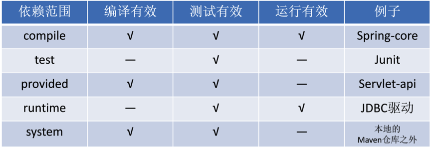
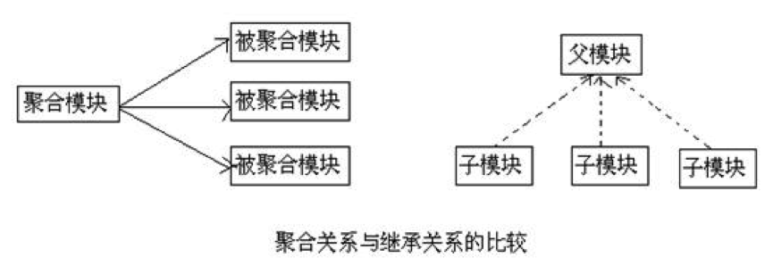

# Maven 依赖管理

在 Maven 的管理体系中，各个项目组成了一个复杂的关系网，但是各个项目在依赖体系中处于平等地位，全球每个项目从理论上来说都可以相互依赖。就是说，你跟开发 Spring 的大牛们平起平坐，你的项目可以依赖 Spring 项目，Spring 项目也可以依赖你的项目（虽然现实中不太会发生，你倒贴钱人家也不敢引用）。

项目的依赖关系主要分为三种：**依赖、继承、聚合**。最后再介绍一下 Maven 的版本规范。

# 1 依赖关系

依赖关系是最常用的一种，就是你的项目需要依赖其他项目，比如 Apache Commons 包、Spring 包等等。

```xml
<dependency>
    <groupId>org.junit.jupiter</groupId>
    <artifactId>junit-jupiter</artifactId>
    <version>6.1.3</version>
    <scope>test</scope>
    <type>jar</type>
    <optional>true</optional>
</dependency>
```

任意一个外部依赖说明包含如下几个要素：**groupId**、**artifactId**、**version**、scope、type、optional。其中前 3 个是必需的（若 version 已在 dependencyManagement 中声明，则可省略）。

这里的 version 可以用区间表达式来表示，比如 `(2.0,)` 表示 `>2.0`，`[2.0,3.0)` 表示 `2.0<=ver<3.0`；多个条件之间用逗号分隔，比如 `[1,3],[5,7]`。

type 一般在 pom 引用依赖时候出现，其他时候不用。

Maven 认为，程序对外部的依赖会随着程序的所处阶段和应用场景而变化，所以 Maven 中的依赖关系有作用域（scope）的限制。在 Maven 中，scope 包含如下的取值：

| **Scope 选项**         | 解释                                                         |
| ---------------------- | ------------------------------------------------------------ |
| compile（编译范围）    | compile 是**默认的范围**；如果没有提供一个范围，那该依赖的范围就是编译范围。编译范围依赖在所有的 classpath 中可用，同时它们也会被打包。 |
| provided（已提供范围） | provided 依赖只有在 JDK 或者一个容器已提供该依赖之后才使用。例如，如果你开发了一个 Web 应用，你可能在编译 classpath 中需要可用的 Servlet API 来编译一个 Servlet，但是你不会想要在打包好的 WAR 中包含这个 Servlet API；这个 Servlet API JAR 由你的应用服务器或者 Servlet 容器提供。已提供范围的依赖在编译 classpath（不是运行时）可用。它们不是传递性的，也不会被打包。 |
| runtime（运行时范围）  | runtime 依赖在运行和测试系统的时候需要，但在编译的时候不需要。比如，你可能在编译的时候只需要 JDBC API JAR，而只有在运行的时候才需要 JDBC 驱动实现。 |
| test（测试范围）       | test 范围依赖在编译和运行时都不需要，它们只有在测试编译和测试运行阶段可用。 |
| system（系统范围）     | system 范围依赖与 provided 类似，但是你必须显式地提供一个对于本地系统中 JAR 文件的路径。这么做是为了允许基于本地对象编译，而这些对象是系统类库的一部分。这样的构件应该是一直可用的，Maven 也不会在仓库中去寻找它。如果你将一个依赖范围设置成系统范围，你必须同时提供一个 systemPath 元素。**强烈不推荐使用此范围**，它已被官方标记为废弃：应尽量通过公共或私有 Maven 仓库引用依赖；对于仓库中找不到的本地 JAR，可以用 `mvn install:install-file` 安装到本地仓库，或部署到公司私服后再按普通依赖引用。 |
| import（导入范围）     | import 只能用于 dependencyManagement 中 type 为 pom 的依赖，表示把目标 POM 中的 dependencyManagement 配置导入到当前项目中，常用于引入 BOM（如 spring-boot-dependencies）来统一管理版本。 |



dependency 中的 type 一般不用配置，**默认是 jar**。当 type 为 pom 时，代表引用关系：

```xml
<dependency>
    <groupId>org.sonatype.mavenbook</groupId>
    <artifactId>persistence-deps</artifactId>
    <version>1.0</version>
    <type>pom</type>
</dependency>
```

此时，persistence-deps 的 `<dependencies>` 中声明的依赖会作为传递依赖引入本项目（这个 pom 本身没有 jar 可引入）。

可以创建一个打包方式为 pom 的项目来将某些通用的依赖归在一起，供其他项目直接引用，不要忘了指定依赖类型为 pom（`<type>pom</type>`）。

与之相对的是 BOM（Bill of Materials）的用法：BOM 同样是 pom 类型的构件，但它只在 dependencyManagement 中统一声明一批依赖的版本，并不直接引入依赖。在 dependencyManagement 中以 `<scope>import</scope>` 引入 BOM 后，项目中再声明这些依赖时就可以省略版本号：

```xml
<dependencyManagement>
    <dependencies>
        <dependency>
            <groupId>org.springframework.boot</groupId>
            <artifactId>spring-boot-dependencies</artifactId>
            <version>4.1.1</version>
            <type>pom</type>
            <scope>import</scope>
        </dependency>
    </dependencies>
</dependencyManagement>
```

由于一个项目只能有一个 parent，而 BOM 可以导入多个，当项目已有自己的父 POM 时，常用这种方式来复用 Spring Boot、Spring Cloud 等框架的版本管理。

# 2 继承关系

继承就是避免重复，Maven 的继承也是这样，它还有一个好处就是让项目更加安全。项目之间存在上下级关系时就属于继承关系。

父项目的配置如下：

```xml
<project>
    <modelVersion>4.0.0</modelVersion>
    <groupId>org.clf.parent</groupId>
    <artifactId>my-parent</artifactId>
    <version>2.0</version>
    <packaging>pom</packaging>
  
    <!-- 该节点下的依赖会被子项目自动全部继承 -->
    <dependencies>
        <dependency>
            <groupId>org.slf4j</groupId>
            <artifactId>slf4j-api</artifactId>
            <version>2.0.20</version>
            <type>jar</type>
            <scope>compile</scope>
        </dependency>
    </dependencies>
  
    <dependencyManagement>
        <!-- 该节点下的依赖关系只是为了统一版本号，不会被子项目自动继承，-->
        <!-- 除非子项目主动引用，好处是子项目可以不用写版本号 -->
        <dependencies>
            <dependency>
                <groupId>org.springframework</groupId>
                <artifactId>spring-orm</artifactId>
                <version>7.0.9</version>
            </dependency>
            <dependency>
                <groupId>org.springframework</groupId>
                <artifactId>spring-web</artifactId>
                <version>7.0.9</version>
            </dependency>
            <dependency>
                <groupId>org.springframework</groupId>
                <artifactId>spring-context-support</artifactId>
                <version>7.0.9</version>
            </dependency>
            <dependency>
                <groupId>org.springframework</groupId>
                <artifactId>spring-beans</artifactId>
                <version>7.0.9</version>
            </dependency>
        </dependencies>
    </dependencyManagement>
  
    <!-- 这个元素和dependencyManagement相类似，它是用来进行插件管理的，需放在build节点下 -->
    <build>
        <pluginManagement></pluginManagement>
    </build>
  
</project>
```

注意，此时 packaging **必须为 pom**。

为了项目的正确运行，必须确保所有子项目使用的依赖项版本统一，这样才能保证测试的和发布的是相同的结果。

Maven 使用 dependencyManagement 元素来提供了一种管理依赖版本号的方式。通常会在一个组织或者项目的最顶层的父 POM 中看到 dependencyManagement 元素。使用 pom.xml 中的 dependencyManagement 元素，能让所有子项目在引用一个依赖时不用显式地列出版本号。Maven 会沿着父子层次向上走，直到找到一个拥有 dependencyManagement 元素的项目，然后它就会使用在这个 dependencyManagement 元素中指定的版本号。

父项目在 dependencies 中声明的依赖，子项目会**全部自动地继承**。而父项目在 dependencyManagement 里只是声明依赖，并不实际引入，因此子项目需要显式地声明需要用的依赖。如果不在子项目中声明依赖，是不会从父项目中继承下来的；只有在子项目中写了该依赖项，并且没有指定具体版本，才会从父项目中继承该项，并且 version 和 scope 都读取自父 pom；另外，如果子项目中指定了版本号，那么会使用子项目中指定的 jar 版本。

如果某个项目需要继承该父项目，基础配置应该这样：

```xml
<project>
  
    <modelVersion>4.0.0</modelVersion>
    <groupId>org.clf.parent.son</groupId>
    <artifactId>my-son</artifactId>
    <version>1.0</version>
  
    <!-- 声明父项目的坐标 -->
    <parent>
        <groupId>org.clf.parent</groupId>
        <artifactId>my-parent</artifactId>
        <version>2.0</version>
        <!-- 父项目的pom.xml文件的相对路径。相对路径允许你选择一个不同的路径。 -->
        <!-- 默认值是../pom.xml。Maven首先在构建当前项目的地方寻找父项目的pom， -->
        <!-- 其次在文件系统的这个位置（relativePath位置）， -->
        <!-- 然后在本地仓库，最后在远程仓库寻找父项目的pom。 -->
        <relativePath>../parent-project/pom.xml</relativePath>
    </parent>
  
    <!-- 声明父项目dependencyManagement的依赖，不用写版本号 -->
    <dependencies>
        <dependency>
            <groupId>org.springframework</groupId>
            <artifactId>spring-web</artifactId>
        </dependency>
        <dependency>
            <groupId>org.springframework</groupId>
            <artifactId>spring-beans</artifactId>
        </dependency>
    </dependencies>
</project>
```

# 3 聚合关系

随着用户对软件的要求越来越高，软件本身也变得越来越复杂。为了应对复杂性，现代软件普遍采用分层架构与分模块开发，来提高代码的清晰度和重用性。针对这一特性，Maven 也给予了相应的配置。

Maven 的多模块管理也是非常强大的。一般来说，Maven 要求同一个工程的所有模块都放置到同一个目录下，每一个子目录代表一个模块，比如：

- 总项目/
  - pom.xml：总项目的 pom 配置文件
  - 子模块 1/
    - pom.xml：子模块 1 的 pom 文件
  - 子模块 2/
    - pom.xml：子模块 2 的 pom 文件

总项目的配置如下：

```xml
<project>
    <modelVersion>4.0.0</modelVersion>
    <groupId>org.clf.parent</groupId>
    <artifactId>my-parent</artifactId>
    <version>2.0</version>
    <!-- 打包类型必须为pom -->
    <packaging>pom</packaging>
    
  <!-- 声明了该项目的直接子模块 -->
    <modules>
        <!-- 这里配置的不是artifactId，而是这个模块的目录名称-->
        <module>module-1</module>
        <module>module-2</module>
        <module>module-3</module>
    </modules>
  
    <!-- 聚合也属于父子关系，总项目中的dependencies与dependencyManagement、pluginManagement用法与继承关系类似 -->
    <dependencies></dependencies>
    <dependencyManagement></dependencyManagement>
    <build>
        <pluginManagement></pluginManagement>
    </build>
</project>
```

子模块的配置如下：

```xml
<project>
    <modelVersion>4.0.0</modelVersion>
    <groupId>org.clf.parent.son</groupId>
    <artifactId>my-son</artifactId>
    <version>1.0</version>
    
    <!-- 声明父项目的坐标 -->
    <parent>
        <groupId>org.clf.parent</groupId>
        <artifactId>my-parent</artifactId>
        <version>2.0</version>
    </parent>
    
</project>
```

需要说明的是，单纯的聚合只需要总项目声明 `<modules>`，子模块并不需要声明 `<parent>`；上面的子模块同时用了 `<parent>`，是因为实际项目中聚合与继承通常结合使用，总项目既负责聚合构建，又作为父 POM 统一管理配置（详见下一节）。

在 Maven 4 中，`<modules>` 被 `<subprojects>` 取代（`<modules>` 仍可使用，但已标记为废弃）；使用 4.1.0 模型时，子模块的 `<parent>` 还可以只写 relativePath 或直接写空的 `<parent/>`，由 Maven 自动推断父项目坐标。截至 2026 年 10 月 Maven 4 仍处于 RC 阶段，生产项目仍以 Maven 3 的写法为主。

# 4 继承与聚合的对比

首先，继承与聚合都属于父子关系，并且，聚合 POM 与继承关系中的父 POM 的 packaging 都是 pom。



不同的是，对于聚合模块来说，它知道有哪些被聚合的模块，但那些被聚合的模块不知道这个聚合模块的存在。对于继承关系的父 POM 来说，它不知道有哪些子模块继承自它，但那些子模块都必须知道自己的父 POM 是什么。

在实际项目中，一个 POM 往往既是聚合 POM，又是父 POM，它继承了某个项目，本身包含几个子模块，同时肯定会存在普通的依赖关系，就是说，依赖、继承、聚合这三种关系是并存的。

Maven 可继承的 POM 元素列表如下：

- groupId：项目组 ID，项目坐标的核心元素
- version：项目版本，项目坐标的核心元素
- description：项目的描述信息
- organization：项目的组织信息
- inceptionYear：项目的创始年份
- url：项目的 URL 地址
- licenses：项目的许可证信息
- developers：项目的开发者信息
- contributors：项目的贡献者信息
- distributionManagement：项目的部署信息
- issueManagement：缺陷跟踪系统信息
- ciManagement：项目的持续集成信息
- scm：项目的版本控制信息
- mailingLists：项目的邮件列表信息
- properties：自定义的 Maven 属性
- dependencies：项目的依赖配置
- dependencyManagement：项目的依赖管理配置
- repositories：项目的仓库配置
- pluginRepositories：项目的插件仓库配置
- build：包括项目的源码目录配置、输出目录配置、插件配置、插件管理配置等
- reporting：包括项目的报告输出目录配置、报告插件配置等

而 artifactId、name、prerequisites、profiles 等元素不会被继承。

# 5 版本规范

Maven 有自己的版本规范，一般是如下定义：

`<major version>.<minor version>.<incremental version>-<qualifier>`

比如 1.2.3-beta-01。要说明的是，早期 Maven（2.x）判断版本的算法是 major、minor、incremental 部分用数字比较，qualifier 部分用字符串比较，所以要小心 alpha-2 和 alpha-15 的比较关系，最好用 alpha-02 的格式。Maven 3 改用 ComparableVersion 算法，qualifier 中的数字部分也会按数值比较，不过统一位数仍是个好习惯。

如今很多开源项目遵循语义化版本（Semantic Versioning，SemVer）规范，格式为 `MAJOR.MINOR.PATCH`：不兼容的 API 变更升级主版本号，向下兼容的新功能升级次版本号，向下兼容的问题修复升级修订号。它与 Maven 的 major.minor.incremental 结构基本对应，但 SemVer 的预发布版本写法（如 `1.0.0-alpha.1`）与 Maven 的排序规则并不完全一致，混用时要留意版本比较结果。

Maven 在版本管理的时候可以使用几个特殊的字符串：**SNAPSHOT**、**LATEST**、**RELEASE**。

比如“1.0-SNAPSHOT”。各个部分的含义和处理逻辑如下说明：

## 5.1 SNAPSHOT

如果一个版本包含字符串 SNAPSHOT，Maven 就会在将这个组件发布（deploy）到远程仓库的时候将该符号展开为一个日期和时间值，转换为 UTC 时间。例如，“1.0-SNAPSHOT”会在 2020 年 5 月 5 日下午 2 点 10 分发布的时候变成 1.0-20200505.141000-1。

这个词只能用于开发过程中，因为一般来说，项目组都会频繁发布一些版本，最后实际发布的时候，会在这些 snapshot 版本中寻找一个稳定的，用于正式发布，比如 1.4 版本发布之前，就会有一系列的 1.4-SNAPSHOT，而实际发布的 1.4，也是从中拿出来的一个稳定版。

## 5.2 LATEST

指某个特定构件的最新发布，这个发布可能是一个发布版，也可能是一个 snapshot 版，具体看哪个时间最后。

## 5.3 RELEASE

指最后一个发布版。

需要注意的是，Maven 3 起已不再支持在插件版本中使用 LATEST 和 RELEASE，在依赖中也不推荐使用，因为它们会导致构建结果不可重复。
