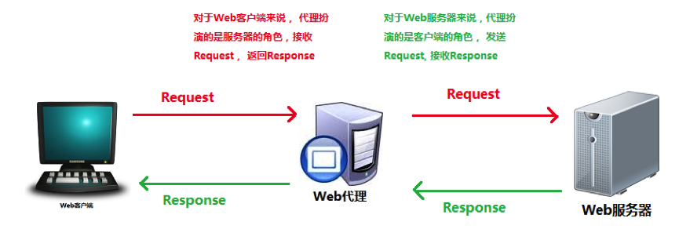
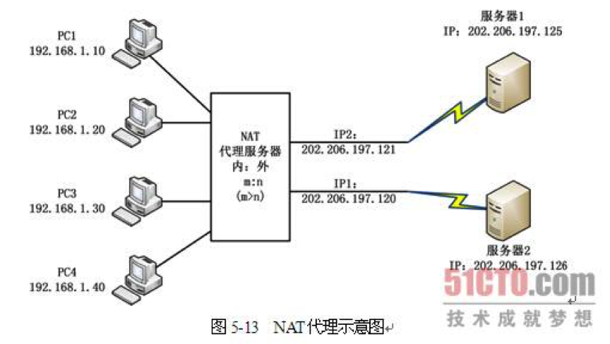
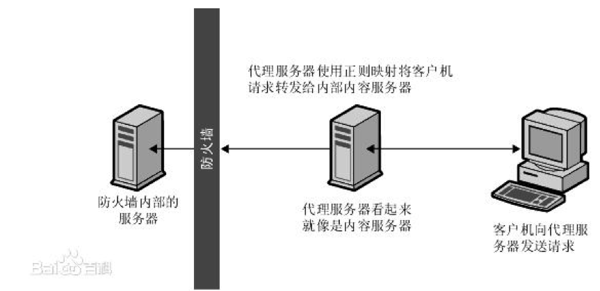
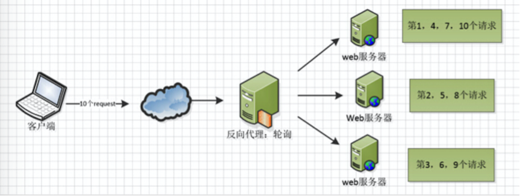
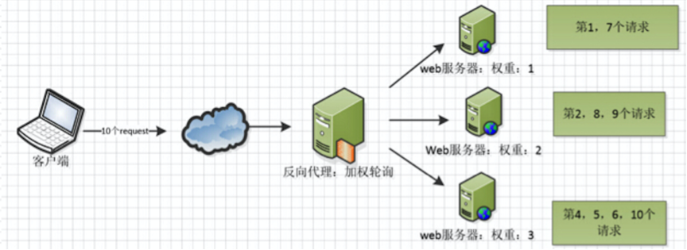
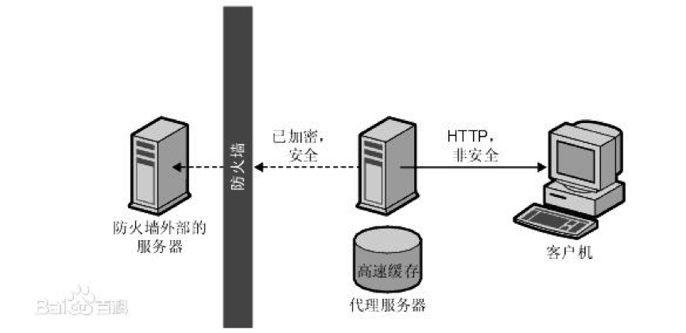
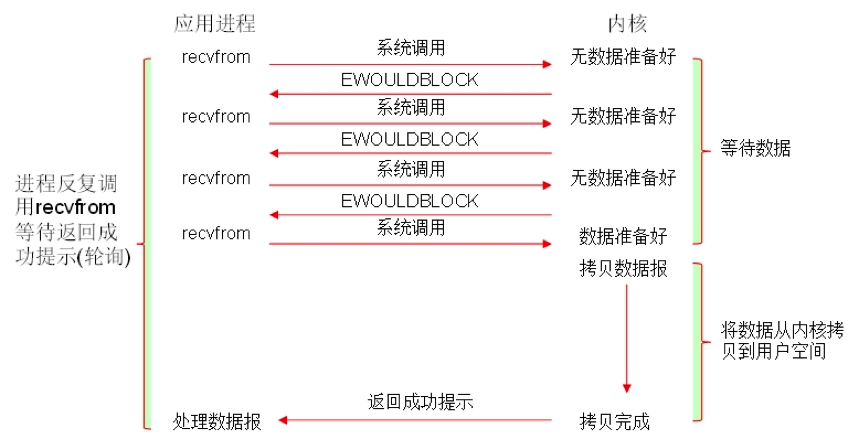
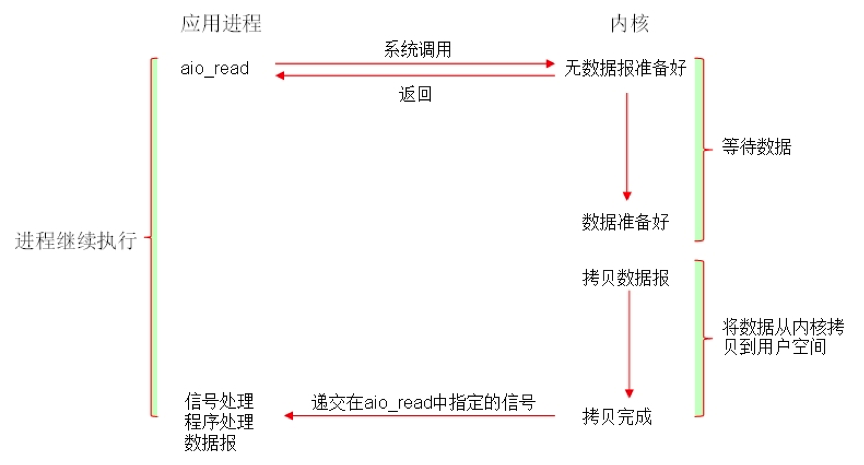

# Nginx 代理与原理

Nginx（“engine x”）是一款轻量级的 Web 服务器、反向代理服务器及电子邮件（IMAP/POP3）代理服务器，由俄罗斯程序员 Igor Sysoev 开发，最初供俄罗斯大型门户网站及搜索引擎 Rambler 使用。后来 Nginx 公司于 2019 年被 F5 收购，开源版本至今仍在持续更新，并通过 stream 模块支持 TCP/UDP 的四层代理。

Nginx 代码完全用 C 语言写成，其特点是占用内存少、并发能力强。早期官方测试称最多能够支撑 5 万并发连接，这个数字放到今天早已不能说明问题：Nginx 的并发上限主要取决于 worker_connections 配置、系统文件描述符限制和内存，官方给出的参考是 1 万个非活跃的 HTTP keep-alive 连接仅占约 2.5 MB 内存，在现代服务器上经过合理调优，单机维持数十万并发连接也很常见。

说到 Web 服务器，Apache 和 IIS 曾是两大巨头，但运行速度更快、更灵活的 Nginx 后来居上。Nginx 到底有多火呢？据 W3Techs 2026 年 10 月的统计，全球网站中使用 Nginx 的占比约为 30.3%，仅次于 Cloudflare Server（32.5%），超过了 Apache（21.4%）；中国大陆但凡你能说得上名字的网站几乎都在使用 Nginx，比如百度、京东、新浪、网易、腾讯、淘宝等。

在介绍 Nginx 的功能之前，先来弄清楚“代理”到底是什么。

# 1 正向代理

有公就有母，有正就有反，阴阳共济，相辅相成。了解反向代理之前，先来看看什么是正向代理。

我们平常所说的**代理服务器**（Proxy Server）提供的就是正向代理服务，其功能是代理网络用户去获取网络信息。代理位于 Web 客户端和 Web 服务器之间，扮演“中间人”的角色。

HTTP 代理服务器既是 Web 服务器又是 Web 客户端。一个完整的代理请求过程为：客户端首先与代理服务器建立连接，接着根据代理服务器所使用的代理协议，请求代理服务器与目标服务器建立连接或者获取目标服务器的指定资源，然后代理服务器再将拿到的资源返回给客户端。

可是，我们的请求为什么不直来直往，而要多此一举地通过代理服务器来转达呢？因为代理服务器的作用很大，通过它可以实现多种功能。

## 1.1 共享 IP 地址

比如，某个局域网内有十台电脑需要上网，但是只分配了一个公网 IP 地址。这时候就可以把这个 IP 地址赋予代理服务器，内网电脑把请求发给代理服务器，由代理服务器以自己的身份向外网发起请求，收到响应后再转交给内网的请求者，这样十台电脑就共享了同一个出口 IP。

需要区分的是，图中的 NAT（Network Address Translation，网络地址转换）也能达到共享 IP 的效果，但它工作在网络层，只改写数据包的 IP 地址和端口，客户端无须任何配置；而 HTTP 代理工作在应用层，需要理解并重新发起 HTTP 请求，客户端通常要显式配置代理地址。家用路由器让多台设备共用一个公网 IP，靠的就是 NAT。

## 1.2 高速缓存

大部分代理服务器都具有缓存功能，就好像一个大的 Cache，它有很大的存储空间，不断将新取得的数据存储到本地存储器上。如果浏览器所请求的数据在代理服务器本地已经存在而且是最新的，那么代理服务器就不再重新从 Web 服务器取数据，而是直接将存储器上的数据传给用户的浏览器，这样就能显著提高浏览速度。

## 1.3 过滤器

外面的世界很精彩，外面的世界也很危险。代理服务器可以作为访问控制的网关：所有请求都要经过它，管理员就可以通过黑白名单、内容过滤等策略，拦截对高风险网站或不适宜内容的访问，比如企业禁止员工访问可疑站点以防止恶意软件感染和数据泄露，家庭或学校网络为儿童屏蔽不良内容。

同时，外部服务器只能看到代理服务器的 IP 地址，内网的真实地址和拓扑结构被隐藏起来，这也在客户端与外部网络之间多了一道安全屏障。

## 1.4 突破自身 IP 的访问限制

有些资源会按来源 IP 限制访问，比如学校购买的论文数据库只对校园网 IP 开放，企业的内部系统只允许办公网访问。人在外面时，只要借助位于允许网段内的代理服务器（或 VPN）转发请求，在目标服务器看来请求就来自合法的 IP，从而可以正常访问这些资源。

注意，正向代理并不是 Nginx 的主要用途（Nginx 虽然也能配置成简单的 HTTP 正向代理，但实际很少这样用），以上内容只是为了引出反向代理的概念。

# 2 反向代理

正向代理是代理客户端向 Internet 发送请求，而反向代理是代理服务端接收 Internet 上的请求。

正向代理中，proxy 和 client 同属一个 LAN，对 server 透明；反向代理中，proxy 和 server 同属一个 LAN，对 client 透明。实际上 proxy 在两种代理中做的事都是代为收发请求和响应，只不过从结构上来看正好左右互换了一下。

再用两个例子来比较一下正向代理与反向代理的区别。

- 正向代理

A 同学在大众创业、万众创新的大时代背景下开启了他的创业之路，目前他遇到的最大问题就是启动资金，于是他决定去找马云借钱，可想而知，最后碰了一鼻子灰回来。情急之下，他想到一个办法：找关系开后门。经过一番打探，原来 A 同学的大学老师王老师是马云的同学，于是 A 同学找到王老师，托王老师帮忙去马云那里借 500 万，最后事情当然办成了。不过马云并不知道这钱是 A 同学借的，马云是借给王老师的，最后由王老师转交给 A 同学。王老师在这个过程中扮演了一个非常关键的角色，就是代理，也可以说是正向代理。王老师代替 A 同学办这件事，在这个过程中，真正借钱的人是谁，马云是不知道的，这点非常关键。

我们常说的代理也就是指正向代理。正向代理隐藏了真实的请求客户端，服务端不知道真实的客户端是谁，客户端请求的服务都由代理服务器代为请求，公司内网的上网代理、浏览器里配置的 HTTP 代理扮演的都是典型的正向代理角色：你把请求发给代理，代理替你去请求目标网站，再把响应结果转交给你，目标网站看到的只是代理的地址。

- 反向代理

大家都有过这样的经历：拨打 10086 客服电话，一个地区的 10086 客服可能有几个或者几十个，你永远都不需要关心电话那头的是哪一个，叫什么，是男是女，是漂亮还是帅气，你关心的是你的问题能不能得到专业的解答。你只需要拨通 10086 的总机号码，电话那头总会有人回答你，只是有时慢有时快而已。这里的 10086 总机号码就是我们说的反向代理，客户不知道真正提供服务的人是谁。

反向代理隐藏了真实的服务端。当我们请求 www.baidu.com 的时候，就像拨打 10086 一样，背后可能有成千上万台服务器为我们服务，但具体是哪一台，你不知道，也不需要知道，你只需要知道反向代理服务器是谁就好了。www.baidu.com 就是我们的反向代理服务器，反向代理服务器会帮我们把请求转发到真实的服务器那里去。

使用反向代理的优势有很多，比如隐藏和保护服务器资源、负载均衡、缓存静态内容、加密和 SSL 加速等。

在 Kubernetes 集群中，反向代理通常以 Ingress Controller 的形式出现：它监听 Kubernetes API 中的路由规则变化并自动更新配置，把外部流量转发到集群内的各个服务，免去手动修改配置文件。基于 Nginx 的 Ingress Controller 曾是最常用的选择，不过需要注意，Kubernetes 社区维护的 ingress-nginx 项目已于 2026 年 3 月退役，不再发布新版本和安全补丁；F5 维护的 NGINX Ingress Controller 是另一个独立项目，仍在继续更新。新的集群更推荐基于 Gateway API 的实现。

# 3 Nginx 的功能

Nginx 的启动特别简单，并且几乎可以做到 7×24 小时不间断运行，即使运行数个月也不需要重新启动，还能够在不中断服务的情况下进行软件版本的升级。

Nginx 在做反向代理时，能够提供性能稳定并且可灵活配置的转发功能。Nginx 可以根据不同的正则匹配采取不同的转发策略，比如以图片后缀结尾的请求转发到文件服务器，动态页面请求转发到 Web 服务器。Nginx 还可以对返回结果进行异常判断，如果被分发的服务器存在异常，会将请求重新转发给另外一台服务器，并自动剔除异常服务器。

在协议支持上，除了 HTTP/1.1 和 HTTP/2，Nginx 自 1.25.0 起支持 QUIC 和 HTTP/3，官方的 Linux 安装包已默认包含该模块。QUIC 基于 UDP 实现，避免了 TCP 层的队头阻塞，并内置 TLS 1.3 加密，在弱网或 Wi-Fi 与蜂窝网络切换等场景下连接更快、更稳定。开启时在 server 中增加 `listen 443 quic reuseport;`，并通过 `Alt-Svc` 响应头告知浏览器可以改用 HTTP/3。

## 3.1 保护服务器

Nginx 作为反向代理部署时，对外只暴露 Nginx 自己，真正提供服务的后端服务器放在内网或防火墙之后，防火墙只放行来自 Nginx 的访问。客户端看到的始终是 Nginx，好像它就是实际的内容服务器。如果后端返回的重定向响应里带有内部地址，Nginx 还可以通过 proxy_redirect 指令改写 Location 等响应头中的 URL，防止内部服务器的地址泄露给外部客户端。

这样，Nginx 就在后端服务和可能的恶意攻击之间提供了又一道屏障。未经授权的用户无法直接访问真正的后端服务器，在 Nginx 这一层还可以统一做访问控制（allow/deny）、请求限流（limit_req、limit_conn）、请求大小限制以及 HTTPS 卸载等防护。

## 3.2 负载均衡

负载均衡服务器的作用是平衡集群中各个服务器的负载压力。

Nginx 最常用的负载均衡策略有 3 种：轮询、加权轮询、IP hash（此外开源版本还内置了 least_conn 最少连接、hash 通用哈希、random 随机等策略）。同时 Nginx 支持扩展策略，完全可以自己写一套规则交给 Nginx 去执行。

- 轮询

这种策略简单易行，将请求平均地分配给每个服务器去处理。

- 加权轮询

升级版的轮询策略，权重越大的服务器会被分配越多的请求。

- IP hash

对客户端请求的 IP 进行 hash 操作，然后根据 hash 结果将同一个客户端 IP 的请求分发给同一台服务器进行处理，可以解决 session 不共享的问题。

## 3.3 Web 缓存

Nginx 可以对不同的文件做不同的缓存处理，配置灵活，并且支持 fastcgi_cache，主要用于对 FastCGI 的动态程序进行缓存。配合第三方的 ngx_cache_purge 模块，可以对指定 URL 的缓存内容进行清除管理。

# 4 实现原理

众所周知，Nginx 性能高，而 Nginx 的高性能与其架构是分不开的。

## 4.1 进程模型

Nginx 在启动后，会有一个 master 进程和多个 worker 进程。master 进程主要用来管理 worker 进程，包括：接收来自外界的信号，向各 worker 进程发送信号，监控 worker 进程的运行状态，当 worker 进程（异常）退出后，会自动重新启动新的 worker 进程。而基本的网络事件，则是放在 worker 进程中来处理的。多个 worker 进程之间是对等的，它们同等竞争来自客户端的请求，各进程之间相互独立。一个请求只可能在一个 worker 进程中处理，一个 worker 进程不可能处理其他进程的请求。worker 进程的个数是可以设置的，一般我们会将其设置为与机器 CPU 核数一致，这里面的原因与 Nginx 的进程模型以及事件处理模型是分不开的。Nginx 的进程模型可以由下图来表示：

master 进程会接收来自外界发来的信号，再根据信号做不同的事情。所以我们要控制 Nginx，只需要向 master 进程发送信号就行了。比如 `kill -HUP pid`，就是告诉 Nginx 平滑地重启（等效于命令 `nginx -s reload`），我们一般用这个信号来重启 Nginx 或重新加载配置，因为是平滑重启，所以服务是不中断的。master 进程在接收到 HUP 信号后是怎么做的呢？首先 master 进程在接到信号后，会先重新加载配置文件，然后再启动新的 worker 进程，并向所有老的 worker 进程发送信号，告诉它们可以光荣退休了。新的 worker 在启动后，就开始接收新的请求，而老的 worker 在收到来自 master 的信号后，就不再接收新的请求，并且在当前进程中所有未处理完的请求处理完成后，再退出。

worker 进程之间是平等的，每个进程处理请求的机会也是一样的。当我们提供 80 端口的 HTTP 服务时，一个连接请求过来，每个进程都有可能处理这个连接。首先，每个 worker 进程都是从 master 进程 fork 出来的，在 master 进程里面，先建立好需要 listen 的 socket（listenfd），然后再 fork 出多个 worker 进程。所有 worker 进程的 listenfd 会在新连接到来时变得可读，为保证只有一个进程处理该连接，所有 worker 进程在注册 listenfd 读事件前抢 accept_mutex，抢到互斥锁的那个进程注册 listenfd 读事件，在读事件里调用 accept 接受该连接（注：自 1.11.3 版本起，accept_mutex 默认关闭，在支持 EPOLLEXCLUSIVE 标志或使用 reuseport 的系统上无须开启）。当一个 worker 进程在 accept 这个连接之后，就开始读取请求、解析请求、处理请求，产生数据后再返回给客户端，最后才断开连接，这就是一个完整请求的处理过程。我们可以看到，一个请求完全由 worker 进程来处理，而且只在一个 worker 进程中处理。

Nginx 采用这种进程模型有很多好处。首先，每个 worker 进程都是独立的进程，不需要加锁，所以省掉了锁带来的开销，同时在编程以及问题排查时，也会方便很多。其次，采用独立的进程可以让进程之间互不影响，一个进程退出后，其他进程还在工作，服务不会中断，master 进程则会很快启动新的 worker 进程。

## 4.2 事件模型

所谓的**同步和异步**关注的是消息通知机制：

- 同步：调用发出后不会立即返回，但一旦返回就可以得到最终结果
- 异步：调用发出之后，被调用方立即返回消息，但返回的并非最终结果；被调用者通过状态、通知机制来通知调用者，或通过回调函数来处理结果

所谓的**阻塞和非阻塞**关注的是调用者在等待调用结果（消息、返回值）时的状态：

- 阻塞：调用结果返回之前，调用者（调用线程）会被挂起，调用者只有在得到结果之后才会返回
- 非阻塞：调用结果返回之前，调用不会阻塞当前线程

常见的五种 I/O 模型如下：

- 阻塞型 I/O（blocking I/O）

- 非阻塞型 I/O（nonblocking I/O）

- I/O 多路复用（I/O multiplexing，如 select、poll、epoll）

- 信号驱动型 I/O（signal driven I/O，基于 SIGIO 信号）

- 异步 I/O（asynchronous I/O）

可以举一个简单的例子来说明 Apache 早期（prefork 模式）的工作流程，就像我们平时去餐厅吃饭。餐厅的工作模式是一个服务员全程服务客户，流程是这样的：服务员在门口等候客人（listen），客人到了就接待并安排到餐桌上（accept），等着客户点菜（request uri），去厨房叫师傅下单做菜（磁盘 I/O），等待厨房做好（read），然后给客人上菜（send），整个过程下来服务员（进程）在很多地方是阻塞的。这样客人一多（HTTP 请求一多），餐厅只能通过叫更多的服务员来服务（fork 进程），但是由于餐厅资源是有限的（CPU），一旦服务员太多管理成本就很高（CPU 上下文切换），这样就进入了一个瓶颈。

再来看看 Nginx 是怎么处理的。餐厅门口挂个门铃（注册 epoll 模型的 listen），一旦有客人（HTTP 请求）到达，就派一个服务员去接待（accept），之后服务员就去忙其他事情了（比如再去接待客人），等这位客人点好餐就叫服务员（数据到了，`read()`），服务员过来拿走菜单到厨房（磁盘 I/O），服务员又去做其他事情了，等厨房做好了菜也喊服务员（磁盘 I/O 结束），服务员再给客人上菜（`send()`），厨房做好一个菜就给客人上一个，中间服务员可以去干其他事情。整个过程被切分成很多个阶段，每个阶段都有相应的服务模块。可以想见，这样一旦客人多了，餐厅也能招待更多的人。

事件驱动其实是很老的技术，早期的 select、poll 都是如此。后来出现了基于内核通知的更高级的事件机制，如 Linux 的 epoll、BSD 的 kqueue（libevent 等库对它们做了封装），使事件驱动性能得以提高。事件驱动的本质还是 I/O 事件，应用程序在多个 I/O 句柄间快速切换，看起来就像是在异步处理 I/O。事件驱动服务器最适合做的就是这种 I/O 密集型工作，如反向代理，它在客户端与 Web 服务器之间起数据中转作用，纯粹是 I/O 操作，自身并不涉及复杂计算。反向代理用事件驱动来做显然更好，一个工作进程就可以胜任，没有进程、线程管理的开销，CPU、内存消耗都小。

需要说明的是，按照上面五种 I/O 模型的划分，Nginx 处理网络 I/O 用的是“I/O 多路复用 + 非阻塞 I/O”，并不是第五种由内核完成全部读写再通知的异步 I/O。下文沿用业界习惯的“异步非阻塞”说法，指的是 worker 不会等待某个请求的 I/O 就绪，而是转去处理其他事件。另外，epoll 对普通磁盘文件并不起作用，Nginx 默认读取静态文件时是同步的，可以通过 aio、aio threads（线程池）等配置，避免磁盘 I/O 阻塞 worker 进程。

有人可能要问了，Nginx 采用多 worker 的方式来处理请求，每个 worker 里面只有一个主线程，那能够处理的并发数很有限啊，多少个 worker 就能处理多少个并发，何来高并发呢？

进程数与并发数不存在很直接的关系，这取决于 server 采用的工作方式。如果一个 server 采用一个进程负责一个 request 的方式，那么进程数就是并发数。那么显而易见，就会有很多进程在等待中。等什么？Web Server 恰好属于网络 I/O 密集型应用，而不是计算密集型应用，最多的就是等待网络传输。

而 Nginx 的异步非阻塞工作方式正是利用了这段等待的时间。在需要等待的时候，这些进程就空闲出来待命了，因此表现为少数几个进程就解决了大量的并发问题。

Nginx 是如何利用的呢？简单来说：同样是 4 个进程，如果采用一个进程负责一个 request 的方式，那么同时进来 4 个 request 之后，每个进程就负责其中一个，直至会话关闭。期间，如果有第 5 个 request 进来了，就无法及时响应了，因为 4 个进程都还没干完活。因此，一般会有个调度进程，每当新进来一个 request，就新开个进程来处理。

Nginx 不这样，每进来一个 request，会有一个 worker 进程去处理。但不是全程处理，处理到什么程度呢？处理到可能发生阻塞的地方，比如向上游（后端）服务器转发 request，并等待请求返回。那么，这个 worker 不会傻等着，它会在发送完请求后注册一个事件：“如果 upstream 返回了，告诉我一声，我再接着干”。于是它就休息去了。此时，如果再有 request 进来，它就可以很快再按这种方式处理。而一旦上游服务器返回了，就会触发这个事件，worker 才会来接手，这个 request 才会接着往下走。

由于 Web Server 的工作性质决定了每个 request 的大部分生命周期都是在网络传输中，实际上花费在 server 机器上的时间片不多，这就是几个进程就能解决高并发的秘密所在。

Nginx 采用 epoll 模型，异步非阻塞。对于 Nginx 来说，它把一个完整的连接请求处理划分成了一个一个的事件，比如 `accept()`、`recv()`、磁盘 I/O、`send()` 等，每部分都有相应的模块去处理，一个完整的请求可能是由几百个模块去处理的。真正核心的是事件收集和分发模块，这就是管理所有模块的核心。只有核心模块的调度才能让对应的模块占用 CPU 资源，从而处理请求。拿一个 HTTP 请求来说，首先在事件收集分发模块注册感兴趣的监听事件，注册好之后不阻塞直接返回，接下来就不需要再管了，等有连接来了内核会通知你（epoll 会通知进程），CPU 就可以处理其他事情去了。一旦有请求来，就对整个请求分配相应的上下文（其实已经预先分配好），这时候再注册新的感兴趣的事件（read 函数），同样，客户端数据来了内核会自动通知进程可以去读数据了，读了数据之后就是解析，解析完后去磁盘找资源（I/O），一旦 I/O 完成会通知进程，进程开始给客户端发回数据 `send()`，这时候也不是阻塞的，调用后就等内核发回通知告知发送的结果就行。整个下来把一个请求分成了很多个阶段，每个阶段都到很多模块去注册，然后处理，都是异步非阻塞的。异步在这里指的就是做一件事情，不需要等返回结果，做好了会自动通知你。

想想 Apache 早期的工作方式（prefork/worker 模式），每个请求会独占一个工作进程或线程，当并发数上到几千时，就同时有几千个进程或线程在处理请求了。这对操作系统来说是个不小的挑战，它们带来的内存占用非常大，上下文切换带来的 CPU 开销也很大，自然性能就上不去了，而这些开销完全是没有意义的。Apache 2.4 起在支持 epoll/kqueue 的系统上默认使用 event 模式，由专门的线程管理空闲的 keep-alive 连接，已经大大缓解了这个问题；但 Nginx 从诞生之初就完全基于事件驱动设计，在超高并发下的资源消耗依然更有优势。

为什么 Nginx 可以采用异步非阻塞的方式来处理呢？或者说，异步非阻塞到底是怎么回事呢？

我们先回到原点，看看一个请求的完整过程。首先，请求过来，要建立连接，然后再接收数据，接收数据后，再发送数据。具体到系统底层，就是读写事件，而当读写事件没有准备好时，必然不可操作，如果不用非阻塞的方式来调用，那就得阻塞调用了，事件没有准备好，那就只能等了，等事件准备好了，你再继续吧。阻塞调用会进入内核等待，CPU 就会让出去给别人用了，对单线程的 worker 来说，显然不合适，当网络事件越多时，大家都在等待呢，CPU 空闲下来没人用，CPU 利用率自然上不去了，更别谈高并发了。好吧，你说加进程数，这跟 Apache 的线程模型有什么区别？注意，别增加无谓的上下文切换。所以，在 Nginx 里面，最忌讳阻塞的系统调用了。不要阻塞，那就非阻塞喽。非阻塞就是，事件没有准备好，马上返回 EAGAIN，告诉你，事件还没准备好呢，你慌什么，过会再来吧。好吧，你过一会，再来检查一下事件，直到事件准备好了为止，在这期间，你就可以先去做其他事情，然后再来看看事件好了没。虽然不阻塞了，但你得不时地过来检查一下事件的状态，你可以做更多的事情了，但带来的开销也是不小的。所以，才会有了异步非阻塞的事件处理机制，具体到系统调用就是像 select/poll/epoll/kqueue 这样的系统调用。它们提供了一种机制，让你可以同时监控多个事件，调用它们是阻塞的，但可以设置超时时间，在超时时间之内，如果有事件准备好了，就返回。这种机制正好解决了我们上面的两个问题。拿 epoll 为例，当事件没准备好时，放到 epoll 里面，事件准备好了，我们就去读写，当读写返回 EAGAIN 时，我们将它再次加入到 epoll 里面。这样，只要有事件准备好了，我们就去处理它，只有当所有事件都没准备好时，才在 epoll 里面等着。这样，我们就可以并发处理大量的请求了。当然，这里的并发请求，是指未处理完的请求，线程只有一个，所以同时能处理的请求当然只有一个了，只是在请求间进行不断地切换而已，切换也是因为异步事件未准备好，而主动让出的。这里的切换几乎没有任何代价，可以理解为循环处理多个准备好的事件，事实上就是这样的。与多线程相比，这种事件处理方式有很大的优势：不需要创建线程，每个请求占用的内存也很少，没有上下文切换，事件处理非常轻量。并发数再多也不会导致无谓的资源浪费（上下文切换），更多的并发数，只是会占用更多的内存而已。现在的网络服务器基本都采用这种方式，这也是 Nginx 性能高效的主要原因。

之前说过，推荐设置 worker 的个数为 CPU 的核数，在这里就很容易理解了：更多的 worker 数，只会导致进程来竞争 CPU 资源，从而带来不必要的上下文切换。而且，Nginx 为了更好地利用多核特性，提供了 CPU 亲和性的绑定选项（worker_cpu_affinity），我们可以将某一个进程绑定在某一个核上，这样就不会因为进程的切换带来 cache 的失效。像这种小的优化在 Nginx 中非常常见，同时也说明了 Nginx 作者的苦心孤诣。比如，Nginx 在做 4 个字节的字符串比较时，会将 4 个字符转换成一个 int 型，再做比较，以减少 CPU 的指令数等等。

异步非阻塞、epoll 以及大量细节上的优化，是 Nginx 脱颖而出的技术基石。

## 4.3 select 模型与 epoll 模型

epoll 是**多路复用 I/O**（I/O Multiplexing）中的一种方式，但是仅适用于 Linux 2.6 及以上内核。在开始讨论这个问题之前，先来解释一下为什么需要多路复用 I/O。

以一个生活中的例子来解释。

假设你在大学中读书，要等待一个朋友来访，而这个朋友只知道你在 A 号楼，但是不知道你具体住在哪里，于是你们约好了在 A 号楼门口见面。

如果你使用阻塞 I/O 模型来处理这个问题，那么你就只能一直守候在 A 号楼门口等待朋友的到来，在这段时间里你不能做别的事情，不难知道，这种方式的效率是低下的。

现在时代变化了，开始使用多路复用 I/O 模型来处理这个问题。你告诉你的朋友到了 A 号楼之后找楼管大妈，让她告诉你的朋友该怎么走。这里的楼管大妈扮演的就是多路复用 I/O 的角色。

进一步解释 select 和 epoll 模型的差异。

select 版大妈做的是如下的事情：比如同学甲的朋友来了，select 版大妈比较笨，她带着朋友挨个房间查询谁是同学甲，然后才能告诉同学甲：你等的朋友来了。

epoll 版大妈就比较先进了，她记下了同学甲的信息，比如说他的房间号，那么等同学甲的朋友到来时，只需要告诉该朋友同学甲在哪个房间即可，不用自己亲自带着人满大楼地找人了。

别小看了这些效率的提高，在一个大规模并发的服务器中，轮询 I/O 是最耗时间的操作之一。再回到那个例子中，如果每到来一个朋友楼管大妈都要在全楼查询同学，那么处理的效率必然就低下了，过不久楼底就有不少人了。

对比最早给出的阻塞 I/O 的处理模型，可以看到采用了多路复用 I/O 之后，程序可以自由地进行除了 I/O 操作之外的工作，只有到 I/O 状态发生变化的时候才由多路复用 I/O 进行通知，然后再采取相应的操作，而不用一直阻塞等待 I/O 状态发生变化了。

select 的特点：select 选择句柄的时候，是遍历所有句柄，也就是说句柄有事件响应时，select 需要遍历所有句柄才能获取到哪些句柄有事件通知，因此效率非常低。但是如果连接很少，select 和 epoll 的 LT 触发模式相比，性能上差别不大。

这里要多说一句，select 支持的句柄数是有限制的，默认最多只支持 1024 个，这是由句柄集合的大小（FD_SETSIZE）限制的，如果超过这个限制，很可能导致溢出，而且非常不容易发现问题。当然，也可以通过修改 FD_SETSIZE 并重新编译来调整这个参数。

epoll 的特点：epoll 对于句柄事件的选择不是遍历的，而是事件响应的，就是句柄上有事件就马上选择出来，不需要遍历整个句柄链表，因此效率非常高，内核用红黑树来保存这些句柄。
