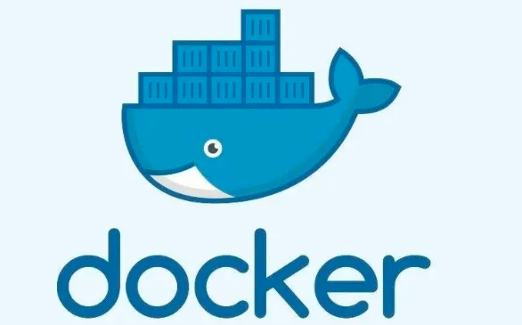
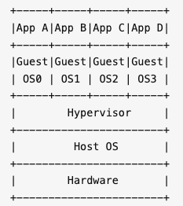
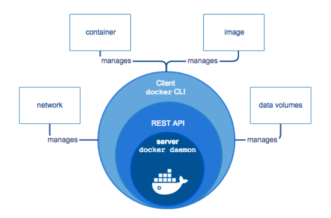

# Docker

# 1 Docker 是什么

**Docker**（英文本意是指码头工人）是一个开源的容器引擎，2013 年 3 月在 PyCon 大会上首次公开亮相并随即开源。它最初是 *dotCloud* 公司（后由于 Docker 开源后大受欢迎，公司于 2013 年 10 月改名为 *Docker Inc.*）内部的一个项目，dotCloud 本身提供的是 PaaS（Platform as a Service）服务。Docker 使用 Google 公司的 Go 语言实现，遵从 Apache 2.0 协议。

Docker 本质上是宿主机上的一个进程，通过 **Namespace**（命名空间）实现资源隔离，通过 **cgroup**（控制组）实现资源限制，通过**写时复制技术**（copy-on-write）实现了高效的文件操作。由于被隔离的 Docker 进程独立于宿主机和其他被隔离的进程，因此也称其为**容器**。最初实现是基于 **LXC**（Linux Container），从 0.9 版本开始默认使用自行开发的 libcontainer 取代 LXC。2015 年，Docker 把 libcontainer 捐给了 OCI（开放容器倡议），并以它为基础发展出独立的容器运行时 **runc**；从 1.11 版本开始，Docker 的架构进一步拆分，由 **containerd** 负责管理容器的生命周期，底层调用 runc 来创建和运行容器。

Docker 的核心理念是：

> Build, Ship and Run Any App, Anywhere

即通过对应用组件的封装（Packaging）、分发（Distribution）、部署（Deployment）、运行（Runtime）等生命周期的管理，达到应用组件级别的“**一次封装，到处运行**”。这里的应用组件，既可以是一个 Web 应用，也可以是一套数据库服务，甚至是一个操作系统。将应用运行在 Docker 容器上，可以实现跨平台、跨服务器，只需一次配置准备好相关的应用环境，即可实现到处运行，保证研发和生产环境的一致性，解决了应用和运行环境的兼容性问题，从而极大提升了部署效率，减少故障的可能性。

Docker 实际上就相当于一个封闭的沙盒或者是集装箱，它可以把不同的应用全都放在它的集装箱里面，并且以后有需要的时候，可以直接把集装箱搬到其他平台或者服务器上，实现容器虚拟化技术，随用随搬。

如今 Docker 早已不是单打独斗。2015 年，Docker 联合多家公司成立了 Linux 基金会旗下的 OCI（Open Container Initiative，开放容器倡议），以 Docker 的镜像格式和运行时为基础制定了镜像规范与运行时规范；2017 年，containerd 又被捐给了 CNCF（云原生计算基金会）。因此，用 Docker 构建的镜像可以直接运行在 containerd、CRI-O、Podman 等任何符合 OCI 标准的容器运行时中，这也是 Kubernetes 在 1.24 版本移除 dockershim 之后，Docker 构建的镜像依然能在集群中照常运行的原因。Docker 自身则把重心放在开发者工具上，Docker Desktop 集成了 Kubernetes 集群、Compose、BuildKit 等工具，成为很多开发者本地的容器工作台。

# 2 Docker 的设计哲学

**Docker 的思想来自于集装箱**。

集装箱解决了什么问题呢？答案是货物的标准化。

各种各样的货物被打包进集装箱，集装箱和集装箱之间不会互相影响。如此一来，我们就不需要专门运送水果的船和专门运送化学品的船了。只要这些货物在集装箱里封装得好好的，就可以用一艘大船把它们都运走。

现在云计算大行其道，云计算就好比大货轮，而 Docker 就是集装箱。

要解释清楚 Docker，首先要解释清楚**容器**（Container）的概念。要解释容器的话，需要从操作系统说起。

操作系统就是管理计算机硬件与软件资源，并且为软件运行提供通用服务的系统软件。硬件、操作系统、应用程序之间的关系可以简单地用下图表示：

随着硬件的性能提升以及软件种类的丰富，有两种情况变得很常见：

1. **硬件性能过剩**：很多计算机的硬件配置，即使不能完全满足峰值性能的要求，也往往会有大量时间处于硬件资源闲置的状态。例如一般家用电脑，已经普遍是八核甚至十几核的配置了，除了 3A 游戏、视频制作、3D 渲染、高性能计算等特殊应用外，通常有 90% 以上的时间 CPU 是闲置的。
2. **软件冲突**：因为业务需要，两个或者多个软件之间冲突，或者需要同一个软件的不同版本。例如一个老系统只能跑在依赖旧版 glibc 的 CentOS 7 上，而新服务需要较新的系统库和 OpenSSL 3，两者很难装在同一个操作系统里。

为了解决软件冲突，只能配置多台计算机，或者很麻烦地在同一台电脑上安装多个操作系统，通过重启来进行切换。显然这两个方案都有其缺点：多台计算机成本太高，多操作系统的安装、切换都很麻烦。在硬件性能过剩的时候，硬件虚拟化的普及就自然而然地被提了出来。

所谓**硬件虚拟化**，就是借助某个特殊的软件，仿真出一台或者多台计算机的各种硬件，用户可以在这一台虚拟机上安装、运行操作系统和各种应用。对于上面的应用程序来说，这台虚拟机和普通的物理计算机是完全一样、没有任何区别的——除了性能可能差一点。虚拟机技术的代表有 **VMware**、**VirtualBox**、**KVM** 等，**OpenStack** 则是基于这些虚拟化技术构建的云计算管理平台。

虚拟机的一个缺点在于 Guest OS 通常会占用不少硬件资源。例如 Windows 安装后开机不运行任何应用，就需要占用数 GB 内存、数十 GB 硬盘空间。即使是没有图形界面的 Linux，根据发行版以及安装软件的不同，空载也要占用一两百 MB 到 1 GB 内存、数 GB 硬盘空间。而且为了应用系统运行的性能，往往还要给每台虚拟机留出更多的内存容量，实际部署时通常要分配 1～2 GB 甚至更多。

通常来说，其中相当大部分甚至全部 Guest OS 都是相同的。能不能让所有的应用使用同一个操作系统以减少硬件资源的浪费，但是又能避免包括运行库在内的软件冲突呢？**操作系统层虚拟化**——容器概念的提出，就是为了解决这个问题。在 Linux 上可以通过**命名空间**（Namespace）和**控制组**（Control Group，通常简写为 **cgroup**）实现隔离与资源限制，并把应用和运行库打包在一起，来实现这个目的。

**虚拟机是硬件层面的隔离，而容器是 App 层面的隔离**。

上图中，每一个 App 和 Lib 的组合，就是一个容器，也就是 Docker 图标里面的一个集装箱。和虚拟机相比，容器有以下优点：

- **迅速启动**：没有虚拟机硬件的初始化，没有 Guest OS 的启动过程，可以节约很多启动时间，这就是容器的“开箱即用”。
- **占用资源少**：没有运行 Guest OS 所需的内存开销，无须为虚拟机预留运行内存，无须安装、运行 App 不需要的运行库/操作系统服务，内存占用、存储空间占用都小得多。相同配置的服务器，如果运行虚拟机只能运行十多台，那么运行上百个容器通常毫无压力——当然前提是单个容器应用本身不会消耗太多资源。

Docker 把 App 和 Lib 的文件打包成为一个**镜像**，并且采用类似多次快照的存储技术，优势如下：

1. 多个 App 可以共用相同的底层镜像（初始的操作系统镜像）
2. App 运行时的 I/O 操作和镜像文件隔离
3. 通过挂载包含不同配置/数据文件的目录或者卷（Volume），单个 App 镜像可以同时用来运行无数个不同业务的容器

上图是基于一个 Alpine Linux 的镜像，分别建立了 Nginx 和 MySQL 的镜像，并且挂载不同的配置/数据，同时运行 3 个网站应用和 3 个数据库应用的示意图。

此外，Docker 公司提供了公共的**镜像仓库**（即 Docker Hub，其中的每个镜像仓库在 Docker 中称为 **Repository**），配合 GitHub Actions 等 CI/CD 流水线，代码提交后即可自动构建并推送镜像，大大简化了应用分发、部署、升级流程。（Docker Hub 早年自带的关联 GitHub 自动构建功能已于 2021 年对免费用户关闭，目前已被标记为废弃，将于 2027 年 4 月 1 日彻底下线。）加上 Docker 可以非常方便地建立各种自定义的镜像文件，这些都是 Docker 成为最流行的容器技术的重要因素。

通过以上这些技术的组合，最后的结果就是，绝大部分应用，开发者都可以通过 `docker build` 创建镜像，通过 `docker push` 上传镜像，用户通过 `docker pull` 下载镜像，用 `docker run` 运行应用。用户不需要再去关心如何搭建环境、如何安装、如何解决不同发行版的库冲突——而且通常不会消耗更多的硬件资源，不会明显降低性能。这就是上文将 Docker 类比为集装箱的原因所在。

# 3 Docker 的优势

作为一种轻量级的虚拟化方式，Docker 跟传统的虚拟化方式相比具有众多的优势。

## 3.1 更高效地利用系统资源

由于容器不需要进行硬件虚拟以及运行完整操作系统等额外开销，Docker 对系统资源的利用率更高。无论是应用执行速度、内存损耗还是文件存储速度，都要比传统虚拟机技术更高效。因此，相比虚拟机技术，一个相同配置的主机，往往可以运行更多数量的应用。

## 3.2 更快速的启动时间

传统的虚拟机技术启动应用服务往往需要数分钟，而 Docker 容器应用，由于直接运行于宿主内核，无须启动完整的操作系统，因此可以做到秒级、甚至毫秒级的启动时间，大大节约了开发、测试、部署的时间。

## 3.3 一致的运行环境

开发过程中一个常见的问题是环境一致性问题。由于开发环境、测试环境、生产环境不一致，导致有些 bug 并未在开发过程中被发现。而 Docker 的镜像提供了除内核外完整的运行时环境，确保了应用运行环境的一致性，从而不会再出现“这段代码在我机器上没问题啊”这类问题。

## 3.4 持续交付和部署

对开发和运维（DevOps）人员来说，最希望的就是一次创建或配置，可以在任意地方正常运行。

使用 Docker 可以通过定制应用镜像来实现持续集成、持续交付、部署。开发人员可以通过 Dockerfile 来进行镜像构建，并结合持续集成（Continuous Integration）系统进行集成测试，而运维人员则可以直接在生产环境中快速部署该镜像，甚至结合持续交付/部署（Continuous Delivery/Deployment）系统进行自动部署。

而且使用 Dockerfile 使镜像构建透明化，不仅开发团队可以理解应用运行环境，也方便运维团队理解应用运行所需条件，有助于更好地在生产环境中部署该镜像。

在此基础上，业界还发展出了开发容器（Dev Containers）规范：在项目中加入 `.devcontainer/devcontainer.json` 配置文件（可以引用项目的 Dockerfile 或 Compose 文件），VS Code、JetBrains 系列 IDE 和 GitHub Codespaces 就能直接在容器中打开项目，让开发环境也像生产镜像一样可以版本化和复现。此外，Docker Desktop 还内置了 AI 助手 Gordon（命令行中为 `docker ai`），可以帮助生成和优化 Dockerfile、排查构建与容器运行中的问题。

## 3.5 更轻松的迁移

由于 Docker 确保了执行环境的一致性，使得应用的迁移更加容易。Docker 可以在很多平台上运行，无论是物理机、虚拟机、公有云、私有云，甚至是笔记本，其运行结果是一致的。因此用户可以很轻易地将在一个平台上运行的应用，迁移到另一个平台上，而不用担心运行环境的变化导致应用无法正常运行。

## 3.6 更轻松的维护和扩展

Docker 使用的分层存储以及镜像的技术，使得应用重复部分的复用更为容易，也使得应用的维护更新更加简单，基于基础镜像进一步扩展镜像也变得非常简单。此外，Docker 团队同各个开源项目团队一起维护了一大批高质量的官方镜像，既可以直接在生产环境使用，又可以作为基础进一步定制，大大降低了应用服务的镜像制作成本。

# 4 架构原理

## 4.1 C/S 架构

由上图可知，**Docker 使用 C/S 架构模式**，核心组件如下：

- **Client**：提供用户跟 Docker 交互的入口，可以通过 Client 向 Docker 发送各种 API 请求
- **Docker Daemon**：用于监听并处理 Docker Client 发送的 API 请求，并且管理 Docker 镜像（Image）、容器（Container）以及文件结构，同时也用于跟其他 Docker Daemon 进行交互
- **Registry**：存储镜像的仓库。Docker Hub 是一个公共仓库，类似于 Maven 的中央仓库，默认情况下 Docker 会从该公共仓库获取镜像。当然 Docker 也可以像 Maven 一样有自己的私有 Registry
- **Images**：定义 Docker 容器执行指令的模板。可以把 Docker Image 比作 Java 的类，把 Docker Container 比作 Java 的对象，Docker 的镜像通常都是在另一个 Image 基础上构建的
- **Containers**：Docker 镜像的运行实例，用户可以通过 Docker API 对 Docker 容器进行 `start/stop/create/move/delete` 等操作

## 4.2 客户端

Docker 提供了一个命令行工具 docker 以及一整套 RESTful API。我们日常使用各种 docker 命令，其实就是在使用客户端工具与 Docker 引擎进行交互。

## 4.3 服务端

Docker Daemon 是 Docker 架构中一个常驻在后台的系统进程。所谓的“运行 Docker”，即代表运行 Docker Daemon。Docker Daemon 的作用主要有以下两方面：

- 接收并处理 Docker Client 发送的请求
- 管理所有的 Docker 容器

Docker Daemon 运行时，会在后台启动一个 Server，Server 负责接收 Docker Client 发送的请求；接收请求后，Server 通过路由与分发调度，找到相应的 Handler 来处理请求。

早期的 Docker（1.x）中，Daemon 内部由一个 Engine 统一调度一个个 Job 来完成工作，这套机制早已被重构移除。如今的 Docker 服务端采用分层的模块化架构，一个创建并运行容器的请求大致会经过以下几个组件：

- **dockerd**：接收并处理 API 请求，负责镜像构建、网络（libnetwork）、数据卷等上层功能
- **containerd**：负责容器的生命周期管理；在 containerd 镜像存储模式下（Docker Engine 29 起新安装的默认设置），镜像的拉取与存储也由它负责
- **containerd-shim**：每个容器对应一个 shim 进程，作为容器进程的父进程，即使 containerd 重启，容器也能继续运行
- **runc**：符合 OCI 规范的底层运行时，按照配置创建 Namespace、cgroup 等隔离环境并启动容器进程，完成后即退出

## 4.4 注册中心

Docker Registry 是一个存储容器镜像（Docker Image）的仓库。容器镜像是容器创建时用来初始化容器 rootfs 的文件系统内容。Docker Registry 将大量的容器镜像汇集在一起，并为分散的 Docker Daemon 提供镜像服务。

Docker 的运行过程中，有三种情况可能与 Docker Registry 通信，分别为**搜索镜像**、**下载镜像**、**上传镜像**。这三种操作分别对应 `docker search`、`docker pull` 和 `docker push` 命令，由 Docker Daemon 代为与 Registry 通信。其中 pull 和 push 使用的是 Registry HTTP API V2（现已标准化为 OCI Distribution 规范），search 用的则是 Docker Hub 提供的搜索接口，很多私有仓库并不支持。

不同场景下，Docker Daemon 可以使用不同的 Docker Registry。公有 Registry 与私有 Registry 就是两种场景模式不同的 Docker Registry。其中，大家熟知的 Docker Hub，就是全球范围内最大的公有 Registry。Docker 可以通过互联网访问 Docker Hub，并下载容器镜像；同时 Docker 也允许用户构建本地私有 Registry，使容器镜像的获取在内网完成。

通常，一个仓库会包含同一个软件不同版本的镜像，而标签对应该软件的各个版本。我们可以通过 `<仓库名>:<标签>` 的格式来指定具体是这个软件哪个版本的镜像。如果不给出标签，将以 `latest` 作为默认标签。注意，`latest` 只是一个普通的标签名，并不保证指向最新版本，生产环境建议显式指定版本标签。

## 4.5 镜像

镜像，即创建容器的模板，含有启动容器所需要的文件系统及其他内容。

第 2 节提到，镜像采用类似多次快照的存储技术，从而实现底层镜像共享、运行时 I/O 与镜像隔离等优势。下面具体看看这种存储结构是怎么实现的。

### 4.5.1 镜像分层

Docker 镜像包含一层层的文件系统，它们通过 **Union FS**（联合文件系统）组合在一起。联合文件系统可以将几层目录挂载到同一个挂载点上，逐层叠加，形成一个统一的虚拟文件系统。早期 Docker 使用 AUFS 来实现，如今在 Linux 上使用的是内核自带的 OverlayFS：从旧版本升级而来的环境默认使用 overlay2 存储驱动，Docker Engine 29 起的新安装则默认改用 containerd 镜像存储，底层同样基于 OverlayFS。虚拟文件系统的目录结构就像普通 Linux 的目录结构一样，镜像通过这些文件再加上宿主机的内核共同提供了一个 Linux 的虚拟环境。

**镜像中每一层文件系统都是只读的**。构建镜像的时候，从一个最基本的操作系统开始，每个构建提交的操作都相当于做一层修改，增加了一层文件系统，一层层往上叠加，上层的修改会覆盖底层该位置的可见性。这也很容易理解，就像上层把底层遮住了一样，当使用镜像的时候，我们只会看到一个完整的整体，不知道里面有几层，也不需要知道里面有几层，结构如下：

镜像分层最大的一个好处就是共享资源。比如说有多个镜像都从相同的 base 镜像构建而来，那么 Docker Host 只需在磁盘上保存一份 base 镜像；同时内存中也只需加载一份 base 镜像，就可以为所有容器服务了。而且镜像的每一层都可以被共享。

### 4.5.2 容器层

当容器启动时，一个新的可写层被加载到镜像的顶部。这一层通常被称作“容器层”，“容器层”之下的都叫“镜像层”。

所有对容器的改动——无论添加、删除、还是修改文件都只会发生在容器层中。**只有容器层是可写的，容器层下面的所有镜像层都是只读的**。

镜像层数量可能会很多，所有镜像层会联合在一起组成一个统一的文件系统。如果不同层中有一个相同路径的文件，比如 /a，上层的 /a 会覆盖下层的 /a，也就是说用户只能访问到上层中的文件 /a。在容器层中，用户看到的是一个叠加之后的文件系统。

如果多个容器共享一份基础镜像，当某个容器修改了基础镜像的内容，比如 `/etc` 下的文件，这时其他容器的 `/etc` 是不会被修改的，修改只会被限制在单个容器内。这就是容器 Copy-on-Write 特性。可见，**容器层保存的是镜像变化的部分**，不会对镜像本身进行任何修改。

### 4.5.3 Dockerfile

Dockerfile 是一个用来构建镜像的文本文件，由一条条指令组成，其中 `RUN` 等指令执行的就是 Linux 下的 Shell 命令。Dockerfile 有自己的书写方式和支持的指令，Docker 程序读取 Dockerfile 并根据指令生成 Docker 镜像。相比手动制作镜像的方式，Dockerfile 更能直观地展示镜像是怎么产生的。有了 Dockerfile，当后期有额外的需求时，只要在之前的 Dockerfile 中添加或者修改相应的指令即可重新生成新的 Docker 镜像，避免了重复手动制作镜像的麻烦。它就像 Shell 脚本一样，可以方便高效地制作镜像。

自 Docker Engine 23.0 起，Linux 上默认的构建引擎已换成 BuildKit。相比传统构建器，BuildKit 可以并行执行互不依赖的构建步骤、更精细地复用缓存，并在多阶段构建中跳过最终镜像用不到的阶段，构建速度明显更快。此外，随着 Apple Silicon 电脑和云上 ARM 服务器的普及，同一个镜像往往需要同时支持 amd64 和 arm64 两种架构。借助 `docker buildx build --platform linux/amd64,linux/arm64`，一份 Dockerfile 就能一次构建出多个架构的镜像，并推送为一个多架构镜像清单（Manifest List，在 OCI 规范中称为 Image Index），拉取时 Docker 会自动选择与本机架构匹配的版本。

## 4.6 容器

Docker Container（Docker 容器）是 Docker 架构中**服务交付的最终体现形式**。Docker 通过 Docker Daemon 的管理、runc（早期为 libcontainer）的执行，最终创建 Docker 容器。Docker 容器作为一个交付单位，功能类似于传统意义上的虚拟机（Virtual Machine），具备资源受限、环境与外界隔离的特点。然而，实现手段却与 KVM、Xen 等传统虚拟化技术大相径庭。

Docker 容器的从无到有，涉及 Docker 利用到的很多技术。总而言之，用户可以根据自己的需求，通过 Docker Client 向 Docker Daemon 发送容器的创建与启动请求，请求中将携带容器的配置信息，从而达到定制相应 Docker 容器的目的。用户对 Docker 容器的配置有以下 4 个基本方面：

- 通过指定容器镜像，使得 Docker 容器可以自定义 rootfs 等文件系统
- 通过指定物理资源的配额，如 CPU、内存等，使得 Docker 容器使用受限的物理资源
- 通过配置容器网络及其安全策略，使得 Docker 容器拥有独立且安全的网络环境
- 通过指定容器的运行命令，使得 Docker 容器执行指定的任务

实际上我们的容器就好像是一个简易版的操作系统，只不过系统中只安装了我们的程序运行所需要的环境。不过，容器的可写层会随容器一起被删除，那么容器中的程序产生的需要持久化的数据该怎么办呢？

**数据卷**就是用来解决这个问题的，它将数据持久化到宿主机上，还可以在多个容器之间共享。常用的方式有两种：一种是由 Docker 管理的命名卷（Volume），数据存放在 Docker 的数据目录中（默认为 `/var/lib/docker/volumes`）；另一种是绑定挂载（Bind Mount），直接把宿主机上的某个目录映射到容器中。无论哪种方式，应用程序在容器中对该目录的读写都会落到宿主机上，即使容器被删除，数据也不会丢失。比如数据库容器，就可以把数据存储到宿主机上的真实磁盘中。
