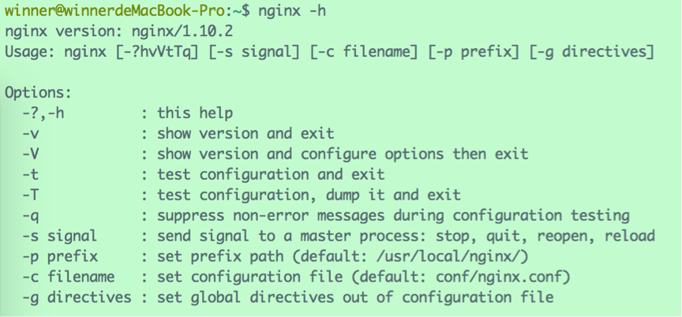
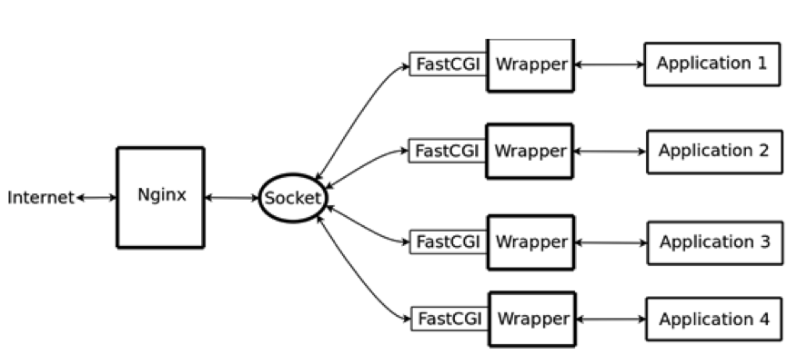

# Nginx 安装与配置

# 1 安装

首先从官网 http://nginx.org/ 下载 stable version（稳定版）源码，本文以 nginx-1.10.2.tar.gz 为例（截至 2026 年 10 月，最新稳定版为 1.30.x，主线版为 1.31.x，安装步骤基本一致）。

## 1.1 configure

解压之后，会发现里面有一个名为“configure”的文件：


configure 本身是一个 Shell 脚本，中间会调用 `<nginx-source-path>/auto/` 目录下别的脚本执行各种任务。根据不同的用途，auto 目录下面的脚本各司其职，有检查编译器版本的，有检查操作系统版本的，有检查标准库版本的，有检查模块依赖情况的，有关于安装的，有关于初始化的，有关于多线程检查的等等。configure 作为一个总驱动，调用这些脚本去生成版本信息头文件、默认被包含的模块的声明代码和 makefile 文件，版本信息头文件和默认被包含的模块的声明代码被放置在新创建的 objs 目录下。

插段广告，先来普及一下有关 makefile 的知识。

一般来说，无论是 C 还是 C++，首先要把源文件编译成中间代码文件，在 Windows 下也就是 .obj 文件，在 UNIX 下是 .o 文件，即 Object File，这个动作叫作**编译**（compile），每个源文件都应该对应于一个中间目标文件（O 文件或是 OBJ 文件）。然后再把大量的 Object File 合成可执行文件，这个动作叫作**链接**（link）。

编译时，编译器需要保证语法的正确以及函数与变量声明的正确。对于后者，通常需要告诉编译器头文件的所在位置（头文件中应该只是声明，而定义应该放在 C/C++ 文件中），只要所有的语法正确，编译器就可以编译出中间目标文件。

链接时，主要是链接函数和全局变量，所以，我们可以使用这些中间目标文件（O 文件或是 OBJ 文件）来链接我们的应用程序。链接器并不管函数所在的源文件，只管函数的中间目标文件（Object File）。在大多数时候，由于源文件太多，编译生成的中间目标文件太多，而在链接时需要明确地指出中间目标文件名，这对于编译很不方便，所以，我们要给中间目标文件打个包，在 Windows 下这种包叫“库文件”（Library File），也就是 .lib 文件，在 UNIX 下，是 Archive File，也就是 .a 文件。

总结一下，源文件首先会生成中间目标文件，再由中间目标文件生成可执行文件。在编译时，编译器只检测程序语法，以及函数、变量是否被声明。如果函数未被声明，编译器会给出一个警告，但可以生成 Object File。而在链接程序时，链接器会在所有的 Object File 中找寻函数的实现，如果找不到，就会报链接错误（Linker Error）。

Linux 下的 make 命令用于编译源代码，但是它执行之前需要一个 makefile 文件来告诉它怎样去编译和链接程序。

广告完毕，继续来说 Nginx。

由于我们下载下来的是源码，需要编译后才能安装。在编译安装 Nginx 之前，我们需要使用 configure 命令做大量“幕后”工作，包括检测操作系统内核和已经安装的软件、参数解析、中间目录生成以及根据各种参数生成 .c 文件、makefile 文件等。

所以，第一步需要运行 configure 脚本，该命令可以携带多种参数，使用 `configure --help` 查看参数列表：


例如：

- `--prefix=<path>`：指定 Nginx 安装路径，默认为 `/usr/local/nginx`
- `--sbin-path=<path>`：指定 Nginx 可执行文件安装路径，默认为 `<prefix>/sbin/nginx`
- `--conf-path=<path>`：指定配置文件路径，默认为 `<prefix>/conf/nginx.conf`
- `--pid-path=<path>`：指定 pid 文件路径，默认为 `<prefix>/logs/nginx.pid`

**注意**，Nginx 的一些模块需要依赖其他库，如果系统没有安装，运行 configure 命令的时候会报这样的错误：

> ./configure: error: the HTTP rewrite module requires the PCRE library.You can either disable the module by using --without-http_rewrite_module option, or install the PCRE library into the system, or build the PCRE library statically from the source with nginx by using `--with-pcre=<path>` option.

一般需要提前安装三个依赖库：

- rewrite 模块依赖的 **PCRE 库**
  PCRE（Perl Compatible Regular Expressions）是一个用 C 语言编写的正则表达式库，提供与 Perl 兼容的正则表达式语法。Rewrite 主要的功能就是实现 URL 的重写，Nginx 的 Rewrite 依赖 PCRE 库来实现正则匹配。自 1.21.5 版本起，Nginx 默认使用新一代的 PCRE2 库进行构建。
- gzip 模块依赖的 **zlib 库**
  我们在 Linux 中经常会用到后缀为“.gz”的文件，它们就是 gzip 格式的。gzip 现今已经成为 Internet 上使用非常普遍的一种数据压缩格式，或者说一种文件格式。
  HTTP 协议上的 gzip 编码是一种用来改进 Web 应用程序性能的技术。大流量的 Web 站点常常使用 gzip 压缩技术来让用户感受到更快的速度。这一般是指 Web 服务器中安装的一个功能，当有人来访问这个服务器中的网站时，服务器就将网页内容压缩后传输到来访的电脑浏览器中显示出来。一般纯文本内容可压缩到原大小的 40%。
  zlib 是一个通用的开源压缩库，提供了在内存中压缩和解压的函数，包括对解压后数据的校验。Nginx 依赖 zlib 库来实现 gzip 格式的数据压缩。
- ssl 模块依赖的 **OpenSSL 库**
  SSL 是 Secure Sockets Layer（安全套接层协议）的缩写，可以在 Internet 上提供保密传输，其继任者为 TLS（Transport Layer Security，传输层安全协议），如今实际使用的基本都是 TLS。OpenSSL 是一个安全套接字层密码库，囊括主要的密码算法、常用的密钥和证书封装管理功能及 SSL/TLS 协议。
  Nginx 依赖 OpenSSL 库实现 HTTPS 安全连接等方面的功能。

## 1.2 make && make install

make 是 Linux 下的编译命令，它根据 makefile 文件中描述的规则来自动进行编译。

make install 是 Linux 下的安装命令。

可以直接输入 `make && make install` 一并完成编译与安装操作。默认的安装路径为 `/usr/local/nginx`。

安装完毕后，输入 `nginx -v`，如果出现如下的版本信息，证明安装成功：

> nginx version: nginx/1.10.2

使用 `nginx` 命令启动 Nginx，浏览器输入 `127.0.0.1:80`，会看到 Nginx 的默认页面：


## 1.3 常用命令

使用 `nginx -h` 可列出所有可使用的命令列表：



常用命令如下：

- `nginx`
  启动 Nginx，可以利用 `-c` 参数指定要使用的配置文件。
- `nginx -s stop`
  快速停止 Nginx。`-s` 代表向 Nginx 发送信号。与之相对的是 `nginx -s quit`。注：stop 是快速停止 Nginx，可能并不保存相关信息；quit 是完整有序地（平滑）停止 Nginx，并保存相关信息。
- `nginx -s reload`
  重载配置，修改配置文件后需要使用该命令使之生效。
- `nginx -v`
  查看 Nginx 的版本信息。
- `nginx -t`
  检查配置文件是否正确。
- `nginx -c filename`
  指定配置文件的路径为“filename”，默认路径为“conf/nginx.conf”。
- `nginx -g`
  临时指定一些全局配置项，以使新的配置项生效，例如：`nginx -g "pid /var/nginx/test.pid"`，意味着会把 pid 文件写到 /var/nginx/test.pid 中。

`-g` 参数的约束条件是指定的配置项不能与默认路径下的 nginx.conf 中的配置项相冲突，否则无法启动。就像上例那样，类似这样的配置项：`pid logs/nginx.pid`，是不能存在于默认的 nginx.conf 中的。

另一个约束条件是，以 `-g` 方式启动的 Nginx 服务执行其他命令行时，需要把 `-g` 参数也带上，否则可能出现配置项不匹配的情形。例如，如果要停止 Nginx 服务，那么需要执行下面的命令：

```bash
nginx -g "pid /var/nginx/test.pid;" -s stop
```

如果不带上 `-g "pid /var/nginx/test.pid;"`，那么会找不到 pid 文件，也会出现无法停止服务的情况。

# 2 配置

一个简单的配置文件如下：

```nginx
#定义Nginx运行的用户及用户组
user  userName  userGroupName;

#工作进程数目，根据硬件调整，通常等于CPU数量或者2倍于CPU
worker_processes  1;

#错误日志路径与级别，级别选项：debug|info|notice|warn|error|crit|alert|emerg
error_log  logs/error.log debug;

#pid（进程标识符）存放路径
pid  logs/nginx.pid;

events {

    #每个工作进程的最大连接数量
    worker_connections  1024;

    #指定IO模型，linux建议epoll，FreeBSD建议采用kqueue，window下不指定
    use  epoll;

}

#设置http服务器
http {

    #文件扩展名与文件类型映射表
    include  mime.types;

    #默认文件类型
    default_type  text/html;

    #日志格式设置,main为日志格式的名称可在后文中引用
    log_format  main  '$remote_addr - $remote_user [$time_local] "$request" '
                      '$status $body_bytes_sent "$http_referer" '
                      '"$http_user_agent" "$http_x_forwarded_for"';

    #访问日志路径、格式
    access_log  logs/access.log  main;

    #sendfile指令指定 nginx 是否调用sendfile 函数（zero copy 方式）来输出文件，对于普通应用，必须设为on。
    #如果用来进行下载等应用磁盘IO重负载应用，可设置为off，以平衡磁盘与网络IO处理速度，降低系统uptime。
    sendfile  on;

    #允许或禁止使用socket的TCP_CORK的选项，此选项仅在使用sendfile的时候使用
    tcp_nopush  on;

    #长连接超时时间，这里指的是http层面的keep-alive并非tcp的keepalive，只能配置在http/server/location中，不能放在events中
    keepalive_timeout  65;

    #是否开启gzip压缩
    #gzip  on;

    #配置名为“static_file_server”的主机组，按照权重负载均衡；upstream只能定义在http块中，不能放在server内
    upstream static_file_server {
        server 192.168.2.1:8080 weight=1;
        server 192.168.2.2:8080 weight=2;
        server 192.168.2.3:8080 weight=3;
    }

    #虚拟主机配置，下可以有多个location用来表示不同的反向代理
    server {

        #监听端口
        listen       80;

        #主机名，默认为本机
        server_name  127.0.0.1;

        #编码
        charset utf-8;

        #访问日志
        access_log  logs/host.access.log  main;

        #根路径“/” 的访问规则
        location / {

            #网站根目录
            root   html;

            #默认网页
            index  index.html index.htm index.php;
        }

        #发生404错误时跳转到/404.html页面
        error_page  404  /404.html;

        #正则表达式，配置以“.js”、“.css”结尾的路径的访问规则
        location ~ .*\.(js|css)$ {

            #将该类请求转发至static_file_server
            proxy_pass  http://static_file_server;

            #设置浏览器缓存过期时间
            expires  600;

            #关闭重定向
            proxy_redirect  off;

            #以下三行，目的是将代理服务器收到的用户的信息传到真实服务器上
            proxy_set_header  Host $host;
            proxy_set_header  X-Real-IP $remote_addr;
            proxy_set_header  X-Forwarded-For $proxy_add_x_forwarded_for;

            #拒绝的ip
            deny  127.0.0.1;

            #允许的ip
            allow  172.18.5.54;
        }
    }
}
```

## 2.1 内置变量

在 log_format 配置项当中，使用了很多 Nginx 的内置变量，一些变量代表了客户端请求头部的一些字段，如 `$http_user_agent`、`$http_cookie` 等等，由于这些变量会在请求中定义，所以可能无法保证它们是存在的或者说可以定义到一些别的地方（例如遵循一定的规范）。

常用变量如下：

| **变量名**             | **说明**                                                     |
| ---------------------- | ------------------------------------------------------------ |
| **$args**              | 请求行中的参数，同 **$query_string**                         |
| **$content_length**    | 请求头中的 Content-Length 字段                               |
| **$content_type**      | 请求头中的 Content-Type 字段                                 |
| **$document_root**     | 当前请求在 root 指令中指定的值                               |
| **$document_uri**      | 不带请求参数的当前 URI，不包含主机名，同 **$uri**            |
| **$host**              | 请求中的主机头字段，如果请求中的主机头不可用，则为服务器处理请求的服务器名称 |
| **$http_user_agent**   | 客户浏览器信息                                               |
| **$http_cookie**       | 客户端 cookie 信息                                           |
| **$remote_addr**       | 客户端的 IP 地址                                             |
| **$remote_port**       | 客户端的端口                                                 |
| **$remote_user**       | 经过 Auth Basic Module 验证的用户名                          |
| **$request_filename**  | 当前请求的文件路径，由 root 或 alias 指令与 URI 请求生成     |
| **$request_method**    | 这个变量是客户端请求的动作，通常为 GET 或 POST               |
| **$request_uri**       | 包含请求参数的原始 URI，不包含主机名                         |
| **$server_addr**       | 服务器地址                                                   |
| **$server_name**       | 服务器名称                                                   |
| **$server_port**       | 请求到达服务器的端口号                                       |
| **$server_protocol**   | 请求使用的协议，通常是 HTTP/1.0、HTTP/1.1 或 HTTP/2.0        |
| **$scheme**            | 请求使用的协议类型（如 http、https）                         |

例如，对于 URL：http://localhost:88/test1/test2/test.php

- **$host**：localhost
- **$server_port**：88
- **$request_uri**：/test1/test2/test.php
- **$document_uri**：/test1/test2/test.php
- **$document_root**：/var/www/html
- **$request_filename**：/var/www/html/test1/test2/test.php

## 2.2 负载均衡配置

**upstream** 用于配置负载均衡。Nginx 的 upstream 常用的分配方式有以下 5 种：

- **轮询（默认）**

每个请求按时间顺序逐一分配到不同的后端服务器，如果后端服务器宕机，能自动剔除。

- **weight**

指定轮询概率，weight 和访问比率成正比，用于后端服务器性能不均的情况。

例如：

```nginx
upstream bakend {
	server 192.168.0.14 weight=10;
	server 192.168.0.15 weight=10;
}
```

- **ip_hash**

每个请求按访问 IP 的 hash 结果分配，这样每个访客固定访问一个后端服务器，可以解决 session 的问题。

例如：

```nginx
upstream bakend {
	ip_hash;
	server 192.168.0.14:88;
	server 192.168.0.15:80;
}
```

- **fair（第三方）**

按后端服务器的响应时间来分配请求，响应时间短的优先分配。该第三方模块已多年未维护，开源版 Nginx 可使用内置的 least_conn（最少连接）策略作为替代。

```nginx
upstream backend {
	server server1;
	server server2;
	fair;
}
```

- **url_hash（第三方）**

按访问 URL 的 hash 结果来分配请求，使每个 URL 定向到同一个后端服务器，后端服务器为缓存时比较有效。

例：在 upstream 中加入 hash 语句，server 语句中不能写入 weight 等其他的参数，hash_method 是使用的 hash 算法。注意，Nginx 自 1.7.2 版本起已内置 `hash` 指令（如 `hash $request_uri consistent;`），无须再借助第三方模块，内置版本也不支持 hash_method 参数。

```nginx
upstream backend {
	server squid1:3128;
	server squid2:3128;
	hash $request_uri;
	hash_method crc32;
}
```

此外，可以在各后端机器的地址后附带状态参数，例如：

```nginx
upstream bakend{
  server 127.0.0.1:9090 down;
  server 127.0.0.1:8080 weight=2;
  server 127.0.0.1:6060;
  server 127.0.0.1:7070 backup;
}
```

每个设备的状态设置为：

- down：表示当前的 server 暂时不参与负载
- weight：该值越大，负载的权重就越大
- backup：其他所有的非 backup 机器宕机或者忙的时候，请求 backup 机器，所以这台机器压力会最轻（注意，官方文档规定 backup 不能与 hash、ip_hash、random 策略同时使用）

## 2.3 正则匹配

正则匹配规则：

- `=` 开头表示精确匹配
- `^~` 开头表示 URI 以某个常规字符串开头，不是正则匹配
- `~` 开头表示区分大小写的正则匹配
- `~*` 开头表示不区分大小写的正则匹配
- `$` 结尾表示以某字符串结尾的正则匹配
- `!~` 和 `!~*` 分别为区分大小写不匹配及不区分大小写不匹配的正则
- `/` 通用匹配，任何请求都会匹配到

看几个实例：

```nginx
location = / {
    # 精确匹配，只有请求 / 时才会匹配到
    [ configuration A ]
}

location / {
    # 因为所有的地址都以 / 开头，所以这条规则将匹配到所有请求
    # 但是正则和最长字符串会优先匹配
    [ configuration B ]
}

location /documents/ {
    # 匹配任何以 /documents/ 开头的地址，匹配符合以后，还要继续往下搜索
    # 只有后面的正则表达式没有匹配到时，才会采用这一条
    [ configuration C ]
}

location ~ /documents/Abc {
    # 区分大小写的正则匹配，匹配任何包含 /documents/Abc 的地址
    # 正则按书写顺序匹配，命中后即采用这一条
    [ configuration CC ]
}

location ^~ /images/ {
    # 匹配任何以 /images/ 开头的地址，匹配符合以后，停止往下搜索正则，采用这一条
    [ configuration D ]
}

location ~* \.(gif|jpg|jpeg)$ {
    # 匹配所有以 gif、jpg 或 jpeg 结尾的请求
    # 然而，所有请求 /images/ 下的图片会被 config D 处理，因为 ^~ 到达不了这一条正则
    [ configuration E ]
}

location /images/ {
    # 字符匹配到 /images/，继续往下，会发现 ^~ 存在
    [ configuration F ]
}

location /images/abc {
    # 最长字符匹配到 /images/abc，继续往下，会发现 ^~ 存在
    # F 与 G 的放置顺序是没有关系的
    [ configuration G ]
}

location ~ /images/abc/ {
    # 只有去掉 config D 才有效：先最长匹配 config G 开头的地址，继续往下搜索，匹配到这一条正则，采用
    [ configuration H ]
}
```

配置的优先级遵循以下规则：

> (location =) > (location 完整路径) > (location ^~ 路径) > (location ~,~* 正则顺序) > (location 部分起始路径) > (/)

按照上面的 location 写法，以下匹配示例成立：

- `/` → config A：精确完全匹配，即使 /index.html 也匹配不了
- `/downloads/download.html` → config B：匹配 B 以后，往下没有任何匹配，采用 B
- `/images/1.gif` → configuration D：匹配到 F，往下匹配到 D，停止往下
- `/images/abc/def` → config D：最长匹配到 G，往下匹配 D，停止往下。你可以看到，任何以 /images/ 开头的都会匹配到 D 并停止，F、G 写在这里是没有任何意义的，H 是永远轮不到的，这里只是为了说明匹配顺序
- `/documents/document.html` → config C：匹配到 C，往下没有任何匹配，采用 C
- `/documents/1.jpg` → configuration E：匹配到 C，往下正则匹配到 E
- `/documents/Abc.jpg` → config CC：最长匹配到 C，往下正则顺序匹配到 CC，不会往下到 E

所以实际使用中，有三个匹配规则定义可作参考：

- 规则 1

直接匹配网站根，通过域名访问网站首页比较频繁，使用这个会加速处理，官网如是说。这里是直接转发给后端应用服务器了，也可以是一个静态首页。

```nginx
location = / {
  proxy_pass http://tomcat:8080/index;
}
```

- 规则 2

处理静态文件请求是 Nginx 作为 HTTP 服务器的强项，有两种配置模式：目录匹配或后缀匹配，任选其一或搭配使用：

```nginx
location ^~ /static/ {
  root /webroot/static/;
}

location ~* \.(gif|jpg|jpeg|png|css|js|ico)$ {
  root /webroot/res/;
}
```

- 规则 3

通用规则，用来转发动态请求到后端应用服务器，非静态文件请求就默认是动态请求，可根据实际情况自行把握。

```nginx
location / {
  proxy_pass http://tomcat:8080/;
}
```

## 2.4 rewrite 配置

rewrite 功能就是使用 Nginx 提供的全局变量或自己设置的变量，结合正则表达式和标志位实现 URL 重写以及重定向。rewrite 只能放在 `server{}`、`location{}`、`if{}` 中，并且只能对域名后边的除传递参数外的字符串起作用，例如 http://seanlook.com/a/we/index.php?id=1&u=str 只对 /a/we/index.php 重写。语法：

`rewrite regex replacement [flag]`

如果想对域名或参数字符串起作用，可以使用全局变量匹配，也可以使用 proxy_pass 反向代理。

表面看 rewrite 和 location 功能有点像，都能实现跳转，主要区别在于 **rewrite 是在同一域名内更改获取资源的路径**，而 location 是对一类路径做控制访问或反向代理，可以 proxy_pass 到其他机器。很多情况下 rewrite 也会写在 location 里，它们的执行顺序是：

1. 执行 server 块的 rewrite 指令
2. 执行 location 匹配
3. 执行选定的 location 中的 rewrite 指令

如果其中某步 URI 被重写，则重新循环执行第 1～3 步，直到找到真实存在的文件；循环超过 10 次，则返回 500 Internal Server Error 错误。

flag 标志位用法如下：

- last：相当于 Apache 的 [L] 标记，表示完成 rewrite
- break：停止执行当前虚拟主机的后续 rewrite 指令集
- redirect：返回 302 临时重定向，地址栏会显示跳转后的地址
- permanent：返回 301 永久重定向，地址栏会显示跳转后的地址

因为 301 和 302 不能简单地只返回状态码，还必须有重定向的 URL，所以早期版本的 return 指令无法返回 301、302；自 0.8.42 版本起，return 指令已支持 `return 301 URL;` 这样的写法。这里 last 和 break 的区别有点难以理解：last 一般写在 server 和 if 中，而 break 一般使用在 location 中；last 不终止重写后的 URL 匹配，即新的 URL 会再从 server 走一遍匹配流程，而 break 终止重写后的匹配；break 和 last 都能阻止继续执行后面的 rewrite 指令。

还有一个 if 指令，非常有用，语法为：

```nginx
if (condition) {
	...
}
```

对给定的条件 condition 进行判断。如果为真，大括号内的 rewrite 指令将被执行，if 条件（condition）可以是如下任何内容：

- 当表达式只是一个变量时，如果值为空或是任何以 0 开头的字符串，都会被当作 false
- 直接比较变量和内容时，使用 `=` 或 `!=`
- `~` 为正则表达式匹配，`~*` 为不区分大小写的匹配，`!~` 为区分大小写的不匹配
- `-f` 和 `!-f` 用来判断是否存在文件
- `-d` 和 `!-d` 用来判断是否存在目录
- `-e` 和 `!-e` 用来判断是否存在文件或目录
- `-x` 和 `!-x` 用来判断文件是否可执行

例如：

```nginx
# 如果UA包含"MSIE"，rewrite请求到/msie/目录下
if ($http_user_agent ~ MSIE) {
  rewrite ^(.*)$ /msie/$1 break;
}

# 如果cookie匹配正则，设置变量$id等于正则引用部分
if ($http_cookie ~* "id=([^;]+)(?:;|$)") {
  set $id $1;
}

# 如果提交方法为POST，则返回状态405（Method not allowed）
if ($request_method = POST) {
  return 405;
}

# 限速，$slow可以通过 set 指令设置
if ($slow) {
  limit_rate 10k;
}

# 如果请求的文件名不存在，则反向代理到localhost。这里的break也是停止rewrite检查
if (!-f $request_filename) {
  break;
  proxy_pass http://127.0.0.1;
}

# 如果query string中包含"post=140"，永久重定向到example.com
if ($args ~ post=140) {
  rewrite ^ http://example.com/ permanent;
}

# 防盗链
location ~* \.(gif|jpg|png|swf|flv)$ {
  valid_referers none blocked www.jefflei.com www.leizhenfang.com;
  if ($invalid_referer) {
    return 404;
  }
}
```

## 2.5 FastCGI 配置

Nginx 本身不支持对外部程序的直接调用或者解析，所有的外部程序（包括 PHP）必须通过 **FastCGI 接口**来调用。FastCGI 接口在 Linux 下是 socket（这个 socket 可以是文件 socket，也可以是 IP socket）。为了调用 CGI 程序，还需要一个 FastCGI 的 wrapper（wrapper 可以理解为用于启动另一个程序的程序），这个 wrapper 绑定在某个固定 socket 上，如端口或者文件 socket。当 Nginx 将 CGI 请求发送给这个 socket 的时候，通过 FastCGI 接口，wrapper 接收到请求，然后派生出一个新的线程，这个线程调用解释器或者外部程序处理脚本并读取返回数据；接着，wrapper 再将返回的数据通过 FastCGI 接口，沿着固定的 socket 传递给 Nginx；最后，Nginx 将返回的数据发送给客户端。



以下为 Nginx 支持 PHP 的配置示例：

```nginx
location ~ \.php$ {

  root      html;

  fastcgi_pass  127.0.0.1:9000;

  fastcgi_index index.php;

  fastcgi_param SCRIPT_FILENAME /scripts$fastcgi_script_name;

  include    fastcgi_params;

}
```

通过 location 指令，将所有以 php 为后缀的文件都交给 127.0.0.1:9000 来处理，而这里的 IP 地址和端口就是 FastCGI 进程监听的 IP 地址和端口。fastcgi_param 指令指定放置 PHP 动态程序的主目录，也就是 `$fastcgi_script_name` 前面指定的路径，建议将这个目录与 Nginx 虚拟主机指定的根目录保持一致，当然也可以不一致。fastcgi_params 文件是 FastCGI 进程的一个参数配置文件，在安装 Nginx 后，会默认生成一个这样的文件，这里通过 include 指令将 FastCGI 参数配置文件包含了进来。
