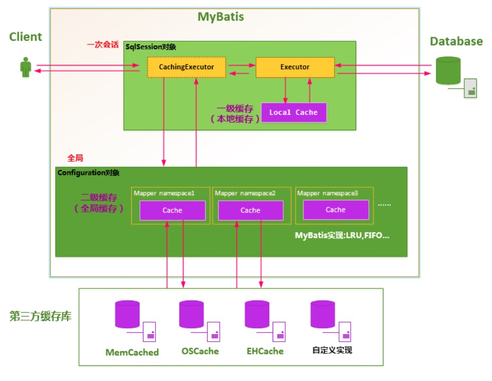
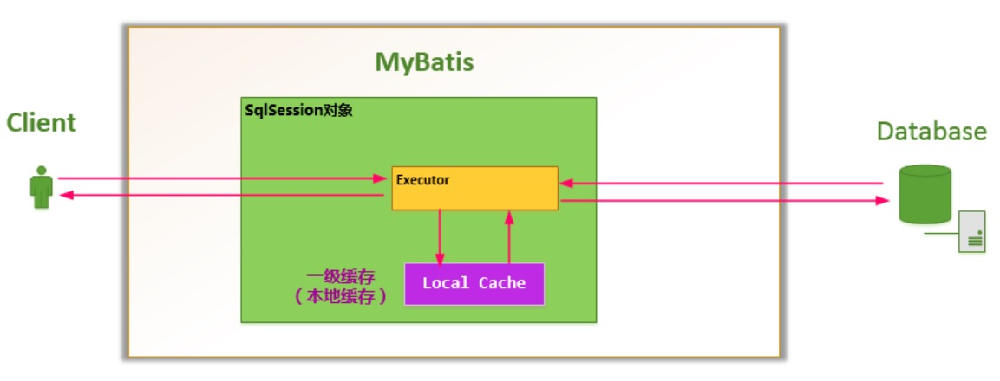
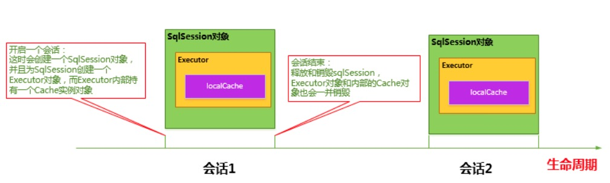
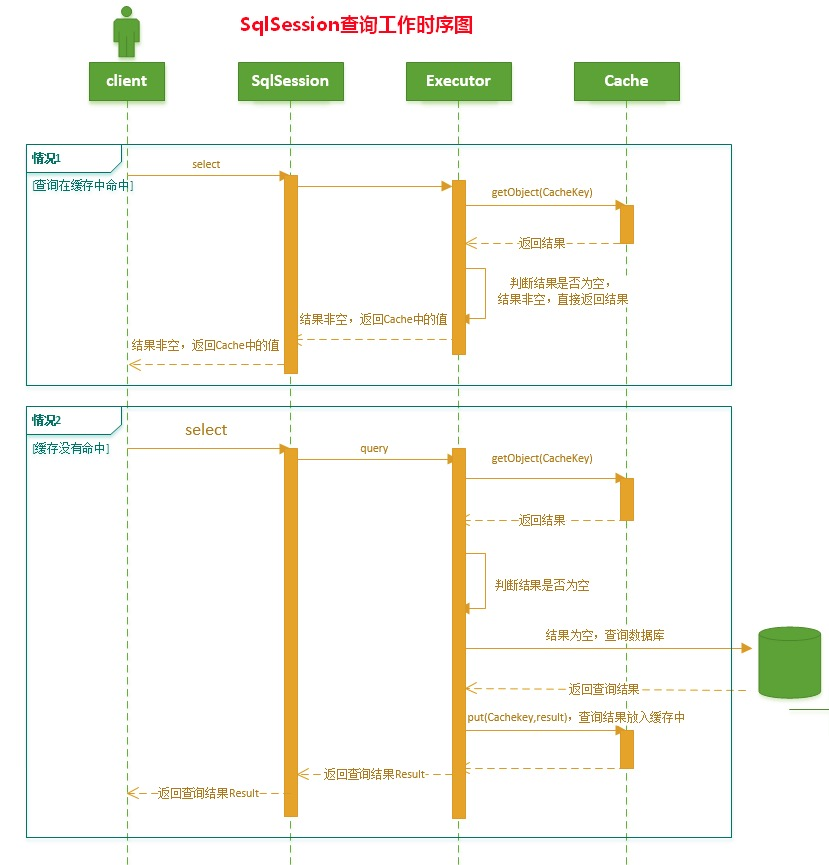
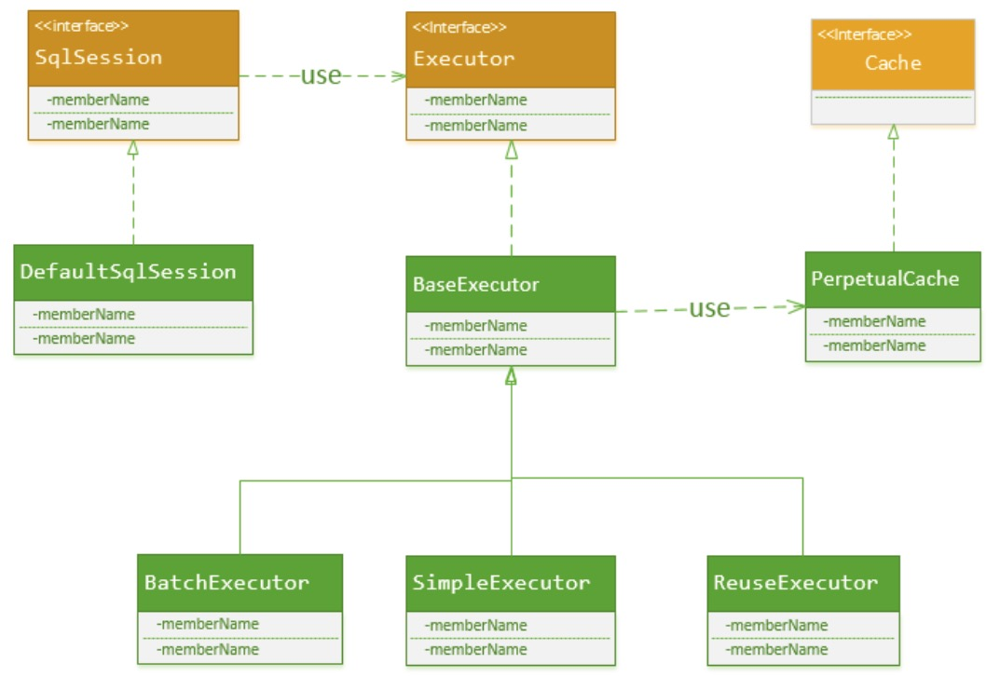
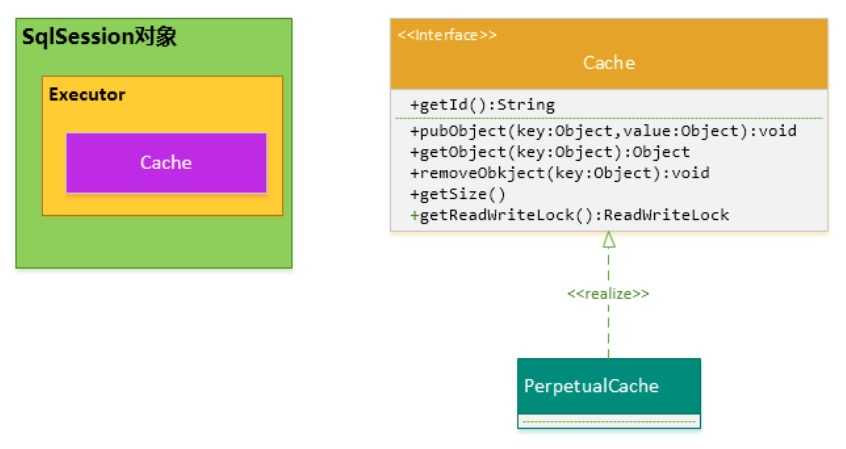
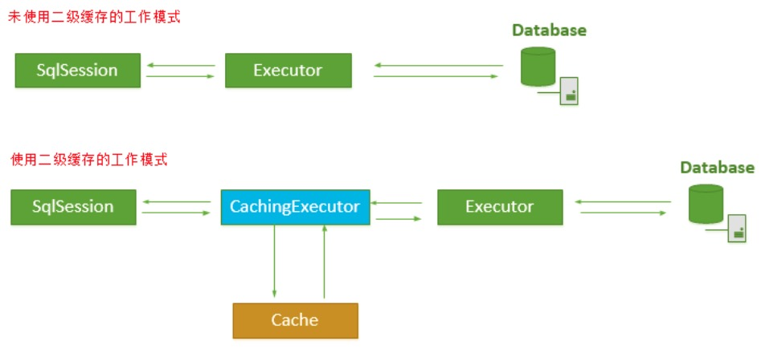
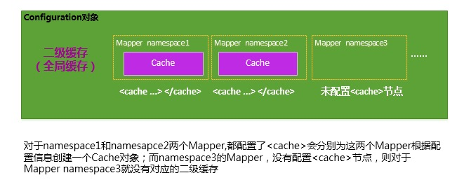
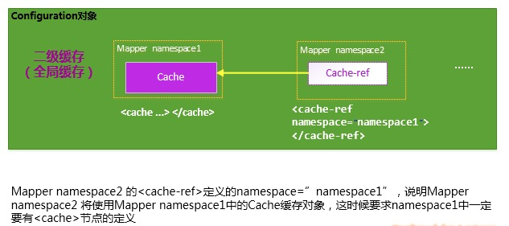

# MyBatis 缓存机制

# 1 概述

MyBatis 将数据缓存设计成两级结构：

- **一级缓存是 Session 会话级别的缓存**，位于表示一次数据库会话的 SqlSession 对象之中，又被称为本地缓存。一级缓存是 MyBatis 内部实现的一个特性，默认自动开启，用户无法将其关闭，也没有定制它的权利（不过这也不是绝对的：可以通过全局配置 `localCacheScope=STATEMENT` 将其作用范围缩小到单条语句，也可以通过开发插件对它进行修改）
- **二级缓存是 Application 应用级别的缓存**，它的生命周期很长，跟 Application 的生命周期一样，也就是说它的作用范围是整个 Application 应用



# 2 一级缓存

## 2.1 作用范围

每当我们使用 MyBatis 开启一次和数据库的会话，MyBatis 都会创建出一个 SqlSession 对象来表示这次数据库会话。

在一次数据库会话中，我们有可能反复地执行完全相同的查询语句。如果不采取一些措施，每一次查询都会访问一次数据库；而在极短的时间内做完全相同的查询，它们的结果极有可能完全相同，由于查询一次数据库的代价很大，这有可能造成很大的资源浪费。

为了解决这一问题，MyBatis 会在表示会话的 SqlSession 对象中建立一个简单的缓存，将每次查询到的结果缓存起来。下次查询的时候，如果判断先前有个完全一样的查询，就会直接从缓存中将结果取出，返回给用户，不需要再进行一次数据库查询了。



## 2.2 生命周期

- MyBatis 在开启一个数据库会话时，会创建一个新的 SqlSession 对象，SqlSession 对象中会有一个新的 Executor 对象，Executor 对象中持有一个新的 PerpetualCache 对象；当会话结束时，SqlSession 对象及其内部的 Executor 对象和 PerpetualCache 对象也一并释放
- 如果 SqlSession 调用了 `close()` 方法，会释放掉一级缓存 PerpetualCache 对象，一级缓存将不可用
- 如果 SqlSession 调用了 `clearCache()`，会清空 PerpetualCache 对象中的数据，但是该对象仍可使用
- SqlSession 中执行了任何一个更新操作（`update()`、`delete()`、`insert()`），都会清空 PerpetualCache 对象的数据，但是该对象可以继续使用



## 2.3 工作流程

1. 对于某个查询，根据 statementId、params、rowBounds 来构建一个 key 值，再根据这个 key 值去缓存 Cache 中取出对应的缓存结果
2. 判断从 Cache 中根据特定的 key 值取出的数据是否为空，即是否命中
3. 如果命中，则直接将缓存结果返回
4. 如果没命中：
   1. 去数据库中查询数据，得到查询结果
   2. 将 key 和查询到的结果作为 KV 对存储到 Cache 中
   3. 将查询结果返回
5. 结束



## 2.4 实现细节

实际上，SqlSession 只是 MyBatis 对外的一个接口，SqlSession 将它的工作交给了 Executor 执行器这个角色来完成，由它负责对数据库的各种操作。当创建了一个 SqlSession 对象时，MyBatis 会为这个 SqlSession 对象创建一个新的 Executor 执行器，而缓存信息就被维护在这个 Executor 执行器中，MyBatis 将缓存和对缓存相关的操作封装到了 Cache 接口中。

SqlSession、Executor、Cache 之间的关系如下列类图所示：



如上述类图所示，Executor 接口的实现类 BaseExecutor 中拥有一个 Cache 接口的实现类 PerpetualCache，对于 BaseExecutor 对象而言，它将使用 PerpetualCache 对象维护缓存。

SqlSession 对象、Executor 对象、Cache 对象之间的关系如下图所示：



PerpetualCache 的实现原理其实很简单，其内部就是通过一个简单的 `HashMap<K,V>` 来实现的，没有任何其他限制。如下是 PerpetualCache 的实现代码：

```java
public class PerpetualCache implements Cache {

  private String id;

  private Map<Object, Object> cache = new HashMap<Object, Object>();

  public PerpetualCache(String id) {
    this.id = id;
  }

  public String getId() {
    return id;
  }

  public int getSize() {
    return cache.size();
  }

  public void putObject(Object key, Object value) {
    cache.put(key, value);
  }

  public Object getObject(Object key) {
    return cache.get(key);
  }

  public Object removeObject(Object key) {
    return cache.remove(key);
  }

  public void clear() {
    cache.clear();
  }

  public ReadWriteLock getReadWriteLock() {
    return null;
  }

  public boolean equals(Object o) {
    if (getId() == null) throw new CacheException("Cache instances require an ID.");
    if (this == o) return true;
    if (!(o instanceof Cache)) return false;

    Cache otherCache = (Cache) o;
    return getId().equals(otherCache.getId());

  }

  public int hashCode() {
    if (getId() == null) throw new CacheException("Cache instances require an ID.");
    return getId().hashCode();
  }

}
```

Cache 将本次查询使用的特征值作为 key，将查询结果作为 value 存储到 Map 中，那么问题来了：怎样来确定一次查询的特征值？

MyBatis 认为，对于两次查询，如果以下条件都完全一样，那么就认为它们是完全相同的两次查询：

1. 传入的 statementId，它代表着你将执行什么样的 SQL
2. 查询时要求的结果集中的结果范围（结果的范围通过 `rowBounds.offset` 和 `rowBounds.limit` 表示）。MyBatis 自身提供的分页功能是通过 RowBounds 来实现的，它通过 `rowBounds.offset` 和 `rowBounds.limit` 来过滤查询出来的结果集，这种分页功能是基于查询结果的再过滤，而不是进行数据库的物理分页
3. 这次查询所产生的、最终要传递给 JDBC `java.sql.PreparedStatement` 的 SQL 语句字符串（`boundSql.getSql()`）
4. 传递给 `java.sql.Statement` 要设置的参数值

综上所述，CacheKey 由以下条件决定：

> 缓存 key = statementId + rowBounds + 传递给 JDBC 的 SQL + 传递给 JDBC 的参数值

CacheKey 的构建被放置到了 Executor 接口的实现类 BaseExecutor 中，定义如下：

```java
  /**
   * org.apache.ibatis.executor.BaseExecutor
   */
  public CacheKey createCacheKey(MappedStatement ms, Object parameterObject, RowBounds rowBounds, BoundSql boundSql) {
    if (closed) throw new ExecutorException("Executor was closed.");
    CacheKey cacheKey = new CacheKey();
    //1.statementId
    cacheKey.update(ms.getId());
    //2. rowBounds.offset
    cacheKey.update(rowBounds.getOffset());
    //3. rowBounds.limit
    cacheKey.update(rowBounds.getLimit());
    //4. SQL语句
    cacheKey.update(boundSql.getSql());
    //5. 将每一个要传递给JDBC的参数值也更新到CacheKey中
    List<ParameterMapping> parameterMappings = boundSql.getParameterMappings();
    TypeHandlerRegistry typeHandlerRegistry = ms.getConfiguration().getTypeHandlerRegistry();
    for (int i = 0; i < parameterMappings.size(); i++) { // mimic DefaultParameterHandler logic
      ParameterMapping parameterMapping = parameterMappings.get(i);
      if (parameterMapping.getMode() != ParameterMode.OUT) {
        Object value;
        String propertyName = parameterMapping.getProperty();
        if (boundSql.hasAdditionalParameter(propertyName)) {
          value = boundSql.getAdditionalParameter(propertyName);
        } else if (parameterObject == null) {
          value = null;
        } else if (typeHandlerRegistry.hasTypeHandler(parameterObject.getClass())) {
          value = parameterObject;
        } else {
          MetaObject metaObject = configuration.newMetaObject(parameterObject);
          value = metaObject.getValue(propertyName);
        }
        //将每一个要传递给JDBC的参数值也更新到CacheKey中
        cacheKey.update(value);
      }
    }
    return cacheKey;
  }    
```

刚才已经提到，Cache 接口的实现本质上使用的是 `HashMap<K,V>`，而构建 CacheKey 的目的就是作为 `HashMap<K,V>` 中的 key 值。HashMap 是通过 key 值的 hashCode 来组织和存储的，那么，构建 CacheKey 的过程实际上就是构造其 hashCode 的过程。下面的代码就是 CacheKey 的核心 hashCode 生成算法：

```java
  public void update(Object object) {
    if (object != null && object.getClass().isArray()) {
      int length = Array.getLength(object);
      for (int i = 0; i < length; i++) {
        Object element = Array.get(object, i);
        doUpdate(element);
      }
    } else {
      doUpdate(object);
    }
  }
 
  private void doUpdate(Object object) {
	
	  //1. 得到对象的hashcode;  
    int baseHashCode = object == null ? 1 : object.hashCode();
    //对象计数递增
    count++;
    checksum += baseHashCode;
    //2. 对象的hashcode 扩大count倍
    baseHashCode *= count;
    //3. hashCode * 拓展因子（默认37）+拓展扩大后的对象hashCode值
    hashcode = multiplier * hashcode + baseHashCode;
    updateList.add(object);
  }
```

## 2.5 性能分析

MyBatis 并没有对 HashMap 的容量和大小进行限制，难道不会有隐患吗？如果一直使用某一个 SqlSession 对象查询数据，会不会导致 HashMap 太大，进而导致 OutOfMemoryError 错误？

MyBatis 这样设计也有它自己的理由：

- 一般而言 SqlSession 的生存时间很短，使用一个 SqlSession 对象执行的操作不会太多，执行完就会消亡
- 对于某一个 SqlSession 对象而言，只要执行更新操作（update、insert、delete），都会将这个 SqlSession 对象中对应的一级缓存清空，所以一般情况下不会出现缓存过大、影响 JVM 内存空间的问题
- 可以手动地释放掉 SqlSession 对象中的缓存

还有个问题，一级缓存是一种粗粒度的缓存，没有更新缓存和缓存过期的概念。MyBatis 只负责将查询数据库的结果存储到缓存中去，不会去判断缓存存放的时间是否过长、是否过期，因此也就没有对缓存的结果进行更新这一说了。

根据一级缓存的特性，在使用的过程中应该注意：

- 对于数据变化频率很高、并且对时效准确性要求高的数据，使用 SqlSession 查询时要控制好 SqlSession 的生存时间。SqlSession 的生存时间越长，其中缓存的数据就可能越旧，从而造成和真实数据库的误差；对于这种情况，用户也可以适时地手动清空 SqlSession 中的缓存
- 对于只执行、并且频繁执行大范围 select 操作的 SqlSession 对象，其生存时间不应过长

# 3 二级缓存

## 3.1 作用范围

MyBatis 的二级缓存是 Application 级别的缓存，它可以提高数据库查询的效率，从而提高应用的性能。

一个 SqlSession 对象会使用一个 Executor 对象来完成会话操作，MyBatis 二级缓存机制的关键就是在这个 Executor 对象上做文章。如果开启了 `cacheEnabled=true`（默认值即为 true），MyBatis 在为 SqlSession 对象创建 Executor 对象时，会为 Executor 对象加上一个装饰者 CachingExecutor，这时 SqlSession 使用 CachingExecutor 对象来完成操作请求。对于查询请求，CachingExecutor 会先判断该查询请求在 Application 级别的二级缓存中是否有缓存结果，如果有，则直接返回缓存结果；如果缓存中没有，再交给真正的 Executor 对象来完成查询操作，之后 CachingExecutor 会将真正 Executor 返回的查询结果放置到缓存中，然后再返回给用户。



## 3.2 配置方式

MyBatis 并不是简单地让整个 Application 只有一个 Cache 缓存对象，它将缓存划分得更细，即 Mapper 级别的。

对于每一个 Mapper.xml，如果在其中使用了 `<cache>` 节点，则 MyBatis 会为这个 Mapper 创建一个 Cache 缓存对象，如下图所示：



如果想让多个 Mapper 共用一个 Cache，可以使用 `<cache-ref namespace="">` 节点，来指定这个 Mapper 使用哪一个 Mapper 的 Cache 缓存：



MyBatis 对二级缓存的支持粒度很细，它可以指定某一条查询语句是否使用二级缓存。

虽然在 Mapper 中配置了 `<cache>`，并且为此 Mapper 分配了 Cache 对象，但这并不表示使用 Mapper 中定义的查询语句查到的结果都会放置到 Cache 对象之中，还取决于每条语句的 `useCache` 属性：只有 `<select>` 节点的 `useCache="true"` 时（`<select>` 语句默认即为 true），Mapper 才会对此 select 查询支持缓存特性；设置为 false 则该查询不使用二级缓存，如下所示：

```xml
<select id="selectByMinSalary" resultMap="BaseResultMap" parameterType="java.util.Map" useCache="true">
```

总之，要想使某条 select 查询支持二级缓存，需要保证：

1. MyBatis 支持二级缓存的总开关：全局配置变量参数 `cacheEnabled=true`
2. 该 select 语句所在的 Mapper 配置了 `<cache>` 或 `<cache-ref>` 节点，并且有效
3. 该 select 语句的参数 `useCache="true"`

## 3.3 缓存策略

MyBatis 对二级缓存的设计非常灵活，它在内部实现了一系列的 Cache 缓存实现类，并提供了 LRU、FIFO 等各种缓存刷新策略；另外，MyBatis 还允许用户自定义 Cache 接口实现，用户需要实现 `org.apache.ibatis.cache.Cache` 接口，然后将 Cache 实现类配置在 `<cache type="">` 节点的 type 属性上即可。

每个 Cache 都有一个容量限制，MyBatis 提供了各种策略来对 Cache 缓存的容量进行控制，以及对 Cache 中的数据进行刷新和置换。MyBatis 主要提供了以下几个刷新和置换策略：

- **LRU**（Least Recently Used）：最近最少使用算法，即如果缓存中容量已经满了，会将缓存中最近最少被使用的缓存记录清除掉，然后添加新的记录（默认策略）
- **FIFO**（First In First Out）：先进先出算法，如果缓存中的容量已经满了，那么会将最先进入缓存中的数据清除掉
- **Scheduled**：指定时间间隔清空算法，该算法会以指定的某一个时间间隔将 Cache 缓存中的数据清空（对应 `<cache>` 的 `flushInterval` 属性）

此外，MyBatis 还提供了基于 Java 引用类型的 SOFT（软引用）和 WEAK（弱引用）淘汰策略。
