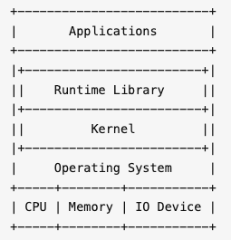
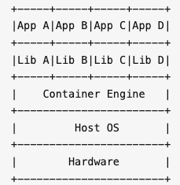
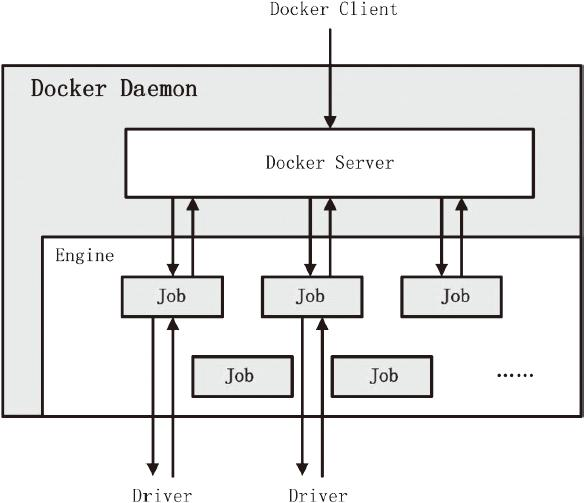
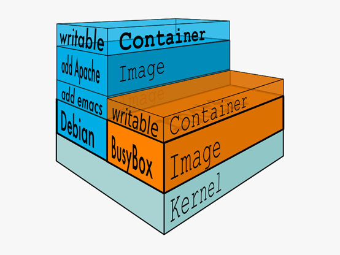
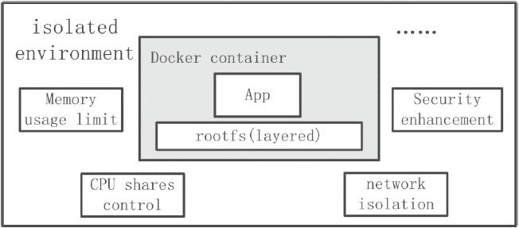

# Docker

# 1 Docker 是什么

**Docker**（英文本意是指码头工人）是一个开源的容器引擎，诞生于 2013 年初，最初是 *dotCloud* 公司（后由于 Docker 开源后大受欢迎，公司改名为 *Docker Inc.*）内部的一个项目，dotCloud 本身提供的是 PaaS（Platform as a Service）服务。它基于 Google 公司的 Go 语言实现，后来加入了 Linux 基金会，遵从 Apache 2.0 协议。

Docker 本质上是宿主机上的一个进程，通过 **namespace** 实现资源隔离，通过 **cgroup** 实现资源限制，通过**写时复制技术**（copy-on-write）实现了高效的文件操作。由于被隔离的 Docker 进程独立于宿主机和其他被隔离的进程，因此也称其为**容器**。最初实现是基于 **LXC**（Linux Container），从 0.9 版本开始默认使用自行开发的 libcontainer 取代 LXC，从 1.11 开始，则进一步演进为使用 **runC** 和 **containerd**。

Docker 的核心理念是：

> Build, Ship and Run Any App, Anywhere

即通过对应用组件的封装（Packaging）、分发（Distribution）、部署（Deployment）、运行（Runtime）等生命周期的管理，达到应用组件级别的“**一次封装，到处运行**”。这里的应用组件，既可以是一个 Web 应用，也可以是一套数据库服务，甚至是一个操作系统。将应用运行在 Docker 容器上，可以实现跨平台、跨服务器，只需一次配置准备好相关的应用环境，即可实现到处运行，保证研发和生产环境的一致性，解决了应用和运行环境的兼容性问题，从而极大提升了部署效率，减少故障的可能性。

Docker 实际上就相当于一个封闭的沙盒或者是集装箱，它可以把不同的应用全都放在它的集装箱里面，并且以后有需要的时候，可以直接把集装箱搬到其他平台或者服务器上，实现容器虚拟化技术，随用随搬。

再通俗点说，我们使用 Docker，只需要配置一次 Docker 容器上面的应用，就可以跨平台、跨服务器，实现应用程序跨平台间的无缝衔接。

# 2 Docker 的设计哲学

**Docker 的思想来自于集装箱**。

集装箱解决了什么问题呢？答案是货物的标准化。

各种各样的货物被打包进集装箱，集装箱和集装箱之间不会互相影响。如此一来，我们就不需要专门运送水果的船和专门运送化学品的船了。只要这些货物在集装箱里封装得好好的，就可以用一艘大船把它们都运走。

现在云计算大行于世，云计算就好比大货轮，而 Docker 就是集装箱。

要解释清楚 Docker，首先要解释清楚**容器**（Container）的概念。要解释容器的话，需要从操作系统说起。

操作系统就是管理计算机硬件与软件资源，并且为软件运行提供通用服务的系统软件。硬件、操作系统、应用程序之间的关系可以简单地用下图表示：

随着硬件的性能提升以及软件种类的丰富，有两种情况变得很常见：

1. **硬件性能过剩**：很多计算机的硬件配置，即使不能完全满足峰值性能的要求，也往往会有大量时间处于硬件资源闲置的状态。例如一般家用电脑，已经普遍是六核、八核甚至更多核心的配置了，除了 3A 游戏、视频制作、3D 渲染、高性能计算等特殊应用外，通常有 90% 以上的时间 CPU 是闲置的。
2. **软件冲突**：因为业务需要，两个或者多个软件之间冲突，或者需要同一个软件的不同版本。例如早年做 Web 前端的，要测试网页在不同版本的 IE 上是否能正常显示，然而 Windows 只能装一个版本的 IE。

为了解决软件冲突，只能配置多台计算机，或者很麻烦地在同一台电脑上安装多个操作系统，通过重启来进行切换。显然这两个方案都有其缺点：多台计算机成本太高，多操作系统的安装、切换都很麻烦。在硬件性能过剩的时候，硬件虚拟化的普及就自然而然地被提了出来。

所谓**硬件虚拟化**，就是借助某个特殊的软件，仿真出一台或者多台计算机的各种硬件，用户可以在这一台虚拟机上安装、运行操作系统和各种应用。对于上面的应用程序来说，这台虚拟机和普通的物理计算机是完全一样、没有任何区别的——除了性能可能差一点。虚拟机技术的代表有 **VMware**、**VirtualBox**、**KVM** 等，**OpenStack** 则是基于这些虚拟化技术构建的云计算管理平台。

虚拟机的一个缺点在于 Guest OS 通常会占用不少硬件资源。例如 Windows 安装后开机不运行任何应用，就需要占用数 GB 内存、数十 GB 硬盘空间。即使是没有图形界面的 Linux，根据发行版以及安装软件的不同也会占用 100 MB～1 GB 内存、1～4 GB 硬盘空间。而且为了应用系统运行的性能，往往还要给每台虚拟机留出更多的内存容量。

通常来说，其中相当大部分甚至全部 Guest OS 都是相同的。能不能让所有的应用使用同一个操作系统以减少硬件资源的浪费，但是又能避免包括运行库在内的软件冲突呢？**操作系统层虚拟化**——容器概念的提出，就是为了解决这个问题。在 Linux 上可以通过命名空间（namespace）和**控制组**（Control Group，通常简写为 **cgroup**）实现隔离与资源限制，并把应用和运行库打包在一起，来实现这个目的。

**虚拟机是硬件层面的隔离，而容器是 App 层面的隔离**。

上图中，每一个 App 和 Lib 的组合，就是一个容器，也就是 Docker 图标里面的一个集装箱。和虚拟机相比，容器有以下优点：

- **迅速启动**：没有虚拟机硬件的初始化，没有 Guest OS 的启动过程，可以节约很多启动时间，这就是容器的“开箱即用”。
- **占用资源少**：没有运行 Guest OS 所需的内存开销，无须为虚拟机预留运行内存，无须安装、运行 App 不需要的运行库/操作系统服务，内存占用、存储空间占用都小得多。相同配置的服务器，如果运行虚拟机只能运行十多台，那么运行上百个容器通常毫无压力——当然前提是单个容器应用本身不会消耗太多资源。

Docker 把 App 和 Lib 的文件打包成为一个**镜像**，并且采用类似多次快照的存储技术，优势如下：

1. 多个 App 可以共用相同的底层镜像（初始的操作系统镜像）
2. App 运行时的 I/O 操作和镜像文件隔离
3. 通过挂载包含不同配置/数据文件的目录或者卷（Volume），单个 App 镜像可以同时用来运行无数个不同业务的容器

上图是基于一个 Alpine Linux 的镜像，分别建立了 Nginx 和 MySQL 的镜像，并且挂载不同的配置/数据，同时运行 3 个网站应用和 3 个数据库应用的示意图。

此外，Docker 公司提供了公共的**镜像仓库**（即 Docker Hub，其中的每个镜像仓库在 Docker 中称为 **Repository**），支持关联 GitHub 自动构建镜像，大大简化了应用分发、部署、升级流程。加上 Docker 可以非常方便地建立各种自定义的镜像文件，这些都是 Docker 成为最流行的容器技术的重要因素。

通过以上这些技术的组合，最后的结果就是，绝大部分应用，开发者都可以通过 `docker build` 创建镜像，通过 `docker push` 上传镜像，用户通过 `docker pull` 下载镜像，用 `docker run` 运行应用。用户不需要再去关心如何搭建环境、如何安装、如何解决不同发行版的库冲突——而且通常不会消耗更多的硬件资源，不会明显降低性能。这就是上文将 Docker 类比为集装箱的原因所在。

# 3 Docker 的优势

作为一种轻量级的虚拟化方式，Docker 跟传统的虚拟化方式相比具有众多的优势。

## 3.1 更高效地利用系统资源

由于容器不需要进行硬件虚拟以及运行完整操作系统等额外开销，Docker 对系统资源的利用率更高。无论是应用执行速度、内存损耗还是文件存储速度，都要比传统虚拟机技术更高效。因此，相比虚拟机技术，一个相同配置的主机，往往可以运行更多数量的应用。

## 3.2 更快速的启动时间

传统的虚拟机技术启动应用服务往往需要数分钟，而 Docker 容器应用，由于直接运行于宿主内核，无须启动完整的操作系统，因此可以做到秒级、甚至毫秒级的启动时间，大大节约了开发、测试、部署的时间。

## 3.3 一致的运行环境

开发过程中一个常见的问题是环境一致性问题。由于开发环境、测试环境、生产环境不一致，导致有些 bug 并未在开发过程中被发现。而 Docker 的镜像提供了除内核外完整的运行时环境，确保了应用运行环境的一致性，从而不会再出现“这段代码在我机器上没问题啊”这类问题。

## 3.4 持续交付和部署

对开发和运维（DevOps）人员来说，最希望的就是一次创建或配置，可以在任意地方正常运行。

使用 Docker 可以通过定制应用镜像来实现持续集成、持续交付、部署。开发人员可以通过 Dockerfile 来进行镜像构建，并结合持续集成（Continuous Integration）系统进行集成测试，而运维人员则可以直接在生产环境中快速部署该镜像，甚至结合持续交付/部署（Continuous Delivery/Deployment）系统进行自动部署。

而且使用 Dockerfile 使镜像构建透明化，不仅开发团队可以理解应用运行环境，也方便运维团队理解应用运行所需条件，有助于更好地在生产环境中部署该镜像。

## 3.5 更轻松的迁移

由于 Docker 确保了执行环境的一致性，使得应用的迁移更加容易。Docker 可以在很多平台上运行，无论是物理机、虚拟机、公有云、私有云，甚至是笔记本，其运行结果是一致的。因此用户可以很轻易地将在一个平台上运行的应用，迁移到另一个平台上，而不用担心运行环境的变化导致应用无法正常运行。

## 3.6 更轻松的维护和扩展

Docker 使用的分层存储以及镜像的技术，使得应用重复部分的复用更为容易，也使得应用的维护更新更加简单，基于基础镜像进一步扩展镜像也变得非常简单。此外，Docker 团队同各个开源项目团队一起维护了一大批高质量的官方镜像，既可以直接在生产环境使用，又可以作为基础进一步定制，大大降低了应用服务的镜像制作成本。

# 4 架构原理

## 4.1 C/S 架构

由上图可知，**Docker 使用 C/S 架构模式**，核心组件如下：

- **Client**：提供用户跟 Docker 交互的入口，可以通过 Client 向 Docker 发送各种 API 请求
- **Docker Daemon**：用于监听并处理 Docker Client 发送的 API 请求，并且管理 Docker 镜像（Image）、容器（Container）以及文件结构，同时也用于跟其他 Docker Daemon 进行交互
- **Registry**：存储镜像的仓库。Docker Hub 是一个公共仓库，类似于 Maven 的中央仓库，默认情况下 Docker 会从该公共仓库获取镜像。当然 Docker 也可以像 Maven 一样有自己的私有 Registry
- **Images**：定义 Docker 容器执行指令的模板。可以把 Docker Image 比作 Java 的类，把 Docker Container 比作 Java 的对象，Docker 的镜像通常都是在另一个 Image 基础上构建的
- **Containers**：Docker 镜像的运行实例，用户可以通过 Docker API 对 Docker 容器进行 `start/stop/create/move/delete` 等操作

## 4.2 客户端

Docker 提供了一个命令行工具 docker 以及一整套 RESTful API。我们日常使用各种 docker 命令，其实就是在使用客户端工具与 Docker 引擎进行交互。

## 4.3 服务端

Docker Daemon 是 Docker 架构中一个常驻在后台的系统进程。所谓的“运行 Docker”，即代表运行 Docker Daemon。Docker Daemon 的作用主要有以下两方面：

- 接收并处理 Docker Client 发送的请求
- 管理所有的 Docker 容器

Docker Daemon 运行时，会在后台启动一个 Server，Server 负责接收 Docker Client 发送的请求；接收请求后，Server 通过路由与分发调度，找到相应的 Handler 来处理请求。

Engine 是 Docker 架构中的运行引擎，同时也是 Docker 运行的核心模块。Engine 存储着大量的容器信息，同时管理着 Docker 大部分 Job 的执行。换言之，Docker 中大部分任务的执行都需要 Engine 协助，并通过 Engine 匹配相应的 Job 完成 Job 的执行。

**Job 可以认为是 Docker 架构中 Engine 内部最基本的工作执行单元**。Docker Daemon 可以完成的每一项工作都会呈现为一个 Job。例如，在 Docker 容器内部运行一个进程，这是一个 Job；创建一个新的容器，这是一个 Job；在网络上下载一个文档，这是一个 Job；包括之前在 Docker Server 部分谈及的，创建 Server 服务于 HTTP 协议的 API，这也是一个 Job，等等。

注意，上述 Engine 与 Job 的描述基于早期 Docker（1.x）的架构，后续版本中 Job 机制已被重构移除。当前的 Docker Daemon（dockerd）通过 containerd、containerd-shim 和 runc 来管理容器的生命周期。

## 4.4 注册中心

Docker Registry 是一个存储容器镜像（Docker Image）的仓库。容器镜像是容器创建时用来初始化容器 rootfs 的文件系统内容。Docker Registry 将大量的容器镜像汇集在一起，并为分散的 Docker Daemon 提供镜像服务。

Docker 的运行过程中，有三种情况可能与 Docker Registry 通信，分别为**搜索镜像**、**下载镜像**、**上传镜像**。这三种情况所对应的 Job 名称分别为 `search`、`pull` 和 `push`。

不同场景下，Docker Daemon 可以使用不同的 Docker Registry。公有 Registry 与私有 Registry 就是两种场景模式不同的 Docker Registry。其中，大家熟知的 Docker Hub，就是全球范围内最大的公有 Registry。Docker 可以通过互联网访问 Docker Hub，并下载容器镜像；同时 Docker 也允许用户构建本地私有 Registry，使容器镜像的获取在内网完成。

通常，一个仓库会包含同一个软件不同版本的镜像，而标签对应该软件的各个版本。我们可以通过 `<仓库名>:<标签>` 的格式来指定具体是这个软件哪个版本的镜像。如果不给出标签，将以 latest 作为默认标签。

## 4.5 镜像

镜像，即创建容器的模板，含有启动容器所需要的文件系统及其他内容。

Docker 把 App 文件打包成为一个镜像，并且采用类似多次快照的存储技术，可以实现：

- 多个 App 可以共用相同的底层镜像（初始的操作系统镜像）
- App 运行时的 I/O 操作和镜像文件隔离
- 通过挂载包含不同配置/数据文件的目录或者卷（Volume），单个 App 镜像可以用来运行多个不同业务的容器

### 4.5.1 镜像分层

Docker 镜像包含一层层的文件系统，叫作 **Union FS**（联合文件系统），联合文件系统可以将几层目录挂载到一起，就像俄罗斯套娃一样，形成一个虚拟文件系统。虚拟文件系统的目录结构就像普通 Linux 的目录结构一样，镜像通过这些文件再加上宿主机的内核共同提供了一个 Linux 的虚拟环境。

**镜像中每一层文件系统都是只读的**。构建镜像的时候，从一个最基本的操作系统开始，每个构建提交的操作都相当于做一层修改，增加了一层文件系统，一层层往上叠加，上层的修改会覆盖底层该位置的可见性。这也很容易理解，就像上层把底层遮住了一样，当使用镜像的时候，我们只会看到一个完整的整体，不知道里面有几层，也不需要知道里面有几层，结构如下：

镜像分层最大的一个好处就是共享资源。比如说有多个镜像都从相同的 base 镜像构建而来，那么 Docker Host 只需在磁盘上保存一份 base 镜像；同时内存中也只需加载一份 base 镜像，就可以为所有容器服务了。而且镜像的每一层都可以被共享。

### 4.5.2 容器层

当容器启动时，一个新的可写层被加载到镜像的顶部。这一层通常被称作“容器层”，“容器层”之下的都叫“镜像层”。

所有对容器的改动——无论添加、删除、还是修改文件都只会发生在容器层中。**只有容器层是可写的，容器层下面的所有镜像层都是只读的**。

镜像层数量可能会很多，所有镜像层会联合在一起组成一个统一的文件系统。如果不同层中有一个相同路径的文件，比如 /a，上层的 /a 会覆盖下层的 /a，也就是说用户只能访问到上层中的文件 /a。在容器层中，用户看到的是一个叠加之后的文件系统。

如果多个容器共享一份基础镜像，当某个容器修改了基础镜像的内容，比如 `/etc` 下的文件，这时其他容器的 `/etc` 是不会被修改的，修改只会被限制在单个容器内。这就是容器 Copy-on-Write 特性。可见，**容器层保存的是镜像变化的部分**，不会对镜像本身进行任何修改。

### 4.5.3 Dockerfile

Dockerfile 是一个用来构建镜像的文本文件，由一条条指令组成，其中 RUN 等指令执行的就是 Linux 下的 Shell 命令。Dockerfile 有自己的书写方式和支持的指令，Docker 程序读取 Dockerfile 并根据指令生成 Docker 镜像。相比手动制作镜像的方式，Dockerfile 更能直观地展示镜像是怎么产生的。有了 Dockerfile，当后期有额外的需求时，只要在之前的 Dockerfile 中添加或者修改相应的指令即可重新生成新的 Docker 镜像，避免了重复手动制作镜像的麻烦。它就像 Shell 脚本一样，可以方便高效地制作镜像。

## 4.6 容器

Docker Container（Docker 容器）是 Docker 架构中**服务交付的最终体现形式**。Docker 通过 Docker Daemon 的管理、libcontainer（新版本中为 runc）的执行，最终创建 Docker 容器。Docker 容器作为一个交付单位，功能类似于传统意义上的虚拟机（Virtual Machine），具备资源受限、环境与外界隔离的特点。然而，实现手段却与 KVM、Xen 等传统虚拟化技术大相径庭。

Docker 容器的从无到有，涉及 Docker 利用到的很多技术。总而言之，用户可以根据自己的需求，通过 Docker Client 向 Docker Daemon 发送容器的创建与启动请求，请求中将携带容器的配置信息，从而达到定制相应 Docker 容器的目的。用户对 Docker 容器的配置有以下 4 个基本方面：

- 通过指定容器镜像，使得 Docker 容器可以自定义 rootfs 等文件系统
- 通过指定物理资源的配额，如 CPU、内存等，使得 Docker 容器使用受限的物理资源
- 通过配置容器网络及其安全策略，使得 Docker 容器拥有独立且安全的网络环境
- 通过指定容器的运行命令，使得 Docker 容器执行指定的任务

实际上我们的容器就好像是一个简易版的操作系统，只不过系统中只安装了我们的程序运行所需要的环境。容器是可以删除的，那如果删除了，容器中的程序产生的需要持久化的数据怎么办呢？容器运行的时候我们可以进容器去查看，容器一旦删除就什么都没有了。

**数据卷**就是用来解决这个问题的，它用来将数据持久化到我们的宿主机上，并与容器间实现数据共享。简单地说，就是将宿主机的目录映射到容器中的目录，应用程序在容器中的目录读写数据会同步到宿主机上，这样容器产生的数据就可以持久化了。比如我们的数据库容器，就可以把数据存储到宿主机上的真实磁盘中。
