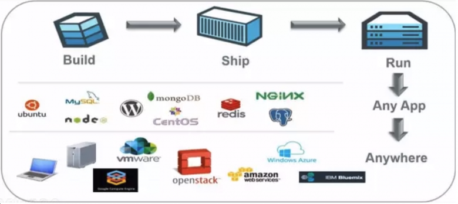
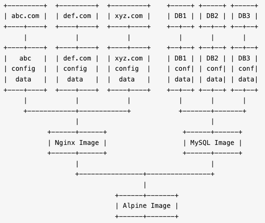
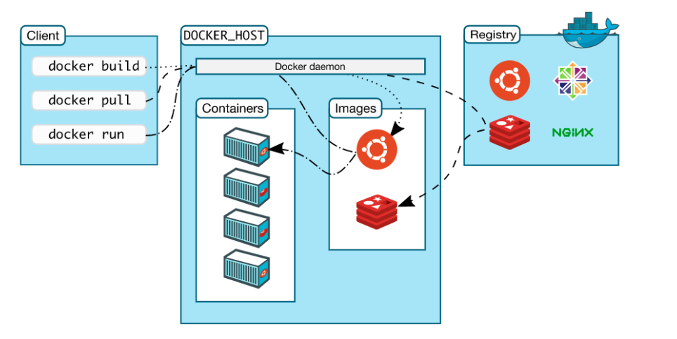
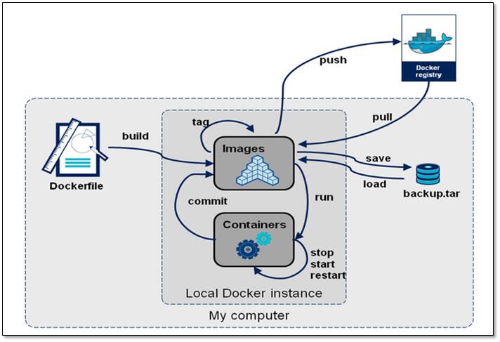

# 1、Docker是什么

**Docker** （英文本意是指码头工人）是一个开源的容器引擎，诞生于 2013 年初，最初是 *dotCloud* 公司（后由于 Docker 开源后大受欢迎就将公司改名为 *Docker Inc* ）内部的一个开源的 PAAS 服务 (Platform as a ServiceService )。它基于 Google 公司的 Go 语言实现，后来加入了 Linux 基金会，遵从 Apache 2.0 协议。

Docker本质上是宿主机上的一个进程，通过**namespace**实现资源隔离，通过**cgroup**实现资源限制，通过**写时复制技术**（copy-on-write）实现了高效的文件操作。由于隔离Docker的进程独立于宿主和其它的隔离的进程，因此也称其为**容器**。最初实现是基于 **LXC**（Linux Container），从 0.7 版本以后开始去除 LXC，转而使用自行开发的 libcontainer，从 1.11 开始，则进一步演进为使用 **runC** 和 **containerd**。

Docker的核心理念是：

> Build, Ship and Run Any App, Anywhere

即通过对应用组件的封装（Packaging）、分发（Distribution）、部署（Deployment）、运行（Runtime）等生命周期的管理，达到应用组件级别的“**一次封装，到处运行**”。这里的应用组件，既可以是一个Web应用，也可以是一套数据库服务，甚至是一个操作系统。将应用运行在Docker 容器上，可以实现跨平台，跨服务器，只需一次配置准备好相关的应用环境，即可实现到处运行，保证研发和生产环境的一致性，解决了应用和运行环境的兼容性问题，从而极大提升了部署效率，减少故障的可能性。

Docker实际上就相当于一个封闭的沙盒或者是集装箱，它可以把不同的应用全都放在它的集装箱里面，并且以后有需要的时候，可以直接把集装箱搬到其他平台或者服务器上，实现容器虚拟化技术，随用随搬。

再通俗点说，我们使用Docker，只需要配置一次Docker容器上面的应用，就可以跨平台，跨服务器，实现应用程序跨平台间的无缝衔接。

# 2、Docker的设计哲学

**Docker的思想来自于集装箱**。

集装箱解决了什么问题呢？答案是货物的标准化。

各种各样的货物被打包进集装箱，集装箱和集装箱之间不会互相影响。如此一来，我们就不需要专门运送水果的船和专门运送化学品的船了。只要这些货物在集装箱里封装的好好的，就可以用一艘大船把它们都运走。

现在云计算大行于世，云计算就好比大货轮，而Docker就是集装箱。

要解释清楚Docker，首先要说解释清楚**容器**（Container）的概念。要解释容器的话，需要从操作系统说起。

操作系统就是管理计算机的硬件软件和资源，并且为软件运行提供通用服务的系统软件。硬件、操作系统、应用程序之间的关系可以简单的用下图表示：

随着硬件的性能提升以及软件种类的丰富，有两种情况变得很常见：

1. **硬件性能过剩**：很多计算机的硬件配置，即使不能完全满足峰值性能的要求，也往往会有大量时间处于硬件资源闲置的状态。例如一般家用电脑，已经是四核、六核的配置了，除了3A游戏、视频制作、3D渲染、高性能计算等特殊应用外，通常有90%以上时间CPU是闲置的。
2. **软件冲突**：因为业务需要，两个或者多个软件之间冲突，或者需要同一个软件的不同版本。例如早几年做web前端的，要测试网页在不同版本的IE上是否能正常显示，然而Windows只能装一个版本的IE。

为了解决软件冲突，只能配置多台计算机，或者很麻烦的在同一台电脑上安装多个操作系统，通过重启来进行切换。显然这两个方案都有其缺点：多台计算机成本太高，多操作系统的安装、切换都很麻烦。在硬件性能过剩的时候，硬件虚拟化的普及就很自然而然的提出来了。

所谓**硬件虚拟化**，就是借助某个特殊的软件，仿真出一台或者多台计算机的各种硬件，用户可以在这一台虚拟机上安装、运行操作系统和各种应用。对于上面的应用程序来说，这台虚拟机和普通的物理计算机是完全一样没有任何区别的——除了性能可能差一点。虚拟机技术的代表，就是**VMWare**和**OpenStack**。

虚拟机的一个缺点在于Guest OS通常会占用不少硬件资源。例如Windows安装开机不运行任何运用，就需要占用2 ~ 3G内存，20 ~ 30G硬盘空间。即使是没有图形界面的Linux，根据发行版以及安装软件的不同也会占用100M ~ 1G内存，1G ~ 4G硬盘空间。而且为了应用系统运行的性能，往往还要给每台虚拟机留出更多的内存容量。

通常来说，其中相当大部分甚至全部Guest OS都是相同的。能不能所有的应用使用同一个的操作系统减少硬件资源的浪费，但是又能避免包括运行库运行库在内的软件冲突呢？**操作系统层虚拟化**——容器概念的提出，就是为了解决这个问题。在Linux可以通过**控制组**（Control Group，通常简写为**cgroup**）隔离，并把应用和运行库打包在一起，来实现这个目的。

**虚拟机是硬件层面的隔离，而容器是APP层面的隔离**。

上图中，每一个App和Lib的组合，就是一个容器，也就是Docker图标里面的一个集装箱。和虚拟机相比，容器有以下优点：

* **迅速启动**：没有虚拟机硬件的初始化，没有Guest OS的启动过程，可以节约很多启动时间，这就是容器的“开箱即用”。
* **占用资源少**：没有运行Guest OS所需的内存开销，无需为虚拟机预留运行内存，无需安装、运行App不需要的运行库/操作系统服务，内存占用、存储空间占用都小的多。相同配置的服务器，如果运行虚拟机只能运行十多台的，通常可以运行上百个容器毫无压力——当然前提是单个容器应用本身不会消耗太多资源。

Docker把App和Lib的文件打包成为一个**镜像**，并且采用类似多次快照的存储技术，优势如下：

1. 多个App可以共用相同的底层镜像（初始的操作系统镜像）
2. App运行时的IO操作和镜像文件隔离
3. 通过挂载包含不同配置/数据文件的目录或者卷（Volume），单个App镜像可以同时用来运行无数个不同业务的容器。

上图是基于一个Alpine Linux的镜像，分别建立了Nginx和MySQL的镜像，并且挂载不同的配置/数据同时运行3个网站应用3个数据库应用的示意图。

此外，Docker公司提供公共的**镜像仓库**（Docker称之为**Repository**），Github connect，自动构建镜像，大大简化了应用分发、部署、升级流程。加上Docker可以非常方便的建立各种自定义的镜像文件，这些都是Docker成为最流行的容器技术的重要因素。

通过以上这些技术的组合，最后的结果就是，绝大部分应用，开发者都可以通过`docker build`创建镜像，通过`docker push`上传镜像，用户通过`docker pull`下载镜像，用`docker run`运行应用。用户不需要再去关心如何搭建环境，如何安装，如何解决不同发行版的库冲突——而且通常不会需要消耗更多的硬件资源，不会明显降低性能。这就是上文将Docker类比为集装箱的原因所在。

# 3、Docker的优势

作为一种新兴的虚拟化方式，Docker 跟传统的虚拟化方式相比具有众多的优势。

## （1）更高效的利用系统资源。

由于容器不需要进行硬件虚拟以及运行完整操作系统等额外开销，Docker 对系统资源的利用率更高。无论是应用执行速度、内存损耗或者文件存储速度，都要比传统虚拟机技术更高效。因此，相比虚拟机技术，一个相同配置的主机，往往可以运行更多数量的应用。

## （2）更快速的启动时间

传统的虚拟机技术启动应用服务往往需要数分钟，而 Docker 容器应用，由于直接运行于宿主内核，无需启动完整的操作系统，因此可以做到秒级、甚至毫秒级的启动时间。大大的节约了开发、测试、部署的时间。

## （3）一致的运行环境

开发过程中一个常见的问题是环境一致性问题。由于开发环境、测试环境、生产环境不一致，导致有些 bug 并未在开发过程中被发现。而 Docker 的镜像提供了除内核外完整的运行时环境，确保了应用运行环境一致性，从而不会再出现 「这段代码在我机器上没问题啊」 这类问题。

## （4）持续交付和部署

对开发和运维（DevOps）人员来说，最希望的就是一次创建或配置，可以在任意地方正常运行。

使用 Docker 可以通过定制应用镜像来实现持续集成、持续交付、部署。开发人员可以通过 Dockerfile 来进行镜像构建，并结合 持续集成(Continuous Integration) 系统进行集成测试，而运维人员则可以直接在生产环境中快速部署该镜像，甚至结合 持续部署(Continuous Delivery/Deployment) 系统进行自动部署。

而且使用 Dockerfile 使镜像构建透明化，不仅仅开发团队可以理解应用运行环境，也方便运维团队理解应用运行所需条件，帮助更好的生产环境中部署该镜像。

## （5）更轻松的迁移

由于 Docker 确保了执行环境的一致性，使得应用的迁移更加容易。Docker 可以在很多平台上运行，无论是物理机、虚拟机、公有云、私有云，甚至是笔记本，其运行结果是一致的。因此用户可以很轻易的将在一个平台上运行的应用，迁移到另一个平台上，而不用担心运行环境的变化导致应用无法正常运行的情况。

## （6）更轻松的维护和扩展

Docker 使用的分层存储以及镜像的技术，使得应用重复部分的复用更为容易，也使得应用的维护更新更加简单，基于基础镜像进一步扩展镜像也变得非常简单。此外，Docker 团队同各个开源项目团队一起维护了一大批高质量的 官方镜像，既可以直接在生产环境使用，又可以作为基础进一步定制，大大的降低了应用服务的镜像制作成本。

# 4、架构原理

## 4.1 C/S架构

由上图可知，**Docker 使用C/S架构模式**， 核心组件如下：

* **Client**：提供用户跟Docker交互的入口，可以通过client跟docker发送各种API
* **Docker Deamon**：用于监听并处理docker client发送的api请求并且管理docker镜像(images), 容器(container)以及文件结构。同时也用于跟其它docker daemon进行交互
* **Registry**：存储镜像的仓库。Docker Hub是一个公共仓库，类似与maven的中心仓库，默认情况下docker会从该公共仓库获取镜像。当然docker也可以像maven一样有自己的私有registry
* **Images**：定义docker容器执行指令的模板。可以把docker image比作是java的类，docker container比作的java的对象，docker的镜像通常都是在另一个image基础上构建的
* **Containers**：docker镜像的运行实例，用户可以通过docker api对docker容器进行`start/stop/create/move/delete`等操作

## 4.2 客户端

Docker 提供了一个命令行工具Docker 以及一整套 RESTful API。我们日常使用各种 docker 命令，其实就是在使用客户端工具 与 Docker 引擎进行交互。

## 4.3 服务端

Docker Daemon是Docker架构中一个常驻在后台的系统进程。所谓的“运行Docker”，即代表运行Docker Daemon。Docker Daemon的作用主要有以下两方面：

* 接收并处理Docker Client发送的请求
* 管理所有的Docker容器

Docker Daemon运行时，会在后台启动一个Server，Server负责接收Docker Client发送的请求；接收请求后，Server通过路由与分发调度，找到相应的Handler来处理请求。

Engine是Docker架构中的运行引擎，同时也是Docker运行的核心模块。Engine存储着大量的容器信息，同时管理着Docker大部分Job的执行。换言之，Docker中大部分任务的执行都需要Engine协助，并通过Engine匹配相应的Job完成Job的执行。

**Job可以认为是Docker架构中Engine内部最基本的工作执行单元**。Docker Daemon可以完成的每一项工作都会呈现为一个Job。例如，在Docker容器内部运行一个进程，这是一个Job；创建一个新的容器，这是一个Job；在网络上下载一个文档，这是一个Job；包括之前在Docker Server部分谈及的，创建Server服务于HTTP协议的API，这也是一个Job，等等。

## 4.4 注册中心

Docker Registry是一个存储容器镜像（Docker Image）的仓库。容器镜像（Docker Image）是容器创建时用来初始化容器rootfs的文件系统内容。Docker Registry将大量的容器镜像汇集在一起，并为分散的Docker Daemon提供镜像服务。

Docker的运行过程中，有三种情况可能与Docker Registry通信，分别为**搜索镜像**、**下载镜像**、**上传镜像**。这三种情况所对应的Job名称分别为`search`、`pull`和`push`。

不同场景下，Docker Daemon可以使用不同的Docker Registry。公有Registry与私有Regsitry就是两种场景模式不同的Docker Registry。其中，大家熟知的Docker Hub，就是全球范围内最大的公有Registry。Docker可以通过互联网访问Docker Hub，并下载容器镜像；同时Docker也允许用户构建本地私有Registry，使容器镜像的获取在内网完成。

通常，一个仓库会包含同一个软件不同版本的镜像，而标签对应该软件的各个版本。我们可以通过<仓库名>:<标签> 的格式来指定具体是这个软件哪个版本的镜像。如果不给出标签，将以 latest 作为默认标签。

## 4.5 镜像

镜像，即创建容器的模版，含有启动容器所需要的文件系统及所需要的内容。

Docker 把 App 文件打包成为一个镜像，并且采用类似多次快照的存储技术，可以实现：

* 多个 App 可以共用相同的底层镜像（初始的操作系统镜像）
* App 运行时的 IO 操作和镜像文件隔离
* 通过挂载包含不同配置/数据文件的目录或者卷（Volume），单个 App 镜像可以用来运行多个不同业务的容器

### 4.5.1 镜像分层
Docker 镜像包含一层层的文件系统，叫做 **Union FS**（联合文件系统），联合文件系统可以将几层目录挂载到一起，就像俄罗斯套娃一样，形成一个虚拟文件系统。虚拟文件系统的目录结构就像普通 linux 的目录结构一样，镜像通过这些文件再加上宿主机的内核共同提供了一个 linux 的虚拟环境。

**镜像中每一层文件系统都是只读的**，构建镜像的时候，从一个最基本的操作系统开始，每个构建提交的操作都相当于做一层的修改，增加了一层文件系统，一层层往上叠加，上层的修改会覆盖底层该位置的可见性，这也很容易理解，就像上层把底层遮住了一样，当使用镜像的时候，我们只会看到一个完全的整体，不知道里面有几层也不需要知道里面有几层，结构如下：

镜像分层最大的一个好处就是共享资源。比如说有多个镜像都从相同的 base 镜像构建而来，那么Docker Host 只需在磁盘上保存一份 base 镜像；同时内存中也只需加载一份 base 镜像，就可以为所有容器服务了。而且镜像的每一层都可以被共享。

### 4.5.2 容器层

当容器启动时，一个新的可写层被加载到镜像的顶部。这一层通常被称作“容器层”，“容器层”之下的都叫“镜像层”。

所有对容器的改动——无论添加、删除、还是修改文件都只会发生在容器层中。**只有容器层是可写的，容器层下面的所有镜像层都是只读的**。

镜像层数量可能会很多，所有镜像层会联合在一起组成一个统一的文件系统。如果不同层中有一个相同路径的文件，比如 /a，上层的 /a 会覆盖下层的 /a，也就是说用户只能访问到上层中的文件 /a。在容器层中，用户看到的是一个叠加之后的文件系统。

如果多个容器共享一份基础镜像，当某个容器修改了基础镜像的内容，比如 `/etc` 下的文件，这时其他容器的 `/etc` 是不会被修改的，修改只会被限制在单个容器内。这就是容器 Copy-on-Write 特性。可见，**容器层保存的是镜像变化的部分**，不会对镜像本身进行任何修改。

### 4.5.3 DockerFile

Dockerfile 是一个用来构建镜像的文本文件，由一条条的命令组成的，每条命令对应linux下面的一条命令，Docker程序将这些DockerFile指令再翻译成真正的linux命令，其有自己的书写方式和支持的命令，Docker程序读取DockerFile并根据指令生成Docker镜像，相比手动制作镜像的方式，DockerFile更能直观的展示镜像是怎么产生的，有了DockerFile，当后期有额外的需求时，只要在之前的DockerFile添加或者修改响应的命令即可重新生成新的Docke镜像，避免了重复手动制作镜像的麻烦，类似与shell脚本一样，可以方便高效的制作镜像。

## 4.6 容器

Docker Container（Docker容器）是Docker架构中**服务交付的最终体现形式**。Docker通过Docker Daemon的管理，libcontainer的执行，最终创建Docker容器。Docker容器作为一个交付单位，功能类似于传统意义上的虚拟机（Virtual Machine），具备资源受限、环境与外界隔离的特点。然而，实现手段却与KVM、Xen等传统虚拟化技术大相径庭。

Docker容器的从无到有，涉及Docker利用到的很多技术。总而言之，用户可以根据自己的需求，通过Docker Client向Docker Daemon发送容器的创建与启动请求，请求中将携带容器的配置信息，从而达到定制相应Docker容器的目的。用户对Docker容器的配置有以下4个基本方面：

* 通过指定容器镜像，使得Docker容器可以自定义rootfs等文件系统。
* 通过指定物理资源的配额，如CPU、内存等，使得Docker容器使用受限的物理资源。
* 通过配置容器网络及其安全策略，使得Docker容器拥有独立且安全的网络环境。
* 通过指定容器的运行命令，使得Docker容器执行指定的任务。

实际上我们的容器就好像是一个简易版的操作系统，只不过系统中只安装了我们的程序运行所需要的环境，前边说到我们的容器是可以删除的，那如果删除了，容器中的程序产生的需要持久化的数据怎么办呢？容器运行的时候我们可以进容器去查看，容器一旦删除就什么都没有了。

**数据卷**就是来解决这个问题的，是用来将数据持久化到我们宿主机上，与容器间实现数据共享，简单的说就是将宿主机的目录映射到容器中的目录，应用程序在容器中的目录读写数据会同步到宿主机上，这样容器产生的数据就可以持久化了，比如我们的数据库容器，就可以把数据存储到我们宿主机上的真实磁盘中。
