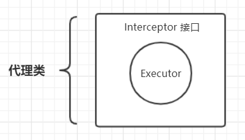
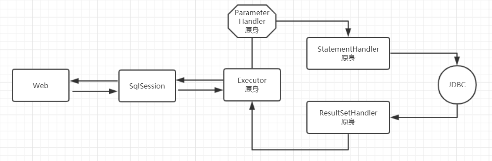
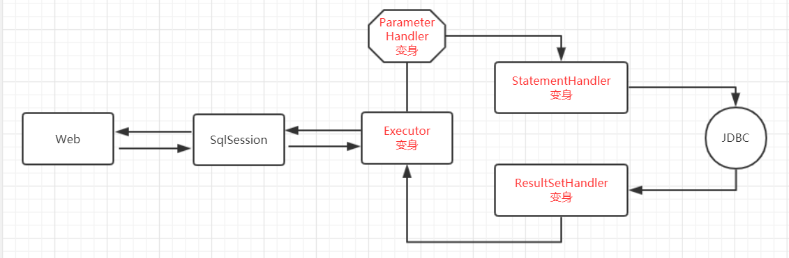
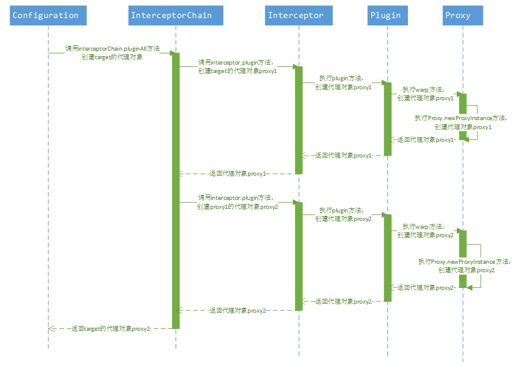
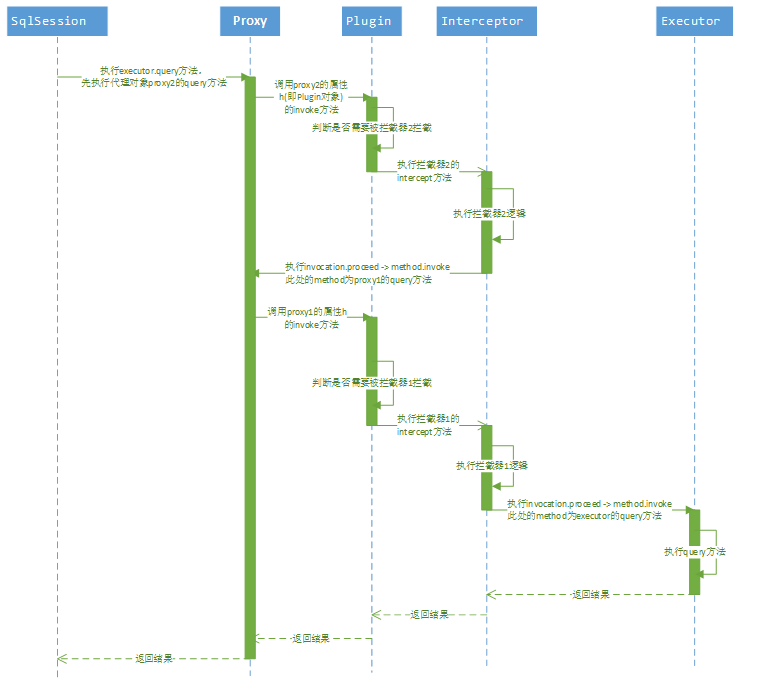

# MyBatis 插件

# 1 概述

我们知道，MyBatis 有四大核心对象：

- ParameterHandler：处理 SQL 的参数对象
- ResultSetHandler：处理 SQL 的返回结果集
- StatementHandler：数据库的处理对象，用于执行 SQL 语句
- Executor：MyBatis 的执行器，用于执行增删改查操作

MyBatis 拦截器针对的就是上面这四个核心对象。要拦截某个对象，需要通过动态代理为它生成一个代理对象：



这样，每次调用这些对象（如 Executor）的方法时，总是要经过 Interceptor 接口的拦截。

借助插件，MyBatis 允许用户在 SQL 执行过程中的某一点进行拦截。常见的应用场景如下：

- **分页查询**：MyBatis 的分页默认是基于内存分页的（查出所有，再截取），数据量大的情况下效率较低。使用 MyBatis 插件可以改变该行为，只需要拦截 StatementHandler 类的 `prepare` 方法，将要执行的 SQL 语句改为分页语句即可。实际项目中常用的 PageHelper 以及 MyBatis-Plus 的 PaginationInnerInterceptor 都是基于这一机制实现的，二者都借助 JSqlParser 解析 SQL，自动生成 count 查询和对应数据库方言的分页语句
- **参数赋值**：一般业务系统都会有创建者、创建时间、修改者、修改时间等字段，这四个字段的赋值可以在 DAO 层统一拦截处理，用 MyBatis 插件拦截 Executor 类的 `update` 方法，对相关参数进行统一赋值即可
- **性能监控**：对于 SQL 语句执行的性能监控，可以通过拦截 Executor 类的 `update`、`query` 等方法，用日志记录每个方法执行的时间
- **其他**：基于插件机制，可以控制 SQL 的执行阶段、参数处理阶段、语法构建阶段以及结果集处理阶段，具体可以根据项目业务来实现对应业务逻辑

配置了插件后，MyBatis 会用代理对象替换原始的目标对象。以 ParameterHandler 为例，代理对象的生成过程如下：

第一步：根据插件配置，通过反射创建 Interceptor 拦截器实例

`Interceptor interceptor = MyInterceptor.class.getDeclaredConstructor().newInstance();`

第二步：创建原始的目标对象

`ParameterHandler parameterHandler = createParameterHandler();`

第三步：将目标对象与拦截器结合，生成代理对象

`parameterHandler = (ParameterHandler) Plugin.wrap(parameterHandler, interceptor);`

在这一步，`Plugin.wrap` 将 parameterHandler 和 interceptor 包装到一起生成代理对象，并重新赋值给 parameterHandler 变量，此后对它的方法调用都会先经过拦截器。

没有插件的运行过程：



有插件的运行过程：



# 2 代理对象的生成

MyBatis 插件主要是基于动态代理实现的，其中最为关键的就是代理对象的生成。

这些可拦截的类对应的对象都是通过 InterceptorChain 的 `pluginAll` 方法来创建的，其实现如下：

```java
  public Object pluginAll(Object target) {
    for (Interceptor interceptor : interceptors) {
      target = interceptor.plugin(target);
    }
    return target;
  }
```

遍历所有拦截器，调用拦截器的 `plugin` 方法生成代理对象。注意生成的代理对象会重新赋值给 target，所以如果有多个拦截器，生成的代理对象会被另一个代理对象层层包裹，从而形成一个代理链条。需要注意，包装顺序与执行顺序是相反的：后注册的拦截器位于代理链的外层，方法调用时最先执行它的 `intercept` 方法，再通过 `proceed()` 逐层向内传递，最先注册的拦截器最后执行前置逻辑（后置逻辑的执行顺序则正好反过来）。

编写拦截器的时候，一个典型的 `plugin` 方法实现方式如下：

```java
@Override
public Object plugin(Object target) {
  return Plugin.wrap(target, this);
}
```

`wrap` 方法的实现如下：

```java
public static Object wrap(Object target, Interceptor interceptor) {
  Map<Class<?>, Set<Method>> signatureMap = getSignatureMap(interceptor);
  Class<?> type = target.getClass();
  Class<?>[] interfaces = getAllInterfaces(type, signatureMap);
  if (interfaces.length > 0) {
    return Proxy.newProxyInstance(
      type.getClassLoader(),
      interfaces,
      new Plugin(target, interceptor, signatureMap));
  }
  return target;
}
```

这是典型的 **JDK 动态代理实现**，调用的是 `Proxy.newProxyInstance` 方法来生成代理对象。从代码中也可以看到，只有当目标对象实现了拦截器 `@Signature` 中声明的接口时，才会生成代理，否则直接返回 target 本身。

代理链的每一层都会多一次 `invoke` 和反射调用，相比数据库 IO 这部分开销通常很小，但拦截器数量越多、`intercept` 中的逻辑越重，累积的开销就越明显。因此应控制拦截器的数量，并让拦截逻辑尽量轻量。

以上逻辑对应的时序图如下。这里假设声明了两个拦截器，那么在创建 target 代理对象的时候，最终返回的代理对象 proxy2 实际上代理了 proxy1，而 proxy1 又代理了 target：



# 3 拦截逻辑的执行

由于真正去执行 Executor、ParameterHandler、ResultSetHandler 和 StatementHandler 类中方法的对象是代理对象，所以在执行方法时，首先调用的是 Plugin 类（实现了 InvocationHandler 接口）的 `invoke` 方法。

首先根据执行方法所属的类，获取拦截器中声明需要拦截的方法集合；然后判断当前方法是否需要执行拦截逻辑，需要的话，执行拦截逻辑方法（即 Interceptor 接口的 `intercept` 方法实现），不需要则直接执行原方法：

```java
    @Override
    public Object invoke(Object proxy, Method method, Object[] args) throws Throwable {
        try {
            // 获得目标方法是否被拦截
            Set<Method> methods = signatureMap.get(method.getDeclaringClass());
            if (methods != null && methods.contains(method)) {
                // 如果是，则拦截处理该方法
                return interceptor.intercept(new Invocation(target, method, args));
            }
            // 如果不是，则调用原方法
            return method.invoke(target, args);
        } catch (Exception e) {
            throw ExceptionUtil.unwrapThrowable(e);
        }
    }
```

可以关注一下 Interceptor 接口的 `intercept` 方法实现，它一般需要用户自定义实现逻辑。其中有一个重要参数，即 Invocation 类，通过该参数我们可以获取执行对象、执行方法以及执行方法上的参数，从而进行各种业务逻辑实现。一般该方法的最后一句代码都是 `invocation.proceed()`（内部执行 `method.invoke` 方法），否则将无法执行下一个拦截器的 `intercept` 方法。

以上逻辑对应的时序图如下，这里以执行 executor 对象的 `query` 方法为例，且假设有两个拦截器存在。调用首先进入最外层代理 proxy2 的 `invoke` 方法，执行拦截器 2 的 `intercept`；当其中调用 `invocation.proceed()` 时，实际是对 proxy1 发起 `method.invoke`，于是进入 proxy1 的 `invoke` 并执行拦截器 1 的 `intercept`；拦截器 1 再调用 `proceed()`，才最终执行到 target 的 `query` 方法。结果随后沿调用链逐层返回：



# 4 代码实例

通过 MyBatis 提供的强大机制，使用插件是非常简单的，只需实现 Interceptor 接口，并指定想要拦截的方法签名即可。

Interceptor 接口的定义如下所示：

```java
public interface Interceptor {

    /**
     * 拦截方法
     *
     * @param invocation 调用信息
     * @return 调用结果
     * @throws Throwable 若发生异常
     */
    Object intercept(Invocation invocation) throws Throwable;

    /**
     * 应用插件。如应用成功，则会创建目标对象的代理对象
     *
     * @param target 目标对象
     * @return 应用的结果对象，可以是代理对象，也可以是 target 对象，也可以是任意对象。具体的，看代码实现
     */
    Object plugin(Object target);

    /**
     * 设置拦截器属性
     *
     * @param properties 属性
     */
    void setProperties(Properties properties);

}
```

在当前版本的 MyBatis 中，`plugin()` 和 `setProperties()` 已改为 default 方法（默认实现分别为 `Plugin.wrap(target, this)` 和空操作），自定义拦截器通常只需实现 `intercept()` 方法。

对于实现自己的 Interceptor 而言，有两个很重要的注解：

`@Intercepts` 用于表明当前的对象是一个 Interceptor，其值是一个 `@Signature` 数组。代码如下所示：

```java
@Documented
@Retention(RetentionPolicy.RUNTIME)
@Target(ElementType.TYPE)
public @interface Intercepts
{
    Signature[] value();
}
```

`@Signature` 则表明要拦截的接口、方法以及对应的参数类型。代码如下所示：

```java
@Retention(RetentionPolicy.RUNTIME)
@Target({})
public @interface Signature {
  Class<?> type();

  String method();

  Class<?>[] args();
}
```

下面来看一个自定义的简单 Interceptor，出自 MyBatis 官方教程：

```java
// ExamplePlugin.java
@Intercepts({@Signature(
  type= Executor.class,
  method = "update",
  args = {MappedStatement.class,Object.class})})
public class ExamplePlugin implements Interceptor {
  private Properties properties = new Properties();

  @Override
  public Object intercept(Invocation invocation) throws Throwable {
    // implement pre processing if need
    Object returnObject = invocation.proceed();
    // implement post processing if need
    return returnObject;
  }

  @Override
  public void setProperties(Properties properties) {
    this.properties = properties;
  }
}
```

由于 `plugin()` 已有默认实现，官方示例中不再重写它。默认实现 `Plugin.wrap(target, this)` 会为目标对象生成一个代理对象（Plugin 类作为 InvocationHandler，持有当前拦截器 ExamplePlugin），MyBatis 通过这个代理对象来实现拦截的功能。

```xml
<!-- mybatis-config.xml -->
<plugins>
  <plugin interceptor="org.mybatis.example.ExamplePlugin">
    <property name="someProperty" value="100"/>
  </plugin>
</plugins>
```

MyBatis 在注册自定义的拦截器时，会先把对应拦截器下面的所有 property 通过 Interceptor 的 `setProperties` 方法注入给对应的拦截器。然后这个插件将会拦截 Executor 实例中所有的 `update` 方法调用，这里的 Executor 是负责执行底层映射语句的内部对象。

在 Spring Boot 项目中，通常不需要在 mybatis-config.xml 中声明插件。mybatis-spring-boot-starter 的自动配置类 MybatisAutoConfiguration 会收集 Spring 容器中所有 Interceptor 类型的 Bean，在创建 SqlSessionFactory 时注册为插件，因此只需将拦截器通过 `@Component` 或 `@Bean` 注册到容器即可。需要注意的是，如果项目自行定义了 SqlSessionFactory Bean，自动配置不会生效，此时需要手动调用 `SqlSessionFactoryBean.setPlugins()` 注册。
