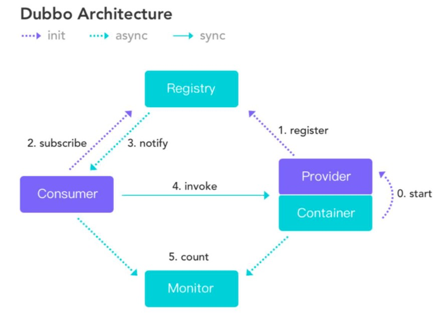
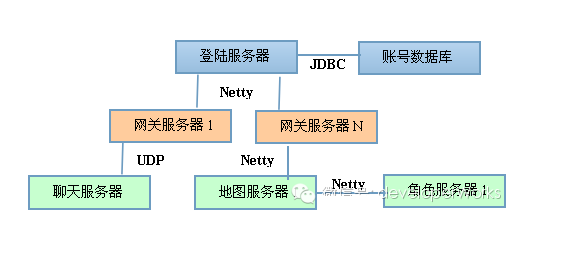
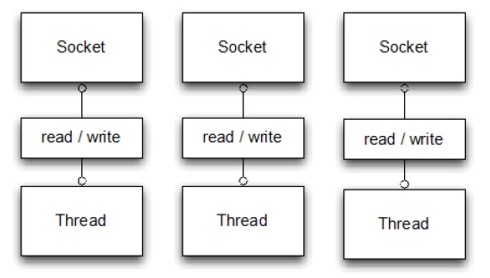
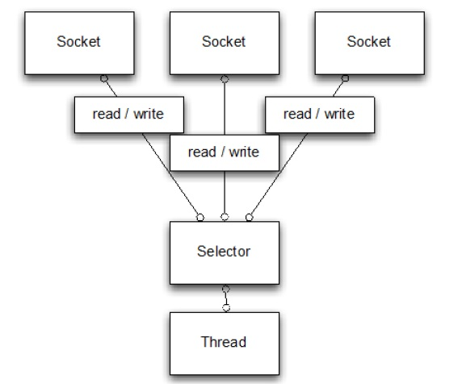
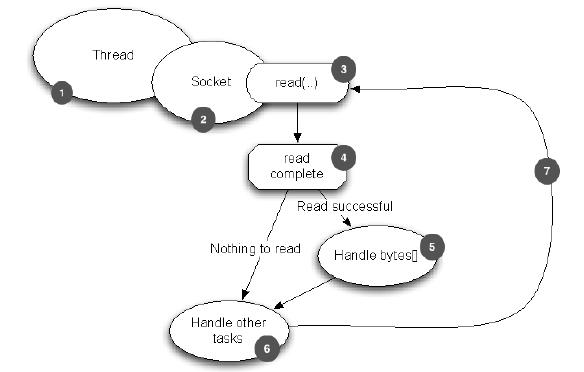
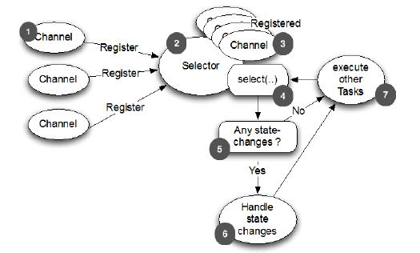
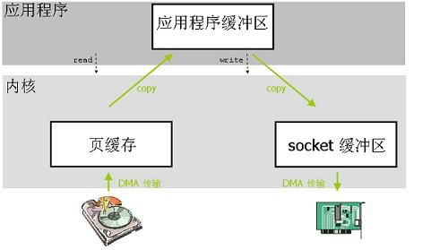
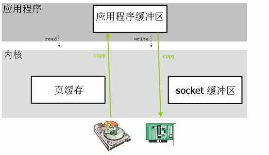

# Netty 概述

# 1 Netty 是什么

**Netty 是什么？**

- 本质：最初由 JBoss 开发的一个 Jar 包，现为独立的开源社区项目
- 目的：快速开发高性能、高可靠性的网络服务器和客户端程序
- 优点：提供异步的、事件驱动的网络应用程序框架和工具
- 通俗地说：一个好用的处理 Socket 的框架

**如果没有 Netty？**

- 远古：`java.net` + `java.io`
- 近代：`java.nio`
- 其他：Mina、Grizzly

顺便说一下，Netty 的作者 Trustin Lee 是一个韩国人，另外一个著名的网络编程框架——Mina，也是他开发的。二者在很多方面都十分相似，它们的线程模型也基本一致。不过 Netty 社区的活跃程度要比 Mina 高得多。

# 2 Netty vs Java NIO

JDK 原生也有一套网络应用程序 API，但是存在一系列问题，主要如下：

- NIO 的类库和 API 繁杂，使用麻烦。你需要熟练掌握 `Selector`、`ServerSocketChannel`、`SocketChannel`、`ByteBuffer` 等
- 需要具备其他额外技能做铺垫。例如熟悉 Java 多线程编程，因为 NIO 编程涉及 Reactor 模式，你必须对多线程和网络编程非常熟悉，才能编写出高质量的 NIO 程序
- 可靠性能力补齐的开发工作量和难度都非常大。例如客户端面临断连重连、网络闪断、半包读写、失败缓存、网络拥塞和异常码流的处理等。NIO 编程的特点是功能开发相对容易，但是可靠性能力补齐的工作量和难度都非常大
- JDK NIO 的 Bug。例如臭名昭著的 Epoll Bug，它会导致 Selector 空轮询，最终导致 CPU 100%。官方声称在 JDK 1.6 update 18 修复了该问题，但之后的版本中仍有复现，只是触发概率降低了，并没有被根本解决。Netty 在框架层做了规避：统计 Selector 连续空轮询的次数，超过阈值（默认 512 次）后自动重建 Selector

Netty 对 JDK 自带的 NIO 的 API 进行封装，解决上述问题，主要特点有：

- 设计优雅：适用于各种传输类型的统一 API（阻塞和非阻塞 Socket）；基于灵活且可扩展的事件模型，可以清晰地分离关注点；高度可定制的线程模型（单线程，一个或多个线程池）；真正的无连接数据报套接字支持（自 3.1 起）
- 使用方便：详细记录的 Javadoc、用户指南和示例；没有其他依赖项，JDK 5（Netty 3.x）、JDK 6（Netty 4.1）或 JDK 8（Netty 4.2）就足够了。目前 4.2 是主线版本，4.1 将于 2027 年 7 月 1 日停止维护（EOL）
- 高性能：吞吐量更高，延迟更低；减少资源消耗；最小化不必要的内存复制
- 安全：完整的 SSL/TLS 和 StartTLS 支持
- 社区活跃：不断更新，版本迭代周期短，发现的 Bug 可以被及时修复，同时会加入更多的新功能
- 云原生友好：Netty 自带 GraalVM Native Image 所需的配置元数据，基于 Netty 的应用可以被编译为本地可执行文件，启动更快、内存占用更低

# 3 应用场景

作为当前最流行的 NIO 框架，Netty 在互联网领域、大数据分布式计算领域、游戏行业、通信行业等获得了广泛的应用，一些业界著名的开源组件也基于 Netty 的 NIO 框架构建。

## 3.1 互联网行业

随着业务规模的扩大，系统普遍被拆分为分布式部署的多个服务，各个节点之间需要频繁地进行远程服务调用，高性能的 RPC 框架必不可少。Netty 作为异步高性能的通信框架，往往作为基础通信组件被这些 RPC 框架使用。

阿里开源的分布式服务框架 Dubbo（现为 Apache 顶级项目）默认使用 Netty 作为基础通信组件，用于实现各进程节点之间的内部通信。它的架构图如下：



其中，服务提供者和服务消费者之间，服务提供者、服务消费者和性能统计节点之间使用 Netty 进行异步/同步通信。

除了 Dubbo 之外，阿里开源的消息中间件 RocketMQ（现为 Apache 顶级项目）的消息生产者和消息消费者之间，也采用 Netty 进行高性能、异步通信。

除了阿里系之外，很多其他的大型互联网公司或者电商内部也已经大量使用 Netty 构建高性能、分布式的网络服务器。

在新一代传输协议方面，Netty 也提供了对基于 UDP 的 QUIC 协议的支持（HTTP/3 即构建在 QUIC 之上）。QUIC 编解码器最初在独立的孵化项目 netty-incubator-codec-quic 中开发，自 Netty 4.2 起已并入主仓库。

## 3.2 游戏行业

无论是手游服务端还是大型的网络游戏，Java 语言都得到了越来越广泛的应用。Netty 作为高性能的基础通信组件，它本身提供了 TCP/UDP 和 HTTP 协议栈，非常方便定制和开发私有协议栈。账号登录服务器、地图服务器之间可以方便地通过 Netty 进行高性能的通信，架构示意图如下：



## 3.3 大数据领域

从 Spark 1.3.1 版本开始，为了解决大块数据（如 Shuffle）的传输问题，Spark 引入了 Netty 通信框架，到了 1.6.0 版本，Netty 完全取代了 Akka，承担 Spark 内部所有的 RPC 通信以及数据流传输。Flink 中 TaskManager 之间的数据交换同样基于 Netty 实现。

大数据计算往往采用多个计算节点和一个/N 个汇总节点进行分布式部署，各节点之间存在海量的数据交换。由于 Netty 的综合性能是目前各个成熟 NIO 框架中最高的，因此，它往往会被选中用作大数据各节点间的通信。

## 3.4 网关与物联网

API 网关需要承载海量并发连接并转发请求，Spring Cloud Gateway 的响应式版本（基于 Reactor Netty）、Netflix Zuul 2 等网关都以 Netty 作为网络层。在物联网领域，设备接入需要维持大量长连接，并处理 MQTT 等多种协议，Netty 对多协议的支持和私有协议定制的便捷性，使它成为 MQTT Broker 等设备接入服务的常用通信组件。

## 3.5 通信行业

Netty 的异步高性能、高可靠性和高成熟度的优点，使它在通信行业得到了大量的应用。

# 4 为什么 Netty 受欢迎

如上所述，Netty 是一款很受大公司青睐的框架，之所以这么受欢迎，大体上原因有三：

- 并发高
- 传输快
- 封装好

## 4.1 Netty 为什么并发高

Netty 是一款基于 NIO（New I/O，因其非阻塞特性也常被理解为 Non-blocking I/O）开发的网络通信框架，对比于 BIO（Blocking I/O，阻塞 I/O），它的并发性能得到了很大提高。





从这两张图（分别为阻塞 I/O 和非阻塞 I/O 的通信方式）可以看出，NIO 的单线程能处理的连接数量比 BIO 要高出很多。为什么单线程能处理更多的连接呢？原因就是图二中出现的 `Selector`。

当一个连接建立之后，有两个步骤要做：第一步是接收完客户端发过来的全部数据，第二步是服务端处理完请求业务之后返回 response 给客户端。NIO 和 BIO 的区别主要在第一步。

在 BIO 中，等待客户端发数据这个过程是阻塞的，这样就造成了一个线程只能处理一个请求的情况，而机器能支持的最大线程数是有限的，这就是 BIO 不能支持高并发的原因。

而在 NIO 中，当一个 Socket 建立好之后，Thread 并不会阻塞地去接收这个 Socket 的数据，而是将这个请求交给 Selector，Selector 会不断地去遍历所有的 Socket，一旦有一个 Socket 的数据准备就绪就会通知 Thread，然后 Thread 处理完数据再返回给客户端——**这个过程是不阻塞的**，这样就能让一个 Thread 处理更多的请求了。

下面两张图分别是基于 BIO 的处理流程和基于 NIO（Netty）的处理流程，有助于理解两种方式的差别：





## 4.2 Netty 为什么传输快

Java 对象存放在 JVM 的堆内存中。如果使用堆内存作为 I/O 缓冲区，从网络读取数据时，数据要先从内核的 Socket 缓冲区拷贝到一块堆外的临时内存，再拷贝到堆内存中（由于 GC 可能移动堆中对象的地址，JDK 无法把堆内存直接交给操作系统读写，只能借助堆外内存中转）。也就是说，一份数据会被多拷贝一次，数据量大时就会造成不必要的资源浪费。

针对这种情况，Netty 实现了自己的**零拷贝**（Zero-Copy）机制，主要体现在以下几个方面：

- 直接内存：ByteBuf 支持在堆外分配直接内存，Socket 读写可以直接使用这块内存，省去了堆内存与堆外内存之间的拷贝
- 组合与切分：通过 CompositeByteBuf 将多个 ByteBuf 逻辑上组合成一个，通过 `slice()` 将一个 ByteBuf 切分为多个共享底层内存的视图，避免合并、拆分数据时的内存复制
- 文件传输：通过 FileRegion 封装 `FileChannel.transferTo()`，文件数据由内核直接发送到 Socket，无需拷贝到用户空间

下面两张图分别展示了传统数据拷贝和零拷贝两种方式的区别：





## 4.3 为什么说 Netty 封装好

> Talk is cheap. Show me the code.

没有对比就没有伤害，上代码。

阻塞 I/O：

```java
public class PlainOioServer {

    public void serve (int port) throws IOException {
        final ServerSocket socket = new ServerSocket(port);
        try {
            for (; ; ) {
                final Socket clientSocket = socket.accept();
                System.out.println("Accepted connection from " + clientSocket);

                new Thread(new Runnable() {
                    @Override
                    public void run () {
                        OutputStream out;
                        try {
                            out = clientSocket.getOutputStream();
                            out.write("Hi!\r\n".getBytes(Charset.forName("UTF-8")));
                            out.flush();
                            clientSocket.close();

                        } catch (IOException e) {
                            e.printStackTrace();
                            try {
                                clientSocket.close();
                            } catch (IOException ex) {
                                // ignore on close
                            }
                        }
                    }
                }).start();
            }
        } catch (IOException e) {
            e.printStackTrace();
        }
    }
}
```

非阻塞 I/O：

```java
public class PlainNioServer {
    
    public void serve (int port) throws IOException {
        ServerSocketChannel serverChannel = ServerSocketChannel.open();
        serverChannel.configureBlocking(false);
        ServerSocket ss = serverChannel.socket();
        InetSocketAddress address = new InetSocketAddress(port);
        ss.bind(address);
        Selector selector = Selector.open();
        serverChannel.register(selector, SelectionKey.OP_ACCEPT);
        final ByteBuffer msg = ByteBuffer.wrap("Hi!\r\n".getBytes());
        for (; ; ) {
            try {
                selector.select();
            } catch (IOException ex) {
                ex.printStackTrace();
                // handle exception
                break;
            }
            Set<SelectionKey> readyKeys = selector.selectedKeys();
            Iterator<SelectionKey> iterator = readyKeys.iterator();
            while (iterator.hasNext()) {
                SelectionKey key = iterator.next();
                iterator.remove();
                try {
                    if (key.isAcceptable()) {
                        ServerSocketChannel server = (ServerSocketChannel) key.channel();
                        SocketChannel client = server.accept();
                        client.configureBlocking(false);
                        client.register(selector, SelectionKey.OP_WRITE | SelectionKey.OP_READ, msg.duplicate());
                        System.out.println("Accepted connection from " + client);
                    }
                    if (key.isWritable()) {
                        SocketChannel client = (SocketChannel) key.channel();
                        ByteBuffer buffer = (ByteBuffer) key.attachment();
                        while (buffer.hasRemaining()) {
                            if (client.write(buffer) == 0) {
                                break;
                            }
                        }
                        client.close();
                    }
                } catch (IOException ex) {
                    key.cancel();
                    try {
                        key.channel().close();
                    } catch (IOException cex) {
                        // 在关闭时忽略
                    }
                }
            }
        }
    }
}
```

Netty：

```java
public class NettyNioServer {

    public void server(int port) throws Exception {
        final ByteBuf buf = Unpooled.unreleasableBuffer(
                Unpooled.copiedBuffer("Hi!\r\n", Charset.forName("UTF-8")));
        EventLoopGroup group = new NioEventLoopGroup();
        try {
            ServerBootstrap b = new ServerBootstrap();        

            b.group(group)                                    
                    .channel(NioServerSocketChannel.class)
                    .localAddress(new InetSocketAddress(port))
                    .childHandler(new ChannelInitializer<SocketChannel>() {
                        @Override
                        public void initChannel(SocketChannel ch)
                                throws Exception {
                            ch.pipeline().addLast(new ChannelInboundHandlerAdapter() {            
                                @Override
                                public void channelActive(ChannelHandlerContext ctx) throws Exception {
                                    ctx.writeAndFlush(buf.duplicate()).addListener(ChannelFutureListener.CLOSE);
                                }
                            });
                        }
                    });
            ChannelFuture f = b.bind().sync();  
            f.channel().closeFuture().sync();
        } finally {
            group.shutdownGracefully().sync();        
        }
    }
}
```

可以看到，同样是非阻塞 I/O，使用 Netty 编写的代码要简洁得多。而且传输方式只由 EventLoopGroup 和 Channel 的实现类决定，只需替换这两处，就能在 NIO、Epoll、KQueue 等不同传输之间切换，业务代码几乎不用改动。早期版本还可以借助 OIO 传输（`OioEventLoopGroup`、`OioServerSocketChannel`）以同样的方式切换为阻塞模式，但它在 Netty 4.1 中已被标记为废弃。在 Netty 4.2 中，`NioEventLoopGroup` 也已被标记为废弃，推荐写法为 `new MultiThreadIoEventLoopGroup(NioIoHandler.newFactory())`。
