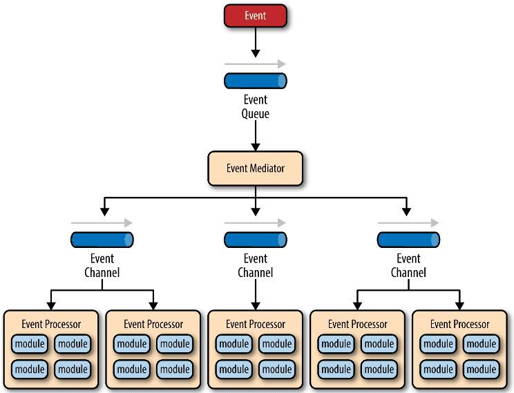
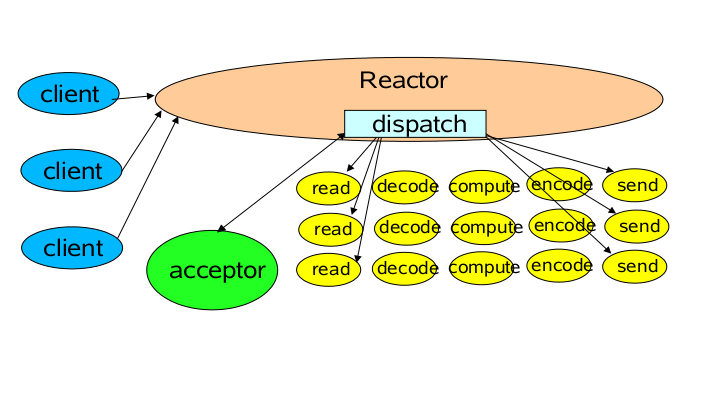
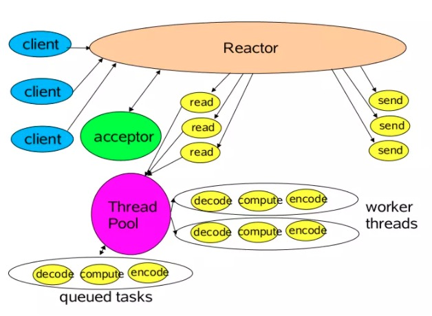
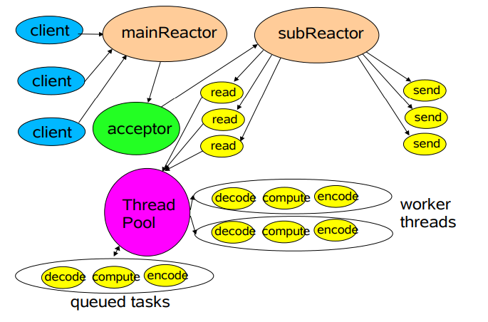
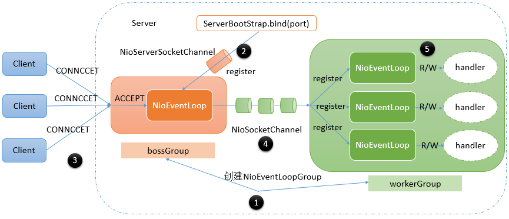

# Netty 线程模型

# 1 事件驱动模型

通常，我们设计一个事件处理模型的程序有两种思路：

- 轮询方式：线程不断轮询访问相关事件发生源有没有发生事件，有发生事件就调用事件处理逻辑
- 事件驱动方式：发生事件时，主线程把事件放入事件队列，在另外的线程中不断循环消费事件队列中的事件，调用事件对应的处理逻辑处理事件。事件驱动方式也被称为消息通知方式，其实就是设计模式中观察者模式的思路

以 GUI 的逻辑处理为例，说明两种方式的不同：

- 轮询方式：线程不断轮询是否发生按钮点击事件，如果发生，就调用处理逻辑
- 事件驱动方式：发生点击事件时把事件放入事件队列，在另外的线程中消费事件队列中的事件，根据事件类型调用相关的事件处理逻辑

这里借用 O'Reilly 关于事件驱动模型的解释图：



主要包括 4 个基本组件：

- 事件队列（event queue）：接收事件的入口，存储待处理事件
- 分发器（event mediator）：将不同的事件分发到不同的业务逻辑单元
- 事件通道（event channel）：分发器与处理器之间的联系渠道
- 事件处理器（event processor）：实现业务逻辑，处理完成后会发出事件，触发下一步操作

可以看出，相对传统轮询模式，事件驱动有如下优点：

- 可扩展性好：分布式的异步架构，事件处理器之间高度解耦，可以方便地扩展事件处理逻辑
- 高性能：基于队列暂存事件，能方便地并行异步处理事件

# 2 Reactor 线程模型

Reactor 模型是指通过一个或多个输入同时传递给服务处理器的服务请求的事件驱动处理模式。

服务端程序处理传入的多路请求，并将它们同步分派给请求对应的处理线程。Reactor 模式也叫 Dispatcher 模式，即通过 I/O 多路复用统一监听事件，收到事件后分发（Dispatch 给某进程），是编写高性能网络服务器的必备技术之一。

根据 Reactor 的数量和 Handler 线程数量的不同，Reactor 模型有 3 个变种：

## 2.1 单线程模型



Reactor 内部通过 Selector 监控连接事件，收到事件后通过 dispatch 进行分发：如果是连接建立的事件，则由 Acceptor 处理，Acceptor 通过 accept 接受连接，并创建一个 Handler 来处理连接后续的各种事件；如果是读写事件，则直接调用连接对应的 Handler 来处理。

Handler 完成 read → 业务处理（decode → compute → encode）→ send 的全部流程。

这种模型的好处是简单，坏处却很明显：当某个 Handler 阻塞时，会导致其他客户端的 Handler 和 Acceptor 都得不到执行，无法做到高性能，只适用于业务处理非常快速的场景。

## 2.2 多线程模型



主线程中，Reactor 对象通过 Selector 监控连接事件，收到事件后通过 dispatch 进行分发。如果是连接建立事件，则由 Acceptor 处理，Acceptor 通过 accept 接收连接，并创建一个 Handler 来处理后续事件，而 **Handler 只负责响应事件，不进行业务操作，也就是只进行 read 读取数据和 write 写出数据，业务处理交给一个线程池进行处理**。

线程池分配一个线程完成真正的业务处理，然后将响应结果交给主线程的 Handler 处理，Handler 将结果 send 给 client。

单 Reactor 承担所有事件的监听和响应，当服务端遇到大量的客户端同时进行连接，或者在请求连接时执行一些耗时操作（比如身份认证、权限检查等）时，这种瞬时的高并发就容易成为性能瓶颈。

## 2.3 主从多线程模型



存在多个 Reactor，**每个 Reactor 都有自己的 Selector 选择器、线程和 dispatch**。

主线程中的 mainReactor 通过自己的 Selector 监控连接建立事件，收到事件后通过 Acceptor 接收，将新的连接分配给某个子线程。

子线程中的 subReactor 将 mainReactor 分配的连接加入连接队列中，通过自己的 Selector 进行监听，并创建一个 Handler 用于处理后续事件。

Handler 完成 read → 业务处理 → send 的完整业务流程。

# 3 Netty 中的 Reactor 线程模型

## 3.1 启动流程

上面提到的几种线程模型，在我们编写的基于 Netty 的应用中都有可能出现，甚至可能不使用 Reactor 线程。具体属于哪一种情况，要看我们的代码是如何编写的。

我们先以一个使用了 Reactor 线程模型的 Netty 服务端的典型代码进行说明：

```java
EventLoopGroup bossGroup = new NioEventLoopGroup(1);
EventLoopGroup workerGroup = new NioEventLoopGroup(3);
ServerBootstrap b = new ServerBootstrap(); 
b.group(bossGroup, workerGroup)
.channel(NioServerSocketChannel.class)
.handler(new LoggingHandler(LogLevel.INFO))
.option(ChannelOption.SO_BACKLOG, 128)
.attr(AttributeKey.valueOf("ssc.key"),"scc.value")
.childHandler(new ChannelInitializer<SocketChannel>() {
  @Override
  public void initChannel(SocketChannel ch) throws Exception {
    ch.pipeline().addLast(new DiscardServerHandler());
  }
}) 
.childOption(ChannelOption.SO_KEEPALIVE, true)
.childAttr(AttributeKey.valueOf("sc.key"),"sc.value")
.bind(port);
```

在上述代码片段中代码很少，却包含了一个复杂的 Reactor 线程模型，如下所示：



图中大致包含了 5 个步骤：

1. 设置服务端 ServerBootstrap 启动参数
2. 通过 ServerBootstrap 的 `bind` 方法启动服务端，`bind` 方法会在 `bossGroup` 中注册 NioServerSocketChannel，监听客户端的连接请求
3. Client 发起连接 CONNECT 请求，`bossGroup` 中的 NioEventLoop 不断轮询是否有新的客户端请求，如果有，ACCEPT 事件触发
4. ACCEPT 事件触发后，`bossGroup` 中的 NioEventLoop 会通过 NioServerSocketChannel 获取到对应的代表客户端的 NioSocketChannel，并将其注册到 `workerGroup` 中
5. `workerGroup` 中的 NioEventLoop 不断检测自己管理的 NioSocketChannel 是否有读写事件准备好，如果有，就调用对应的 ChannelHandler 进行处理

> 注：本文源码分析基于 Netty 4.x（部分代码片段来自 4.0 版本，例如 `BootstrapChannelFactory` 在 4.1 中已改为 `ReflectiveChannelFactory`）。在 Netty 4.2 中，`NioEventLoopGroup` 已被标记为废弃，推荐使用 `new MultiThreadIoEventLoopGroup(NioIoHandler.newFactory())` 创建 EventLoopGroup，但 boss/worker 的线程模型思想不变。

## 3.2 源码解析

ServerBootstrap 继承自 AbstractBootstrap，代表服务端的启动类，调用其 `bind` 方法即表示启动服务端。在启动之前，我们会调用 `group`、`channel`、`handler`、`option`、`attr`、`childHandler`、`childOption`、`childAttr` 等方法来设置一些启动参数。

### 3.2.1 `group` 方法

`group()` 可以认为是设置执行任务的线程池。在 Netty 中，EventLoopGroup 的作用类似于线程池，每个 EventLoopGroup 中包含多个 EventLoop 对象，代表不同的线程。特别地，我们创建的是 2 个 EventLoopGroup 的子类 NioEventLoopGroup 的实例：bossGroup、workerGroup，所以实际上包含的是多个 NioEventLoop 对象。

在创建 `bossGroup`、`workerGroup` 时，分别传入了构造参数 1 和 3，这对应了上图中红色部分的 `bossGroup` 中只有 1 个 NioEventLoop，绿色部分的 `workerGroup` 中有 3 个 NioEventLoop。

特别地，如果创建 NioEventLoopGroup 的时候没有指定参数，或者传入的是 0，那么这个 NioEventLoopGroup 包含的 NioEventLoop 个数将会是 `CPU 核数 * 2`。

具体可参见 NioEventLoopGroup 的父类 MultithreadEventLoopGroup 构造时的相关代码：

```java
public abstract class MultithreadEventLoopGroup extends MultithreadEventExecutorGroup implements EventLoopGroup {
    private static final InternalLogger logger = InternalLoggerFactory.getInstance(MultithreadEventLoopGroup.class);
  
    private static final int DEFAULT_EVENT_LOOP_THREADS = Math.max(1, SystemPropertyUtil.getInt("io.netty.eventLoopThreads", NettyRuntime.availableProcessors() * 2));//默认线程数量，cpu核数*2

    //...
}
```

在创建完 `bossGroup` 和 `workerGroup` 之后，我们把它们当作参数，通过调用带有 2 个参数的 `group` 方法传递给了 ServerBootstrap。在这个方法中，会把 `bossGroup` 当作参数传递给 ServerBootstrap 的父类 AbstractBootstrap 来进行维护，`workerGroup` 则由 ServerBootstrap 自己维护。

之后，我们可以调用 ServerBootstrap 的 `group()` 方法来获取 parentGroup 的引用，这个方法是从父类 AbstractBootstrap 继承的。另外，可以通过调用 ServerBootstrap 自己定义的 `childGroup()` 方法来获取 `workerGroup` 的引用。

`io.netty.bootstrap.ServerBootstrap`：

```java
private volatile EventLoopGroup childGroup;   //ServerBootStrap自己维护childGroup
//...
public ServerBootstrap group(EventLoopGroup parentGroup, EventLoopGroup childGroup) {
        super.group(parentGroup);//将parentGroup传递给父类AbstractBootstrap处理
        if (childGroup == null) {
            throw new NullPointerException("childGroup");
        } else if (this.childGroup != null) {
            throw new IllegalStateException("childGroup set already");
        } else {
            this.childGroup = childGroup;
            return this;
        }
    }
```

`io.netty.bootstrap.AbstractBootstrap`：

```java
volatile EventLoopGroup group;  //这个字段将会被设置为parentGroup
//...
public B group(EventLoopGroup group) {
        if (group == null) {
            throw new NullPointerException("group");
        } else if (this.group != null) {
            throw new IllegalStateException("group set already");
        } else {
            this.group = group;
            return this.self();
        }
    }
```

### 3.2.2 `channel` 方法

`channel()` 继承自 AbstractBootstrap，用于构造通道的工厂类 ChannelFactory 实例，之后需要创建通道实例（例如 NioServerSocketChannel）的时候，通过调用 `ChannelFactory.newChannel()` 方法来创建。

`channel` 方法内部隐含地调用了 `channelFactory` 方法，我们也可以直接调用这个方法。

```java
//这个工厂类最终创建的通道实例，就是channel方法指定的NioServerSocketChannel
private volatile ChannelFactory<? extends C> channelFactory;
//...	
public B channel(Class<? extends C> channelClass) {
        if (channelClass == null) {
            throw new NullPointerException("channelClass");
        } else {
            return this.channelFactory(new AbstractBootstrap.BootstrapChannelFactory(channelClass));
        }
    }

    public B channelFactory(ChannelFactory<? extends C> channelFactory) {
        if (channelFactory == null) {
            throw new NullPointerException("channelFactory");
        } else if (this.channelFactory != null) {
            throw new IllegalStateException("channelFactory set already");
        } else {
            this.channelFactory = channelFactory;
            return this.self();
        }
    }
```

### 3.2.3 `handler`、`option`、`attr` 方法

`handler`、`option`、`attr` 方法都是从 AbstractBootstrap 中继承的。这些方法设置的参数将会被应用到 NioServerSocketChannel 实例上，由于 NioServerSocketChannel 一般只会创建一个，因此这些参数通常只会应用一次。源码如下所示：

```java
private final Map<ChannelOption<?>, Object> options = new LinkedHashMap();
private final Map<AttributeKey<?>, Object> attrs = new LinkedHashMap();
private volatile ChannelHandler handler;
//...

public <T> B option(ChannelOption<T> option, T value) {
        if (option == null) {
            throw new NullPointerException("option");
        } else {
            if (value == null) {
                synchronized(this.options) {
                    this.options.remove(option);
                }
            } else {
                synchronized(this.options) {
                    this.options.put(option, value);
                }
            }

            return this.self();
        }
    }

    public <T> B attr(AttributeKey<T> key, T value) {
        if (key == null) {
            throw new NullPointerException("key");
        } else {
            if (value == null) {
                synchronized(this.attrs) {
                    this.attrs.remove(key);
                }
            } else {
                synchronized(this.attrs) {
                    this.attrs.put(key, value);
                }
            }

            return this.self();
        }
    }

    public B handler(ChannelHandler handler) {
        if (handler == null) {
            throw new NullPointerException("handler");
        } else {
            this.handler = handler;
            return this.self();
        }
    }
```

而 `childHandler`、`childOption`、`childAttr` 方法是 ServerBootstrap 自己定义的，这些方法设置的参数将会被应用到 NioSocketChannel 实例上。由于服务端每接收到一个客户端连接，就会创建一个 NioSocketChannel 实例，因此每个 NioSocketChannel 实例都会应用这些方法设置的参数。

```java
    
private final Map<ChannelOption<?>, Object> childOptions = new LinkedHashMap();
private final Map<AttributeKey<?>, Object> childAttrs = new LinkedHashMap();
private volatile ChannelHandler childHandler;
//...
public <T> ServerBootstrap childOption(ChannelOption<T> childOption, T value) {
        if (childOption == null) {
            throw new NullPointerException("childOption");
        } else {
            if (value == null) {
                synchronized(this.childOptions) {
                    this.childOptions.remove(childOption);
                }
            } else {
                synchronized(this.childOptions) {
                    this.childOptions.put(childOption, value);
                }
            }

            return this;
        }
    }

    public <T> ServerBootstrap childAttr(AttributeKey<T> childKey, T value) {
        if (childKey == null) {
            throw new NullPointerException("childKey");
        } else {
            if (value == null) {
                this.childAttrs.remove(childKey);
            } else {
                this.childAttrs.put(childKey, value);
            }

            return this;
        }
    }

    public ServerBootstrap childHandler(ChannelHandler childHandler) {
        if (childHandler == null) {
            throw new NullPointerException("childHandler");
        } else {
            this.childHandler = childHandler;
            return this;
        }
    }
```

也就是说，以上六个方法是两两对应的：

- `handler` → `childHandler`：分别用于设置 NioServerSocketChannel 和 NioSocketChannel 的处理器链，也就是当有一个 NIO 事件的时候，应该按照怎样的步骤进行处理
- `option` → `childOption`：分别用于设置 NioServerSocketChannel 和 NioSocketChannel 的 TCP 连接参数，在 ChannelOption 类中可以看到 Netty 支持的所有 TCP 连接参数
- `attr` → `childAttr`：用于给 Channel 设置一个 key/value，之后可以根据 key 获取

`ChannelOption` 中定义了一些 TCP 连接相关的参数，常用的参数如下：

- ChannelOption.SO_KEEPALIVE

  是否启用心跳保活机制，默认 false。

  套接字本身是有一套心跳保活机制的，不过默认的设置并不像我们一厢情愿的那样有效。在双方 TCP 套接字建立连接后（即都进入 ESTABLISHED 状态），并且在两个小时左右上层没有任何数据传输的情况下，这套机制才会被激活。实际上这套机制只是操作系统底层使用的一个被动机制，原理上不应该被上层应用使用。当系统关闭一个由 KEEPALIVE 机制检查出来的死连接时，是不会主动通知上层应用的，只有在调用相应的 IO 操作时才能从返回值中检查出来。

- ChannelOption.SO_SNDBUF

  发送缓冲区的大小设置，默认为 8K。

- ChannelOption.SO_RCVBUF

  接收缓冲区大小设置，默认为 8K。该属性既可以在 ServerSocket 实例中设置，也可以在 Socket 实例中设置。

- ChannelOption.TCP_NODELAY

  是否一有数据就马上发送。在 TCP/IP 协议中，无论发送多少数据，总是要在数据前面加上协议头，同时，对方接收到数据，也需要发送 ACK 表示确认。为了尽可能地利用网络带宽，TCP 总是希望尽可能地发送足够大的数据。这里就涉及一个名为 Nagle 的算法，该算法的目的就是尽可能发送大块数据，避免网络中充斥着许多小数据块。

  TCP_NODELAY 选项就是用于启用或关闭 Nagle 算法的。如果要求高实时性，有数据发送时就马上发送，就将该选项设置为 true 关闭 Nagle 算法；如果要减少发送次数、减少网络交互，就设置为 false，等累积一定大小后再发送。JDK 中该选项默认为 false，而 Netty 在大多数平台上（Android 除外）会默认将其设置为 true。

- ChannelOption.SO_BACKLOG

  用于构造服务端套接字 ServerSocket 对象，标识当服务器请求处理线程全满时，用于临时存放已完成三次握手的请求的队列的最大长度。如果未设置或所设置的值小于 1，Java 将使用默认值 50。在 Netty 中，这个值默认是去读取文件 `/proc/sys/net/core/somaxconn` 的值，如果没有读到，则按平台取默认值（参见 `NetUtil.SOMAXCONN`，当前 Netty 4.1 中 Windows 为 200、macOS 为 128、其他平台为 4096）。

### 3.2.4 `bind` 方法

**调用 `bind` 方法，就相当于启动了服务端**。启动的核心逻辑都在 `bind` 方法中。

`bind` 方法内部会创建一个 NioServerSocketChannel 实例，并将其在 `parentGroup` 中进行注册。`parentGroup` 在接收到注册请求时，会从自己管理的 NioEventLoop 中选择一个进行注册。一旦注册完成，我们就可以通过 NioServerSocketChannel 检测有没有新的客户端连接到来。

如果一步一步追踪 `ServerBootstrap.bind` 方法的调用链，最终会定位到 ServerBootstrap 父类 AbstractBootstrap 的 `doBind` 方法，相关源码如下：

```java
    private ChannelFuture doBind(final SocketAddress localAddress) {
        final ChannelFuture regFuture = this.initAndRegister();
        final Channel channel = regFuture.channel();
        if (regFuture.cause() != null) {
            return regFuture;
        } else if (regFuture.isDone()) {
            ChannelPromise promise = channel.newPromise();
            doBind0(regFuture, channel, localAddress, promise);
            return promise;
        } else {
            final AbstractBootstrap.PendingRegistrationPromise promise = new AbstractBootstrap.PendingRegistrationPromise(channel);
            regFuture.addListener(new ChannelFutureListener() {
                public void operationComplete(ChannelFuture future) throws Exception {
                    Throwable cause = future.cause();
                    if (cause != null) {
                        promise.setFailure(cause);
                    } else {
                        promise.executor = channel.eventLoop();
                        AbstractBootstrap.doBind0(regFuture, channel, localAddress, promise);
                    }

                }
            });
            return promise;
        }
    }
```

`doBind` 方法中，最重要的调用是 `initAndRegister` 方法，这个方法主要完成 3 个任务：

- 创建 NioServerSocketChannel 实例，这是通过之前创建的 ChannelFactory 实例的 `newChannel` 方法完成的
- 初始化 NioServerSocketChannel，即将我们前面通过 `handler`、`option`、`attr` 等方法设置的参数应用到 NioServerSocketChannel 上
- 将 NioServerSocketChannel 注册到 parentGroup 中，parentGroup 会选择其中一个 NioEventLoop 来运行这个 NioServerSocketChannel 要完成的功能，即监听客户端的连接

```java
    final ChannelFuture initAndRegister() {
        Channel channel = null;

        try {
            channel = this.channelFactory().newChannel(); //1、创建NioServerSocketChannel实例
            this.init(channel);//2、初始化NioServerSocketChannel，这是一个抽象方法，ServerBootStrap对此进行了覆盖
        } catch (Throwable var3) {
            if (channel != null) {
                channel.unsafe().closeForcibly();
            }

            return (new DefaultChannelPromise(channel, GlobalEventExecutor.INSTANCE)).setFailure(var3);
        }

        ChannelFuture regFuture = this.group().register(channel);//3、NioServerSocketChannel注册到parentGroup中
        if (regFuture.cause() != null) {
            if (channel.isRegistered()) {
                channel.close();
            } else {
                channel.unsafe().closeForcibly();
            }
        }

        return regFuture;
    }
```

ServerBootstrap 实现了 AbstractBootstrap 的抽象方法 `init`，对 NioServerSocketChannel 进行初始化，这是典型的模板方法设计模式，即父类运行过程中会调用多个方法，子类对特定的方法进行覆写。

在这里，`init` 方法主要是为 NioServerSocketChannel 设置运行参数，也就是我们前面通过调用 ServerBootstrap 的 `option`、`attr`、`handler` 等方法指定的参数。

特别需要注意的是，除了我们通过 `handler` 方法为 NioServerSocketChannel 指定的 ChannelHandler（在这里是 LoggingHandler）之外，ServerBootstrap 的 `init` 方法总是会帮我们在 NioServerSocketChannel 的处理器链的最后添加一个默认的处理器 ServerBootstrapAcceptor。

从 ServerBootstrapAcceptor 的名字上可以看出来，它是客户端连接请求的处理器。当接收到一个客户端请求之后，Netty 会创建一个代表客户端的 NioSocketChannel 对象。而我们通过 ServerBootstrap 指定的 `childHandler`、`childOption`、`childAttr`、`childGroup` 等参数，也需要设置到 NioSocketChannel 中。但是现在服务端刚启动，没有接收到任何客户端请求，还没有任何 NioSocketChannel 实例，因此这些参数要保存到 ServerBootstrapAcceptor 中，等到接收到客户端连接的时候，再将这些参数进行设置。我们可以看到，这些参数是通过构造方法传递给 ServerBootstrapAcceptor 的。

```java
    void init(Channel channel) throws Exception { //入参类型就是NioServerSocketChannel
        //为NioServerSocketChannel设置option方法设置的参数  
        Map<ChannelOption<?>, Object> options = this.options();
        synchronized(options) {
            setChannelOptions(channel, options, logger);
        }

        //为NioServerSocketChannel设置attr方法设置的参数
        Map<AttributeKey<?>, Object> attrs = this.attrs();
        synchronized(attrs) {
            Iterator var5 = attrs.entrySet().iterator();

            while(true) {
                if (!var5.hasNext()) {
                    break;
                }

                Entry<AttributeKey<?>, Object> e = (Entry)var5.next();
                AttributeKey<Object> key = (AttributeKey)e.getKey();
                channel.attr(key).set(e.getValue());
            }
        }
     
        ChannelPipeline p = channel.pipeline();
        final EventLoopGroup currentChildGroup = this.childGroup;
        final ChannelHandler currentChildHandler = this.childHandler;
        final Entry[] currentChildOptions;
        synchronized(this.childOptions) {
            currentChildOptions = (Entry[])this.childOptions.entrySet().toArray(newOptionArray(this.childOptions.size()));
        }

        final Entry[] currentChildAttrs;
        synchronized(this.childAttrs) {
            currentChildAttrs = (Entry[])this.childAttrs.entrySet().toArray(newAttrArray(this.childAttrs.size()));
        }

        p.addLast(new ChannelHandler[]{new ChannelInitializer<Channel>() {
            public void initChannel(final Channel ch) throws Exception {
                final ChannelPipeline pipeline = ch.pipeline();
                ChannelHandler handler = ServerBootstrap.this.handler();
                if (handler != null) {//为NioServerSocketChannel设置通过handler方法指定的处理器
                    pipeline.addLast(new ChannelHandler[]{handler});
                }

                ch.eventLoop().execute(new Runnable() {
                    public void run() {
                      //为NioSocketChannel设置默认的处理器ServerBootstrapAcceptor，并将相关参数通过构造方法传给ServerBootstrapAcceptor
                        pipeline.addLast(new ChannelHandler[]{new ServerBootstrap.ServerBootstrapAcceptor(ch, currentChildGroup, currentChildHandler, currentChildOptions, currentChildAttrs)});
                    }
                });
            }
        }});
    }
```

在初始化完成之后，ServerBootstrap 通过调用 `register` 方法将 NioServerSocketChannel 注册到了 `parentGroup` 中。

从较高的层面来说，`parentGroup` 的类型是 NioEventLoopGroup，一个 NioEventLoopGroup 可能会管理多个 NioEventLoop，对于通道的注册，NioEventLoopGroup 会从多个 NioEventLoop 中选择一个来执行真正的注册。之后这个通道的 NIO 事件，也都是由这个 NioEventLoop 来处理。也就是说，**一个通道只能由一个 NioEventLoop 来处理，一个 NioEventLoop 可以处理多个通道**，通道与 NioEventLoop 是多对一的关系。
