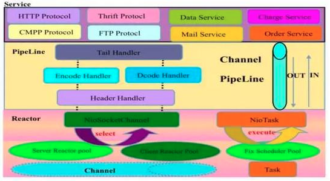
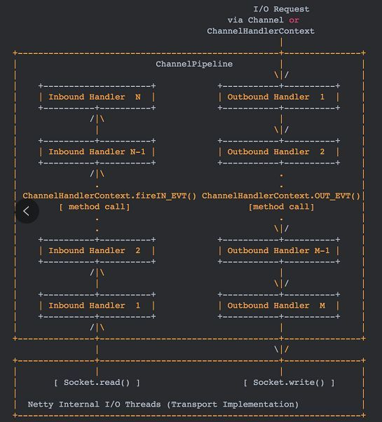
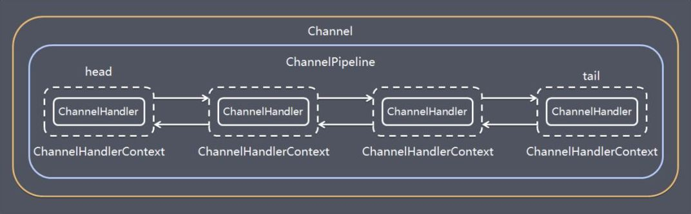
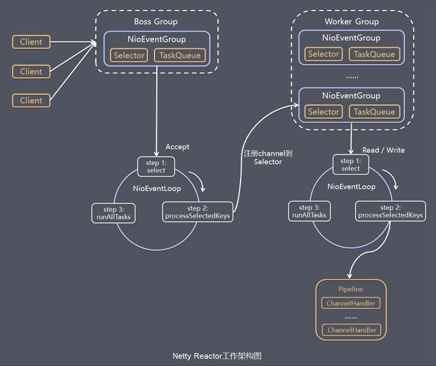

# Netty 工作原理

# 1 架构设计

Netty 采用了比较典型的三层网络架构进行设计，逻辑架构图如下所示：



第一层：Reactor 通信调度层，它由一系列辅助类完成，包括 Reactor 线程 NioEventLoop 及其父类、NioSocketChannel/NioServerSocketChannel 及其父类、ByteBuf 及由其衍生出来的各种 Buffer、Unsafe 及其衍生出的各种内部类等。该层的主要职责是监听网络的读写和连接操作，负责将网络层的数据读取到内存缓冲区中，然后触发各种网络事件，例如连接创建、连接激活、读事件、写事件等，将这些事件触发到 Pipeline 中，由 Pipeline 充当的责任链来进行后续的处理。

其中 ByteBuf 默认采用池化分配。4.1 的 PooledByteBufAllocator 借鉴了 jemalloc 的思想，按 Arena → Chunk → Run（由若干 Page 组成）→ Subpage 的层级管理内存，并配合线程本地缓存复用已释放的内存块，从而减少频繁申请、释放直接内存的开销和内存碎片。4.2 则把默认分配器换成了 AdaptiveByteBufAllocator，如需沿用旧的池化分配器，可以通过 `-Dio.netty.allocator.type=pooled` 切换回去。

第二层：责任链 Pipeline，它负责事件在责任链中的有序传播，同时负责动态地编排责任链。责任链上的 Handler 可以选择监听和处理自己关心的事件，它可以拦截处理事件，也可以向后/向前传播事件。不同应用的 Handler 节点的功能也不同，通常情况下会开发编解码 Handler 用于消息的编解码，它可以将外部的协议消息转换成内部的 POJO 对象，这样上层业务侧只需要关心业务逻辑的处理，不需要感知底层的协议差异和线程模型差异，实现了架构层面的分层隔离。

第三层：业务逻辑处理层，可以分为两类：

- 纯粹的业务逻辑处理，例如订单处理
- 应用层协议管理，例如 HTTP、WebSocket 以及各类自定义 RPC 协议等

# 2 模块组件

## 2.1 Bootstrap、ServerBootstrap

Bootstrap 意思是引导，一个 Netty 应用通常由一个 Bootstrap 开始，主要作用是配置整个 Netty 程序，串联各个组件，Netty 中 Bootstrap 类是客户端程序的启动引导类，ServerBootstrap 是服务端启动引导类。

## 2.2 Future、ChannelFuture

在 Netty 中，所有的 I/O 操作都是异步的，调用方不能立刻得知操作是否被正确处理。

但调用方可以等待操作执行完成，或者直接注册一个监听器，具体就是通过 Future 和 ChannelFuture 实现的：它们可以注册监听器，当操作执行成功或失败时，监听器会被自动回调。

## 2.3 Channel

Channel 是 Netty 网络通信的组件，能够用于执行网络 I/O 操作。Channel 为用户提供：

- 当前网络连接的通道的状态（例如是否打开、是否已连接）
- 网络连接的配置参数（例如接收缓冲区大小）
- 异步的网络 I/O 操作（如建立连接、读写、绑定端口）：异步调用意味着任何 I/O 调用都将立即返回，并且不保证在调用结束时所请求的 I/O 操作已完成；调用会立即返回一个 ChannelFuture 实例，通过向 ChannelFuture 注册监听器，可以在 I/O 操作成功、失败或取消时回调通知调用方
- 将 I/O 操作与对应的处理程序关联起来

不同协议、不同阻塞类型的连接都有不同的 Channel 类型与之对应。下面是一些常用的 Channel 类型：

- NioSocketChannel，基于 Java NIO 的异步客户端 TCP Socket 连接
- NioServerSocketChannel，基于 Java NIO 的异步服务端 TCP Socket 连接
- NioDatagramChannel，基于 Java NIO 的异步 UDP 连接
- EpollSocketChannel / KQueueSocketChannel，分别基于 Linux epoll 和 BSD/macOS kqueue 的原生 TCP 连接，比 NIO 实现产生的垃圾更少、支持的 Socket 选项更多
- IoUringSocketChannel，基于 Linux io_uring 的原生 TCP 连接，原先在孵化项目中，自 4.2 起成为正式模块

此外，Netty 还提供了 NioSctpChannel、NioSctpServerChannel 等 SCTP 通道，不过 SCTP 主要用在电信信令等场景，在互联网业务中很少见。

## 2.4 Selector

Netty 基于 Selector 对象实现 I/O 多路复用，通过 Selector，一个线程可以监听多个连接的 Channel 事件。

当向一个 Selector 中注册 Channel 后，Selector 内部的机制就可以自动不断地查询（Select）这些注册的 Channel 是否有已就绪的 I/O 事件（例如可读、可写、网络连接完成等），这样程序就可以很简单地使用一个线程高效地管理多个 Channel。

## 2.5 NioEventLoop

NioEventLoop 中维护了一个线程和任务队列，支持异步提交执行任务，线程启动时会调用 NioEventLoop 的 `run` 方法，执行 I/O 任务和非 I/O 任务：

- I/O 任务，即 `selectionKey` 中处于就绪（ready）状态的事件，如 accept、connect、read、write 等，由 `processSelectedKeys` 方法触发
- 非 I/O 任务，即添加到 `taskQueue` 中的任务，如 `register0`、`bind0` 等任务，由 `runAllTasks` 方法触发

两种任务的执行时间比例由变量 `ioRatio` 控制，默认为 50，表示允许非 I/O 任务执行的时间与 I/O 任务的执行时间相等。

以上描述基于 Netty 4.1。在 4.2 中，NioEventLoop 已被废弃，事件循环统一由 SingleThreadIoEventLoop 搭配 NioIoHandler 等 IoHandler 实现，默认改为按固定时间片限制每轮执行非 I/O 任务的时长（由 `io.netty.eventLoop.maxTaskProcessingQuantumMs` 控制，默认 1000 毫秒）。

## 2.6 NioEventLoopGroup

NioEventLoopGroup 主要管理 EventLoop 的生命周期，可以理解为一个线程池，内部维护了一组线程，每个线程（NioEventLoop）负责处理多个 Channel 上的事件，而一个 Channel 只对应于一个线程。

NioEventLoopGroup 基于 JDK NIO，可以跨平台使用。对性能要求较高时，可以换成平台相关的原生传输：Linux 下使用 EpollEventLoopGroup 配合 EpollServerSocketChannel，macOS/BSD 下使用 KQueueEventLoopGroup 配合 KQueueServerSocketChannel。原生传输需要额外引入对应平台的 native 依赖，切换时 EventLoopGroup 与 Channel 类型要成对替换。在 4.2 中，这些 EventLoopGroup 同样被标记为废弃，统一写成 `new MultiThreadIoEventLoopGroup(EpollIoHandler.newFactory())` 这样的形式，只替换 IoHandler 即可。

## 2.7 ChannelHandler

ChannelHandler 是一个接口，用于处理 I/O 事件或拦截 I/O 操作，并将其转发到所属 ChannelPipeline（业务处理链）中的下一个处理程序。

ChannelHandler 本身并没有提供很多方法，实际使用时通常实现它的子接口：

- ChannelInboundHandler 用于处理入站 I/O 事件
- ChannelOutboundHandler 用于处理出站 I/O 操作

子接口中需要实现的方法较多，为了方便使用，也可以继承以下适配器类：

- ChannelInboundHandlerAdapter 用于处理入站 I/O 事件
- ChannelOutboundHandlerAdapter 用于处理出站 I/O 操作
- ChannelDuplexHandler 用于处理入站和出站事件

## 2.8 ChannelHandlerContext

保存 Channel 相关的所有上下文信息，同时关联一个 ChannelHandler 对象。

## 2.9 ChannelPipeline

保存 ChannelHandler 的 List，用于处理或拦截 Channel 的入站事件和出站操作。

ChannelPipeline 实现了一种高级形式的拦截过滤器模式，使用户可以完全控制事件的处理方式，以及 Channel 中各个 ChannelHandler 如何相互交互。

下图引自 Netty 4.1 Javadoc 中 ChannelPipeline 的说明，描述了 ChannelPipeline 中的 ChannelHandler 通常如何处理 I/O 事件。

I/O 事件由 ChannelInboundHandler 或 ChannelOutboundHandler 处理，并通过调用 ChannelHandlerContext 中定义的事件传播方法（例如 `ChannelHandlerContext.fireChannelRead(Object)` 和 `ChannelOutboundInvoker.write(Object)`）转发到最近的下一个处理程序。



入站事件由入站处理程序按自下而上的方向处理，如图左侧所示。入站 Handler 通常处理由图底部的 I/O 线程生成的入站数据。

入站数据通常通过实际的输入操作（例如 `SocketChannel.read(ByteBuffer)`）从远程读取。

出站事件由出站处理程序按自上而下的方向处理，如图右侧所示。出站 Handler 通常会生成或转换出站数据，例如 write 请求。

I/O 线程通常执行实际的输出操作，例如 `SocketChannel.write(ByteBuffer)`。

在 Netty 中，每个 Channel 都有且仅有一个 ChannelPipeline 与之对应，它们的组成关系如下：



一个 Channel 包含了一个 ChannelPipeline，而 ChannelPipeline 中又维护了一个由 ChannelHandlerContext 组成的双向链表，并且每个 ChannelHandlerContext 中又关联着一个 ChannelHandler。

入站 Handler 和出站 Handler 位于同一个双向链表中，链表两端分别是 Netty 内置的 HeadContext 和 TailContext。入站事件沿 next 指针从 Head 向 Tail 方向传播，出站事件沿 prev 指针从 Tail 向 Head 方向传播；传播过程中，Pipeline 只会把事件交给对应类型的 Handler，入站事件跳过出站 Handler，出站事件跳过入站 Handler，ChannelDuplexHandler 则两个方向都会经过。

需要注意事件的起点：通过 Channel 或 ChannelPipeline 触发的事件（如 `pipeline.fireChannelRead()`、`channel.write()`）从链表的一端开始传播；而通过 ChannelHandlerContext 触发的事件（如 `ctx.fireChannelRead()`、`ctx.write()`）从当前 Handler 所在位置开始，沿传播方向继续传播。一个常见的坑是：在某个 Handler 中调用 `ctx.write()`，位于它与 Tail 之间的出站 Handler（例如编码器）都不会被执行；如果需要经过完整的出站链，应改用 `ctx.channel().write()`。

# 3 工作原理

初始化并启动 Netty 服务端示例代码如下：

```java
    public static void main(String[] args) {

        // 创建 MainReactor
        NioEventLoopGroup bossGroup = new NioEventLoopGroup();

        // 创建工作线程组
        NioEventLoopGroup workerGroup = new NioEventLoopGroup();

        final ServerBootstrap serverBootstrap = new ServerBootstrap();

        serverBootstrap.group(bossGroup, workerGroup) // 组装 NioEventLoopGroup
                .channel(NioServerSocketChannel.class) // 设置 Channel 类型为 NIO 类型
                .option(ChannelOption.SO_BACKLOG, 1024)// 设置连接配置参数
                .childOption(ChannelOption.SO_KEEPALIVE, true)
                .childOption(ChannelOption.TCP_NODELAY, true)
                .childHandler(new ChannelInitializer<NioSocketChannel>() {// 配置入站、出站事件 Handler

                    @Override
                    protected void initChannel (NioSocketChannel ch) {

                        // 依次添加编解码器和业务 Handler
                        ch.pipeline().addLast(new StringDecoder());
                        ch.pipeline().addLast(new StringEncoder());
                        ch.pipeline().addLast(new SimpleChannelInboundHandler<String>() {
                            @Override
                            protected void channelRead0(ChannelHandlerContext ctx, String msg) {
                                ctx.writeAndFlush("echo: " + msg);
                            }
                        });

                    }
                });

        // 绑定端口
        int port = 8080;
        serverBootstrap.bind(port).addListener(future -> {

            if (future.isSuccess()) {

                System.out.println(new Date() + ": 端口[" + port + "]绑定成功!");

            } else {

                System.err.println("端口[" + port + "]绑定失败!");

            }

        });

    }
```

虽然 Netty 的线程模型基于主从 Reactor 多线程，借用了 MainReactor 和 SubReactor 的结构，但在实际实现上，SubReactor 和 Worker 线程是合一的：workerGroup 中的每个 NioEventLoop 既负责监听所管理 Channel 上的 I/O 事件（SubReactor 的职责），默认也在同一个线程中执行 Pipeline 上的 Handler（Worker 的职责）。只有在添加 Handler 时显式指定了 EventExecutorGroup，对应的 Handler 才会交给独立的线程执行。bossGroup 线程池只是在绑定（bind）某个端口后，从中获得一个线程作为 MainReactor，专门处理该端口的 Accept 事件，每个端口对应一个 Boss 线程。

基本过程如下：

- 初始化创建 2 个 `NioEventLoopGroup`，其中 `bossGroup` 用于接收（Accept）连接建立事件并分发请求，`workerGroup` 用于处理 I/O 读写事件和业务逻辑
- 基于 `ServerBootstrap`（服务端启动引导类），配置 `EventLoopGroup`、`Channel` 类型、连接参数以及入站、出站事件 Handler
- 绑定端口，开始工作

结合 Netty 的 Reactor 线程模型，服务端 Netty 的工作架构图如下：



Server 端包含 1 个 `Boss NioEventLoopGroup` 和 1 个 `Worker NioEventLoopGroup`。

`NioEventLoopGroup` 相当于 1 个事件循环组，这个组里包含多个事件循环 `NioEventLoop`，每个 `NioEventLoop` 包含 1 个 Selector 和 1 个事件循环线程。

每个 `Boss NioEventLoop` 循环执行的任务包含 3 步：

- 轮询 Accept 事件
- 处理 Accept I/O 事件，与 Client 建立连接，生成 `NioSocketChannel`，并将 `NioSocketChannel` 注册到某个 `Worker NioEventLoop` 的 Selector 上
- 处理任务队列中的任务，任务队列中的任务包括用户调用 `eventLoop.execute()` 或 `schedule()` 执行的任务，或者其他线程提交到该 EventLoop 的任务

每个 `Worker NioEventLoop` 循环执行的任务包含 3 步：

- 轮询 Read、Write 事件
- 处理 I/O 事件，即 Read、Write 事件，在 `NioSocketChannel` 可读、可写事件发生时进行处理
- 处理任务队列中的任务

其中任务队列中的 Task 有 3 种典型使用场景：

- **用户程序自定义的普通任务**

```java
ctx.channel().eventLoop().execute(() -> {
    // 执行具体业务逻辑
});
```

- **非当前 Reactor 线程调用 Channel 的各种方法**

例如在推送系统的业务线程里面，根据用户的标识，找到对应的 Channel 引用，然后调用 Write 类方法向该用户推送消息，就会进入到这种场景。最终的 Write 操作会被提交到任务队列中，随后被异步消费。

- **用户自定义定时任务**

```java
ctx.channel().eventLoop().schedule(() -> {
    // 执行定时业务逻辑
}, 60, TimeUnit.SECONDS);
```
