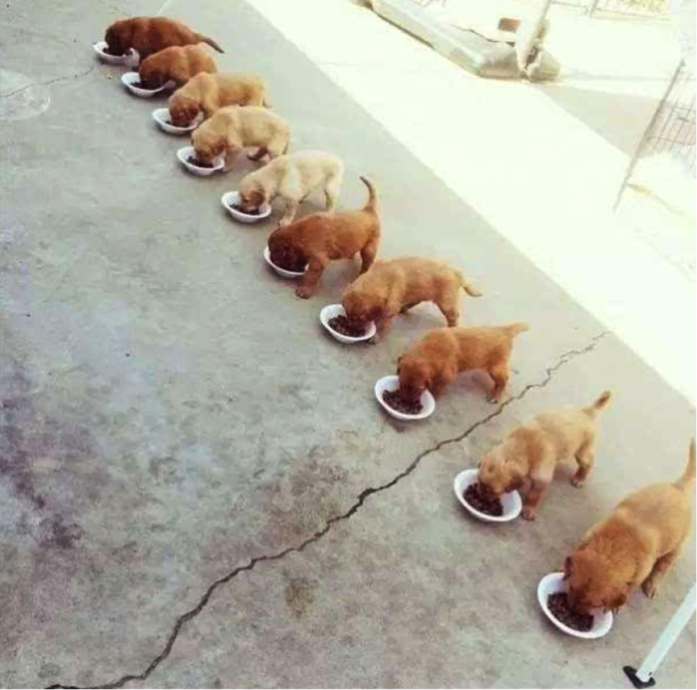
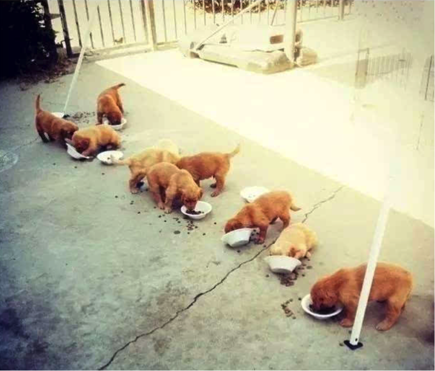

# ZooKeeper

# 1 产生背景

当今是个分布式、集群、云计算等名词满天飞的时代。造成这种局面的一个重要因素就是，单一机器的处理能力已经不能满足我们的需求，不得不采用由多台机器组成的服务集群。服务集群对外提供服务的过程中，可以分解处理压力，在一定程度上打破性能瓶颈，并提高服务的可用性（不会因为一台机器宕机而造成服务不可用）。

上图中有三台机器，每台机器运行同样的一个应用程序。然后我们将这三台机器通过网络连接起来，构成一个系统来为用户提供服务，对用户来说这个系统的架构是透明的，他感觉不到这个系统是一个什么样的架构。那么我们就可以把这种系统称作一个分布式系统。

那么，问题来了：

- 程序的运行往往依赖很多配置文件，比如数据库地址、黑名单控制、服务地址列表等，而且有些配置信息需要频繁地进行动态变更，这时候怎么保证所有机器共享的配置信息保持一致？
- 如果有一台机器宕机了，其他机器如何感知到这一变化并接管任务？如果用户激增，需要增加机器来缓解压力，如何做到不重启集群而完成机器的添加？
- 用户数量增加或者减少，会出现有的机器资源使用繁忙、有的却空闲的情况，如何让每台机器感知到其他机器的负载状态从而实现负载均衡？
- 在一台机器上让多个进程或者多个线程操作同一资源比较简单，因为可以有大量的状态信息或者日志信息提供保证，比如 A 和 B 两个进程同时写一个文件，加锁就可以实现。但是分布式系统怎么办？需要一个第三方的分配锁的机制，几百台 Worker 都对同一个网络中的文件执行写操作，怎么协同？还有，怎么保证高效地运行？

除了上面列举的几种，还有很多细思极恐的问题。分布式系统到底有多让人抓狂，可以想想你第一次接触多线程的感觉：

计划中的多线程

现实中的多线程

分布式系统可以看作多线程的 N 级加强版……

# 2 ZooKeeper 的前世今生

分布式系统的很多难题，都是由于缺少协调机制造成的。

在分布式协调技术方面，比较有代表性的是 Google 的 Chubby 和 Apache 的 ZooKeeper（近年来随 Kubernetes 流行起来的 etcd 也是常见的选择）。有人会问，既然有了 Chubby，为什么还要弄一个 ZooKeeper，难道 Chubby 做得不够好吗？主要是因为 Chubby 是非开源的，仅供 Google 自家使用。后来雅虎参考 Chubby 开发出了 ZooKeeper，也实现了类似的分布式锁的功能，并且将 ZooKeeper 作为开源项目捐献给了 Apache，这样大家就可以使用 ZooKeeper 所提供的锁服务了。而且 ZooKeeper 在分布式领域久经考验，它的可靠性、可用性都经过了理论和实践的验证。

至于这个神器为什么叫 ZooKeeper，与外国人一贯的幽默精神有关。

众所周知，外国人喜欢用动物作为吉祥物，在 IT 界也不例外。比如，负责大数据工作的 Hadoop 是一头黄色的大象；负责数据仓库的 Hive 是一个虚拟蜂巢；负责数据分析的 Apache Pig 是一头聪明的猪；作为 Web 容器的 Tomcat 是一只雄猫……那好，负责分布式协调工作的角色就叫 ZooKeeper（动物园饲养员）吧。

# 3 ZooKeeper 能干什么

官方说辞是：

ZooKeeper 分布式服务框架是 Apache Hadoop 的一个子项目（注：ZooKeeper 早期是 Hadoop 的子项目，后已独立为 Apache 顶级项目），它主要是用来解决分布式应用中经常遇到的一些数据管理问题，如：统一命名服务、状态同步服务、集群管理、分布式应用配置项的管理等。简化分布式应用协调及其管理的难度，提供高性能的分布式服务。ZooKeeper 的目标就是封装好复杂易出错的关键服务，将简单易用的接口和性能高效、功能稳定的系统提供给用户。

ZooKeeper 在一致性、可用性、容错性方面的保证，也是它的成功之处，它获得的一切成功都与它采用的协议——Zab 协议密不可分，这些内容将会在后面介绍。

为了实现前面提到的各种服务，比如分布式锁、配置维护、组服务等，ZooKeeper 设计了一种新的数据结构——Znode，然后在该数据结构的基础上定义了一些原语，也就是关于该数据结构的一些操作。有了这些数据结构和原语还不够，因为 ZooKeeper 工作在分布式环境下，服务是通过消息以网络的形式发送给分布式应用程序的，所以还需要一个通知机制——Watcher 机制。总结一下，ZooKeeper 所提供的服务主要是通过数据结构 + 原语 + Watcher 机制这三个部分来实现的。

# 4 数据结构

ZooKeeper 会维护一个具有层次关系的数据结构，它非常类似于一个标准的文件系统：

树形结构的每个节点都被称作 **Znode**。

Znode 通过路径引用，如同 Unix 中的文件路径。**路径必须是绝对的**，因此它们必须由斜杠字符来开头。除此以外，它们必须是唯一的，也就是说每一个路径只有一个表示，因此这些路径不能改变。在 ZooKeeper 中，路径由 Unicode 字符串组成，并且有一些限制。**路径 `/zookeeper` 是保留节点，用以保存管理信息**，比如配额信息。

## 4.1 Znode 结构

Znode 兼具文件和目录两种特点：既像文件一样维护着数据、元信息、ACL（**A**ccess **C**ontrol **L**ist，访问控制列表）、时间戳等数据结构，又像目录一样可以作为路径标识的一部分。

每个 Znode 由 3 部分组成：

- stat：此为状态信息，描述该 Znode 的版本、权限等信息
- data：与该 Znode 关联的数据
- children：该 Znode 下的子节点

ZooKeeper 虽然可以关联一些数据，但并没有被设计为常规的数据库或者大数据存储，相反，它用来管理调度数据，比如分布式应用中的配置文件信息、状态信息等元数据。这些数据的共同特性就是它们都是很小的数据，通常以 KB 为单位。ZooKeeper 的服务器和客户端都被设计为严格检查并限制**每个 Znode 的数据大小至多 1 MB**，但常规使用中应该远小于此值。

## 4.2 节点类型

ZooKeeper 中的节点有两种，分别为**临时节点**（Ephemeral Node）和**永久节点**（Persistent Node）。节点的类型在创建时即被确定，并且不能改变。

两种节点的区别在于是否依赖于**会话（Session）**而生存。客户端和 ZooKeeper 服务器的一次连接称为一次会话。客户端靠与服务器建立一个 TCP 长连接来维持一个会话，客户端在启动的时候首先会与服务器建立一个 TCP 连接，通过这个连接，客户端能够通过心跳检测与服务器保持有效的会话，也能向 ZooKeeper 服务器发送请求并获得响应。

**（1）临时节点**：该节点的生命周期依赖于创建它们的会话。一旦会话结束，临时节点将被自动删除，当然也可以手动删除。虽然每个临时的 Znode 都会绑定到一个客户端会话，但它们对所有的客户端还是可见的。另外，ZooKeeper 的**临时节点不允许拥有子节点**。

**（2）永久节点**：该节点的生命周期不依赖于会话，并且只有在客户端显式执行删除操作的时候，它们才能被删除。

另外，当创建 Znode 的时候，用户可以请求在 ZooKeeper 的路径结尾添加一个递增的计数。这个计数对于此节点的父节点来说是唯一的：当客户端请求创建节点 A 时，ZooKeeper 会根据父节点维护的计数器（实现上取自父节点的 cversion），为节点 A 生成一个在该父节点下唯一的编号（格式为 10 位数字，不足补 0，这个编号只会一直增长）。这样的节点称为**顺序节点**。

临时节点与永久节点都可以成为顺序节点。细分一下，共有四种节点类型：

- **PERSISTENT**：持久化目录节点，客户端与 ZooKeeper 断开连接后，该节点依旧存在
- **PERSISTENT_SEQUENTIAL**：持久化顺序编号目录节点，客户端与 ZooKeeper 断开连接后，该节点依旧存在，只是 ZooKeeper 给该节点名称进行了顺序编号
- **EPHEMERAL**：临时目录节点，客户端与 ZooKeeper 断开连接后，该节点被删除
- **EPHEMERAL_SEQUENTIAL**：临时顺序编号目录节点，客户端与 ZooKeeper 断开连接后，该节点被删除，只是 ZooKeeper 给该节点名称进行了顺序编号

此外，ZooKeeper 3.5.3 起还新增了容器节点（CONTAINER，最后一个子节点被删除后会被服务端自动清理）和 TTL 节点（如 PERSISTENT_WITH_TTL，超过指定时间未被修改且没有子节点时会被删除）。

## 4.3 数据访问

ZooKeeper 中的每个节点存储的数据要被**原子性地操作**。也就是说，读操作将获取与节点相关的所有数据，写操作也将替换掉节点的所有数据。

另外，每一个节点都拥有自己的 ACL，这个列表规定了用户的权限，即限定了特定用户对目标节点可以执行的操作，有以下权限：

- CREATE：创建子节点的权限
- READ：获取节点数据和子节点列表的权限
- WRITE：更新节点数据的权限
- DELETE：删除子节点的权限
- ADMIN：设置节点 ACL 的权限

上面的权限有点类似信息系统的权限管理，在开发系统的时候一般也会对数据做这些权限管理。一个 ZooKeeper 集群可能会服务很多的业务，尤其是在一些大公司，ZooKeeper 集群的节点中会保存重要的信息，这些信息通常只能对一部分访问者开放，通过 ACL 我们可以对某些节点的访问进行授权，从而保证数据的安全。

## 4.4 zxid

致使 ZooKeeper 节点状态改变的每一个操作都将使节点接收到一个 zxid 格式的时间戳，并且这个时间戳**全局有序**。也就是说，每个对节点的改变都将产生一个唯一的 zxid。如果 zxid1 的值小于 zxid2 的值，那么 zxid1 所对应的事件发生在 zxid2 所对应的事件之前。实际上，ZooKeeper 的每个节点主要维护着两个 zxid 值，分别为 cZxid、mZxid（此外，节点状态中还有记录子节点列表最近一次变更的 pZxid）：

- cZxid：节点的创建时间所对应的 zxid 格式时间戳
- mZxid：节点的修改时间所对应的 zxid 格式时间戳

实现中 zxid 是一个 64 位的数字，它的高 32 位是 epoch，用来标识 Leader 关系是否改变，每次一个 Leader 被选出来，它都会有一个新的 epoch；低 32 位是个递增计数。

## 4.5 版本号

版本号是用来记录节点数据、节点的子节点列表或者权限信息的**修改次数**。如果一个节点的 version 是 1，就代表这个节点的数据从创建以来被修改了一次。

对节点的每一次更新操作都将致使这个节点相应的版本号增加。每个节点维护着三个版本号，它们分别为：

- version：节点数据版本号
- cversion：子节点版本号
- aversion：节点所拥有的 ACL 版本号

## 4.6 Watcher 机制

ZooKeeper 允许用户在指定节点上注册一些 Watcher，当数据节点发生变化的时候，ZooKeeper 服务器会把这个变化的通知发送给感兴趣的客户端。这是 ZooKeeper 的核心特性，ZooKeeper 的很多功能都是基于这个特性实现的。

两个客户端都在 ZooKeeper 集群中注册了 Watcher（事件监听器），那么当 ZooKeeper 中的节点数据发生变化的时候，ZooKeeper 会把这一变化的通知发送给客户端，当客户端收到这个变化通知的时候，会触发某些提前定义好的动作。

一般来说，ZooKeeper 会向客户端发送且仅发送一条通知，即传统的 Watcher 是一次性的，触发后需要重新注册。ZooKeeper 3.6.0 起新增了持久化 Watch 和持久化递归 Watch（通过 `addWatch` 注册），触发后不会被移除。

# 5 系统架构

ZooKeeper 集群是由多台机器组成的，每台机器都充当了特定的角色，各种角色在协作过程中履行自己的任务，从而对外提供稳定、可靠的服务。

由上图可知，ZooKeeper 集群由多台机器组成（这不废话吗），客户端的请求有可能被分配给任何一台机器来处理。考虑下面一个场景：客户端 A 问机器 1，现在几点了，机器 1 回答下午两点半；与此同时，客户端 B 问机器 2，现在几点了，机器 2 说，凌晨三点。两个客户端一交流，发现驴唇不对马嘴，整个世界就乱了。可见，ZooKeeper 集群时刻需要保持内部统一，无论客户端连接哪台机器，给出的响应都应该保持一致。

为了保证数据的一致性，ZooKeeper 对机器进行了角色划分：

在每台机器数据保持一致的情况下，ZooKeeper 集群自然可以保证对于每次查询都返回同样的结果。但是，如果客户端发起增、删、改这类会引起数据变动的请求呢？多台机器自说自话，你让往东，他让往西，你要打狗，他要撵鸡，听谁的？

正所谓，家有千口，主事一人。不管有多少台机器，只能有一台机器充当 Leader 的角色，只有 Leader 才有权力发起更改数据的操作，Follower 如果接收到了更改数据的请求，需要转交给 Leader 来处理。

Leader 接收到一个更改数据的请求后，会广播消息：

每个 Follower 请注意！现在颁布 001 号命令，对某个节点执行某项操作。收到请回答！

Follower 按照 Leader 的要求执行完任务之后，会发送一条消息：

老大老大，任务执行完毕！

一旦 Leader 收到了**半数以上**的 Follower 的确认消息，就判定该操作已生效，会再发一条广播：

每个 Follower 请注意！001 号命令已生效！

以上只是简单描述了 Leader 与 Follower 的一种交互场景，其实还有很多问题需要解决，比如：

- 这个 Leader 是怎么选出来的？
- Leader 发出的消息怎么保证顺序？
- Leader 崩溃后怎么恢复？
- ……

# 6 Zab 协议

ZooKeeper 服务的内部通信基于 **Zab（ZooKeeper Atomic Broadcast）协议**，Zab 是在 **Paxos 算法**基础上扩展改造而来的。

Zab 协议有两种模式，它们分别是**恢复模式（选主）**和**广播模式（同步）**。

当服务启动或者在领导者崩溃后，Zab 就进入了恢复模式，当领导者被选举出来，且大多数 Server 完成了和 Leader 的状态同步以后，恢复模式就结束了。状态同步保证了 Leader 和其他 Server 具有相同的系统状态。

选举出 Leader 节点后，Zab 进入原子广播阶段，这时 Leader 为和自己同步的每个 Follower 节点创建一个操作序列，一个时期内一个 Follower 只能和一个 Leader 保持同步，Leader 节点与 Follower 节点使用心跳检测来感知对方的存在。当 Leader 节点在超时时间内收到来自 Follower 的心跳检测时，Follower 节点会一直与该节点保持连接；若超时时间内 Leader 没有接收到来自过半 Follower 节点的心跳检测或 TCP 连接断开，那么 Leader 会结束当前周期的领导，切换到 LOOKING 状态，所有 Follower 节点也会放弃该 Leader 节点并切换到 LOOKING 状态，然后开始新一轮选举。

每个 Server 在工作过程中有四种状态：

- LOOKING：当前 Server 不知道 Leader 是谁，正在搜寻
- LEADING：当前 Server 即为选举出来的 Leader
- FOLLOWING：Leader 已经选举出来，当前 Server 与之同步
- OBSERVING：Observer 的行为在大多数情况下与 Follower 完全一致，但是它们不参加选举和投票，而仅仅接受（observing）选举和投票的结果

## 6.1 选举流程

当 Leader 崩溃或者 Leader 失去大多数的 Follower 时，ZooKeeper 进入恢复模式，恢复模式需要重新选举出一个新的 Leader，让所有的 Server 都恢复到一个正确的状态。早期 ZooKeeper 的选举算法有两种：一种是基于 basic paxos 实现的，另外一种是基于 fast paxos 算法实现的，系统默认的选举算法为 fast paxos（即 FastLeaderElection）。其他选举算法已在 3.4.0 中被标记为废弃，3.6.0 起只保留 FastLeaderElection 一种。

fast paxos 的流程是：在选举过程中，某 Server 首先向所有 Server 提议自己要成为 Leader，当其他 Server 收到提议以后，解决 epoch 和 zxid 的冲突，并接受对方的提议，然后向对方发送接受提议完成的消息，重复这个流程，最后一定能选举出 Leader。

用文字描述就是：

（1）全天下我最牛，在我没有发现比我牛的推荐人的情况下，我就一直推举我当 Leader。第一次投票那必须推举我自己当 Leader。

（2）每当我接收到其他的被推举者，我都要回馈一个信息，表明我还是不是推举我自己。如果被推举者没我大，我就一直推举我当 Leader，是我是我还是我！

（3）我有一个票箱，和我属于同一轮的投票情况都在这个票箱里面。一人一票，重复的或者过期的票，我都不接受。

（4）一旦我不再推举我自己了（这时我发现别人推举的人比我推荐的更牛），我就把我的票箱清空，重新发起一轮投票（这时我的票箱一定有两票了，都是选的我认为最牛的人）。

（5）一旦我发现收到的推举信息中投票轮要高于我的投票轮，我也要清空我的票箱，并且还是投当初我觉得最牛的那个人（除非当前的人比我最初的推荐牛，我就顺带更新我的推荐）。

（6）不断地重复上面的过程，不断地告诉别人“我的投票是第几轮”“我推举的人是谁”，直到我的票箱中“我推举的最牛的人”收到了不少于 `N/2 + 1` 的推举投票。

（7）这时我就可以决定我是 Follower 还是 Leader 了（如果自始至终都是我最牛，那我就是 Leader 咯，其他情况就是 Follower 咯）。并且不论随后收到谁的投票，都向它直接反馈“我的结果”。

其流程图如下所示：

## 6.2 同步流程

选完 Leader 以后，ZooKeeper 就进入状态同步过程：

1. Leader 等待 Server 连接
2. Follower 连接 Leader，将最大的 zxid 发送给 Leader
3. Leader 根据 Follower 的 zxid 确定同步点
4. 完成同步后通知 Follower 已经成为 UPTODATE 状态
5. Follower 收到 UPTODATE 消息后，又可以重新接受 Client 的请求进行服务了

流程图如下所示：

## 6.3 Leader 工作流程

Leader 主要有三个功能：

1. 恢复数据
2. 维持与 Learner 的心跳，接收 Learner 请求并判断 Learner 的请求消息类型
3. Learner 的消息类型主要有 **PING** 消息、**REQUEST** 消息、**ACK** 消息、**REVALIDATE** 消息，根据不同的消息类型，进行不同的处理
   - PING 消息是指 Learner 的心跳信息
   - REQUEST 消息是 Follower 发送的提议信息，包括写请求及同步请求
   - ACK 消息是 Follower 对提议的回复，超过半数的 Follower 通过，则 commit 该提议
   - REVALIDATE 消息用来延长 Session 有效时间

Leader 的工作流程简图如下所示：

## 6.4 Follower 工作流程

Follower 主要有四个功能：

1. 向 Leader 发送请求（PING 消息、REQUEST 消息、ACK 消息、REVALIDATE 消息）
2. 接收 Leader 消息并进行处理
3. 接收 Client 的请求，如果为写请求，发送给 Leader 进行投票
4. 返回 Client 结果

Follower 的消息循环处理如下几种来自 Leader 的消息：

- **PING** 消息：心跳消息
- **PROPOSAL** 消息：Leader 发起的提案，要求 Follower 投票
- **COMMIT** 消息：服务器端最新一次提案的信息
- **UPTODATE** 消息：表明同步完成
- **REVALIDATE** 消息：根据 Leader 的 REVALIDATE 结果，关闭待 revalidate 的 Session 或者允许其接受消息
- **SYNC** 消息：返回 SYNC 结果到客户端，这个消息最初由客户端发起，用来强制得到最新的更新

Follower 的工作流程简图如下所示：

Observer 的流程不再叙述，Observer 流程和 Follower 唯一不同的地方就是 Observer 不会参加 Leader 发起的投票。

## 6.5 两段式提交

ZooKeeper 集群是通过“**两段提交协议**”（a two-phase commit）来发起意向提议的。

第一阶段：Leader 给所有的 Follower 发送一个 PROPOSAL 消息，Follower 接收到 PROPOSAL 消息后，将其写到磁盘，然后发送给 Leader 一个 ACK 消息，告知已经收到。

第二阶段：当 Leader 收到法定人数（quorum）的 Follower 的 ACK 时，发送 COMMIT 消息执行提交。

为了保证事务的顺序一致性，ZooKeeper 采用了递增的事务 ID（zxid）来标识事务。所有的提议（Proposal）都在被提出的时候加上了 zxid。实现中 zxid 是一个 64 位的数字，它的高 32 位是 epoch，用来标识 Leader 关系是否改变，每次一个 Leader 被选出来，它都会有一个新的 epoch，标识当前属于哪个 Leader 的统治时期；低 32 位用于递增计数。

Zab 协议保证：

（1）如果 Leader 以 T1 和 T2 的顺序广播，那么所有的 Server 必须先执行 T1，再执行 T2。

（2）如果任意一个 Server 以 T1、T2 的顺序 commit 执行，其他所有的 Server 也必须以 T1、T2 的顺序执行。

“两段提交协议”最大的问题是，如果 Leader 发送了 PROPOSAL 消息后崩溃（crash）或暂时失去连接，会导致整个集群处在一种不确定的状态（Follower 不知道该放弃这次提交还是执行提交）。ZooKeeper 这时会选出新的 Leader，请求处理也会移到新的 Leader 上，不同的 Leader 由不同的 epoch 标识。切换 Leader 时，需要解决下面两个问题：

（1）Never forget delivered messages

Leader 在 COMMIT 投递到任何一台 Follower 之前崩溃，只有它自己 commit 了。新 Leader 必须保证这个事务也被 commit。

（2）Let go of messages that are skipped

Leader 产生某个 proposal，但是在崩溃之前，没有 Follower 看到这个 proposal。该 Server 恢复时，必须丢弃这个 proposal。

# 7 Paxos 算法

Paxos 是一个基于消息传递的一致性算法，由 Leslie Lamport 在 1990 年提出，此后被广泛应用于分布式计算中，Google 的 Chubby、Apache 的 ZooKeeper 都是基于它的理论来实现的。Paxos 还曾被认为是唯一的分布式一致性算法，其他的算法都是 Paxos 的改进或简化（例如 2014 年提出的 Raft，如今已被 etcd 等系统广泛采用）。有个问题要提一下，Paxos 有一个前提：不存在拜占庭将军问题（即节点不会伪造或篡改消息，不存在恶意节点）。就是说 Paxos 只有在一个可信的计算环境中才能成立，这个环境是不会被入侵所破坏的。

Paxos 描述了这样一个场景：有一个叫做 Paxos 的小岛（Island）上面住了一批居民，岛上面所有的事情由一些特殊的人决定，他们叫做议员（Senator）。议员的总数（Senator Count）是确定的，不能更改。岛上每次环境事务的变更都需要通过一个提议（Proposal），每个提议都有一个编号（PID），这个编号是一直增长的，不能倒退。每个提议都需要超过半数（`Senator Count / 2 + 1`）的议员同意才能生效。每个议员只会同意大于当前编号的提议，包括已生效的和未生效的。如果议员收到小于等于当前编号的提议，他会拒绝，并告知对方：你的提议已经有人提过了。这里的当前编号是每个议员在自己记事本上面记录的编号，他不断更新这个编号。整个议会不能保证所有议员记事本上的编号总是相同的。现在议会有一个目标：保证所有的议员对于提议都能达成一致的看法。

好，现在议会开始运作，所有议员一开始记事本上面记录的编号都是 0。有一个议员发了一个提议：将电费设定为 1 元/度。他首先看了一下记事本，嗯，当前提议编号是 0，那么我的这个提议的编号就是 1，于是他给所有议员发消息：1 号提议，设定电费 1 元/度。其他议员收到消息以后查了一下记事本，哦，当前提议编号是 0，这个提议可接受，于是他记录下这个提议并回复：我接受你的 1 号提议，同时他在记事本上记录：当前提议编号为 1。发起提议的议员收到了超过半数的回复，立即给所有人发通知：1 号提议生效！收到的议员会修改他的记事本，将 1 号提议由记录改成正式的法令，当有人问他电费为多少时，他会查看法令并告诉对方：1 元/度。

现在看冲突的解决：假设总共有三个议员 S1、S2、S3，S1 和 S2 同时发起了一个提议：1 号提议，设定电费。S1 想设为 1 元/度，S2 想设为 2 元/度。结果 S3 先收到了 S1 的提议，于是他做了和前面同样的操作。紧接着他又收到了 S2 的提议，结果他一查记事本，咦，这个提议的编号小于等于我的当前编号 1，于是他拒绝了这个提议：对不起，这个提议先前提过了。于是 S2 的提议被拒绝，S1 正式发布了提议：1 号提议生效。S2 向 S1 或者 S3 打听并更新了 1 号法令的内容，然后他可以选择继续发起 2 号提议。

好，我觉得 Paxos 的精华就这么多内容。现在让我们来对号入座，看看在 ZooKeeper Server 里面 Paxos 是如何得以贯彻实施的。

- 小岛（Island）——ZooKeeper Server Cluster
- 议员（Senator）——ZooKeeper Server
- 提议（Proposal）——Znode Change（Create/Delete/SetData…）
- 提议编号（PID）——zxid（ZooKeeper Transaction ID）
- 正式法令——所有 Znode 及其数据

貌似关键的概念都能一一对应上，但是等一下，Paxos 岛上的议员应该是人人平等的吧，而 ZooKeeper Server 好像有一个 Leader 的概念。没错，其实 Leader 的概念也应该属于 Paxos 范畴。如果议员人人平等，在某种情况下会由于提议的冲突而产生一个“活锁”（所谓活锁，我的理解是大家都没有死，都在动，但是一直解决不了冲突问题）。Paxos 的作者 Lamport 在他的论文“The Part-Time Parliament”中阐述了这个问题并给出了解决方案——在所有议员中设立一个总统，只有总统有权发出提议，如果议员有自己的提议，必须发给总统并由总统来提出。好，我们又多了一个角色：总统。

- 总统——ZooKeeper Server Leader

现在我们假设总统已经选好了，下面看看 ZooKeeper Server 是怎么实施的。

情况一：

居民甲（Client）到某个议员（ZooKeeper Server）那里询问（Get）某条法令的情况（Znode 的数据），议员毫不犹豫地拿出他的记事本（local storage），查阅法令并告诉他结果，同时声明：我的数据不一定是最新的。你想要最新的数据？没问题，等着，等我找总统 Sync 一下再告诉你。

情况二：

居民乙（Client）到某个议员（ZooKeeper Server）那里要求政府归还欠他的一万元钱，议员让他在办公室等着，自己将问题反映给了总统，总统询问所有议员的意见，多数议员表示欠居民的钱一定要还，于是总统发表声明，从国库中拿出一万元还债，国库总资产由 100 万变成 99 万。居民乙拿到钱回去了（Client 函数返回）。

情况三：

总统突然倒下了，议员接二连三地发现联系不上总统，于是各自发表声明，推选新的总统，总统大选期间政府停业，拒绝居民的请求。

当然还有很多其他的情况，但这些情况总是能在 Paxos 的算法中找到原型并加以解决。这也正是我们认为 Paxos 是 ZooKeeper 的灵魂的原因。当然 ZooKeeper Server 还有很多属于自己特性的东西：Session、Watcher、Version 等，需要我们花更多的时间去研究和学习。
