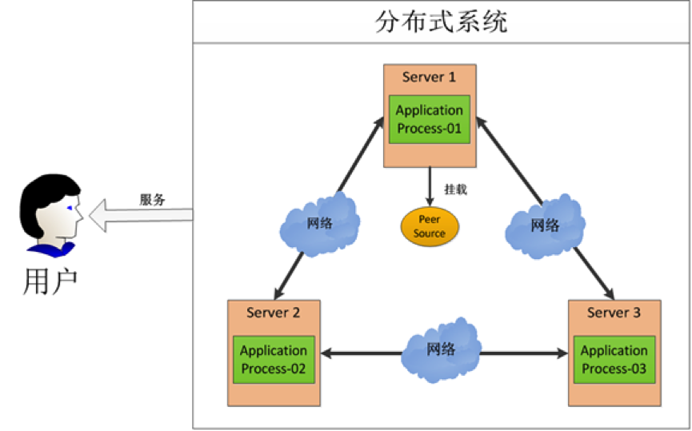
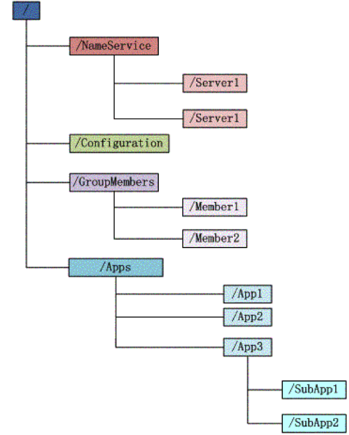
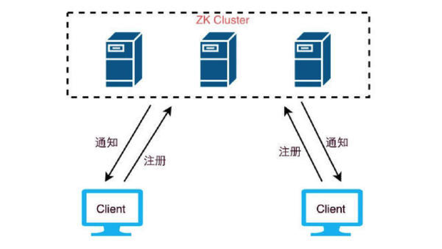
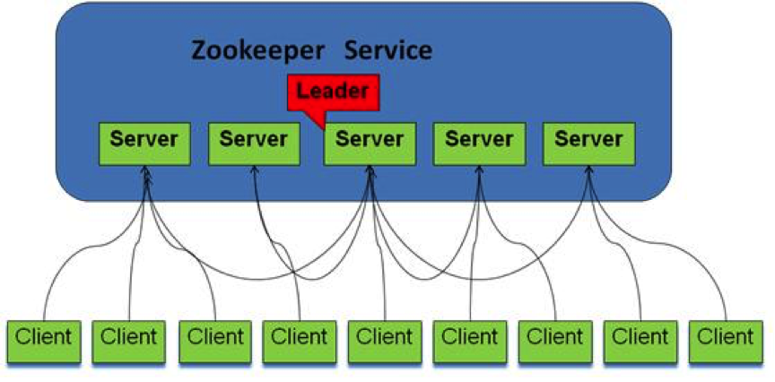
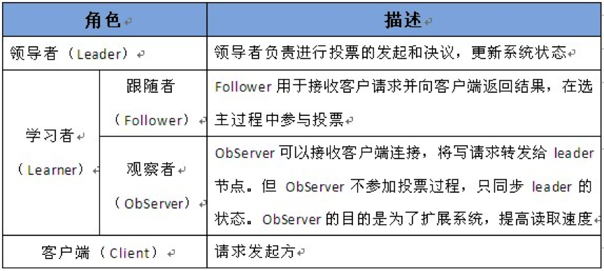
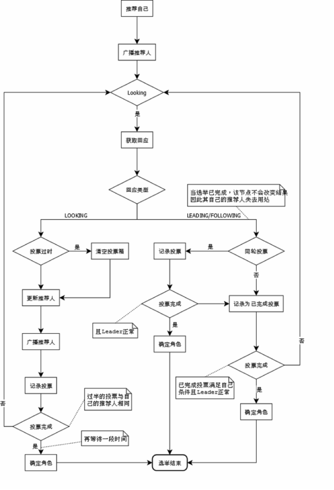
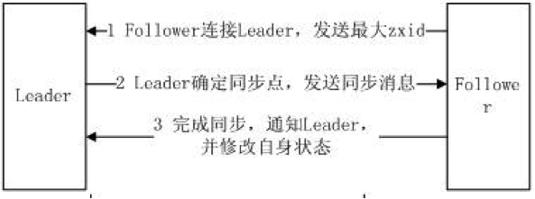
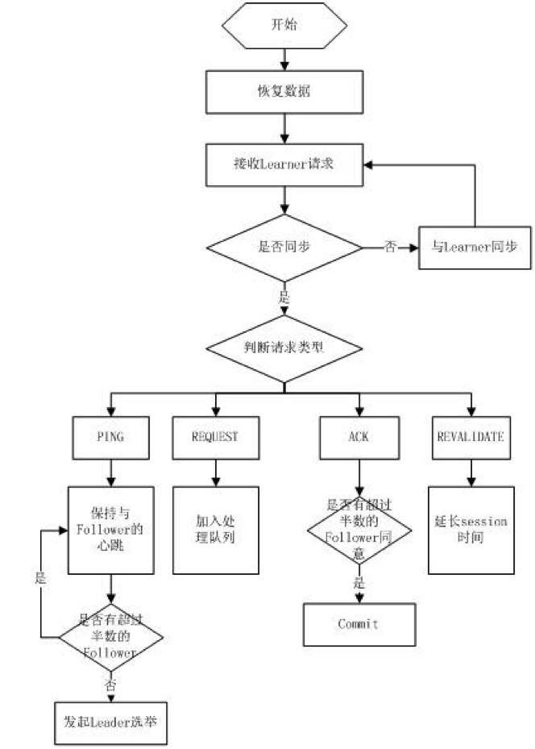
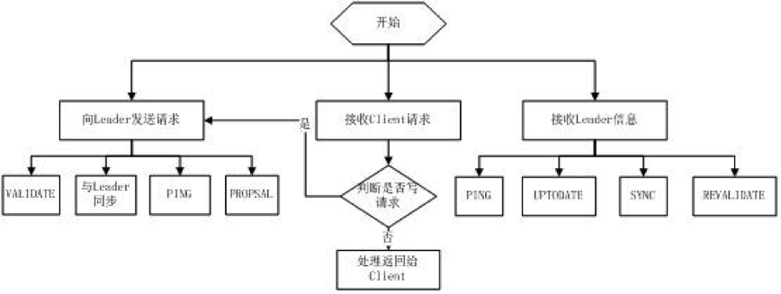

# ZooKeeper

# 1 产生背景

单台机器的处理能力和可用性都有上限，业务规模上来以后，几乎都要由多台机器组成集群对外提供服务：既能分摊处理压力、突破单机的性能瓶颈，也能提高服务的可用性，不会因为一台机器宕机而导致整个服务不可用。

上图中有三台机器，每台机器运行同样的一个应用程序。然后我们将这三台机器通过网络连接起来，构成一个系统来为用户提供服务，对用户来说这个系统的架构是透明的，他感觉不到这个系统是一个什么样的架构。那么我们就可以把这种系统称作一个分布式系统。

那么，问题来了：

- 程序的运行往往依赖很多配置文件，比如数据库地址、黑名单控制、服务地址列表等，而且有些配置信息需要频繁地进行动态变更，这时候怎么保证所有机器共享的配置信息保持一致？
- 如果有一台机器宕机了，其他机器如何感知到这一变化并接管任务？如果用户激增，需要增加机器来缓解压力，如何做到不重启集群而完成机器的添加？
- 用户数量增加或者减少，会出现有的机器资源使用繁忙、有的却空闲的情况，如何让每台机器感知到其他机器的负载状态从而实现负载均衡？
- 在一台机器上让多个进程或者多个线程操作同一资源比较简单，因为可以有大量的状态信息或者日志信息提供保证，比如 A 和 B 两个进程同时写一个文件，加锁就可以实现。但是分布式系统怎么办？需要一个第三方的分配锁的机制，几百台 Worker 都对同一个网络中的文件执行写操作，怎么协同？还有，怎么保证高效地运行？

除了上面列举的几种，分布式系统还要面对很多单机上不存在的问题：网络可能延迟、丢包甚至分区，节点可能在任意时刻宕机或假死，各台机器之间也没有统一的时钟。单机多线程的竞态条件和执行顺序不确定性已经足够让人头疼，分布式系统则把这些问题放大到了跨进程、跨机器的层面，还要额外处理“部分失败”：一个请求发出去迟迟没有回应，调用方无法判断是对方没收到、处理失败，还是响应在路上丢了。

# 2 ZooKeeper 的前世今生

分布式系统的很多难题，都是由于缺少协调机制造成的。

在分布式协调技术方面，比较有代表性的是 Google 的 Chubby 和 Apache 的 ZooKeeper。有人会问，既然有了 Chubby，为什么还要弄一个 ZooKeeper，难道 Chubby 做得不够好吗？主要是因为 Chubby 是非开源的，仅供 Google 自家使用。后来雅虎参考 Chubby 的设计开发了 ZooKeeper 并将其开源，ZooKeeper 进入 Apache 后最初是 Hadoop 的子项目，2010 年 11 月升级为 Apache 顶级项目。与 Chubby 直接提供锁服务不同，ZooKeeper 提供的是更底层的协调原语，分布式锁、选主等功能都可以在它的基础上实现。ZooKeeper 在分布式领域久经考验，它的可靠性、可用性都经过了理论和实践的验证。

如今，云原生场景下另一个常见的选择是 etcd：它基于 Raft 协议实现，是 Kubernetes 存储集群状态的组件，2020 年 11 月从 CNCF 毕业。新建的云原生系统多倾向于 etcd，而 ZooKeeper 仍是 Hadoop（如 HDFS HA）、HBase 等大数据生态以及大量存量系统的协调组件。另一个值得关注的变化来自 Kafka：它曾长期依赖 ZooKeeper 管理集群元数据，后来通过 KIP-500 引入了基于 Raft 的内置元数据仲裁机制 KRaft，2025 年 3 月发布的 Kafka 4.0 已彻底移除 ZooKeeper，只支持 KRaft 模式。

至于这个神器为什么叫 ZooKeeper，与外国人一贯的幽默精神有关。

众所周知，外国人喜欢用动物作为吉祥物，在 IT 界也不例外。比如，负责大数据工作的 Hadoop 是一头黄色的大象；负责数据仓库的 Hive 是一个虚拟蜂巢；负责数据分析的 Apache Pig 是一头聪明的猪；作为 Web 容器的 Tomcat 是一只雄猫……那好，负责分布式协调工作的角色就叫 ZooKeeper（动物园饲养员）吧。

# 3 ZooKeeper 能干什么

ZooKeeper 最初是 Apache Hadoop 的子项目，如今已是独立的 Apache 顶级项目。它主要用来解决分布式应用中经常遇到的一些数据管理问题，如：统一命名服务、状态同步服务、集群管理、分布式应用配置项的管理等。简化分布式应用协调及其管理的难度，提供高性能的分布式服务。ZooKeeper 的目标就是封装好复杂易出错的关键服务，将简单易用的接口和性能高效、功能稳定的系统提供给用户。

ZooKeeper 在一致性、可用性、容错性方面的保证，也是它的成功之处，它获得的一切成功都与它采用的协议——Zab 协议密不可分，这些内容将会在后面介绍。

为了实现前面提到的各种服务，比如分布式锁、配置维护、组服务等，ZooKeeper 设计了一种新的数据结构——Znode，然后在该数据结构的基础上定义了一些原语，也就是关于该数据结构的一些操作。有了这些数据结构和原语还不够，因为 ZooKeeper 工作在分布式环境下，服务是通过消息以网络的形式发送给分布式应用程序的，所以还需要一个通知机制——Watcher 机制。总结一下，ZooKeeper 所提供的服务主要是通过数据结构 + 原语 + Watcher 机制这三个部分来实现的。

# 4 数据结构

ZooKeeper 会维护一个具有层次关系的数据结构，它非常类似于一个标准的文件系统：

树形结构的每个节点都被称作 **Znode**。

Znode 通过路径引用，如同 Unix 中的文件路径。**路径必须是绝对的**，因此它们必须由斜杠字符来开头。除此以外，它们必须是唯一的，也就是说每一个路径只有一个表示，因此这些路径不能改变。在 ZooKeeper 中，路径由 Unicode 字符串组成，并且有一些限制。**路径 `/zookeeper` 是保留节点，用以保存管理信息**，比如配额信息。

## 4.1 Znode 结构

Znode 兼具文件和目录两种特点：既像文件一样维护着数据、元信息、ACL（**A**ccess **C**ontrol **L**ist，访问控制列表）、时间戳等数据结构，又像目录一样可以作为路径标识的一部分。

每个 Znode 由 3 部分组成：

- stat：此为状态信息，描述该 Znode 的版本、权限等信息
- data：与该 Znode 关联的数据
- children：该 Znode 下的子节点

ZooKeeper 虽然可以关联一些数据，但并没有被设计为常规的数据库或者大数据存储，相反，它用来管理调度数据，比如分布式应用中的配置文件信息、状态信息等元数据。这些数据的共同特性就是它们都是很小的数据，通常以 KB 为单位。ZooKeeper 的服务器和客户端都被设计为严格检查并限制**每个 Znode 的数据大小至多 1 MB**，但常规使用中应该远小于此值。

## 4.2 节点类型

ZooKeeper 中的节点有两种，分别为**临时节点**（Ephemeral Node）和**永久节点**（Persistent Node）。节点的类型在创建时即被确定，并且不能改变。

两种节点的区别在于是否依赖于**会话（Session）**而生存。客户端和 ZooKeeper 服务器的一次连接称为一次会话。客户端靠与服务器建立一个 TCP 长连接来维持一个会话，客户端在启动的时候首先会与服务器建立一个 TCP 连接，通过这个连接，客户端能够通过心跳检测与服务器保持有效的会话，也能向 ZooKeeper 服务器发送请求并获得响应。

**（1）临时节点**：该节点的生命周期依赖于创建它们的会话。一旦会话结束，临时节点将被自动删除，当然也可以手动删除。虽然每个临时的 Znode 都会绑定到一个客户端会话，但它们对所有的客户端还是可见的。另外，ZooKeeper 的**临时节点不允许拥有子节点**。

**（2）永久节点**：该节点的生命周期不依赖于会话，并且只有在客户端显式执行删除操作的时候，它们才能被删除。

另外，当创建 Znode 的时候，用户可以请求在 ZooKeeper 的路径结尾添加一个递增的计数。这个计数对于此节点的父节点来说是唯一的：当客户端请求创建节点 A 时，ZooKeeper 会根据父节点维护的计数器（实现上取自父节点的 cversion），为节点 A 生成一个在该父节点下唯一的编号（格式为 10 位数字，不足补 0，这个编号只会一直增长）。这样的节点称为**顺序节点**。

临时节点与永久节点都可以成为顺序节点。细分一下，共有四种节点类型：

- **PERSISTENT**：持久化目录节点，客户端与 ZooKeeper 断开连接后，该节点依旧存在
- **PERSISTENT_SEQUENTIAL**：持久化顺序编号目录节点，客户端与 ZooKeeper 断开连接后，该节点依旧存在，只是 ZooKeeper 给该节点名称进行了顺序编号
- **EPHEMERAL**：临时目录节点，客户端与 ZooKeeper 断开连接后，该节点被删除
- **EPHEMERAL_SEQUENTIAL**：临时顺序编号目录节点，客户端与 ZooKeeper 断开连接后，该节点被删除，只是 ZooKeeper 给该节点名称进行了顺序编号

此外，ZooKeeper 3.5 起还新增了两类节点：

- **容器节点**（CONTAINER，3.5.1 引入）：最后一个子节点被删除后，会被服务端自动清理，适合作为分布式锁、选主等场景的父节点
- **TTL 节点**（如 PERSISTENT_WITH_TTL，3.5.3 引入）：超过指定时间未被修改且没有子节点时会被删除；该功能默认关闭，需要通过系统属性 `zookeeper.extendedTypesEnabled=true` 开启

## 4.3 数据访问

ZooKeeper 中的每个节点存储的数据要被**原子性地操作**。也就是说，读操作将获取与节点相关的所有数据，写操作也将替换掉节点的所有数据。

另外，每一个节点都拥有自己的 ACL，这个列表规定了用户的权限，即限定了特定用户对目标节点可以执行的操作，有以下权限：

- CREATE：创建子节点的权限
- READ：获取节点数据和子节点列表的权限
- WRITE：更新节点数据的权限
- DELETE：删除子节点的权限
- ADMIN：设置节点 ACL 的权限

上面的权限有点类似信息系统的权限管理，在开发系统的时候一般也会对数据做这些权限管理。一个 ZooKeeper 集群可能会服务很多的业务，尤其是在一些大公司，ZooKeeper 集群的节点中会保存重要的信息，这些信息通常只能对一部分访问者开放，通过 ACL 我们可以对某些节点的访问进行授权，从而保证数据的安全。

## 4.4 zxid

致使 ZooKeeper 节点状态改变的每一个操作都将使节点接收到一个 zxid 格式的时间戳，并且这个时间戳**全局有序**。也就是说，每个对节点的改变都将产生一个唯一的 zxid。如果 zxid1 的值小于 zxid2 的值，那么 zxid1 所对应的事件发生在 zxid2 所对应的事件之前。实际上，ZooKeeper 的每个节点主要维护着两个 zxid 值，分别为 cZxid、mZxid（此外，节点状态中还有记录子节点列表最近一次变更的 pZxid）：

- cZxid：节点的创建时间所对应的 zxid 格式时间戳
- mZxid：节点的修改时间所对应的 zxid 格式时间戳

实现中 zxid 是一个 64 位的数字，它的高 32 位是 epoch，用来标识 Leader 关系是否改变，每次一个 Leader 被选出来，它都会有一个新的 epoch；低 32 位是个递增计数。

## 4.5 版本号

版本号是用来记录节点数据、节点的子节点列表或者权限信息的**修改次数**。如果一个节点的 version 是 1，就代表这个节点的数据从创建以来被修改了一次。

对节点的每一次更新操作都将致使这个节点相应的版本号增加。每个节点维护着三个版本号，它们分别为：

- version：节点数据版本号
- cversion：子节点版本号
- aversion：节点所拥有的 ACL 版本号

## 4.6 Watcher 机制

ZooKeeper 允许用户在指定节点上注册一些 Watcher，当数据节点发生变化的时候，ZooKeeper 服务器会把这个变化的通知发送给感兴趣的客户端。这是 ZooKeeper 的核心特性，ZooKeeper 的很多功能都是基于这个特性实现的。

两个客户端都在 ZooKeeper 集群中注册了 Watcher（事件监听器），那么当 ZooKeeper 中的节点数据发生变化的时候，ZooKeeper 会把这一变化的通知发送给客户端，当客户端收到这个变化通知的时候，会触发某些提前定义好的动作。

一般来说，ZooKeeper 会向客户端发送且仅发送一条通知，即传统的 Watcher 是一次性的，触发后需要重新注册。这带来两个问题：一是每次触发后都要多一次注册请求；二是从收到通知到重新注册之间存在时间窗口，这期间发生的变化不会再产生通知，客户端只能通过重新读取数据来弥补。

ZooKeeper 3.6.0 起新增了持久化 Watch，通过 `addWatch` 注册，触发后不会被移除，需要时用 `removeWatches` 显式删除。它有两种模式：

- `PERSISTENT`：监听单个节点，相当于一个不会失效的普通 Watcher
- `PERSISTENT_RECURSIVE`：递归监听该节点及其所有子孙节点的创建、删除和数据变更，一次注册即可覆盖整棵子树，适合配置中心、服务发现这类需要监听整个目录的场景；由于子节点的增删已经能直接收到通知，这种模式不会触发 NodeChildrenChanged 事件

# 5 系统架构

ZooKeeper 集群是由多台机器组成的，每台机器都充当了特定的角色，各种角色在协作过程中履行自己的任务，从而对外提供稳定、可靠的服务。

由上图可知，ZooKeeper 集群由多台机器组成，客户端的请求有可能被分配给任何一台机器来处理。考虑下面一个场景：客户端 A 问机器 1，现在几点了，机器 1 回答下午两点半；与此同时，客户端 B 问机器 2，现在几点了，机器 2 说，凌晨三点。两个客户端一交流，发现驴唇不对马嘴，整个世界就乱了。可见，ZooKeeper 集群时刻需要保持内部统一，无论客户端连接哪台机器，给出的响应都应该保持一致。

为了保证数据的一致性，ZooKeeper 对机器进行了角色划分：

集群成员最初只能在 `zoo.cfg` 中静态配置，增删节点需要滚动重启。3.5.0 起支持动态重配置（Dynamic Reconfiguration），可以通过 `reconfig` 命令在运行时增删服务器、调整角色；出于安全考虑，3.5.3 起该功能默认关闭，需要设置 `reconfigEnabled=true` 开启。3.6.0 起还支持为每台服务器配置多个地址（Multi-Address，地址之间用 `|` 分隔，需设置 `multiAddress.enabled=true`），服务器拥有多块网卡时，某条网络链路故障后可以切换到其他地址，提升集群对网络故障的容错能力。

在每台机器数据保持一致的情况下，ZooKeeper 集群自然可以保证对于每次查询都返回同样的结果。但是，如果客户端发起增、删、改这类会引起数据变动的请求呢？多台机器自说自话，你让往东，他让往西，你要打狗，他要撵鸡，听谁的？

正所谓，家有千口，主事一人。不管有多少台机器，只能有一台机器充当 Leader 的角色，只有 Leader 才有权力发起更改数据的操作，Follower 如果接收到了更改数据的请求，需要转交给 Leader 来处理。

Leader 接收到一个更改数据的请求后，会广播消息：

每个 Follower 请注意！现在颁布 001 号命令，对某个节点执行某项操作。收到请回答！

Follower 把这条命令写入本地事务日志之后，会回复一条消息：

老大老大，命令已记录！

一旦 Leader 收到了**过半数**服务器（Leader 自己也算一票）的确认消息，就判定该操作已生效，会再发一条广播：

每个 Follower 请注意！001 号命令已生效！

以上只是简单描述了 Leader 与 Follower 的一种交互场景，其实还有很多问题需要解决，比如：

- 这个 Leader 是怎么选出来的？
- Leader 发出的消息怎么保证顺序？
- Leader 崩溃后怎么恢复？
- ……

# 6 Zab 协议

ZooKeeper 服务的内部通信基于 **Zab（ZooKeeper Atomic Broadcast）协议**。Zab 借鉴了 **Paxos 算法**中多数派、提案编号等思想，但它并不是 Paxos 的变体，而是专为主备模式设计的原子广播协议。

Zab 协议有两种模式，它们分别是**恢复模式（选主 + 数据同步）**和**广播模式（处理写请求）**。

当服务启动或者在领导者崩溃后，Zab 就进入了恢复模式，当领导者被选举出来，且大多数 Server 完成了和 Leader 的状态同步以后，恢复模式就结束了。状态同步保证了 Leader 和其他 Server 具有相同的系统状态。

选举出 Leader 节点后，Zab 进入原子广播阶段，这时 Leader 为和自己同步的每个 Follower 节点创建一个操作序列，一个时期内一个 Follower 只能和一个 Leader 保持同步，Leader 节点与 Follower 节点使用心跳检测来感知对方的存在。当 Leader 节点在超时时间内收到来自 Follower 的心跳检测时，Follower 节点会一直与该节点保持连接；若超时时间内 Leader 没有接收到来自过半 Follower 节点的心跳检测或 TCP 连接断开，那么 Leader 会结束当前周期的领导，切换到 LOOKING 状态，所有 Follower 节点也会放弃该 Leader 节点并切换到 LOOKING 状态，然后开始新一轮选举。

每个 Server 在工作过程中有四种状态：

- LOOKING：当前 Server 不知道 Leader 是谁，正在搜寻
- LEADING：当前 Server 即为选举出来的 Leader
- FOLLOWING：Leader 已经选举出来，当前 Server 与之同步
- OBSERVING：Observer 的行为在大多数情况下与 Follower 完全一致，但是它们不参加选举和投票，而仅仅接受（observing）选举和投票的结果

## 6.1 选举流程

当 Leader 崩溃或者 Leader 失去大多数的 Follower 时，ZooKeeper 进入恢复模式，恢复模式需要重新选举出一个新的 Leader，让所有的 Server 都恢复到一个正确的状态。早期 ZooKeeper 通过 `electionAlg` 参数提供了几种选举算法：LeaderElection（0）、AuthFastLeaderElection（1、2）和 FastLeaderElection（3），默认使用 FastLeaderElection（FLE）。其他算法已在 3.4.0 中被标记为废弃，3.6.0 起只保留 FastLeaderElection 一种。需要注意，FastLeaderElection 是 ZooKeeper 自己的选举实现，与 Lamport 提出的 Fast Paxos 算法并无关系。

FastLeaderElection 的核心是“投票、比较、过半”：

（1）每台处于 LOOKING 状态的服务器先投自己一票，选票内容包括推荐的 Leader（myid）、该服务器的 zxid 和 epoch，并带上本机的选举轮次（logicalclock），广播给其他服务器。

（2）收到选票后先比较选举轮次：对方轮次更高，说明自己落后了，于是更新轮次、清空票箱，再用对方的选票与自己的推荐比较一次；对方轮次更低则直接忽略这张选票。

（3）轮次相同时，按 epoch → zxid → myid 的顺序比较推荐人（对应源码中的 `totalOrderPredicate`）：epoch 大者优先；epoch 相同则 zxid 大者优先，即数据更新的服务器优先；仍相同则 myid 大者优先。如果对方推荐的人更优，就改投对方的推荐并重新广播。优先比较 zxid，保证了当选的 Leader 拥有最完整的已提交事务。

（4）每台服务器把收到的选票记录在票箱中，同一台服务器只保留其最新的一票。一旦某个推荐人获得了过半数（`N/2 + 1`，N 为参与投票的服务器总数）的支持，再等待一小段时间（finalizeWait）确认没有更优的选票到达，选举结束。

（5）当选的服务器切换为 LEADING 状态，其他参与投票的服务器切换为 FOLLOWING 状态；Observer 不参与投票，保持 OBSERVING 状态。

（6）如果在 LOOKING 期间收到了处于 LEADING 或 FOLLOWING 状态的服务器的回复，说明集群中已经选出了 Leader，此时只要确认这个 Leader 得到了过半数的支持且仍然存活，就直接加入，不必再进行完整的选举。

其流程图如下所示：

## 6.2 同步流程

选完 Leader 以后，ZooKeeper 就进入状态同步过程：

1. Leader 等待 Server 连接
2. Follower 连接 Leader，将最大的 zxid 发送给 Leader
3. Leader 根据 Follower 的 zxid 确定同步点
4. 完成同步后通知 Follower 已经成为 UPTODATE 状态
5. Follower 收到 UPTODATE 消息后，又可以重新接受 Client 的请求进行服务了

流程图如下所示：

## 6.3 Leader 工作流程

Leader 主要有三个功能：

1. 恢复数据
2. 维持与 Learner 的心跳，接收 Learner 请求并判断 Learner 的请求消息类型
3. Learner 的消息类型主要有 **PING** 消息、**REQUEST** 消息、**ACK** 消息、**REVALIDATE** 消息，根据不同的消息类型，进行不同的处理
   - PING 消息是指 Learner 的心跳信息
   - REQUEST 消息是 Follower 发送的提议信息，包括写请求及同步请求
   - ACK 消息是 Follower 对提议的回复，超过半数的 Follower 通过，则 commit 该提议
   - REVALIDATE 消息用来延长 Session 有效时间

Leader 的工作流程简图如下所示：

## 6.4 Follower 工作流程

Follower 主要有四个功能：

1. 向 Leader 发送请求（PING 消息、REQUEST 消息、ACK 消息、REVALIDATE 消息）
2. 接收 Leader 消息并进行处理
3. 接收 Client 的请求，如果为写请求，发送给 Leader 进行投票
4. 返回 Client 结果

Follower 的消息循环处理如下几种来自 Leader 的消息：

- **PING** 消息：心跳消息
- **PROPOSAL** 消息：Leader 发起的提案，要求 Follower 投票
- **COMMIT** 消息：服务器端最新一次提案的信息
- **UPTODATE** 消息：表明同步完成
- **REVALIDATE** 消息：根据 Leader 的 REVALIDATE 结果，关闭待 revalidate 的 Session 或者允许其接受消息
- **SYNC** 消息：返回 SYNC 结果到客户端，这个消息最初由客户端发起，用来强制得到最新的更新

Follower 的工作流程简图如下所示：

Observer 的流程不再叙述，Observer 流程和 Follower 唯一不同的地方就是 Observer 不会参加 Leader 发起的投票。

## 6.5 两段式提交

ZooKeeper 集群是通过“**两段提交协议**”（a two-phase commit）来发起意向提议的。

第一阶段：Leader 给所有的 Follower 发送一个 PROPOSAL 消息，Follower 接收到 PROPOSAL 消息后，将其写到磁盘，然后发送给 Leader 一个 ACK 消息，告知已经收到。

第二阶段：当 Leader 收到法定人数（quorum，即过半数服务器，Leader 自己也算一票）的 ACK 时，发送 COMMIT 消息执行提交。

与传统数据库中的两阶段提交（2PC）不同，Zab 不需要所有参与者都同意，只要过半数确认即可提交，也没有 abort 阶段：Follower 只负责把提案持久化并回复 ACK，不会否决提案。因此少数 Follower 故障或响应缓慢不会阻塞整个集群。

为了保证事务的顺序一致性，ZooKeeper 采用了递增的事务 ID（zxid）来标识事务。所有的提议（Proposal）都在被提出的时候加上了 zxid。实现中 zxid 是一个 64 位的数字，它的高 32 位是 epoch，用来标识 Leader 关系是否改变，每次一个 Leader 被选出来，它都会有一个新的 epoch，标识当前属于哪个 Leader 的统治时期；低 32 位用于递增计数。

Zab 协议保证：

（1）如果 Leader 以 T1 和 T2 的顺序广播，那么所有的 Server 必须先执行 T1，再执行 T2。

（2）如果任意一个 Server 以 T1、T2 的顺序 commit 执行，其他所有的 Server 也必须以 T1、T2 的顺序执行。

广播阶段本身无法应对 Leader 故障：如果 Leader 发送了 PROPOSAL 消息后崩溃（crash）或暂时失去连接，有的 Follower 收到了提案、有的没收到，有的提案可能已经在部分节点上提交，集群会处在一种不一致的状态。这正是 Zab 恢复模式要解决的问题：集群重新进入选举，选出 zxid 最大（即拥有最完整事务记录）的服务器作为新 Leader，并通过前面的同步流程让所有 Follower 与它对齐，不同的 Leader 由不同的 epoch 标识。恢复过程需要满足下面两个要求：

（1）Never forget delivered messages

Leader 在 COMMIT 投递到任何一台 Follower 之前崩溃，只有它自己 commit 了。新 Leader 必须保证这个事务也被 commit。由于这个提案此前已被过半数服务器持久化，而任意两个多数派必有交集，zxid 最大的新 Leader 一定包含它。

（2）Let go of messages that are skipped

Leader 产生某个 proposal，但是在崩溃之前，没有 Follower 看到这个 proposal。该 Server 恢复时，必须丢弃这个 proposal。

# 7 Paxos 算法

Paxos 是一个基于消息传递的一致性算法，由 Leslie Lamport 提出，论文“The Part-Time Parliament”于 1990 年投稿，直到 1998 年才在 ACM TOCS 上正式发表。此后 Paxos 被广泛应用于分布式系统中，Google 的 Chubby 就是基于它实现的。Paxos 一度被认为是唯一的分布式一致性算法，其他算法都是它的改进或简化；2014 年提出的 Raft 以易于理解为设计目标，如今已被 etcd 等系统广泛采用。Paxos 有一个前提：不存在拜占庭将军问题，即节点可能宕机、消息可能丢失或延迟，但节点不会伪造或篡改消息。也就是说，Paxos 只适用于可信的计算环境。

Lamport 在论文中用希腊小岛 Paxos 上的议会来描述这个算法：议员（Senator）人数固定，每项法令都要通过带编号的提议（Proposal）产生，编号只增不减，超过半数的议员同意才能生效。在 Basic Paxos 中，确定一个值需要两个阶段：

1. **Prepare 阶段**：提议者选择一个编号 n，向所有接受者发送 Prepare(n)。接受者如果没有响应过比 n 更大的编号，就承诺不再接受编号小于 n 的提议，并把自己已经接受过的编号最大的提议（如果有）返回给提议者
2. **Accept 阶段**：提议者收到过半数的承诺后，如果有接受者返回了已接受的提议，就必须沿用其中编号最大的那个值，否则才可以使用自己的值，然后发送 Accept(n, value)。接受者如果没有承诺过比 n 更大的编号，就接受这个提议。过半数接受者接受后，这个值就被确定下来

“必须沿用已接受的值”这条规则保证了：一旦某个值被多数派接受，之后任何更大编号的提议都只能提出同一个值，不会出现两个议员各自宣布不同法令的情况。

如果多个提议者交替用更大的编号发起 Prepare，就可能互相抢占、谁也无法完成 Accept，形成“活锁”。Lamport 在论文中给出的解决方案是选出一位总统，只由总统发起提议，其他议员的提议都转交给总统。Multi-Paxos 以及 Zab、Raft 等协议引入 Leader 角色，也是出于同样的考虑。

把这套模型和 ZooKeeper 对照一下：

| Paxos 中的概念 | ZooKeeper 中的对应 |
| --- | --- |
| 小岛（Island） | ZooKeeper 集群 |
| 议员（Senator） | ZooKeeper Server |
| 总统 | Leader |
| 提议（Proposal） | Znode 变更（Create/Delete/SetData…） |
| 提议编号 | zxid |
| 法令 | 所有 Znode 及其数据 |

对应到具体场景：

- **读请求**：客户端所连接的 Server 直接读取本地数据返回，数据不一定是最新的；如果需要读到最新数据，可以先调用 `sync`，让该 Server 与 Leader 同步之后再读
- **写请求**：Server 把请求转交给 Leader，Leader 发起提案，过半数服务器确认后提交，再把结果返回给客户端
- **Leader 宕机**：各 Server 发现联系不上 Leader 后进入选举，选举期间集群暂停对外服务，直到新 Leader 选出并完成数据同步

需要强调的是，ZooKeeper 并没有直接实现 Paxos。Zab 借鉴了 Paxos 中多数派、提案编号和 Leader 的思想，但两者的目标不同：Paxos 解决的是在可能存在多个提议者的情况下如何就某个值达成一致；Zab 则针对主备架构设计，重点保证同一个 Leader 广播的事务严格按顺序执行，以及 Leader 切换后已提交的事务不丢失、未提交的事务被丢弃。除此之外，ZooKeeper 还有很多属于自己的特性，比如 Session、Watcher、Version 等。
