# Git 基础

# 1 为什么使用 Git

孔子说过：“名不正，则言不顺；言不顺，则事不成。”

我们在学习一项新技术之前，弄清楚为什么要学它至关重要。至于为什么要学习 Git，我用一段 `if-else` 语句告诉你原因：

```java
if (你相信我) {
	我推荐你学习;
} else if (诚然，我又不是什么大牛，你可以不相信我，但是你应该相信大多数人的选择) {
	世界上越来越多的人、越来越多的项目在使用 Git，大势所趋，势不可挡;
} else if (用的人多算什么，你可能认为真理掌握在少数人手中) {
	你可以不相信大众，但是你应该相信 Linus Torvalds，就是靠一己之力写出了 Linux 内核原型的大神;
	// 我说的是内核的原型，不是内核的全部，不要挑我毛病
	Git 就是他创造的第二个作品;
} else {
	什么？！你没听过 Linus Torvalds，更不知道 Linux 是个什么东西……
	throw new Exception("好吧，你赢了，你可以不用学 Git，我运行不下去了");
}
```

# 2 Git 是什么

首先，Git 是一个版本管理工具。

我们自己平时写个“Hello World”程序，或者写一个只有几百行代码的小项目，不需要专门的代码管理工具，依靠自己的记忆就能把代码捋顺。

但是，一旦涉及代码量巨大的项目，往往需要很多人协同工作数周乃至数月才能完成。开发过程中会面临代码的修改、增删、恢复等工作，开发人员不可能清楚地记得每次变化，这时候就需要借助版本管理工具来跟踪代码的变化历程。

版本管理工具赋予每个文件一个版本号，每次修改之后，哪怕只改动了一个字母，版本管理工具都会精确地记录下来，并改变该文件的版本号。这样，每个版本号就对应着文件的一次变化，据此可以进行文件的对比、恢复等操作。

最早广泛应用的版本管理工具是 **CVS**（Concurrent Versions System），后来逐渐被 **SVN**（Subversion）替代，两者的工作原理类似，都是以一台服务器为核心进行集中式代码管理：

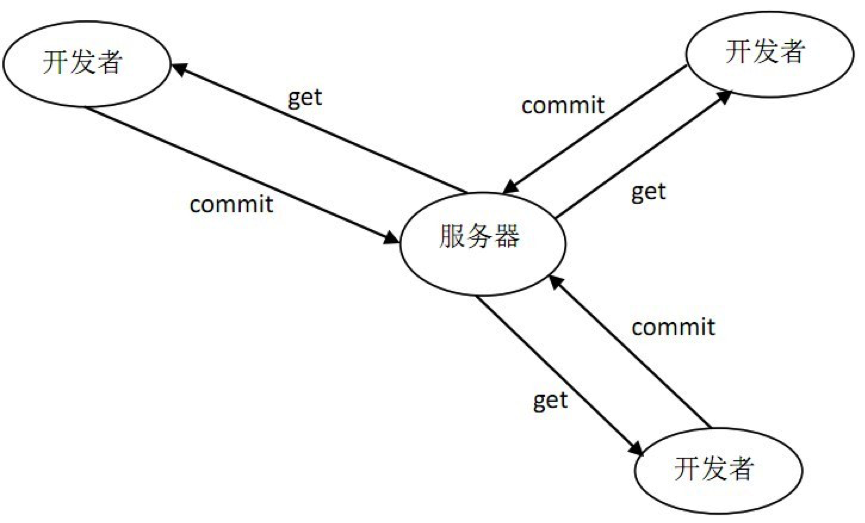

## 2.1 集中式 vs 分布式

SVN 属于典型的集中式版本控制系统。集中式版本控制系统都有一个单一的集中管理的服务器，保存所有文件的修订版本，而协同工作的人们都通过客户端连到这台服务器，取出最新的文件或者提交更新。

这种做法带来了许多好处，特别是相较于老式的本地 VCS 来说，每个人都可以在一定程度上看到项目中的其他人正在做些什么，而管理员也可以轻松掌控每个开发者的权限。

但集中式架构也有明显的局限，最突出的就是中央服务器的单点故障。若是宕机一小时，那么在这一小时内，谁都无法提交更新、还原、对比等，也就无法协同工作。如果中央服务器的磁盘发生故障，并且没做过备份或者备份得不够及时，还会有丢失数据的风险。最坏的情况是彻底丢失整个项目的所有历史更改记录，被客户端提取出来的某些快照数据除外，但这样依然是个问题，因为不能保证所有的数据都已经有人提取出来。

SVN 只关心文件内容的具体差异，每次记录有哪些文件做了更新，以及都更新了什么内容，如下图所示：

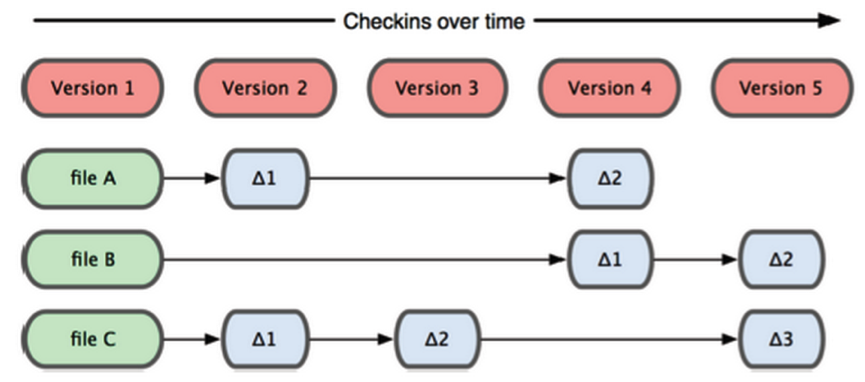

与 SVN 不同，Git 记录版本历史只关心**文件数据的整体是否发生变化**。Git 并不保存文件内容前后变化的差异数据。实际上，Git 更像是把变化的文件作快照后，记录在一个微型的文件系统中。每次提交更新时，它会纵览一遍所有文件的指纹信息并对文件作一快照，然后保存一个指向这次快照的索引。为提高性能，若文件没有变化，Git 不会再次保存，而只保留一个指向上次保存的快照的链接。Git 的工作方式如下图所示：

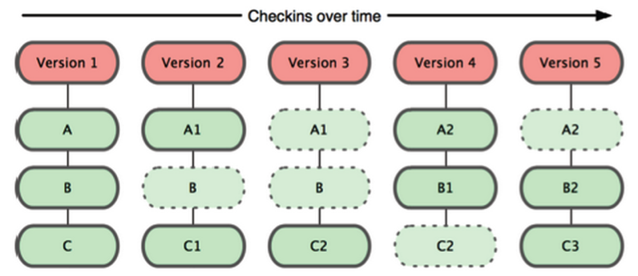

在分布式版本控制系统中，客户端并不只提取最新版本的文件快照，而是把原始的代码仓库完整地镜像下来。这么一来，任何一处协同工作用的服务器发生故障，事后都可以用任何一个镜像出来的本地仓库恢复。这类系统都可以指定和若干不同的远端代码仓库进行交互。借此，就可以在同一个项目中，分别和不同工作小组的人相互协作，并根据需要设定不同的协作流程。

另外，因为 Git 在本地磁盘上保存着所有有关当前项目的历史更新，并且 Git 中的绝大多数操作都只需要访问本地文件和资源，不用联网，所以处理起来速度飞快。用 SVN 的话，没有网络或者断开 VPN 就无法做任何事情。但用 Git 的话，就算你在飞机或者火车上，都可以非常愉快地频繁提交更新，等到了有网络的时候再上传到远程的镜像仓库。换作其他版本控制系统，这么做几乎不可能，抑或是非常麻烦。

简略地说，Git 具有以下特点：

- Git 中每个克隆（clone）的版本库都是平等的。可以从任何一个版本库的克隆来创建属于自己的版本库，同时你的版本库也可以作为源提供给他人，只要你愿意。
- Git 的每一次提取操作，实际上都是一次对代码仓库的完整备份。
- 提交完全在本地完成，无须别人给你授权，你的版本库你做主，并且提交总是会成功。
- Git 的提交不会被打断，直到你对自己的工作完全满意了，再 push 给他人或者由他人 pull 你的版本库。合并会发生在 pull 和 push 过程中，不能自动解决的冲突会提示你手工完成。

不过，“每次克隆都是完整备份”在动辄几十 GB 的超大仓库（如 Monorepo）面前也会成为负担。Git 为此提供了两类机制：部分克隆（Partial Clone），如 `git clone --filter=blob:none <url>`，先只下载提交和目录结构，文件内容在用到时再按需拉取；稀疏检出（Sparse Checkout），如 `git sparse-checkout set <dir>...`，只在工作区中检出指定的目录，默认使用锥形模式（Cone Mode）。微软开发的 Scalar 在 Git 2.38 中并入了 Git 核心，`scalar clone <url>` 会一次性启用部分克隆、稀疏检出、后台维护以及文件系统监视器（平台支持时）等针对大仓库的配置。

## 2.2 全局版本号 vs 全球版本号

与 CVS 每个文件都独立维护一套版本号不同，SVN 采用的是全局版本号。在看似简单的全局版本号的背后，是 SVN 对事务处理的支持，每一个事务处理（即一次提交）都具有整个版本库全局唯一的版本号。

Git 的版本号则更进一步，版本号是全球唯一的。在保存到 Git 之前，所有数据都要进行内容的校验和（checksum）计算，并将此结果作为数据的唯一标识和索引。换句话说，不可能在你修改了文件或目录之后，Git 一无所知。这项特性作为 Git 的设计哲学，建在整体架构的最底层。所以如果文件在传输时变得不完整，或者磁盘损坏导致文件数据缺失，Git 都能立即察觉。

Git 使用 SHA-1 算法计算数据的校验和，通过对文件的内容或目录的结构计算出一个 SHA-1 哈希值，作为指纹字符串。该字串由 40 个十六进制字符（0-9 及 a-f）组成，看起来就像是这个样子：

`24b9da6552252987aa493b52f8696cd6d3b00373`

- 所有保存在 Git 数据库中的东西都是用此哈希值来作索引的，而不是靠文件名。
- 使用哈希值作版本号的好处是，对于一个分布式的版本控制系统，每个人每次提交后形成的版本号都不会出现重复。另一个好处是保证数据的完整性，因为哈希值是根据内容或目录结构计算出来的，所以我们还可以据此来判断数据内容是否被篡改。
- SVN 的版本号是连续的，可以预判下一个版本号，而 Git 的版本号则不是。因为 SVN 是集中式版本控制，很容易实现版本号的连续性。Git 是分布式的版本控制系统，而且 Git 采用 40 位长的哈希值作为版本号，每个人的提交都是各自独立完成的，没有先后之分（即使提交有先后之分，也会由于 push/pull 的方向和时机而不同）。Git 的版本号虽然不连续，但是是有线索的，即每一个版本都有对应的父版本（一个或者两个），进而可以形成一个复杂的提交链。
- Git 的版本号简化：Git 可以使用从左边开始任意长度的字串作为简化版本号，只要该简化的版本号不产生歧义。一般采用 7 位的短版本号（只要不会出现重复，你也可以使用更短的版本号）。

许多人可能会担心一个问题：在随机的偶然情况下，在他们的仓库里会出现两个具有相同 SHA-1 值的对象。那会怎么样呢？

如果你真的向仓库里提交了一个跟之前的某个对象具有相同 SHA-1 值的对象，Git 将会发现之前的那个对象已经存在于 Git 数据库中，并认为它已经被写入了。如果什么时候你想再次检出那个对象，你总是会得到先前那个对象的数据。

不过，你应该了解到，这种情况发生的概率是多么微小。SHA-1 摘要长度是 20 字节，也就是 160 位。为了保证有 50% 的概率出现一次冲突，需要 `2^80` 个随机哈希的对象（计算冲突概率的公式是 `p = (n(n-1)/2) * (1/2^160)`）。`2^80` 约为 `1.2 x 10^24`，也就是一亿亿亿，那是地球上沙粒总数的 1200 倍。

现在举例说一下怎样才能产生一次 SHA-1 冲突。如果地球上 80 亿的人类都在编程，每人每秒都在产生等价于整个 Linux 内核历史（一百万个 Git 对象）的代码，并将之提交到一个巨大的 Git 仓库里面，那也要将近 5 年的时间才会产生足够的对象，使其拥有 50% 的概率产生一次 SHA-1 对象冲突……

所以，你还担心会冲突吗？

需要补充的是，上面讨论的是随机碰撞。2017 年 Google 等机构公布了首个人为构造的 SHA-1 碰撞实例（SHAttered），此后 Git 默认改用能检测此类碰撞攻击的加固版 SHA-1 实现，并从 2.29 版本起支持 SHA-256 对象格式（`git init --object-format=sha256`）。2.42 起官方已不再把 SHA-256 视为实验特性，但 SHA-256 仓库目前还不能与 SHA-1 仓库互通。计划中的 Git 3.0（截至 2.56 版本尚未发布）将把新仓库的默认哈希算法切换为 SHA-256。

# 3 三个工作区域

使用 Git 之前，首先要弄清 Git 的三个管理区域，这有助于理解 Git 的运行原理，以及每个 Git 命令对文件造成的影响。

对于任何一个文件，在本地的 Git 内部都有三种状态：

- **已修改**（modified）：表示修改了某个文件，但还没有提交保存。新增、删除了一个文件，也属于已修改状态的一种。
- **已暂存**（staged）：表示把已修改的文件放到了暂存区，也就是放到了下次提交时的清单中。
- **已提交**（committed）：表示该文件已经被安全地保存在本地数据库中了。

三种状态对应着 Git 的三个区域：工作区、暂存区以及本地版本库。

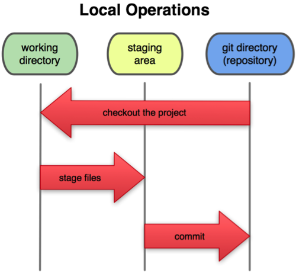

工作区就是我们对文件进行增删改的地方，是唯一对 Git 用户可见的区域；暂存区与本地仓库是 Git 对文件系统跟踪记录的存储区，对用户是透明的。

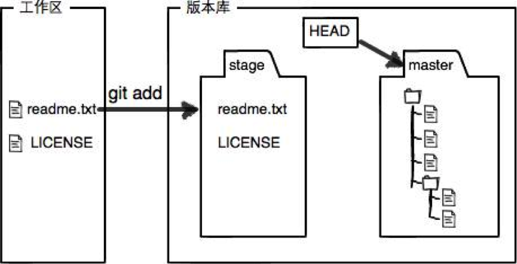

Git 管理项目的过程就是文件频繁地在三个区域中流转的过程。

有了上面的概念，就等于拿到了进入 Git 世界的通行证，可以与 Git 来一次亲密接触了。

# 4 基础命令

首先，需要给 Git 建立一个基地，在你的电脑里给 Git 安排大展身手的舞台。说得这么高大上，其实就是建立个文件夹而已……

## 4.1 git init

新仓库会自带一个默认分支。Git 自身的默认分支名目前仍是 master，未做配置时，`git init` 会先输出一段提示，说明可以修改默认分支名（macOS 自带的 Apple Git 已在系统级配置中预设为 main）。GitHub、GitLab 等主流平台新建仓库的默认分支早已改为 main，Git 也计划在 3.0 中把默认值改为 main。本文的示例统一使用 main，可以先执行下面的命令全局指定（该配置项自 Git 2.28 起可用）：

```shell
git config --global init.defaultBranch main
```

然后切换到合适的目录，新建一个文件夹，使用 `git init` 命令将它初始化为一个 Git 仓库：

```shell
mkdir firstgit
cd firstgit/
git init
```

Git 会提示：

```text
Initialized empty Git repository in /Users/winner/firstgit/.git/
```

Git 告诉你，已经将文件夹初始化为一个 Git 的空仓库。进入该文件夹下面查看会发现，多了一个名为 `.git` 的隐藏文件夹，里面包含这几项内容：

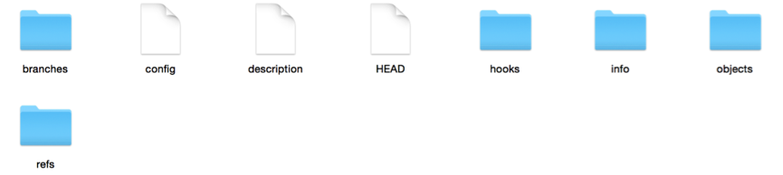

`.git` 文件夹是存储 Git 元信息的地方，Git 就是靠它来管理仓库中的所有文件，所以对这个“闲人莫进”的禁地看看就行了，千万不要随意改动。

## 4.2 git status

这是一个会频繁使用的命令，可以查看当前工作目录下的 Git 仓库状态，它会告诉你当前有哪些文件已经修改、哪些文件没有提交等信息。

比如，在新建的 Git 仓库中运行该命令，会提示：

```text
On branch main

No commits yet

nothing to commit (create/copy files and use "git add" to track)
```

就是说，当前处于名为“main”的分支上，还没有任何提交，暂时也没有任何待提交的东西。括号内还友善地告诉你，新建或者复制过来的文件，可以使用 `git add` 命令交给 Git 来追踪。

## 4.3 git add `<file>`

新建一个名为“readme.txt”的文件，使用 `git status` 查看状态：

```shell
touch readme.txt
git status
```

提示：

```text
On branch main

No commits yet

Untracked files:
  (use "git add <file>..." to include in what will be committed)
	readme.txt

nothing added to commit but untracked files present (use "git add" to track)
```

Git 告诉你，现在有一个名为“readme.txt”的文件处于未追踪的状态。

使用 `git add` 命令之后再查看状态：

```shell
git add readme.txt
git status
```

提示：

```text
On branch main

No commits yet

Changes to be committed:
  (use "git rm --cached <file>..." to unstage)
	new file:   readme.txt
```

Git 告诉你，在 main 分支上，待提交的更改包括一个新建的名为“readme.txt”的文件。`git add` 命令是将文件放入暂存区，并没有提交到本地版本库。

然后 Git 又很友善地告诉你，使用 `git rm --cached` 命令可以将文件恢复到未追踪的状态。

## 4.4 git rm --cached `<file>`

运行命令：

```shell
git rm --cached readme.txt
```

提示：

```text
rm 'readme.txt'
```

`rm` 是“remove”的缩写，移除的意思。

然后继续用 `git status` 命令查看状态，发现又回到了之前的状态：

```text
On branch main

No commits yet

Untracked files:
  (use "git add <file>..." to include in what will be committed)
	readme.txt

nothing added to commit but untracked files present (use "git add" to track)
```

可见，该命令会使文件脱离 Git 的追踪。

假如该文件在之前已经被 commit 到版本库，运行该命令，Git 会提示：

```text
rm 'readme.txt'
```

使用 `git status` 查看：

```text
On branch main
Changes to be committed:
  (use "git restore --staged <file>..." to unstage)
	deleted:    readme.txt

Untracked files:
  (use "git add <file>..." to include in what will be committed)
	readme.txt
```

Git 告诉你，readme.txt 恢复到了未追踪的状态，但是删除文件的操作还没有提交（版本库还保留着该文件的信息）。可见，该命令不会直接将文件从版本库删除，而是将删除操作作为一个修改项放入暂存区，commit 之后才会真正从版本库删除。

**注意**：这里所说的删除是从 Git 的追踪视野中删除，而不是在文件系统中删除。就算从 Git 的版本库中删除掉了该文件，它依然完好无损地存储在你的电脑里，只不过不会再被 Git 追踪罢了。如果想将该文件同时从 Git 版本库和文件系统中删除，去掉 `--cached` 参数即可。

## 4.5 git commit

将 readme.txt 文件先放入暂存区，然后使用 `git commit` 命令提交到本地版本库。

```shell
git add readme.txt
git commit -m 'first commit'
```

参数 `-m` 后面跟着此次提交的说明，有助于后期的管理与对比。Git 要求每次提交都必须有说明：不加 `-m` 时会打开编辑器让你填写，如果说明为空，提交会被中止。

提示：

```text
[main (root-commit) eec8c38] first commit
 1 file changed, 0 insertions(+), 0 deletions(-)
 create mode 100644 readme.txt
```

Git 告诉你，此次提交都包含哪些内容，版本号是多少（eec8c38 就是版本号的前七位）等信息。

再用 `git status` 命令查看：

```text
On branch main
nothing to commit, working tree clean
```

Git 告诉你，在 main 分支上，没有任何待提交的内容，当前工作区是干净的。

## 4.6 git restore `<file>`

现在 readme.txt 文件是空的，随便添加一行文字，然后使用 `git status` 命令查看：

```text
On branch main
Changes not staged for commit:
  (use "git add <file>..." to update what will be committed)
  (use "git restore <file>..." to discard changes in working directory)
	modified:   readme.txt

no changes added to commit (use "git add" and/or "git commit -a")
```

Git 告诉你，现在文件 readme.txt 已经发生了变化，使用 `git add` 命令可以将变化放入暂存区，使用 `git restore <file>` 命令可以丢弃工作区的变化，将文件恢复到暂存区中的状态（暂存区中没有该文件的改动时，就是最近一次提交时的状态）。

假设现在工作区、暂存区、版本库中的 readme.txt 文件处于一致状态，都只包含下面一行内容：

```text
this is my first Git project
```

现在我们对 readme.txt 增加一行文字：

```text
this is my first Git project
second row will be added
```

使用 `git add` 命令将文件放到暂存区，然后对 readme.txt 再增加一行文字（不进行 add 操作）：

```text
this is my first Git project
second row will be added
third row will not be added
```

使用 `git status` 命令查看：

```text
On branch main
Changes to be committed:
  (use "git restore --staged <file>..." to unstage)
	modified:   readme.txt

Changes not staged for commit:
  (use "git add <file>..." to update what will be committed)
  (use "git restore <file>..." to discard changes in working directory)
	modified:   readme.txt
```

现在 readme.txt 在三个区域的情况是：工作区有三行内容，暂存区有两行内容，本地版本库有一行内容。

运行 `git restore readme.txt`，再使用 `git status` 命令查看，提示消息如下：

```text
On branch main
Changes to be committed:
  (use "git restore --staged <file>..." to unstage)
	modified:   readme.txt
```

可见，工作区中没有放入暂存区的修改被丢弃了，恢复到了两行内容的状态。

在 Git 2.23 之前，这个操作要用 `git checkout -- <file>` 完成。`git checkout` 同时承担了切换分支和恢复文件两种职责，很容易混淆，所以 Git 2.23 把它拆成了 `git switch`（切换分支）和 `git restore`（恢复文件）两个命令。旧写法至今仍然可用，在很多老资料中也很常见。

## 4.7 git restore --staged 与 git reset

回到同样的初始条件：readme.txt 在工作区有三行内容，在暂存区有两行内容，在本地版本库有一行内容。

运行 `git restore --staged readme.txt` 命令，执行成功后不会有任何输出。使用 `git status` 查看：

```text
On branch main
Changes not staged for commit:
  (use "git add <file>..." to update what will be committed)
  (use "git restore <file>..." to discard changes in working directory)
	modified:   readme.txt

no changes added to commit (use "git add" and/or "git commit -a")
```

可见，该命令可以清空暂存区，但是不会影响工作区以及版本库。

在 Git 2.23 之前，取消暂存使用的是 `git reset HEAD readme.txt`，效果相同，执行后会提示 `Unstaged changes after reset:`，并列出受影响的文件。不过 `git reset` 更重要的用途是版本回退。

`git reset HEAD <file>` 中的 `HEAD` 指向当前工作分支的最新提交记录：

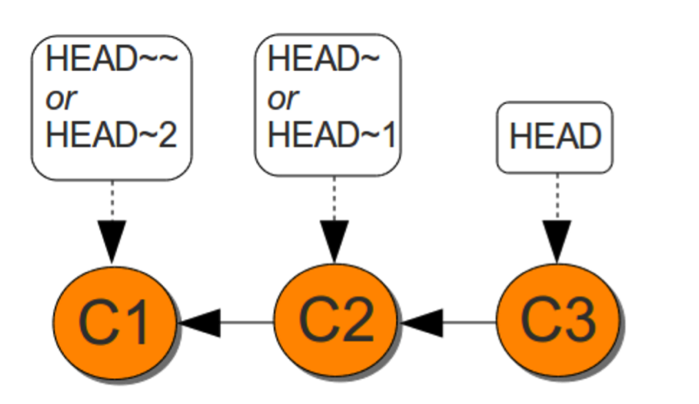

而 `HEAD~` 或者 `HEAD~1` 就代表上次的提交记录，`HEAD~~` 或者 `HEAD~2` 就代表上上次的提交记录，以此类推。

例如执行命令 `git reset HEAD~1` 之后，会发生下面的变化：

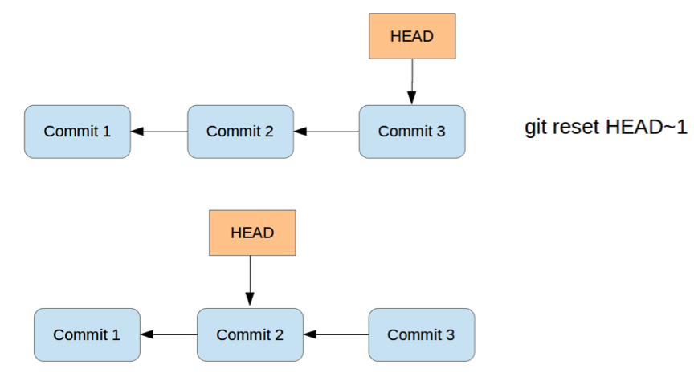

HEAD 指针回退到了上一次的提交记录。

除此之外，还可以使用“版本号”来替代“HEAD”参数，直接回退到某个版本。当然了，在实际工作中，我们脑子里怎么可能记得一个几千行的文件每次都改了什么内容，不然要版本控制系统干什么。版本控制系统肯定有某个命令可以告诉我们历史记录，在 Git 中，我们用 `git log` 命令查看每次提交的版本号、备注以及修改内容等信息。

例如，`git reset 7dd233c` 代表回退到版本号以“7dd233c”开头的版本。前面我们提到过，Git 的版本号是对文件内容或目录结构计算出的一个 SHA-1 哈希值，是一个 40 位的十六进制字符串。版本号没必要写全，一般来讲只写前七位就可以了，只要不产生歧义，Git 会自动去找；否则，Git 可能会找到多个版本号，就无法确定是哪一个了。

如果没有指定任何版本参数，如 `git reset`，Git 会默认按照 `git reset HEAD` 来处理，即恢复到最新提交的版本。

其实，`git reset` 命令还有一组非常重要的可选参数：`--soft`、`--hard` 与 `--mixed`。

三个参数决定了回退操作的影响范围。

- `git reset --soft`：Git 将重置 HEAD 到另外一个 commit，但是工作区与暂存区都不会做任何变化，在 original HEAD 和你重置到的那个 commit 之间的所有变更集仍然在暂存区域中。

  

- `git reset --hard`：Git 将重置 HEAD 到另外一个 commit，同时重置暂存区与工作区。这是一个比较危险的动作，具有破坏性，数据因此可能会丢失！如果真的发生了数据丢失又希望找回来，那么只有使用 `git reflog` 命令了。

  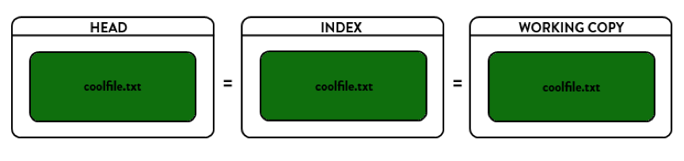

- `git reset --mixed`：顾名思义，该参数是 `--soft` 与 `--hard` 的混合体。Git 将重置 HEAD 到另外一个 commit，同时重置暂存区而对工作区不做任何改动。从 original HEAD 到重置的那个 commit 之间的所有变更仍然保存在工作区（working copy）中，被标示为已变更但未暂存（unstaged）的状态。

  

`--mixed` 是 reset 的默认参数，也就是当你不指定任何参数的时候，Git 将会按照 `--mixed` 方式处理。

总体来说，三个参数的区别如下图所示：

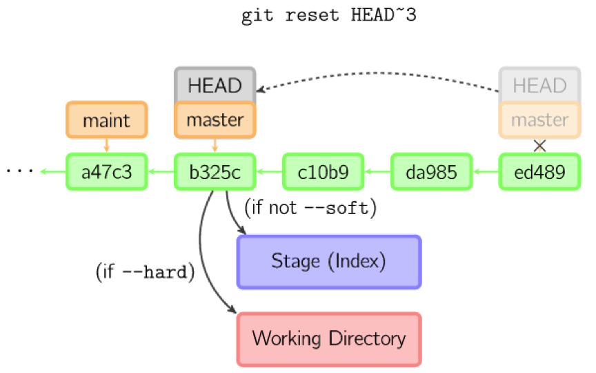

# 5 三个区域的流转

熟练掌握了上面的命令，就可以操控文件在三个区域中的流转，一个更全面的流转图如下：

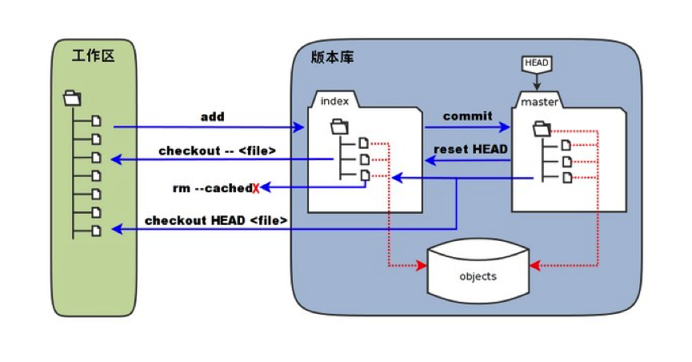

图中使用的是 Git 2.23 之前的命令：`checkout -- <file>` 对应 `git restore <file>`，`reset HEAD` 对应 `git restore --staged <file>`，`checkout HEAD <file>` 对应 `git restore --staged --worktree <file>`，即同时用最新提交恢复暂存区和工作区。

总结如下：

- 从未追踪状态转换为被追踪状态：`git add`
- 从被追踪状态转换为未追踪状态：`git rm --cached`
- 将工作区的更改提交到暂存区：`git add`
- 丢弃工作区的更改：`git restore`（旧写法 `git checkout -- <file>`）
- 将暂存区的更改提交到版本库：`git commit`
- 清空暂存区的更改：`git restore --staged`（旧写法 `git reset HEAD <file>`）
- 版本回退：`git reset`

# 6 辅助命令

熟悉了 Git 的基本操作之后，再来研究一下 Git 为我们提供的基础设施服务。正如一个程序员，只会写代码是远远不够的，还得知道怎么吃饭，怎么睡觉，怎么谈恋爱……会了这些才能写出更好的代码，这就是所谓的“基础设施服务”或者“外围服务”。

## 6.1 git config

一般在新的系统上，我们都需要先配置下自己的 Git 工作环境。配置工作只需一次，以后升级时还会沿用现在的配置。当然，如果需要，随时可以用相同的命令修改已有的配置。

Git 提供了一个叫做 `git config` 的工具，专门用来配置或读取相应的工作环境变量。而正是由这些环境变量，决定了 Git 在各个环节的具体工作方式和行为。这些变量可以存放在以下三个不同的地方：

- `/etc/gitconfig` 文件：系统中对所有用户都普遍适用的配置。若使用 `git config --system` 选项，读写的就是这个文件。
- `~/.gitconfig` 文件：用户目录下的配置文件只适用于该用户。若使用 `git config --global` 选项，读写的就是这个文件。Git 同时也会读取 `$XDG_CONFIG_HOME/git/config`（未设置该环境变量时为 `~/.config/git/config`），两者同属用户级配置；`--global` 默认写入 `~/.gitconfig`，只有该文件不存在而 XDG 路径下的文件存在时，才会写入后者。
- 工作目录中的 `.git/config` 文件：这里的配置仅仅针对当前项目有效。若使用 `git config --local` 选项，读写的就是这个文件。

每一个级别的配置都会覆盖上层的相同配置。

首先需要配置的是用户名称和电子邮件地址。这两条配置很重要，每次 Git 提交时都会引用这两条信息，说明是谁提交了更新，所以会随更新内容一起被永久纳入历史记录。

比如，用 `--local` 参数仅作项目级别的修改：

```shell
git config --local user.name 'clf'
git config --local user.email 'clf@163.com'
```

上面的两条命令会改变工作目录中的 `.git/config` 配置，打开文件验证一下：

```text
[user]
	name = clf
	email = clf@163.com
```

发现里面的用户配置已更改。本项目之后的 commit 会标注这两项用户信息，类似这样：

```text
commit b34fb46
Author: clf <clf@163.com>
Date:   Fri Jul 1 11:59:29 2016 +0800
```

还有一个很有用的配置，就是为 Git 命令配置别名，可以简化命令输入。例如我们想使用 `git st` 来作为 `git status` 的别名，在用户级别生效：

```shell
git config --global alias.st status
```

以后运行 `git st` 就相当于运行命令 `git status`。

原生 Git 没有专门列出别名的命令，可以用 `git config --get-regexp '^alias\.'` 查看所有已配置的别名：

```text
alias.st status
```

Git 本身不内置任何别名。网上常见的 `git alias` 命令和一长串预置别名，大多来自 git-extras 之类的扩展工具或别人分享的配置文件，需要自行安装或配置，可以根据自己的使用习惯来增删。

除了用户信息、别名等，还有很多可配置的信息，使用命令 `git config --list` 可以查看所有已配置的信息。有时候会看到重复的变量名，那就说明它们来自不同的配置文件（比如 `/etc/gitconfig` 和 `~/.gitconfig`），不过最终 Git 实际采用的是最后一个。

## 6.2 git log

每次 commit 都会生成一个提交记录，`git log` 就是用来查看提交记录的。

如果不带任何参数，它会列出所有历史记录，最近的排在最上方，显示提交对象的哈希值、作者、提交日期和提交说明。如果记录过多，则按 Page Up、Page Down、↓、↑ 来控制显示；按 q 退出历史记录列表。

```text
commit 02c7ffcacae468e8adc4633e011db6f9c7627c6d  --版本号
Author: chenlongfei <chenlongfei@163.com>  --提交者信息
Date:   Fri Jul 1 15:46:47 2016 +0800  --提交时间

    third commit  --备注

commit cfb3dcd6673433ba184b4a2084b48ae0e70e133f
Author: chenlongfei <chenlongfei@163.com>
Date:   Fri Jul 1 15:46:01 2016 +0800

    second commit

commit 2ecd99eba77d110b9191426317cfde014801d1ee
Author: chenlongfei <chenlongfei@163.com>
Date:   Fri Jul 1 15:45:04 2016 +0800

    first commit readme.txt
……
```

携带 `--stat` 参数时，该命令会显示每次提交的更改概要；携带 `-<n>`（如 `-2`）时，该命令只显示最近 n 次的提交记录。

例如，运行命令 `git log --stat -2` 显示如下：

```text
commit 02c7ffcacae468e8adc4633e011db6f9c7627c6d
Author: chenlongfei <chenlongfei@163.com>
Date:   Fri Jul 1 15:46:47 2016 +0800

    third commit

 readme.txt | 1 +
 1 file changed, 1 insertion(+)

commit cfb3dcd6673433ba184b4a2084b48ae0e70e133f
Author: chenlongfei <chenlongfei@163.com>
Date:   Fri Jul 1 15:46:01 2016 +0800

    second commit

 readme.txt | 2 +-
 1 file changed, 1 insertion(+), 1 deletion(-)
```

该命令还有很多可选参数，可以灵活地控制提交记录的显示方式，比如只显示某个日期之后的记录、只显示某个人提交的记录、以图形化的方式显示记录等，具体可查看 Git 文档。

`git log` 的格式参数比较长，很适合配置成别名，例如：

```shell
git config --global alias.lg "log --color --graph --pretty=format:'%C(bold white)%h%Creset -%C(bold green)%d%Creset %s %C(bold green)(%cr)%Creset %C(bold blue)<%an>%Creset' --abbrev-commit --date=relative"
git config --global alias.llg "log --color --graph --pretty=format:'%C(bold white)%H %d%Creset%n%s%n%+b%C(bold blue)%an <%ae>%Creset %C(bold green)%cr (%ci)' --abbrev-commit"
```

配置好之后，使用 `git llg` 会得到这样的显示结果：

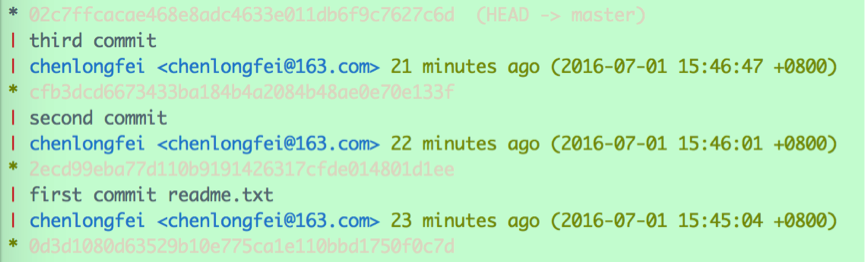

关键字变色高亮，左侧还以图形化的方式显示出提交节点与分支，比默认的输出直观得多。

## 6.3 git diff

该命令用于比较文件在不同区域或不同版本之间的差别，输出采用统一 diff 格式（unified diff），与 `diff -u` 的格式一致。

直接运行 `git diff readme.txt`：

```text
diff --git a/readme.txt b/readme.txt
index ebdd200..dab1993 100644
--- a/readme.txt
+++ b/readme.txt
@@ -1,3 +1,4 @@
this is my first git project.
add one row
add second row
+add third row  --后者与前者相比，增加了该行内容
```

- `git diff`：比较的是工作区与暂存区之间的差别，即修改之后还没有暂存起来的变化内容
- `git diff --cached`：比较的是暂存区与版本库最新提交之间的差别
- `git diff HEAD`：比较的是工作区与版本库最新提交之间的差别
- `git diff SHA_1 SHA_2`：比较的是版本号 SHA_1 与 SHA_2 之间的差别

## 6.4 git help

Git 提供了详细的帮助文档，借助 `git help` 可以查看每个命令的详细说明。

例如，我们想看看 `git add` 到底都有哪些隐藏技能，果然发现了几个必杀技：

```text
-u, --update
        Update the index just where it already has an entry matching <pathspec>. This removes as well as modifies index entries to match the working
        tree, but adds no new files.
-A, --all, --no-ignore-removal
        Update the index not only where the working tree has a file matching <pathspec> but also where the index already has an entry. This adds,
        modifies, and removes index entries to match the working tree.
```

可见，Git 提供了批量 add 的方法：

`git add -u`（等效于 `git add --update`）：把工作区内所有 tracked 文件中被修改过或已删除文件的信息添加到暂存区，但是它不会处理 untracked 的文件。还可以在后面加上路径限制，只提交某个路径下的所有更改。

`git add -A`（等效于 `git add --all`）：把工作区内所有 tracked 文件中被修改过或已删除文件，以及所有 untracked 的文件信息添加到暂存区。该命令同样可以加上路径限制，只提交某个路径下的所有更改。

此外，还有一种简化的查看帮助文档的方法，即在 Git 命令后面加上 `-h` 参数，h 代表 help 的首字母。

使用 `git add -h` 查看 add 命令的使用方法：

```text
usage: git add [<options>] [--] <pathspec>...

    -n, --dry-run         dry run
    -v, --verbose         be verbose

    -i, --interactive     interactive picking
    -p, --patch           select hunks interactively
    -e, --edit            edit current diff and apply
    -f, --force           allow adding otherwise ignored files
    -u, --update          update tracked files
    -N, --intent-to-add   record only the fact that the path will be added later
    -A, --all             add changes from all tracked and untracked files
    --ignore-removal      ignore paths removed in the working tree (same as --no-all)
    --refresh             don't add, only refresh the index
    --ignore-errors       just skip files which cannot be added because of errors
    --ignore-missing      check if - even missing - files are ignored in dry run
```

其中 `-p`（`--patch`）非常实用。一个文件里常常混着几处互不相关的修改，比如既修了 bug 又顺手调了格式，`git add -p` 会把差异按块（hunk）逐一展示，询问每一块是否放入暂存区：`y` 暂存、`n` 跳过、`s` 把当前块拆成更小的块、`e` 手动编辑要暂存的内容、`q` 退出。借助它，可以把同一个文件的修改拆进不同的提交，让每次提交只做一件事。

## 6.5 git mv

初看该命令，很容易认为这是一个移动文件的操作，事实上，**该命令一般用于文件的重命名**。

不像其他的版本管理系统，Git 并不跟踪文件移动操作。如果在 Git 中重命名了某个文件，仓库中存储的元数据并不会体现出这是一次改名操作。不过 Git 非常聪明，它会推断出究竟发生了什么。

比如，运行命令：

```shell
git mv readme.txt readmeCopy.txt
```

然后查看状态，恰如预期，可以明白无误地看到关于重命名操作的说明：

```text
On branch main
Changes to be committed:
  (use "git restore --staged <file>..." to unstage)
	renamed:    readme.txt -> readmeCopy.txt
```

其实，运行 `git mv` 就相当于运行了下面三条命令：

```shell
mv readme.txt readmeCopy.txt  # Linux 命令，在文件系统中将 readme.txt 重命名为 readmeCopy.txt
git rm readme.txt             # 将旧文件 readme.txt 的删除操作放入暂存区
git add readmeCopy.txt        # 将新文件 readmeCopy.txt 交给 Git 追踪管理
```

即便如此分开操作，Git 也会意识到这是一次改名，所以不管何种方式都一样。当然，直接用 `git mv` 轻便得多。

## 6.6 忽略文件

一般我们总会有些文件无需纳入 Git 的管理，也不希望它们总出现在未跟踪文件列表。通常都是些自动生成的文件，比如日志文件，或者编译过程中创建的临时文件等。

设置忽略文件的方式有三种。

（1）在 Git 工作目录下创建 `.gitignore` 文件

文件 `.gitignore` 的格式规范如下：

- 所有空行或者以注释符号 `#` 开头的行都会被 Git 忽略。
- 可以使用标准的 glob 模式匹配。匹配模式最后跟斜杠（`/`）说明要忽略的是目录。要忽略指定模式以外的文件或目录，可以在模式前加上感叹号（`!`）取反。

所谓的 glob 模式是指 shell 所使用的简化了的正则表达式。

- 星号（`*`）匹配零个或多个任意字符
- `[abc]` 匹配任何一个列在方括号中的字符（要么匹配一个 a，要么匹配一个 b，要么匹配一个 c）
- 问号（`?`）只匹配一个任意字符
- 如果在方括号中使用短划线分隔两个字符，表示所有在这两个字符范围内的都可以匹配（比如 `[0-9]` 表示匹配所有 0 到 9 的数字）

我们再看一个 `.gitignore` 文件的例子：

```text
# 此为注释，将被 Git 忽略
# 忽略所有 .a 结尾的文件
*.a
# 但 lib.a 除外
!lib.a
# 仅仅忽略项目根目录下的 TODO 文件，不包括 subdir/TODO
/TODO
# 忽略任意层级下名为 build 的目录
build/
# 会忽略 doc/notes.txt，但不包括 doc/server/arch.txt
doc/*.txt
```

注意，`#` 只有出现在行首时才表示注释。如果写成 `*.a  # 忽略所有 .a 结尾的文件` 这样的行尾注释，后面的空格和文字都会被当作模式的一部分，这条规则也就失效了，所以注释一定要单独占一行。

（2）通过配置 `.git/info/exclude` 文件来忽略文件，规范与 `.gitignore` 类似。这种方式只能对自己本地仓库有作用，其他人没办法通过这种方式来共享忽略规则，除非他人也修改其本地仓库的该文件。

（3）通过 Git 配置文件（如 `.git/config` 或 `~/.gitconfig`）的 `core.excludesFile` 选项，指定一个忽略规则文件（完整路径）。

使用 `git config --list` 命令可以看到，我的环境中该项的配置为：

```text
core.excludesfile=~/.gitignore
```

该配置项的意思是，用户目录下的 `.gitignore` 是忽略配置文件，Git 会从该文件中读取哪些文件应该被忽略。如果将配置项改为：

```text
core.excludesfile=~/gitignore.txt
```

那么 Git 将会从名为“gitignore.txt”的文件中读取信息，而不是原来的 `.gitignore`。需要说明的是，Git 本身并不会自动设置该项；未设置时，Git 默认读取 `$XDG_CONFIG_HOME/git/ignore`（通常即 `~/.config/git/ignore`）。不过除非特殊需要，尽量遵从 Git 的默认规则。
