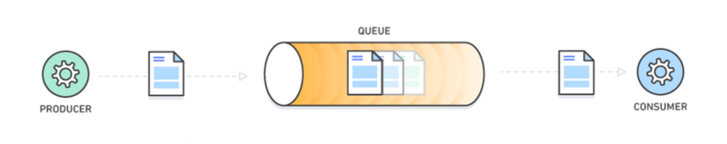
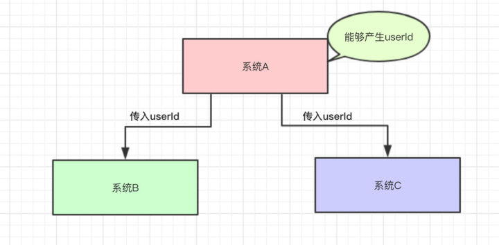
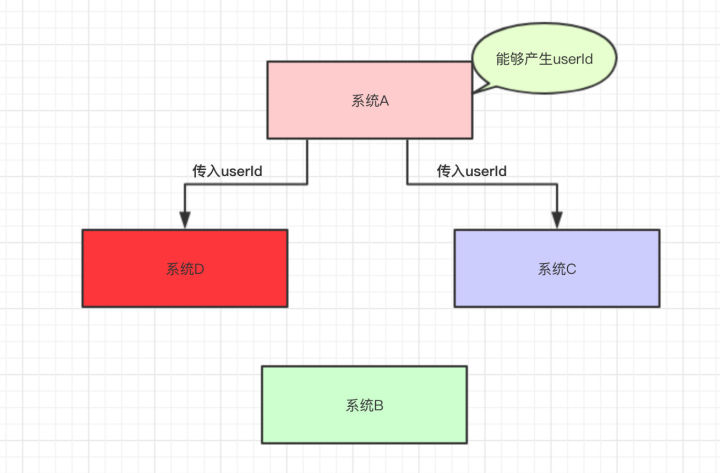
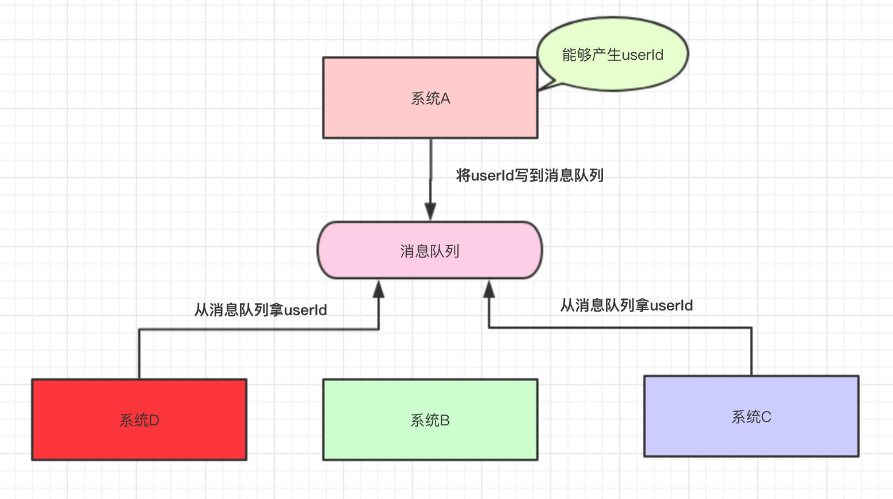
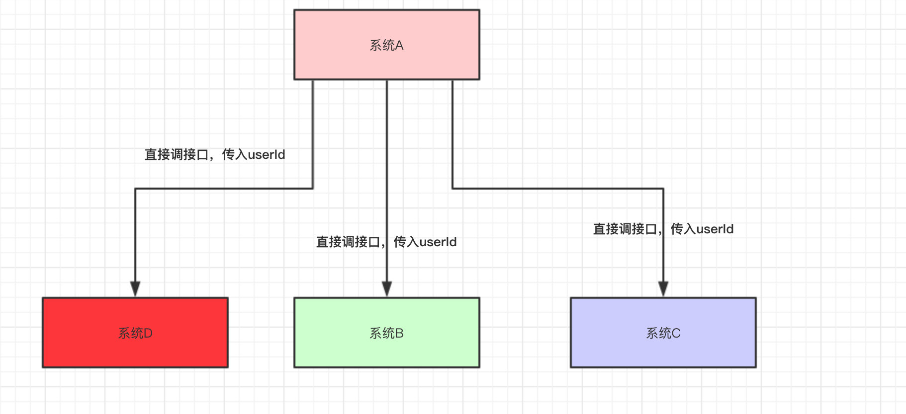
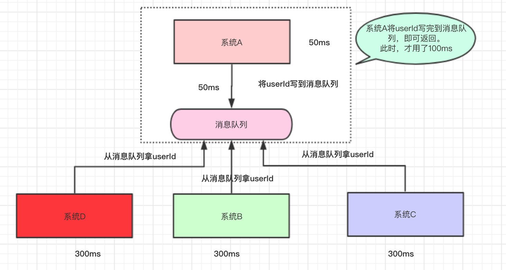
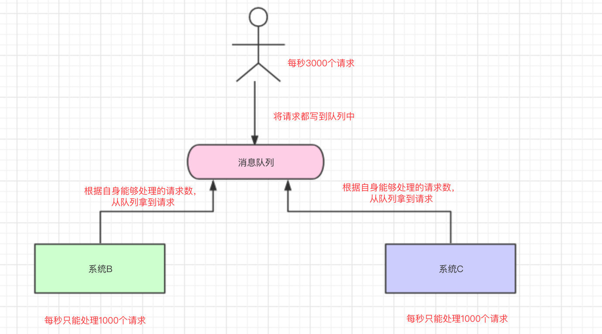
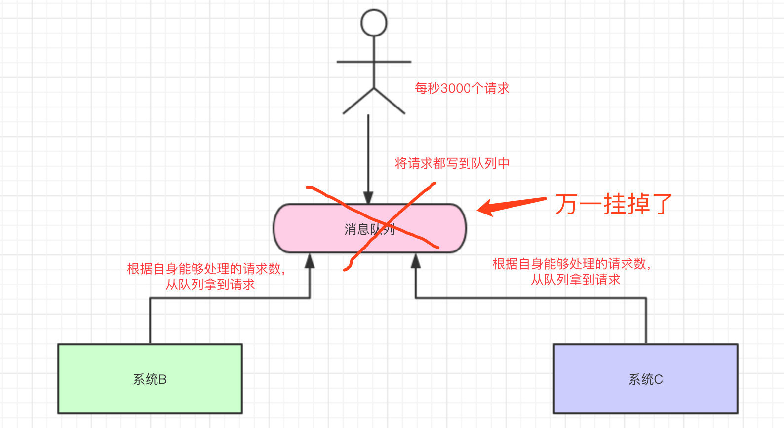
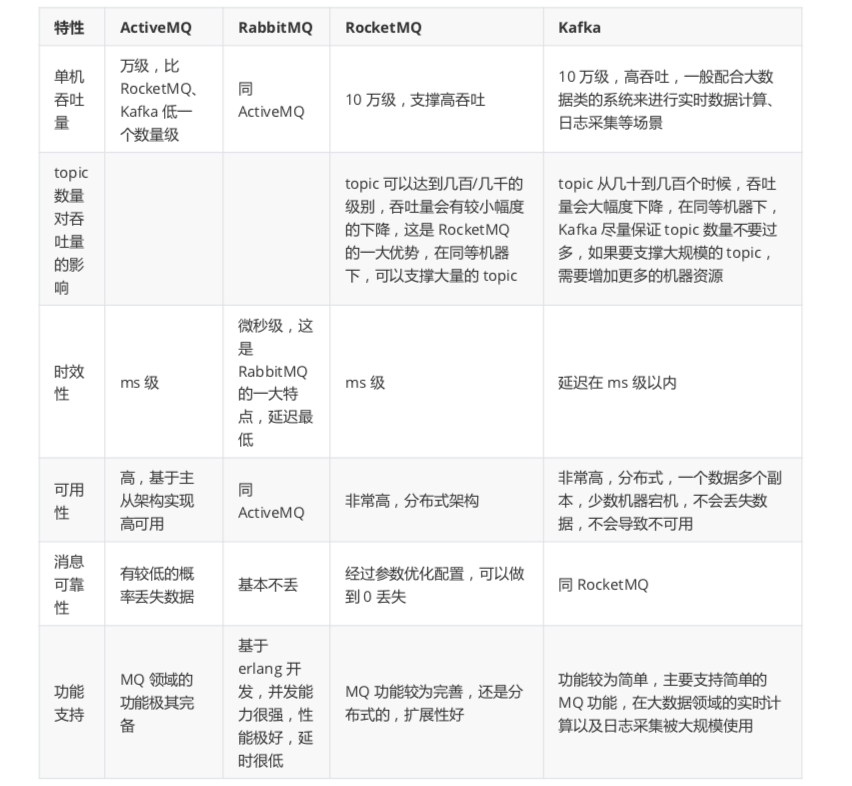

# 1 消息队列是什么

分布式系统中常用的通信模型主要是“请求-应答”模型和“发布-订阅”模型。前者常见如 RPC 通信，常用 HTTP REST 或 Dubbo 等协议；后者多指消息队列通信。

RPC 大多属于请求-应答模式，也包括越来越多的响应式范式。对于需要点对点交互、强事务保证和延迟敏感的服务/应用之间的通信，RPC 是优于消息队列的。

**消息队列**（Message Queue，**MQ**）提供了一种基于消息的异步通信机制，它将原本同步的直接调用转化为通过中间媒介的异步传递：调用方先把消息转存到队列中，消息再在合适的时机投递给接收方。消息的发送者和接收者不需要在同一时间与消息队列进行交互，消息在被处理或被删除之前一直存储在队列上。



消息队列提供一个临时存储消息的轻量级缓存区，以及允许软件组件连接到队列以发送接收消息的终端节点。这些消息通常较小，可以是请求、回复、错误消息或明文消息等。要发送消息时，一个名为“生产者”的组件将消息添加到队列。消息将存储在队列中，直至名为“消费者”的另一组件检索该消息并执行相关操作。

许多生产者和消费者都可以使用队列，但一条消息只能有一组消费者处理一次。因此，这种消息收发模式通常称为一对一或点对点通信。如果消息需要由多个消费者进行处理，可以将消息队列与发布/订阅结合起来使用。

随着云原生架构的深入，传统的消息队列正在向**事件网格（EventMesh）**演进，典型代表是各大云厂商推出的 EventBridge 以及 Apache EventMesh 项目。它们遵循 CNCF 提出的 **CloudEvents 规范**，使得来自不同系统（如 GitHub Webhook、数据库 Binlog、IoT 传感器）的事件能够以统一的 JSON 格式进行标准化封装。事件网格不仅支持传统的发布/订阅，还能将事件无缝路由到函数计算（FaaS）、Serverless 容器或数据仓库中，真正实现了跨云、跨语言的泛在事件驱动架构。

# 2 为什么使用消息队列

如果有人问你这个问题，期望的一个回答是说，你们公司有个什么业务场景，这个业务场景有个什么技术挑战，如果不用 MQ 可能会很麻烦，但是现在用了 MQ 之后带给了你很多的好处。

消息队列的使用场景有很多，但是归根结底都可以用六字真言来概括：**解耦**、**异步**、**削峰**。

## 2.1 解耦

假设现在有一个系统 A，可以产生 userId，系统 B 和系统 C 都需要这个 userId 去做相关的操作。



写成伪代码可能是这样的：

```java
public class SystemA {

    // 系统B和系统C的依赖
    SystemB systemB = new SystemB();
    SystemC systemC = new SystemC();

    // 系统A独有的数据userId
    private String userId = "winner";

    public void doSomething() {

        // 系统B和系统C都需要拿着系统A的userId去操作其他的事
        systemB.SystemBNeed2do(userId);
        systemC.SystemCNeed2do(userId);

    }
}
```

系统上线后，平稳运行了一段时间，一切貌似很完美。

某一天，系统 B 的负责人告诉系统 A 的负责人，现在系统 B 的`SystemBNeed2do(String userId)`这个接口不再使用了，让系统 A 别去调它了。

于是，系统 A 的负责人说“好的，那我就不调用你了”，于是就把调用系统 B 接口的代码给删掉了：

```java
public void doSomething() {

  // 系统A不再调用系统B的接口了
  //systemB.SystemBNeed2do(userId);
  systemC.SystemCNeed2do(userId);

}
```

又过了几天，系统 D 的负责人接了个需求，也需要用到系统 A 的 userId，于是就跑去跟系统 A 的负责人说：“老哥，我要用到你的 userId，你调一下我的接口吧”。

于是系统 A 说：“没问题的，这就搞”。



然后，系统A的代码如下：

```java
public class SystemA {

    // 已经不再需要系统B的依赖了
    // SystemB systemB = new SystemB();

    // 系统C和系统D的依赖
    SystemC systemC = new SystemC();
    SystemD systemD = new SystemD();

    // 系统A独有的数据
    private String userId = "winner";

    public void doSomething() {


        // 已经不再需要系统B的依赖了
        //systemB.SystemBNeed2do(userId);

        // 系统C和系统D都需要拿着系统A的userId去操作其他的事
        systemC.SystemCNeed2do(userId);
        systemD.SystemDNeed2do(userId);

    }
}
```

时间飞逝：

- 又过了几天，系统 E 的负责人过来了，告诉系统 A，需要 userId。
- 又过了几天，系统 B 的负责人过来了，告诉系统 A，还是重新调那个接口吧。
- 又过了几天，系统 F 的负责人过来了，告诉系统 A，需要 userId。
- ……

于是系统 A 的负责人，每天都被这给骚扰着，改来改去，改来改去……

还有另外一个问题，调用系统 C 的时候，如果系统 C 挂了，系统 A 还得想办法处理。如果调用系统 D 时，由于网络延迟，请求超时了，那系统 A 是反馈失败还是重试？

最终，系统 A 的负责人因频繁应对此类变更不堪重负，选择了离职。

然后，公司招来一个大佬，大佬经过几天熟悉，上来就说：“将系统 A 的 userId 写到消息队列中，这样系统 A 就不用经常改动了”。为什么呢？下面我们来一起看看：



系统 A 将 userId 写到消息队列中，系统 C 和系统 D 从消息队列中拿数据。这样有什么好处？

- 系统 A 只负责把数据写到队列中，谁想要或不想要这个数据（消息），系统 A 一点都不关心。
- 即便现在系统 D 不想要 userId 这个数据了，系统 B 又突然想要 userId 这个数据了，都跟系统 A 无关，系统 A 一点代码都不用改。
- 系统 D 拿 userId 不再经过系统 A，而是从消息队列里边拿。系统 D 即便挂了或者请求超时，都跟系统 A 无关，只跟消息队列有关。

这样一来，系统 A 与系统 B、C、D 都解耦了。

## 2.2 异步

我们再来看看下面这种情况：系统 A 还是直接调用系统 B、C、D。



代码如下：

```java
public class SystemA {

    SystemB systemB = new SystemB();
    SystemC systemC = new SystemC();
    SystemD systemD = new SystemD();

    // 系统A独有的数据
    private String userId ;

    public void doOrder() {

        // 下订单
        userId = this.order();
        // 如果下单成功，则安排其他系统做一些事  
        systemB.SystemBNeed2do(userId);
        systemC.SystemCNeed2do(userId);
        systemD.SystemDNeed2do(userId);

    }
}
```

假设系统 A 运算出 userId 具体的值需要 50ms，调用系统 B 的接口需要 300ms，调用系统 C 的接口需要 300ms，调用系统 D 的接口需要 300ms。那么这次请求就需要：50+300+300+300=950ms。

并且我们得知，系统 A 做的是主要的业务，而系统 B、C、D 是非主要的业务。比如系统 A 处理的是订单下单，而系统 B 是订单下单成功了，那发送一条短信告诉具体的用户此订单已成功，而系统 C 和系统 D 也是处理一些小事而已。

那么此时，为了提高用户体验和吞吐量，其实可以异步地调用系统 B、C、D 的接口。所以，我们可以弄成是这样的：



系统 A 执行完了以后，将 userId 写到消息队列中，然后就直接返回了（至于其他的操作，则异步处理）。

- 本来整个请求需要用 950ms（同步）
- 现在将调用其他系统接口异步化，只需要 100ms（异步）

## 2.3 削峰

我们再来一个场景，现在我们每个月要搞一次大促，大促期间的并发可能会很高的，比如每秒 3000 个请求。假设我们现在有两台机器处理请求，并且每台机器每秒只能处理 1000 个请求。

那多出来的 1000 个请求，可能就把我们整个系统给搞崩了……所以，有一种办法，我们可以写到消息队列中：



系统 B 和系统 C 根据自己能够处理的请求数去消息队列中拿数据，这样即便每秒有 8000 个请求，那只是把请求放在消息队列中，去拿消息队列的消息由系统自己去控制，这样就不会把整个系统给搞崩。

# 3 副作用

上文列举了消息队列的三个用武之地，表面来看，很多难题只要引入了消息队列就能够化腐朽为神奇。但是，事分两面，下面就要说说消息队列的副作用。

## 3.1 高可用问题

系统引入的外部依赖越多，越容易挂掉。本来你就是 A 系统调用 BCD 三个系统的接口就好了，人家 ABCD 四个系统好好的，没啥问题，你偏加个 MQ 进来，万一 MQ 挂了，导致整套系统崩溃的，你不就完了？



为了保证消息队列的高可用性，一般都会采用**集群/分布式**的部署方式。

RabbitMQ 早期采用镜像队列（Mirrored Queues）模式，把每个 queue 同步到多个实例上，但由于存在性能瓶颈和脑裂风险，该模式自 3.12 版本起被官方废弃，并在 4.0 版本中被彻底移除。目前生产环境推荐使用基于 Raft 共识算法的 **Quorum Queues（仲裁队列）**：只有在多数节点确认后，消息才算写入成功，从根本上解决了镜像队列容易出现的脑裂和数据不一致问题。

而 Kafka 本来就是天然的分布式消息队列，由多个 broker 构成集群，一个 topic 可以划分为多个 partition，每个 partition 可以存在于不同的 broker 上，每个 partition 就放一部分数据。也就是说一个 topic 的数据，是分散放在多个机器上的，每个机器就放一部分数据。

过去，部署 Kafka 必须强依赖一个 ZooKeeper 集群来管理元数据和控制器选举，这大大增加了运维复杂度。如今，Kafka 通过 **KRaft（Kafka Raft Metadata mode）** 模式彻底移除了 ZooKeeper 依赖。KRaft 自 Kafka 2.8 引入、在 3.x 版本趋于成熟，它将元数据本身作为一个内部的 Kafka topic 进行管理，利用内置的 Raft 协议进行共识选举，不仅简化了部署架构（只需维护单一系统），还大幅提升了集群启动速度和元数据的吞吐量。

为了进一步提升高可用性和弹性伸缩能力，现代消息队列还在向**存算分离**的云原生架构演进。传统的 Broker 既负责网络连接、鉴权（计算），又负责消息落盘（存储），导致扩缩容极慢。以 **Apache Pulsar** 为代表，它将无状态的 Broker 层与底层的分布式存储层（BookKeeper）完全解耦；**RocketMQ 5.0** 也引入了独立的 Proxy 代理层。这种架构使得计算节点可以根据流量在 Kubernetes 中秒级自动扩缩容，而无需迁移任何底层数据。

## 3.2 一致性问题

A 系统处理完了直接返回成功了，调用方就以为请求成功了。但是问题是，假如 BCD 三个系统那里，BD 两个系统写库成功了，结果 C 系统写库失败了怎么办？会导致数据的一致性被破坏。

## 3.3 复杂性问题

消息队列实际是一种非常复杂的架构，引入它有很多好处，但是也得针对它带来的坏处做各种额外的技术方案和架构来规避掉，比如下面的“夺命三板斧”：

- 如何保证消息不被重复消费？
- 如何保证消息不丢失？
- 如何保证消息的顺序投递？

面对上述复杂的副作用（如偶发的消息丢失或延迟毛刺），传统的日志排查往往力不从心。目前前沿的解决方案是引入 **eBPF（Extended Berkeley Packet Filter）技术**。借助 DeepFlow、Pixie 等 eBPF 可观测性工具，运维人员可以在不修改 MQ 源码、几乎不引入额外性能开销的前提下，直接在内核态抓取 Kafka/RocketMQ 的网络协议包，自动生成全链路的网络拓扑图和消息流转火焰图，让“夺命三板斧”的排查过程变得可视化且精准。

# 4 常见中间件对比



- 经典的 ActiveMQ 5.x 因架构老旧、版本迭代慢，目前已较少用于新建的大型互联网项目。但其新一代版本 **ActiveMQ Artemis** 采用非阻塞 I/O 架构，性能极高，并且原生支持 JMS 2.0 以及 AMQP、MQTT、STOMP 等多种现代协议。若系统重度依赖标准 JMS 规范或多协议物联网接入，Artemis 仍是一个优秀的选择。
- RabbitMQ 在吞吐量方面虽然稍逊于 Kafka 和 RocketMQ，但是由于它基于 Erlang 开发，所以并发能力很强，性能极其好，延时很低，达到微秒级。但是也因为 RabbitMQ 基于 Erlang 开发，所以国内很少有公司有实力做 Erlang 源码级别的研究和定制。如果业务场景对并发量要求不是太高（十万级、百万级），那这四种消息队列中，RabbitMQ 一定是你的首选。
- RocketMQ 由阿里出品，目前是 Apache 顶级项目，社区非常活跃。它是 Java 系开源项目，源码可以直接阅读，进而定制自己公司的 MQ，并且经受了阿里巴巴实际业务场景的实战考验。随着 **RocketMQ 5.0** 的发布，它引入了云原生架构，并提供了基于 gRPC 的多语言 SDK（支持 C++、Go、Python 等），极大地改善了早期跨语言生态薄弱的问题。同时，它内置了对事件驱动和 Serverless 的支持，是国内金融级业务和复杂电商场景的首选。
- Kafka 的特点其实很明显，就是仅仅提供较少的核心功能，但是提供超高的吞吐量、极高的可用性以及可靠性，而且分布式可以任意扩展。在现代硬件和优化配置下，Kafka 同样能提供毫秒级甚至亚毫秒级的低延迟表现，并且早已通过**幂等性生产者和事务机制**实现了端到端的 Exactly-Once（精确一次）语义，解决了早期版本中消息可能重复消费的痛点。早期 Kafka 依赖 ZooKeeper 管理元数据，支撑较多 topic 时会遇到元数据管理的性能瓶颈；随着 KRaft 模式的全面普及，这一限制已基本消除，单个集群能够轻松支撑数万级别的 topic 数量。凭借超高的吞吐量、低延迟以及完善的流处理生态，Kafka 天然适合大数据实时计算以及日志收集。

当前的另一个趋势是消息队列与流处理的界限正在模糊。除了 Kafka Streams 允许开发者直接在应用端进行流式计算外，新兴的高性能平台如 **Redpanda**（用 C++ 重写、100% 兼容 Kafka API 的消息引擎）甚至内置了 WASM（WebAssembly）计算引擎。这意味着开发者可以直接将轻量级的数据过滤、转换逻辑下发到消息代理层执行，无需额外部署 Flink 或 Spark 等重型流处理框架，极大降低了实时数据处理的延迟和架构复杂度。