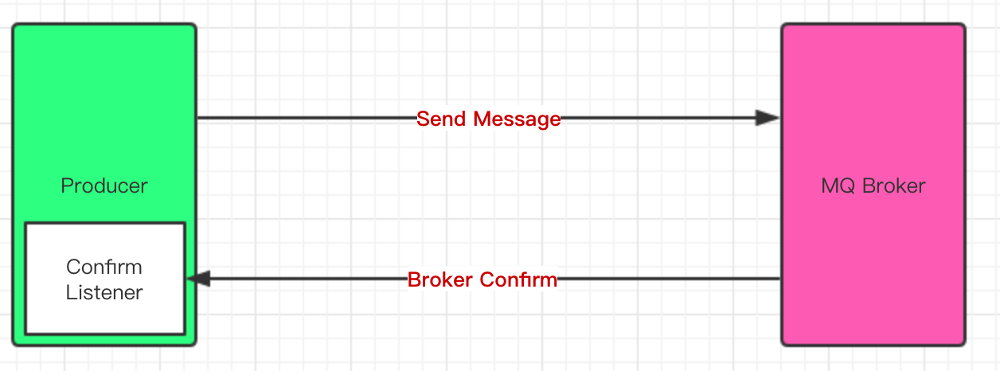

RabbitMQ 的消息确认有两种：

- 对生产者发送消息的确认：发送消息时，由于网络等原因可能导致消息发送失败。所以，RabbitMQ 必须有机制确保消息能准确到达 MQ，如果不能到达，必须反馈给生产端进行重发。

- 对消费者消费消息的确认：消息的消费过程中，也可能发生很多异常，比如消息格式不合法、处理超时等，RabbitMQ 需要提供消费回执，消费成功的消息可以删除，消费失败的消息则继续存储，择机再次投递。

# 1 投递确认

RabbitMQ 对生产者发送消息的确认有两种实现方式：

- 通过 AMQP 提供的事务机制实现
- 使用发送者 confirm 模式实现

## 1.1 confirm

生产者投递消息后，如果 broker 收到消息，则会给生产者一个应答。生产者通过接收应答来确定这条消息是否正确地发送到了 broker，这种机制也是消息可靠性投递的核心保障。



一旦 channel 处于 confirm 模式，broker 和 client 都将启动消息计数（以 confirm.select 为基础从 1 开始计数）。broker 会在处理完消息后，在当前 channel 上通过发送 basic.ack 的方式对其进行 confirm。delivery-tag 域的值标识了被 confirm 消息的序列号。broker 也可以通过设置 basic.ack 中的 multiple 域来表明到指定序列号为止的所有消息都已被 broker 正确地处理了。

需要说明的是，basic.nack 并不代表“网络发送失败”这类常见问题：按照官方文档，只有当负责该队列的 Erlang 进程发生内部错误时，broker 才会发送 basic.nack，也就是说它表示“消息没有被 broker 正确处理”，此时生产端可以选择重新发布消息。

confirm 在代码实现上分为两步：

- 在 channel 上开启确认模式：`channel.confirmSelect()`
- 在 channel 上添加监听：`channel.addConfirmListener(ConfirmListener listener)`，监听成功和失败的结果，根据具体结果对消息进行重新发送或记录日志等后续处理。

```java
import com.rabbitmq.client.*;
import java.io.IOException;

public class ConfirmAndReturnProducer {
    public static void main(String[] args) throws Exception {
        ConnectionFactory factory = new ConnectionFactory();
        factory.setHost("localhost");
        factory.setVirtualHost("/");
        factory.setUsername("guest");
        factory.setPassword("guest");

        Connection connection = factory.newConnection();
        Channel channel = connection.createChannel();

        String exchangeName = "test_return_exchange";
        String routingKey = "item.update";
        String errRoutingKey = "error.update";

        // 开启 confirm 确认模式
        channel.confirmSelect();

        // 发送
        for (int i = 0; i < 3; i++) {
            String msg = "this is a return-listening msg ";
            // 第三个参数 mandatory 为 true 时，路由不可达的消息会触发 return 监听，而非被直接丢弃
            if (i == 0) {
                channel.basicPublish(exchangeName, errRoutingKey, true, null, msg.getBytes());
            } else {
                channel.basicPublish(exchangeName, routingKey, true, null, msg.getBytes());
            }
            System.out.println("Send message : " + msg);
        }

        // 添加一个确认监听，这里先不关闭连接，以保证能收到监听消息
        channel.addConfirmListener(new ConfirmListener() {
            /**
             * 收到 ack 时的回调
             */
            public void handleAck(long deliveryTag, boolean multiple) throws IOException {
                System.out.println("success ack");
            }
            /**
             * 收到 nack 时的回调（可按需重新发布消息）
             */
            public void handleNack(long deliveryTag, boolean multiple) throws IOException {
                System.out.println("nack received");
            }
        });

        // 添加一个 return 监听（官方推荐的回调式写法）
        channel.addReturnListener(returnMessage -> {
            System.out.println("return code: " + returnMessage.getReplyCode()
                    + ", return body: " + new String(returnMessage.getBody()));
        });

    }
}
```

以上代码采用的正是异步 confirm 模式，除此之外还有单条同步 confirm 模式（每发一条调用一次 `waitForConfirms()`）、批量同步 confirm 模式（一批发送完毕后调用 `waitForConfirmsOrDie()`）。不过同步模式会阻塞发送流程、吞吐量受限，现实场景中很少使用，官方文档也强烈建议以异步的方式处理确认。

异步模式的关键在于自行追踪未确认的消息：在发布前通过 `channel.getNextPublishSeqNo()` 取得本条消息的序列号，与消息内容一起记录在一个有序映射（例如 `ConcurrentSkipListMap`）中；当确认回调触发时，如果 multiple 为 true，说明序列号小于等于本次 deliveryTag 的消息都已被确认，可以把映射中这一区间内的记录批量清除；对于迟迟未被确认的消息，则可以在超时后取出重发。这样一来，“待确认”消息的管理完全在客户端内完成，不必为此引入 Redis 等外部组件。

而后面的 Return Listener 则用于处理不可路由的消息，它与 ConfirmListener 的职责不同：ConfirmListener 关心的是“消息有没有被 broker 接收”，只要 broker 收到了消息，即使它无法路由到任何队列，也会发送 basic.ack；Return Listener 关心的是“消息能不能被路由到队列”，在开启 mandatory 配置后，不可路由的消息会被退回给生产者，交由回调进行后续处理。需要注意的是，发布到不存在的 exchange 并不会触发 return，而是会直接导致 channel 被关闭。

在基础 API 中有一个关键的配置项 `mandatory`：如果为 true，则监听器会接收到路由不可达的消息，然后进行后续处理；如果为 false，那么 broker 会自动丢弃该消息。

## 1.2 事务

事务的实现主要是对信道（Channel）的设置，涉及三个方法：

- `channel.txSelect()` 声明启动事务模式
- `channel.txCommit()` 提交事务
- `channel.txRollback()` 回滚事务

```java
import com.rabbitmq.client.Channel;
import com.rabbitmq.client.Connection;
import com.wj.transaction.config.MqConfig;

public class TxSend {

    private static final String QUEUE_NAME = "test_queue_tx";

    public static void send() throws Exception {
        Connection connection = MqConfig.getConnection();
        Channel channel = connection.createChannel();
        channel.queueDeclare(QUEUE_NAME, false, false, false, null);
        String msg = "hello tx!";
        try {
            // 将当前 channel 设置为事务模式
            channel.txSelect();

            channel.basicPublish("", QUEUE_NAME, null, msg.getBytes());

            // 故意制造异常，触发回滚
            int x = 1 / 0;

            System.out.println("【发送端】消息：" + msg);
            // 提交事务
            channel.txCommit();
        } catch (Exception e) {
            channel.txRollback();
            System.out.println("发生异常，回滚");
        }
        channel.close();
        connection.close();
    }
}
```

如果消息被 nack，或者迟迟等不到确认，生产端就无法确定消息是否真的到达 broker，可能造成数据丢失。解决思路不是退回事务机制——事务是同步阻塞的，官方文档的对比数据显示，它会使吞吐量下降约 250 倍，只适合作为原理了解。

合理的做法是在异步确认的基础上做应用层兜底：在本地缓存中记录未确认的消息，收到确认后删除对应记录；若收到 nack 或等待确认超时，则按指数退避策略进行有限次数的重试；重试仍失败的消息转入死信队列或落库记录，并触发告警交由人工介入。

如果生产端希望在重启后仍能恢复“待确认”的消息，可以把本地缓存换成 Redis 或数据库等外部存储：以 ackId 为键保存消息并设置超时时间，超时未确认则重发，确认成功后删除；不依赖键过期事件时，也可以把消息放入一个 ackFailList，由定时任务扫描重发。这种外置方案属于额外的加固手段，并非必须——配合前文介绍的序列号追踪，大多数场景在内存中管理“待确认”消息即可。

如果使用 Spring AMQP，这套机制有开箱即用的支持：发送时传入 CorrelationData 作为消息标识，通过 RabbitTemplate 的 setConfirmCallback() 与 setReturnsCallback() 分别注册确认与退回的回调；CorrelationData.getFuture() 返回一个 CompletableFuture<Confirm>，用 get() 等待或 whenComplete() 异步获取确认结果都可以。对于 broker 连接故障这类问题，还可以为 RabbitTemplate 配置 RetryTemplate（例如指数退避策略），把重试逻辑交给框架统一处理。无论使用原生客户端还是框架，核心思路都是一致的：围绕 Publisher Confirms 的 ack/nack 回调，管理好“待确认”消息的生命周期。

# 2 消费确认

为了保证消息能可靠到达消费端，RabbitMQ 也提供了消费端的消息确认机制。消费者在订阅队列时可以指定 autoAck 参数（对应底层 AMQP 协议中的 no-ack）：当 autoAck=false 时，RabbitMQ 会等待消费者显式发回 ack 信号后才从内存（和磁盘，如果是持久化消息的话）中移去消息；当 autoAck=true 时，消息一旦发出就被视为已确认并立即删除，消费者还没处理完就崩溃的话消息就丢失了。

采用消息确认机制后，只要令 autoAck=false，消费者就有足够的时间处理消息，不用担心处理消息过程中消费者进程挂掉后消息丢失的问题：RabbitMQ 会一直持有消息，直到消费者显式调用 `basicAck` 为止。被确认的消息才会从队列中删除，连接断开时未被确认的消息会重新入队。

不过，如果消费者端堆积大量未确认的消息，会有内存溢出的风险。可以通过 `channel.basicQos(1)` 限制预取数量（prefetch count）：broker 一次只推送 1 条消息，等消费者确认后再推送下一条，即每个消费者在被确认前最多持有 1 条未确认消息，这样既避免了消息在客户端堆积，也让消息在多个消费者之间分发得更均匀。

```java
import com.rabbitmq.client.*;
import java.io.IOException;
import java.util.Map;

public class AckAndNackConsumer {
    public static void main(String[] args) throws Exception {
        ConnectionFactory factory = new ConnectionFactory();
        factory.setHost("localhost");
        factory.setVirtualHost("/");
        factory.setUsername("guest");
        factory.setPassword("guest");
        factory.setAutomaticRecoveryEnabled(true);
        factory.setNetworkRecoveryInterval(3000);

        Connection connection = factory.newConnection();

        final Channel channel = connection.createChannel();

        String exchangeName = "test_ack_exchange";
        String queueName = "test_ack_queue";
        String routingKey = "item.#";
        channel.exchangeDeclare(exchangeName, "topic", true, false, null);
        channel.queueDeclare(queueName, false, false, false, null);

        // 一般不用代码绑定，在管理界面手动绑定
        channel.queueBind(queueName, exchangeName, routingKey);

        Consumer consumer = new DefaultConsumer(channel) {
            @Override
            public void handleDelivery(String consumerTag, Envelope envelope,
                                       AMQP.BasicProperties properties, byte[] body)
                    throws IOException {

                String message = new String(body, "UTF-8");
                System.out.println(" [x] Received '" + message + "'");

                try {
                    Thread.sleep(2000);
                } catch (InterruptedException e) {
                    e.printStackTrace();
                }

                // num 为 0 时模拟消费失败：nack 并让消息重新入队
                Map<String, Object> headers = properties.getHeaders();
                Object num = headers == null ? null : headers.get("num");
                if (num != null && (Integer) num == 0) {
                    channel.basicNack(envelope.getDeliveryTag(), false, true);
                } else {
                    channel.basicAck(envelope.getDeliveryTag(), false);
                }
            }
        };

        // 每次只向消费者推送 1 条消息，处理并确认后再推送下一条
        channel.basicQos(1);

        // 订阅队列，autoAck 设为 false（手动确认）
        channel.basicConsume(queueName, false, consumer);

    }
}
```

代码中的 `num` 是随消息一起发送的自定义头字段，用来模拟消费失败：`num` 为 0 时调用 `basicNack` 拒绝消息并重新入队，其余消息则通过 `basicAck` 正常确认。上面的代码把 requeue 设置为 true，如果一条消息因为内容不合法等原因总是处理失败（所谓“毒丸消息”），nack 后它会被反复重新投递，形成无限循环。

生产上的通用做法是借助死信交换器（DLX，Dead-Letter Exchange）为处理失败的消息提供出口：在声明队列时通过 `x-dead-letter-exchange` 参数指定一个死信交换器，当消息被拒绝（`basicNack` / `basicReject` 且 requeue=false）或者过期（TTL）时，broker 会自动将消息路由到死信交换器，进而转入死信队列。消费者端则不再用 requeue=true 无限重投，而是给消息约定一个重试上限（次数记录在消息头里）：未达上限的重新发布到业务队列继续重试，达到上限的转入死信队列，便于在管理界面中排查问题、人工修复后再重新处理。
