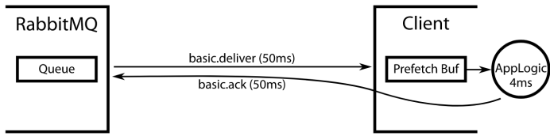
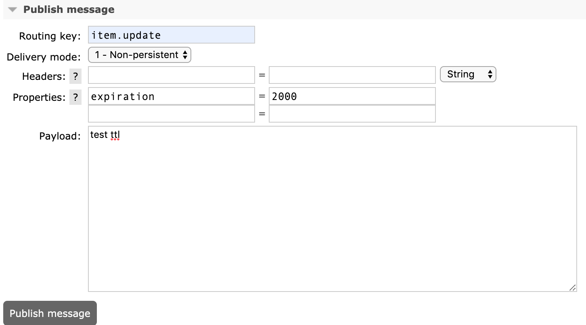
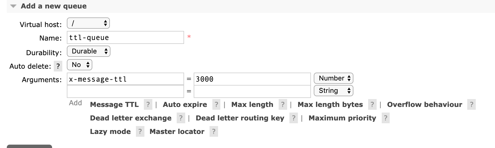
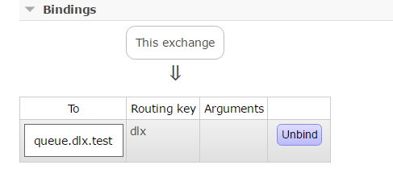
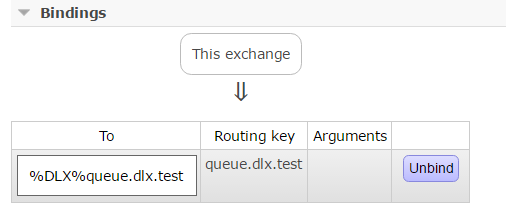
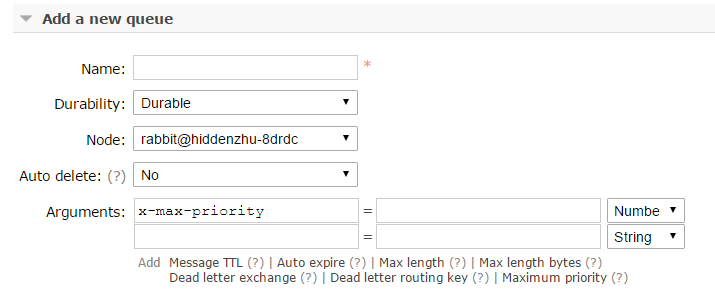

# 1 消费限流

假设一个场景：RabbitMQ 服务器积压了上万条未处理的消息，我们随便打开一个消费者客户端，会出现这样的情况：巨量的消息瞬间全部推送过来，但是我们单个客户端无法同时处理这么多数据，当消息数量激增的时候很有可能造成资源耗尽，导致系统的卡顿甚至直接崩溃。

RabbitMQ 提供了一种 **QoS**（Quality of Service，服务质量保证）功能，即**在非自动确认消息的前提下**，当未被确认的消息达到一定数目（通过基于 consumer 或 channel 设置 QoS 的值）时，不再向消费者投递新的消息。

RabbitMQ 客户端可通过 Channel 类的 `basicQos(int prefetchCount)` 设置消费者的预取数目，即消费者最大的未确认消息的数目。

假设 prefetchCount=10，有两个消费者，两个消费者依次从队列中抓取 10 条消息缓存在本地。若此时有新的消息到达队列，Broker 会先判断每个消费者未确认的消息数：未确认数达到 10 条的消费者，不再向其投递新的消息；哪个消费者的未确认数小于 10 条，就把消息投递给哪个消费者。

需要注意的是，prefetchCount**在消费端自动确认的模式下是不生效的**。

`channel.basicQos()` 中设置的预取数量多少合适，是一个颇有讲究的问题。我们希望充分利用消费者的处理能力，因此不宜设置过小，否则在消费者处理完一条消息后，要等服务端收到确认消息才会投递新的消息，导致此期间消费者处于空闲状态，浪费了处理能力；但设置过大，又可能使消息积压在消费者的缓存里，我们希望对于来不及处理的消息，应保留在队列中，便于加入新的消费者或空闲出来的消费者分担消息处理任务。

RabbitMQ 官网的一篇文章详细讨论了预取数量的设置问题：
[https://www.rabbitmq.com/blog/2012/05/11/some-queuing-theory-throughput-latency-and-bandwidth/](https://www.rabbitmq.com/blog/2012/05/11/some-queuing-theory-throughput-latency-and-bandwidth/)

文章大致思路如下。

假设从 RabbitMQ 服务端队列取消息、传输消息到消费者耗时为 50ms，消费者消费消息耗时 4ms，消费者传输确认消息到服务端耗时为 50ms。在消费者单线程串行处理消息、网络与处理耗时稳定的前提下，预取数量的最优数值为：(50 + 4 + 50)/4 = 26 个。



最初服务端会向客户端发送 26 条消息，并缓存在客户端本地，当消费者处理好第一个消息后，向服务端发送确认消息并取本地缓存的第二个消息，确认消息由客户端传送到服务端耗时 50ms，服务端收到确认后发送新的消息经过 50ms 又到达了客户端，而余下的 25 条消息消费耗时 25×4=100ms，所以当新的消息到达时，第一轮的 26 个消息恰好全部处理完。以此类推，之后每当处理完一个旧有的消息时，恰好会到达一个新的消息。既不会发生消息积压，消费者也不会空闲。

但实际情况是，网络的传输状况、消费者处理消息的速度都不会是恒定的，会时快时慢，造成消息积压或消费者空闲，这就要求预取数量随网络和消费者的状况实时调整。

还有两点需要注意：一是 `basicQos` 带 global 参数的重载——global 为 false（默认值）时，预取限制分别作用于信道上的每个消费者；global 为 true 时，则作用于整个信道，信道上的所有消费者共享同一份额度。二是仲裁队列的要求：官方明确仲裁队列不支持全局 QoS 预取——在启用了全局 QoS 的信道上消费仲裁队列会直接返回信道错误，因此消费仲裁队列时必须使用按消费者计算的预取设置（global=false）。

# 2 TTL

TTL 是 Time To Live 的缩写，也就是生存时间。

RabbitMQ 支持消息的过期时间，在消息发送时可以进行指定。

RabbitMQ 支持队列的过期时间，从消息入队列开始计算，只要超过了队列的超时时间配置，那么消息会自动地清除。

如果上述两种方法同时使用，则消息的过期时间以两者之间 TTL 较小的那个数值为准。

需要注意的是，过期消息的清理受队列位置约束——服务器会尽力在消息过期前后将其移除，但只有到达队头的过期消息才会被真正清理：要么被直接丢弃，要么按队列的死信配置转入死信交换器。这也解释了两种 TTL 的差异：对于队列级 TTL，消息按入队顺序排列，过期的消息恰好聚集在队头，清理非常自然；而对于消息级 TTL，各条消息的过期时间不同、分散在队列各处，只能等消息排到队头时再逐一处理，因此队列中可能滞留着早已过期、但尚未排到队头的消息。

## 2.1 消息的 TTL

我们在生产端发送消息的时候可以在 properties 中指定 `expiration` 属性来对消息过期时间进行设置，单位为毫秒（ms）。

```java
	      /**
         * deliveryMode 设置为 2 的时候代表持久化消息
         * expiration 意思是设置消息的有效期，超过 10 秒没有被消费者接收后会被自动删除
         * headers 自定义的一些属性
         * */
        // 5. 发送
        Map<String, Object> headers = new HashMap<String, Object>();
        headers.put("myhead1", "111");
        headers.put("myhead2", "222");

        AMQP.BasicProperties properties = new AMQP.BasicProperties().builder()
                .deliveryMode(2)
                .contentEncoding("UTF-8")
                .expiration("100000")
                .headers(headers)
                .build();
        String msg = "test message";
        channel.basicPublish("", queueName, properties, msg.getBytes());
```

我们也可以在后台管理页面中进入 Exchange 发送消息指定 `expiration`：



## 2.2 队列的 TTL

我们也可以在后台管理界面中新增一个 queue，创建时可以设置 TTL，队列中超过该时间的消息将会被移除：



对应的代码：

```java
ConnectionFactory factory = new ConnectionFactory();
factory.setHost(ip);
factory.setPort(port);
factory.setUsername(username);
factory.setPassword(password);

Connection connection = factory.newConnection();
Channel channel = connection.createChannel();

// arguments 仅用于设置队列自身的属性（TTL、死信等）
Map<String, Object> args = new HashMap<String, Object>();
args.put("x-message-ttl", 3000); // 设置队列的 TTL
channel.queueDeclare(queueName, durable, exclusive, autoDelete, args);
```

另外也可以通过 RabbitMQ 的命令行模式来设置：

```shell
rabbitmqctl set_policy TTL ".*" '{"message-ttl":60000}' --apply-to queues
```

# 3 死信队列

DLX（Dead-Letter-Exchange），即死信交换器。当消息在一个队列中变成死信（dead message）之后，它可以被重新发布到 DLX，再由 DLX 路由到绑定在它上面的队列——用来接收死信的队列通常被称为死信队列（DLQ，Dead-Letter Queue）。消息变成死信一般有以下几种情况：

- 消息被拒绝（basic.reject / basic.nack）并且不再重新投递（requeue=false）
- TTL（time-to-live）消息超时未消费
- 达到最大队列长度

DLX 本身就是一个普通的 Exchange，与一般的 Exchange 没有区别。它可以在任何队列上被指定——实际上就是设置队列的一个属性；当队列中出现死信时，RabbitMQ 就会自动将这些消息重新发布到指定的 DLX 上，进而被路由到死信队列，应用可以监听死信队列中的消息做相应的处理。

通过在 queueDeclare 方法中加入 `x-dead-letter-exchange` 参数实现：

```java
channel.exchangeDeclare("some.exchange.name", "direct");

Map<String, Object> args = new HashMap<String, Object>();
args.put("x-dead-letter-exchange", "some.exchange.name");
channel.queueDeclare("myqueue", false, false, false, args);
```

你也可以为这个 DLX 指定 routing key，如果没有特殊指定，则使用原队列的 routing key：

```java
args.put("x-dead-letter-routing-key", "some-routing-key");
```

还可以使用 policy 来配置：

```shell
rabbitmqctl set_policy DLX ".*" '{"dead-letter-exchange":"my-dlx"}' --apply-to queues
```

示例代码如下：

```java

ConnectionFactory factory = new ConnectionFactory();
factory.setHost(ip);
factory.setPort(port);
factory.setUsername(username);
factory.setPassword(password);

Connection connection = factory.newConnection();
Channel channel = connection.createChannel();

Map<String, Object> args = new HashMap<String, Object>();
// 指定死信的 exchange
args.put("x-dead-letter-exchange", "exchange.dlx.test");

// 指定死信的 routing key，如果不指定 x-dead-letter-routing-key 参数，则使用原来的 routing key
args.put("x-dead-letter-routing-key", "queue.dlx.test");

channel.queueDeclare("queue.dlx.test", durable, exclusive, autoDelete, args);

```

在 RabbitMQ 中有两个 exchange：`exchange.dlx.self` 和 `exchange.dlx.test`，两个 queue：`queue.dlx.test` 和 `%DLX%queue.dlx.test`。

`exchange.dlx.self` 是正常情况下生产者发送消息使用的 exchange，绑定关系如图：



`exchange.dlx.test` 是产生死信之后，原队列 `queue.dlx.test` 中的死信所发往的 exchange，绑定关系如图：



数据首先发送到 exchange [exchange.dlx.self]，根据 routing key [dlx] 路由到 `queue.dlx.test`，正常情况下，消费者可以消费 `queue.dlx.test` 中的内容。但是如果 `queue.dlx.test` 中的消息变成了 dead message 即死信，那么这个死信则会通过 `exchangeName=exchange.dlx.test`、`routingKey=queue.dlx.test` 路由到死信队列 `%DLX%queue.dlx.test` 中，如果要消费这个 dead message，此时消费者必须消费 `%DLX%queue.dlx.test` 中的内容而不是 `queue.dlx.test` 中的内容。

# 4 优先级队列

优先级队列，顾名思义，具有更高优先级的消息具有较高的优先权，优先级高的消息具备优先被消费的特权。

可以通过 RabbitMQ 管理界面配置队列的优先级属性，如下图的 `x-max-priority`：



也可以通过代码去实现，比如：

```java
Map<String,Object> args = new HashMap<String,Object>();
args.put("x-max-priority", 10);
channel.queueDeclare("queue_priority", true, false, false, args);
```

上面配置的是一个队列 queue 的最大优先级。之后要在发送的消息中设置消息本身的优先级，如下：

```java
AMQP.BasicProperties.Builder builder = new AMQP.BasicProperties.Builder();
builder.priority(5);
AMQP.BasicProperties properties = builder.build();
channel.basicPublish("exchange_priority","rk_priority",properties,("messages").getBytes());
```

下面演示一段生产-消费的代码。首先 producer 端先生产 10 个消息，第奇数个消息具备优先级，第偶数个消息就是默认的优先级。

```java
//create exchange
channel.exchangeDeclare("exchange_priority","direct",true);

//create queue with priority
Map<String,Object> args = new HashMap<String,Object>();
args.put("x-max-priority", 10);
channel.queueDeclare("queue_priority", true, false, false, args);
channel.queueBind("queue_priority", "exchange_priority", "rk_priority");

//send message with priority
for(int i=0;i<10;i++) {
  AMQP.BasicProperties.Builder builder = new AMQP.BasicProperties.Builder();
  if(i%2!=0)
    builder.priority(5);
  AMQP.BasicProperties properties = builder.build();
  channel.basicPublish("exchange_priority","rk_priority",properties,("messages-"+i).getBytes());
}
```

消费端运行结果：

> messages-1
> messages-3
> messages-5
> messages-7
> messages-9
> messages-0
> messages-2
> messages-4
> messages-6
> messages-8

当然，在消费端速度大于生产端速度，且 broker 中没有消息堆积的话，对发送的消息设置优先级也没什么实际意义，因为发送端刚发送完一条消息就被消费端消费了，相当于 broker 中至多只有一条消息，此时对单条消息来说优先级也就没有意义了。

另外，对于多消费者场景，RabbitMQ 3.8 引入了**单活跃消费者**（Single Active Consumer，SAC），经典队列与仲裁队列均支持：声明队列时将 `x-single-active-consumer` 参数设置为 `true`，同一时刻就只有一个消费者真正消费该队列，其余消费者处于待命状态；当活跃消费者被取消订阅或断开连接时，另一个已注册的消费者会自动接替它，常用于对消费顺序敏感、不希望多个消费者并发处理的场景。

# 5 延迟队列

延迟队列专门用于存储延迟消息。所谓“延迟消息”，是指当消息被发送以后，并不想让消费者立即拿到消息，而是等待指定时间后，消费者才拿到这个消息进行消费。

目前常见的应用软件都有消息的延迟推送的影子，应用也极为广泛，例如：

- 淘宝七天自动确认收货。在我们签收商品后，物流系统会在七天后延时发送一个消息给支付系统，通知支付系统将款打给商家，这个过程持续七天，就是使用了消息中间件的延迟推送功能。
- 12306 购票支付确认页面。我们在选好票点击确定跳转的页面中往往都会有倒计时，代表着 30 分钟内订单不确认的话将会自动取消订单。其实在下订单那一刻开始购票业务系统就会发送一个延时消息给订单系统，延时 30 分钟，告诉订单系统订单未完成，如果我们在 30 分钟内完成了订单，则可以通过逻辑代码判断来忽略掉收到的消息。

在 RabbitMQ 3.6.x 之前我们一般采用**死信队列+TTL 过期时间**来实现延迟队列。

从 RabbitMQ 3.6.x 开始，官方提供了延迟队列插件 `rabbitmq_delayed_message_exchange`，可以下载后放入 RabbitMQ 根目录下的 plugins 目录中使用。

## 5.1 死信队列+TTL

先来看看第一种的实现方式。

首先建立 2 个 exchange 和 2 个 queue：

- exchange_delay_begin：这个是 producer 端发送时调用的 exchange，将消息发送至 queue_delay_begin 中。
- queue_delay_begin：通过 routingKey="delay" 绑定 exchange_delay_begin，同时配置 DLX=exchange_delay_done，当消息变成死信时，发往 exchange_delay_done 中。
- exchange_delay_done：死信的 exchange，如果不配置 x-dead-letter-routing-key 则采用原有默认的 routingKey，即 queue_delay_begin 绑定 exchange_delay_begin 时采用的“delay”。
- queue_delay_done：消息在 TTL 到期之后，最终通过 exchange_delay_done 发送至此 queue，消费端通过消费此 queue 的消息，即可以达到延迟的效果。

**建立 exchange 和 queue** 的代码（当然，这里也可以通过 RabbitMQ 的管理界面来完成，无需编写相关代码）：

```java
channel.exchangeDeclare("exchange_delay_begin", "direct", true);
channel.exchangeDeclare("exchange_delay_done", "direct", true);

Map<String, Object> args = new HashMap<String, Object>();
args.put("x-dead-letter-exchange", "exchange_delay_done");
channel.queueDeclare("queue_delay_begin", true, false, false, args);
channel.queueDeclare("queue_delay_done", true, false, false, null);

channel.queueBind("queue_delay_begin", "exchange_delay_begin", "delay");
channel.queueBind("queue_delay_done", "exchange_delay_done", "delay");

```

producer 端代码：

```java
AMQP.BasicProperties.Builder builder = new AMQP.BasicProperties.Builder();
builder.expiration("60000"); // 设置消息 TTL
builder.deliveryMode(2); // 设置消息持久化
AMQP.BasicProperties properties = builder.build();

String message = String.valueOf(new Date());
channel.basicPublish("exchange_delay_begin","delay",properties,message.getBytes());
```

consumer 端代码：

```java
DeliverCallback deliverCallback = (consumerTag, delivery) -> {
    String msg = new String(delivery.getBody(), StandardCharsets.UTF_8);
    System.out.println("receive msg time:" + new Date() + ", msg body:" + msg);
    channel.basicAck(delivery.getEnvelope().getDeliveryTag(), false);
};
channel.basicConsume("queue_delay_done", false, deliverCallback, consumerTag -> {});
```

早期教程里常见的 `QueueingConsumer` 是基于阻塞队列的轮询式消费 API，早已被废弃，并已在 Java 客户端 5.0 中被移除；现代客户端统一使用基于回调的 `DeliverCallback` 来消费消息。

## 5.2 插件模式

> **提示**：使用这一插件前请留意它的维护状态——官方仓库已声明“Team RabbitMQ no longer maintains this project”（RabbitMQ 团队不再维护该项目），并明确表示它“不是长期的调度方案”（not a longer term scheduling solution）。插件把延迟消息保存在 Mnesia 表中，官方表示其设计不适合延迟消息数量很大的场景（“doesn't really fit scenarios with a high number of delayed messages”，如数十万到数百万条的规模）。它适合延迟消息规模不大的场景，选型时请结合维护与容量状况评估。

如果用插件方式来实现，编码上就简单多了。前面 5.1 的示例基于原生 Java 客户端，下面改用项目中常用的 Spring AMQP（Spring Boot）来演示：

```java
import org.springframework.amqp.core.*;
import org.springframework.context.annotation.Bean;
import org.springframework.context.annotation.Configuration;

import java.util.HashMap;
import java.util.Map;

@Configuration
public class MQConfig {

    public static final String LAZY_EXCHANGE = "Ex.LazyExchange";
    public static final String LAZY_QUEUE = "MQ.LazyQueue";
    public static final String LAZY_KEY = "lazy.#";

    @Bean
    public TopicExchange lazyExchange(){
        TopicExchange exchange = new TopicExchange(LAZY_EXCHANGE, true, false);
        exchange.setDelayed(true);
        return exchange;
    }

    @Bean
    public Queue lazyQueue(){
        return new Queue(LAZY_QUEUE, true);
    }

    @Bean
    public Binding lazyBinding(){
        return BindingBuilder.bind(lazyQueue()).to(lazyExchange()).with(LAZY_KEY);
    }
}
```

调用 `exchange.setDelayed(true)` 即可把交换器声明为延迟交换器。其底层相当于：把交换器类型声明为 `x-delayed-message`，并通过 `x-delayed-type` 参数指定实际的交换器类型——换成手动声明的方式就是：

```java
Map<String, Object> args = new HashMap<>();
// 延迟交换器的实际类型（路由行为）由 x-delayed-type 指定
args.put("x-delayed-type", "topic");
CustomExchange exchange = new CustomExchange(LAZY_EXCHANGE, "x-delayed-message", true, false, args);
```

发送消息时我们需要指定延迟推送的时间，这里在发送消息的方法中传入参数 `new MessagePostProcessor()` 是为了获得 `Message` 对象，因为需要借助 `Message` 对象的 API 来设置延迟时间。

```java
import com.anqi.mq.config.MQConfig;
import org.springframework.amqp.AmqpException;
import org.springframework.amqp.core.Message;
import org.springframework.amqp.core.MessageDeliveryMode;
import org.springframework.amqp.core.MessagePostProcessor;
import org.springframework.amqp.rabbit.connection.CorrelationData;
import org.springframework.amqp.rabbit.core.RabbitTemplate;
import org.springframework.beans.factory.annotation.Autowired;
import org.springframework.stereotype.Component;

import java.util.Date;

@Component
public class MQSender {

    @Autowired
    private RabbitTemplate rabbitTemplate;

    public void sendLazy(Object message){
        rabbitTemplate.setMandatory(true);
        // 确认回调：消息到达交换器后触发
        rabbitTemplate.setConfirmCallback((correlationData, ack, cause) -> {
            // ack=false 表示消息未到达交换器，在此处理失败逻辑
        });
        // 退回回调：消息无法路由到队列时触发
        rabbitTemplate.setReturnsCallback(returned -> {
            // 在此处理被退回的消息
        });
        // id + 时间戳 全局唯一
        CorrelationData correlationData = new CorrelationData("12345678909" + new Date());

        // 发送消息时指定 header 延迟时间
        rabbitTemplate.convertAndSend(MQConfig.LAZY_EXCHANGE, "lazy.boot", message,
                new MessagePostProcessor() {
            @Override
            public Message postProcessMessage(Message message) throws AmqpException {
                // 设置消息持久化
                message.getMessageProperties().setDeliveryMode(MessageDeliveryMode.PERSISTENT);
                // 等同于代码：message.getMessageProperties().setHeader("x-delay", "6000");
                message.getMessageProperties().setDelay(6000);
                return message;
            }
        }, correlationData);
    }
}
```
