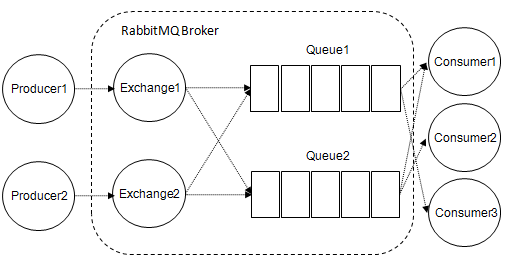
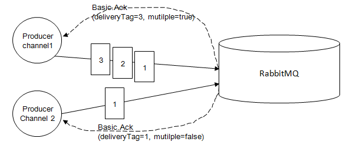
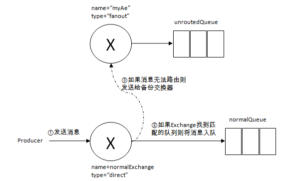

# 概述

RabbitMQ 如何确保消息可靠？

这是一个很难回答的问题——要确保消息可靠，不是三言两语就能说明白的，Kafka 等其他消息中间件也是如此。可靠是一个相对的概念，比较客观的衡量标准是在条件合理的范围内系统所能确保的几个 9 的可靠性。

在详细论述 RabbitMQ 的消息可靠性之前，我们先来回顾下消息在 RabbitMQ 中的经由之路。



如图所示，从 AMQP 协议层面上来说：

- 消息先从生产者 Producer 出发到达交换器 Exchange；
- 交换器 Exchange 根据路由规则将消息转发至对应的队列 Queue 之上；
- 消息在队列 Queue 上进行存储；
- 消费者 Consumer 订阅队列 Queue 并进行消费。

我们对于消息可靠性的分析也从这四个阶段来一一探讨。

# 阶段1

消息从生产者发出到达交换器 Exchange，在这个过程中可能会发生各种情况，生产者客户端发送出去之后可能发生网络丢包、网络故障等，造成消息丢失。一般情况下如果不采取措施，生产者无法感知消息是否已经正确无误地发送到交换器中。如果消息在传输到 Exchange 的过程中发生失败而可以让生产者感知的话，生产者可以进行进一步的处理动作，比如重新投递相关消息以确保消息的可靠性。

为此 AMQP 协议在建立之初就考虑到这种情况而提供了事务机制。RabbitMQ 客户端中与事务机制相关的方法有三个：

- `channel.txSelect`：用于将当前的信道设置成事务模式
- `channel.txCommit`：用于提交事务
- `channel.txRollback`：用于事务回滚

在通过 `channel.txSelect` 方法开启事务之后，我们便可以发布消息给 RabbitMQ 了，如果事务提交成功，则消息一定到达了 RabbitMQ 中，如果在事务提交执行之前由于 RabbitMQ 异常崩溃或者其他原因抛出异常，这个时候我们便可以将其捕获，进而通过执行 `channel.txRollback` 方法来实现事务回滚。注意，RabbitMQ 中的事务机制与大多数数据库中的事务概念并不相同，需要区分。

事务确实能够解决消息发送方和 RabbitMQ 之间消息确认的问题，只有消息成功被 RabbitMQ 接收，事务才能提交成功，否则我们便可在捕获异常之后进行事务回滚，与此同时可以进行消息重发。但是使用事务机制的话会严重拖垮 RabbitMQ 的性能，那么有没有更好的方法既能保证消息发送方确认消息已经正确送达，又能基本上不带来性能上的损失呢？从 AMQP 协议层面来看并没有更好的办法，但是 RabbitMQ 提供了一个改进方案，即**发送方确认机制**（Publisher Confirm）。

生产者将信道设置成 confirm（确认）模式后，所有在该信道上面发布的消息都会被指派一个唯一的序号（从 1 开始，即 deliveryTag）。一旦消息被投递到所有匹配的队列之后，RabbitMQ 就会发送一个确认（Basic.Ack）给生产者（其中携带该消息的序号），这就使得生产者能够知晓消息已经正确到达目的地。此外，Basic.Ack 命令还带有 multiple 参数，当其为 true 时，表示截至该序号（含）的所有消息都已经得到了处理。



事务机制在一条消息发送之后会使发送端阻塞，以等待 RabbitMQ 的回应，之后才能继续发送下一条消息。相比之下，发送方确认机制最大的好处在于它是异步的，一旦发布一条消息，生产者应用程序就可以在等待信道返回确认的同时继续发送下一条消息，当消息最终得到确认之后，生产者应用便可以通过回调方法来处理该确认消息，如果 RabbitMQ 因为自身内部错误导致消息丢失，就会发送一条 nack（Basic.Nack）命令，生产者应用程序同样可以在回调方法中处理该 nack 命令。

生产者通过调用 `channel.confirmSelect` 方法将信道设置为 confirm 模式，之后 RabbitMQ 会返回 `Confirm.Select-Ok` 命令表示同意生产者将当前信道设置为 confirm 模式。所有被发送的后续消息都被 ack 或者 nack 一次，不会出现一条消息既被 ack 又被 nack 的情况。并且 RabbitMQ 也并没有对消息被 confirm 的快慢做任何保证。

**事务机制和 Publisher Confirm 机制两者是互斥的，不能共存**。如果企图将已开启事务模式的信道再设置为 Publisher Confirm 模式，RabbitMQ 会报错。

事务机制和 Publisher Confirm 机制确保的是消息能够正确地发送至 RabbitMQ，这里的“发送至 RabbitMQ”的含义是指消息被正确地发往 RabbitMQ 的交换器，如果此交换器没有匹配的队列的话，那么消息也将会丢失。所以在使用这两种机制的时候要确保所涉及的交换器能够有匹配的队列。更进一步地讲，发送方要配合 mandatory 参数或者备份交换器一起使用来提高消息传输的可靠性。

需要说明的是，Publisher Confirm 的确认范围并不止于“到达交换器”这一步：对能够正常路由的消息，Broker 要等消息进入所有匹配的队列（对持久化消息则是写入磁盘）之后才会发出确认，阶段 3 还会从落盘的角度继续讨论；而对找不到匹配队列的消息，Broker 同样会发出确认——但消息已经被丢弃，这也正是需要 mandatory 和备份交换器兜底的原因。

在实际的高并发场景中，Publisher Confirm 是异步返回的，应用需要一种高效的机制来追踪哪些消息尚未被确认。官方 Java 客户端教程的异步确认示例给出了一种经典模式：借助 `ConcurrentSkipListMap` 这类并发跳表结构记录未确认消息——发送前通过 `channel.getNextPublishSeqNo()` 取得消息序号作为 key；收到 Basic.Ack 时，如果 multiple 为 true，用 `headMap(deliveryTag, true).clear()` 一次性清除该序号及之前的所有已确认消息，否则只移除对应的一条；收到 Basic.Nack 时，则取出对应消息进行重发。相比普通 Map 加锁，这种写法能以较低的锁竞争成本完成待确认消息的追踪。

# 阶段2

`mandatory` 和 `immediate` 是 `channel.basicPublish` 方法中的两个参数，它们都有当消息传递过程中不可达目的地时将消息返回给生产者的功能。而 RabbitMQ 提供的备份交换器（Alternate Exchange）可以将未能被交换器路由的消息（没有绑定队列或者没有匹配的绑定）存储起来，而不用返回给客户端。

RabbitMQ 3.0 版本开始去掉了对于 immediate 参数的支持，对此 RabbitMQ 官方解释是：immediate 参数会影响镜像队列的性能，增加代码复杂性，建议采用 TTL 和 DLX 的方法替代。所以本文只简单介绍 mandatory 和备份交换器。

当 mandatory 参数设为 true 时，如果交换器无法根据自身的类型和路由键找到一个符合条件的队列，那么 RabbitMQ 会调用 Basic.Return 命令将消息返回给生产者。当 mandatory 参数设置为 false 时，出现上述情形的话，消息直接被丢弃。那么生产者如何获取到没有被正确路由到合适队列的消息呢？这时候可以通过调用 `channel.addReturnListener` 添加一个 Return 回调来实现（官方推荐的回调式写法）。使用 mandatory 参数的关键代码如下所示：

```java
channel.basicPublish(EXCHANGE_NAME, "", true, MessageProperties.PERSISTENT_TEXT_PLAIN, "mandatory test".getBytes());
channel.addReturnListener(returnMessage -> {
    String message = new String(returnMessage.getBody());
    System.out.println("Basic.Return 返回的结果是：" + message);
});
```

生产者可以通过回调中返回的消息来重新投递，或者采用其他方案来提高消息的可靠性。

**备份交换器**，英文名称 Alternate Exchange，简称 AE。生产者在发送消息的时候如果不设置 mandatory 参数，那么消息在未被路由的情况下将会丢失，如果设置了 mandatory 参数，那么需要添加 Return 回调的编程逻辑，生产者的代码将变得复杂化。如果你不想复杂化生产者的编程逻辑，又不想消息丢失，那么可以使用备份交换器，这样可以将未被路由的消息存储在 RabbitMQ 中，再在需要的时候去处理这些消息。可以通过在声明交换器的时候添加 `alternate-exchange` 参数来实现，也可以通过策略的方式实现。如果两者同时使用的话，前者的优先级更高，会覆盖掉 Policy 的设置。

参考下图，如果此时我们发送一条消息到 normalExchange 上，当路由键等于“normalKey”的时候，消息能正确路由到 normalQueue 这个队列中。如果路由键设为其他值，比如“errorKey”，则消息不能被正确地路由到与 normalExchange 绑定的任何队列上，此时消息就会被发送给 myAe，进而发送到 unroutedQueue 这个队列。



备份交换器其实和普通的交换器没有太大的区别，为了方便使用，建议设置为 fanout 类型，如若读者想设置为 direct 或者 topic 的类型也没有什么不妥。需要注意的是消息被重新发送到备份交换器时的路由键和从生产者发出的路由键是一样的。备份交换器的实质就是原有交换器的一个“备胎”，所有无法正确路由的消息都发往这个备份交换器中，可以为所有的交换器设置同一个 AE，不过这里需要提前确保的是 AE 已经正确地绑定了队列，最好类型也是 fanout 的。

**如果备份交换器和 mandatory 参数一起使用，那么无法路由的消息会被转发到备份交换器——此时对 mandatory 而言消息仍算作“已路由”，不会再有 Basic.Return 返回，因此 mandatory 参数实际不再生效**。

# 阶段3

mandatory 或者 AE 可以让消息在路由到队列之前得到极大的可靠性保障，但是消息存入队列之后的可靠性又如何保证？

首先是持久化。持久化可以提高队列的可靠性，以防在异常情况（重启、关闭、宕机等）下的数据丢失。队列的持久化是通过在声明队列时将 `durable` 参数置为 true 实现的，如果队列不设置持久化，那么在 RabbitMQ 服务重启之后，相关队列的元数据将会丢失，此时数据也会丢失。正所谓“皮之不存，毛将焉附”，队列都没有了，消息又能存在哪里呢？队列的持久化能保证其本身的元数据不会因异常情况而丢失，但是并不能保证内部所存储的消息不会丢失。要确保消息不会丢失，需要将其设置为持久化。

设置了队列和消息的持久化，当 RabbitMQ 服务重启之后，消息依旧存在。单单只设置队列持久化，重启之后消息会丢失；单单只设置消息的持久化，重启之后队列消失，继而消息也丢失。单单设置消息持久化而不设置队列的持久化显得毫无意义。

在持久化的消息正确存入 RabbitMQ 之后，还需要有一段时间（虽然很短，但是不可忽视）才能存入磁盘之中。RabbitMQ 并不会为每条消息都做同步存盘（调用内核的 fsync 方法）的处理，可能仅仅保存到操作系统缓存之中而不是物理磁盘之中。如果在这段时间内 RabbitMQ 服务节点发生了宕机、重启等异常情况，消息还没来得及落盘，那么这些消息将会丢失。

如果在阶段 1 中采用了事务机制或者 Publisher Confirm 机制的话，可以进一步提高消息的可靠性。不过需要注意，确认发生的时机随队列类型而异：对于经典队列，非持久化消息一到达内存就会被确认，持久化消息则在写入磁盘（严格来说是写入消息存储的日志文件，并不等待内核 fsync）之后被确认；对于仲裁队列，消息需要复制到多数节点、写入各自的 WAL（预写日志）之后，Broker 才会发出确认。但即便如此，也无法避免单机故障且无法修复（比如磁盘损毁）而引起的消息丢失，这就需要引入多副本机制——绝大多数分布式系统都有多副本的概念来确保 HA。

RabbitMQ 早期为经典队列提供的方案是镜像队列（mirrored queue）：为主节点配置副本，主节点挂掉时可以自动切换到从节点，从而保证高可用性。但镜像队列已被官方弃用——自 3.9 起标记为弃用、不再推荐使用，4.0 中正式移除。取而代之的是自 3.8 引入的**仲裁队列**（quorum queue）：它基于 Raft 一致性协议，将消息复制到多个节点，leader 失效后，会在存有最新日志的节点中通过多数投票选出新的 leader，从而有效地保证了高可用性，除非整个集群都挂掉。虽然这样也不能完全地保证 RabbitMQ 消息不丢失，但是配置了多副本要比没有副本的可靠性高很多，在实际生产环境中的关键业务队列一般都会采用仲裁队列。

# 阶段4

进一步从消费者的角度来说，如果在消费者接收到相关消息之后，还没来得及处理就宕机了，这样也算数据丢失。

为了保证消息从队列可靠地到达消费者，RabbitMQ 提供了**消息确认机制**（message acknowledgement）。消费者在订阅队列时，可以指定 `autoAck` 参数，当 autoAck 等于 false 时，RabbitMQ 会等待消费者显式地回复确认信号后才从内存（或者磁盘）中移去消息（实质上是先打上删除标记，之后再删除）。当 autoAck 等于 true 时，RabbitMQ 会自动把发送出去的消息置为确认，然后从内存（或者磁盘）中删除，而不管消费者是否真正地消费到了这些消息。

采用消息确认机制后，只要设置 autoAck 参数为 false，消费者就有足够的时间处理消息（任务），不用担心处理消息过程中消费者进程挂掉后消息丢失的问题，因为 RabbitMQ 会一直持有消息直到消费者显式调用 Basic.Ack 命令为止。

当 autoAck 参数置为 false 时，对于 RabbitMQ 服务端而言，队列中的消息分成了两个部分：一部分是等待投递给消费者的消息；一部分是已经投递给消费者，但是还没有收到消费者确认信号的消息。如果 RabbitMQ 一直没有收到消费者的确认信号，并且消费此消息的消费者已经断开连接，则 RabbitMQ 会安排该消息重新进入队列，等待投递给下一个消费者，当然也有可能还是原来的那个消费者。

RabbitMQ 不会为未确认的消息设置过期时间，它判断此消息是否需要重新投递给消费者的唯一依据是消费该消息的消费者连接是否已经断开，这么设计的原因是 RabbitMQ 允许消费者消费一条消息的时间可以很久很久。

此外还需要说明的是，预取（QoS）与消息确认机制是配套的：在非自动确认（autoAck=false）的前提下，可以通过 `channel.basicQos(prefetchCount)` 限制消费者本地未确认消息的最大数目，达到上限后 Broker 不再向该消费者投递新消息，来不及处理的消息则保留在队列中，便于由其他消费者分担处理。需要注意两点：预取限制在消费端自动确认的模式下是不生效的；仲裁队列不支持全局 QoS 预取（即不允许由信道为所有消费者设置同一个预取上限），在启用了全局 QoS（global=true）的信道上消费仲裁队列会直接返回信道错误，因此消费仲裁队列时预取限制只能按消费者级别（global=false）设置。

如果消息消费失败，也可以调用 `Basic.Reject` 或者 `Basic.Nack` 来拒绝当前消息，而不是确认它：将 `requeue` 参数设置为 true 时，RabbitMQ 会重新把这条消息存入队列，以便可以发送给下一个订阅的消费者；设置为 false 时，RabbitMQ 会立即把消息从队列中移除——若队列配置了死信交换器，消息会被转入死信队列，否则将被直接丢弃。

还有一种情况需要考虑：requeue 的消息会很快被再次投递——官方文档对位置的描述是：消息会被尽量放回原来的位置，无法做到时则会放在更靠近队头的位置，并且可能立即处于可投递状态。如果此时消费者又不能正确地消费而又 requeue 的话，就会进入一个无尽的循环之中。对于这种情况，建议是在出现无法正确消费的消息时不要采用 requeue 的方式来确保消息可靠性，而是将消息重新投递到新的队列中，比如设定的死信队列中，以此可以避免前面所说的死循环而又可以确保相应的消息不丢失。对于死信队列中的消息可以用另外的方式来消费分析，以便找出问题的根源。

如果使用的是仲裁队列，还有两点差异需要注意。其一，从 3.10 起，被 nack 并 requeue 的消息会被放到队尾而不是队头，官方将这一调整标记为破坏性变更（Breaking Change）。这样能提升运维安全性：卡住或高频 requeue 的消费者不会让消息持续循环、使 Raft 日志不断增长，进而可能耗尽节点磁盘空间；如果需要保留原来的行为，可以为队列设置投递次数上限，此时 requeue 会尽量把消息放回原位置。其二，仲裁队列自 3.8 起支持毒丸消息（poison message）处理，也就是投递次数限制：通过 `x-delivery-limit` 队列参数或 delivery-limit 策略，可以限制同一条消息的最大投递次数——消息头部会带上 `x-delivery-count` 记录投递次数，超过限制后消息会被直接丢弃或转入死信队列（若配置了 DLX），4.0 起该限制的默认值为 20。需要注意，这一机制目前只有仲裁队列支持，经典队列并不具备，因此在经典队列上更稳妥的做法仍是配合死信交换器来兜底。