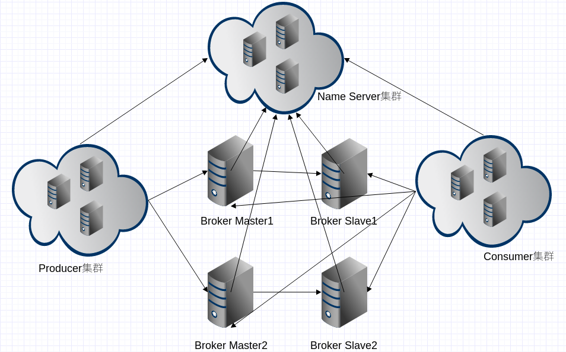
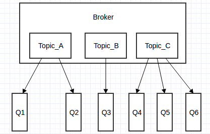

# 1 RocketMQ 是什么

RocketMQ 是阿里巴巴在 2012 年开源的分布式消息中间件，目前已经捐赠给 Apache 软件基金会，并于 2017 年 9 月 25 日成为 Apache 的顶级项目。目前 RocketMQ 已演进至 5.x 版本，全面拥抱云原生架构，并衍生出了 gRPC 多语言支持等新特性。作为经历过多次阿里巴巴双十一的洗礼并有稳定出色表现的国产中间件，RocketMQ 以其高性能、低延时和高可靠等特性，近年来被越来越多的企业使用。

随着 RocketMQ 5.0 的正式发布，其架构迎来了重大升级，全面转向云原生架构。5.0 版本将计算与存储进行了分离，引入了无状态的 Proxy 层，使得客户端变得更加轻量。同时，RocketMQ 5.0 原生支持了基于 gRPC 的全新多语言客户端协议，彻底解决了以往非 Java 语言生态薄弱的问题。此外，事件驱动架构（EventBridge）、时序消息以及轻量级消息模型等新特性的加入，使其应用场景从单一的微服务解耦扩展到了物联网、事件驱动等更广泛的领域。

其主要特点有：

- 灵活可扩展性
  RocketMQ 天然支持分布式，其核心四组件（NameServer、Broker、Producer、Consumer）每一个都可以在没有单点故障的情况下进行水平扩展。
- 海量消息堆积能力
  RocketMQ 采用基于磁盘的顺序写机制（结合 mmap 内存映射技术）实现超大消息的堆积能力，单机已可以支持亿级消息堆积，而且在堆积了这么多消息后依然保持写入低延迟。
- 支持顺序消息
  可以保证消息消费者按照消息发送的顺序对消息进行消费。顺序消息分为全局有序和局部有序，一般推荐使用局部有序，即生产者通过将某一类消息按顺序发送至同一个队列来实现。
- 多种消息过滤方式
  消息过滤分为在服务器端过滤和在消费端过滤。服务器端过滤时可以按照消息消费者的要求做过滤，优点是减少不必要消息传输，缺点是增加了消息服务器的负担，实现相对复杂。消费端过滤则完全由具体应用自定义实现，这种方式更加灵活，缺点是很多无用的消息会传输给消息消费者。
- 支持事务消息
  RocketMQ 除了支持普通消息、顺序消息之外还支持事务消息，这个特性对于分布式事务来说提供了又一种解决思路。
- 回溯消费
   回溯消费是指消费者已经消费成功的消息，由于业务上需求需要重新消费，RocketMQ 支持按照时间回溯消费，时间维度精确到毫秒，可以向前回溯，也可以向后回溯。

# 2 基础架构

RocketMQ 架构上主要分为四部分，如上图所示：

- **Producer**：消息发布的角色，支持分布式集群方式部署。Producer 通过 MQ 的负载均衡模块选择相应的 Broker 集群队列进行消息投递，投递的过程支持快速失败并且低延迟。Producer 与 NameServer 集群中的其中一个节点（随机选择）建立长连接，定期从 NameServer 取 Topic 路由信息，并向提供 Topic 服务的 Master 建立长连接（消息写入只在 Master 上进行），且定时向 Master 发送心跳。

  在 RocketMQ 5.0 的云原生架构中，Producer 的交互链路发生了变化。客户端不再直接与底层 Broker 建立复杂的长连接，而是将请求发送给新增的 Proxy 层。Proxy 负责处理协议解析、权限校验以及负载均衡等计算逻辑，随后再将消息转发给底层的 Broker 存储节点。这种存算分离的设计使得 Producer 端 SDK 可以做得极其轻量，同时也让服务端的扩缩容对客户端完全透明。
- **Consumer**：消息消费的角色，支持分布式集群方式部署。支持以 push 推、pull 拉两种模式对消息进行消费。同时也支持集群方式和广播方式的消费，它提供实时消息订阅机制，可以满足大多数用户的需求。Consumer 与 NameServer 集群中的其中一个节点（随机选择）建立长连接，定期从 NameServer 取 Topic 路由信息，并向提供 Topic 服务的 Master、Slave 建立长连接，且定时向 Master、Slave 发送心跳。在经典架构中，Consumer 默认从 Master 读取消息，当 Master 故障或负载过高时可配置为从 Slave 读取；在最新的 5.x 架构中，通过引入 Controller 组件实现了自动主备切换，进一步提升了高可用性。
- **NameServer**：NameServer 是一个几乎无状态的节点，可集群部署，节点之间无任何信息同步。Broker 会向集群中所有的 NameServer 节点注册路由信息，因此每个 NameServer 节点都会保存一份完整的全局路由信息。当某个 NameServer 因某种原因下线了，Broker 仍然可以向其它 NameServer 同步其路由信息，Producer、Consumer 仍然可以动态感知 Broker 的路由信息。NameServer 主要包括两个功能：
  - Broker 管理，NameServer 接收 Broker 集群的注册信息并且保存下来作为路由信息的基本数据。然后提供心跳检测机制，检查 Broker 是否还存活；
  - 路由信息管理，每个 NameServer 将保存关于 Broker 集群的整个路由信息和用于客户端查询的队列信息。然后 Producer 和 Consumer 通过 NameServer 就可以知道整个 Broker 集群的路由信息，从而进行消息的投递和消费。
- **Broker**：Broker 主要负责消息的存储、投递和查询以及服务高可用保证。Broker 分为 Master 与 Slave，一个 Master 可以对应多个 Slave，但是一个 Slave 只能对应一个 Master，Master 与 Slave 的对应关系通过指定相同的 BrokerName，不同的 BrokerId 来定义，BrokerId 为 0 表示 Master，非 0 表示 Slave。Master 也可以部署多个。每个 Broker 与 NameServer 集群中的所有节点建立长连接，定时注册 Topic 信息到所有 NameServer。

# 3 基本概念

## 生产者组（Producer Group）

用来表示一个发送消息应用，一个 Producer Group 下包含多个 Producer 实例，可以是多台机器，也可以是一台机器的多个进程，或者一个进程的多个 Producer 对象。一个 Producer Group 可以发送多个 Topic 消息，Producer Group 作用如下：

- 标识一类 Producer
- 可以通过运维工具查询这个发送消息应用下有多少个 Producer 实例
- 发送分布式事务消息时，如果 Producer 中途意外宕机，Broker 会主动回调 Producer Group 内的任意一台机器来确认事务状态。

## 消费者组（Consumer Group）

用来表示一个消费消息应用，一个 Consumer Group 下包含多个 Consumer 实例，可以是多台机器，也可以是多个进程，或者是一个进程的多个 Consumer 对象。一个 Consumer Group 下的多个 Consumer 以均摊方式消费消息，如果设置为广播方式，那么这个 Consumer Group 下的每个实例都消费全量数据。

消费者组与生产者组类似，都是将相同角色的分组在一起并命名，分组是个很精妙的概念设计，RocketMQ 正是通过这种分组机制，实现了天然的消息负载均衡。消费消息时通过 Consumer Group 实现了将消息分发到多个消费者服务器实例，比如某个 Topic 只有一个 Consumer Group 订阅，假设待消费消息总数为 9 条，该 Consumer Group 有 3 个实例（3 个进程或 3 台机器），那么每个实例将均摊 3 条消息，这也意味着我们可以很方便地通过加机器来实现水平扩展。

## 消息（Message）

消息就是要传输的信息。一条消息必须有一个主题，主题可以看作是你的信件要邮寄的地址。一条消息也可以拥有一个可选的标签和额外的键值对，它们可以用于设置一个业务 key 并在 Broker 上查找此消息以便在开发期间查找问题。

## 主题（Topic）

主题可以看作消息的归类，它是消息的第一级类型。比如一个电商系统可以分为：交易消息、物流消息等，一条消息必须有一个 Topic。Topic 与生产者和消费者的关系非常松散，一个 Topic 可以有 0 个、1 个、多个生产者向其发送消息，一个生产者也可以同时向不同的 Topic 发送消息。一个 Topic 也可以被 0 个、1 个、多个消费者订阅。

除了传统的 Topic 模型外，最新版本的 RocketMQ 还引入了轻量级消息（Lightweight Message）的概念。在某些不需要复杂路由和海量堆积的场景下，可以通过动态创建 Topic 或直接利用 Key-Value 语义来降低资源开销。同时，配合事件网格（EventBridge）能力，Topic 现在不仅作为内部系统的通信管道，还可以作为跨云、跨系统的事件总线，支持基于 CloudEvents 规范的标准化事件路由。

## 标签（Tag）

标签（Tag）可以看作子主题，它是消息的第二级类型，用于为用户提供额外的灵活性。使用标签，同一业务模块不同目的的消息就可以用相同 Topic 而不同的 Tag 来标识。比如交易消息又可以分为：交易创建消息、交易完成消息等，一条消息可以没有 Tag。标签有助于保持您的代码干净和连贯，并且还可以为 RocketMQ 提供的查询系统提供帮助。

## 消息队列（Message Queue）

主题被划分为一个或多个子主题，即消息队列。一个 Topic 下可以设置多个消息队列，发送消息时指定该消息的 Topic，默认情况下，RocketMQ 会轮询该 Topic 下的所有队列将消息均匀分发出去。下图为 Broker 内部消息情况：

# 4 集群部署模式

## 4.1 单 master 模式

也就是只有一个 master 节点，称不上是集群，一旦这个 master 节点宕机，那么整个服务就不可用，一般只用于实验场景。

## 4.2 多 master 模式

多个 master 节点组成集群，单个 master 节点宕机或者重启对应用没有影响。

- **优点**：所有模式中性能最高
- **缺点**：单个 master 节点宕机期间，未被消费的消息在节点恢复之前不可用，消息的实时性就受到影响。

**注意**：使用同步刷盘可以保证消息不丢失，同时 Topic 相对应的 queue 应该分布在集群中各个节点，而不是只在某个节点上，否则，该节点宕机会对订阅该 Topic 的应用造成影响。

## 4.3 多 master 多 slave 异步复制模式

在多 master 模式的基础上，每个 master 节点都有至少一个对应的 slave。master 节点可读可写，但是 slave 只能读不能写，类似于 MySQL 的主备模式。

- **优点**：在 master 宕机时，消费者可以从 slave 读取消息，消息的实时性不会受影响，性能几乎和多 master 一样。
- **缺点**：使用异步复制方式有可能会有消息丢失的问题。

## 4.4 多 master 多 slave 同步双写模式

同多 master 多 slave 异步复制模式类似，区别在于 master 和 slave 之间的数据复制方式：异步复制采用异步机制，同步双写采用同步机制。

- **优点**：同步双写模式能保证数据不丢失。
- **缺点**：发送单个消息 RT 会略长，性能相比异步复制低 10% 左右。

**注意**：要保证数据可靠，需采用同步刷盘和同步双写的方式，但性能会较其他方式低。

需要注意的是，上述传统的 Master-Slave 模式在主节点宕机时无法自动进行主备切换。在当前主流的生产实践中，更推荐采用基于 Raft 协议的 DLedger 模式，或者在 RocketMQ 5.x 中使用独立的 Controller 组件模式，以实现真正的主备自动切换（Auto Failover）。

针对上述传统部署模式的局限性，目前 RocketMQ 提供了两种更为先进的自动化高可用部署方案。第一种是基于 DLedger 的部署模式，它利用 Raft 共识算法在多个 Broker 节点之间进行日志复制，当 Leader 节点发生故障时，集群能够在秒级自动选举出新的 Leader 继续提供服务，无需人工干预。第二种是 RocketMQ 5.0 推出的 Controller 模式，它将元数据和选主逻辑抽离到一个独立的 Controller 集群中，Broker 节点专注于存储和收发，这种架构不仅实现了自动主备切换，还大幅降低了运维复杂度，是目前大规模生产环境的首选方案。