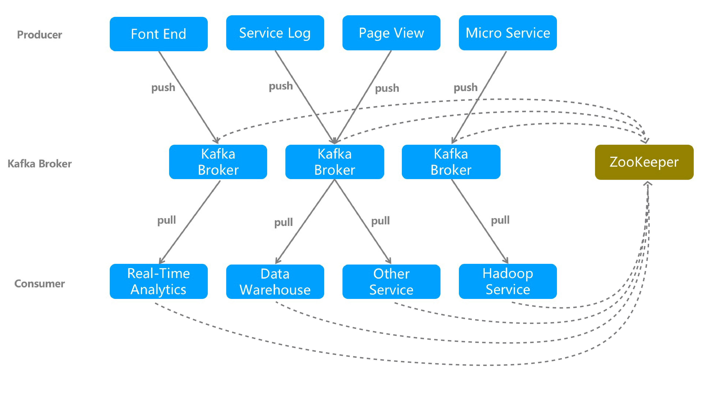
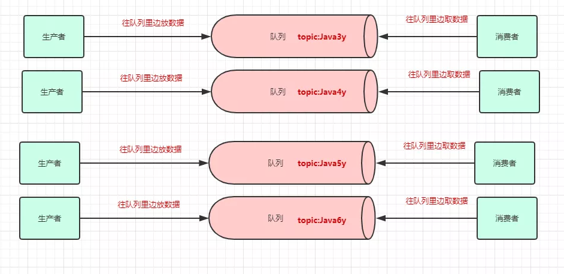
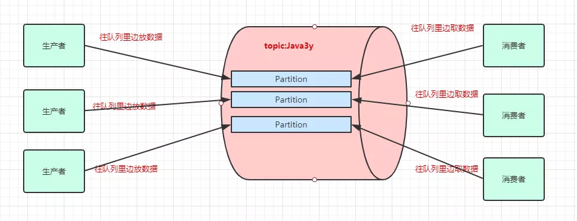
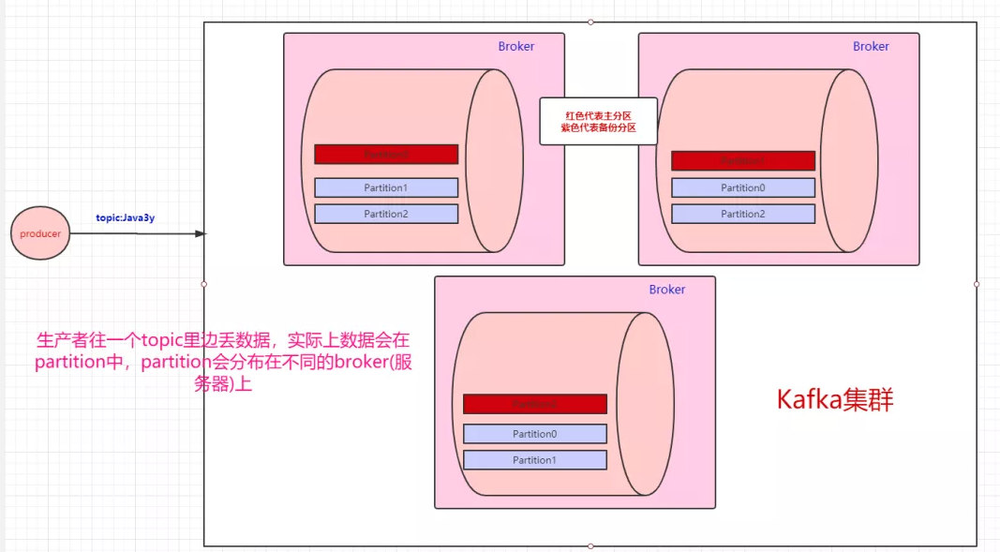
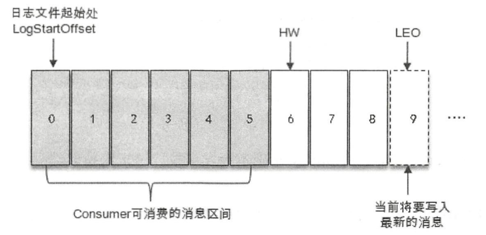
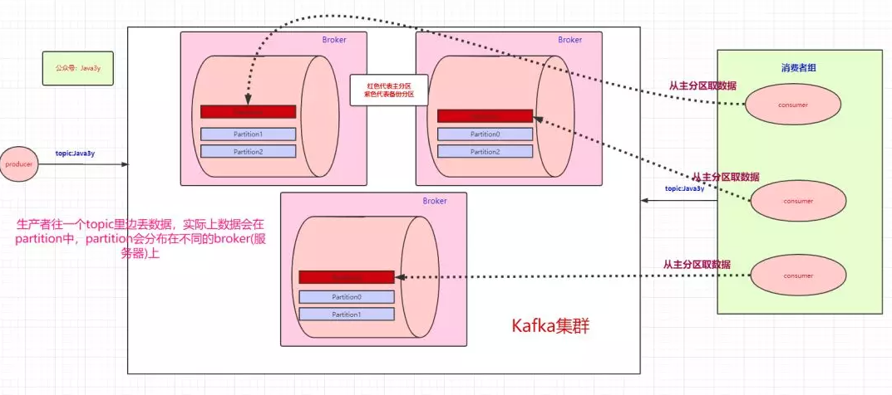
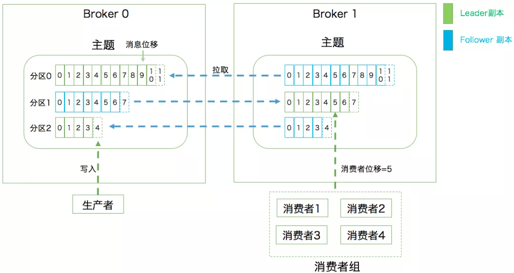

# 1 Kafka 是什么

Kafka 最早是由 LinkedIn 公司采用 Scala 语言开发的一个多分区、多副本且基于 ZooKeeper 协调的分布式消息系统，现已成为 Apache 的顶级项目。

Apache Kafka 与传统消息系统相比，有以下特点：

- 同时为发布和订阅提供高吞吐量
  Kafka 的设计目标是以时间复杂度为 O(1) 的方式提供消息持久化能力，即使对 TB 级以上数据也能保证常数时间的访问性能。即使在非常廉价的商用机器上也能做到单机支持每秒 100K 条消息的传输。
- 消息持久化
  将消息持久化到磁盘，因此可用于批量消费，例如 ETL 以及实时应用程序。通过将数据持久化到硬盘以及 replication 防止数据丢失。
- 分布式
  支持 Server 间的消息分区及分布式消费，同时保证每个 partition 内的消息顺序传输。这样易于向外扩展，所有的 producer、broker 和 consumer 都会有多个，均为分布式的。无需停机即可扩展机器。
- 消费消息采用 pull 模式
  消息被处理的状态是在 consumer 端维护，而不是由 server 端维护，broker 无状态，consumer 自己保存 offset。

# 2 体系架构

- **Producer**
  通过 push 模式向 Kafka Broker 发送消息。发送的消息可以是网站的页面访问、服务器日志，也可以是 CPU 和内存相关的系统资源信息。
- **Broker**
  用于存储消息的服务器，可以简单地看作一个独立的 Kafka 实例。Kafka Broker 支持水平扩展。Kafka Broker 节点的数量越多，Kafka 集群的吞吐率越高。
- **Consumer**
  通过 pull 模式从 Broker 订阅并消费消息。每个 Consumer 属于一个特定的 Consumer Group（可为每个 Consumer 指定 Group Name，若不指定 Group Name 则属于默认的 Group）。
- **ZooKeeper**
  管理集群的配置、选举 leader 分区，并且在 Consumer Group 发生变化时，进行负载均衡。

# 3 Topic 与 Partition

一个消息中间件，队列不单单只有一个，我们往往会有多个队列，而我们生产者和消费者就得知道：把数据丢给哪个队列，从哪个队列取消息。我们需要给队列取名字，叫做**topic**：

为了提高一个 topic 的吞吐量，Kafka 会对 topic 进行**分区**（partition）。所以，生产者实际上是往 topic 的一个 partition 发送数据，而消费者实际上也是从一个 topic 的 partition 拉取数据：

Kafka 可以保证**单个 partition 的写入是有顺序的**。如果要保证全局有序，那只能写入一个 partition 中。如果要消费也有序，消费者也只能有一个。

凡是分布式就无法避免网络抖动/机器宕机等问题的发生，很有可能消费者 A 读取了数据，还没来得及消费，就挂掉了。ZooKeeper 发现消费者 A 挂了，让消费者 B 去消费原本消费者 A 的分区，等消费者 A 重连的时候，发现已经重复消费同一条数据了。如果业务上不允许重复消费，最好在消费者端做业务上的校验。

一个 broker 就是一个 Kafka 服务器，多个 broker 构成一个 Kafka 集群。一个 topic 会分为多个 partition，partition 会分布在不同的 broker 中。

也就是说，**Kafka 是天然分布式的**。

# 4 多副本机制

既然是分布式，肯定会有单点问题：如果其中一台 broker 挂了，怎么办？

Kafka 为分区引入了**多副本**（Replica）机制，通过增加副本数量可以提升容灾能力。比如，现在我们有三个 partition，分别存在三台 broker 上。每个 partition 都会备份，这些备份散落在不同的 broker 上：

红色块的 partition 代表的是**主分区**，紫色的 partition 块代表的是**备份分区**。生产者往 topic 丢数据，是与主分区交互，消费者消费 topic 的数据，也是与主分区交互。

**备份分区仅仅用作备份，不做读写**。如果某个 Broker 挂了，那就会选举出其他 Broker 的 partition 来作为主分区，这就实现了高可用。

分区中的所有副本统称为 **AR**（Assigned Replicas）。所有与 leader 副本保持一定程度同步的副本（包括 leader 副本在内）组成 **ISR**（In-Sync Replicas），ISR 集合是 AR 集合中的一个子集。消息会先发送到 leader 副本，然后 follower 副本才能从 leader 副本中拉取消息进行同步，同步期间内 follower 副本相对于 leader 副本而言会有一定范围的滞后，这个范围可以通过参数进行配置。与 leader 副本同步滞后过多的副本（不包括 leader 副本）组成 **OSR**（Out-of-Sync Replicas），由此可见：`AR=ISR+OSR`。在正常情况下，所有的 follower 副本都应该与 leader 副本保持一定程度的同步，即 AR=ISR，OSR 集合为空。

由此可见，Kafka 的复制机制既不是完全的同步复制，也不是单纯的异步复制。事实上，同步复制要求所有能工作的 follower 副本都复制完，这条消息才会被确认为已成功提交，这种复制方式极大地影响了性能。而在异步复制方式下，follower 副本异步地从 leader 副本中复制数据，数据只要被 leader 副本写入就被认为已经成功提交。在这种情况下，如果 follower 副本都还没有复制完而落后于 leader 副本，突然 leader 副本宕机，则会造成数据丢失。Kafka 使用的这种 ISR 的方式则有效地权衡了数据可靠性和性能之间的关系。

ISR 与 **HW** 和 **LEO** 也有紧密的关系。HW 是 High Watermark 的缩写，俗称**高水位**，它标识了一个特定的消息偏移量（offset），消费者只能拉取到这个 offset 之前的消息。

如下图所示，它代表一个日志文件，这个日志文件中有 9 条消息，第一条消息的 offset 为 0，最后一条消息的 offset 为 8，offset 为 9 的消息用虚线框表示，代表下一条待写入的消息。日志文件的 HW 为 6，表示消费者只能拉取到 offset 在 0 至 5 之间的消息，而 offset 为 6 的消息对消费者而言是不可见的。

LEO 是 Log End Offset 的缩写，它标识当前日志文件中下一条待写入消息的 offset，上图中 offset 为 9 的位置即为当前日志文件的 LEO，LEO 的大小相当于当前日志分区中最后一条消息的 offset 值加 1。分区 ISR 集合中的每个副本都会维护自身的 LEO，而 ISR 集合中最小的 LEO 即为分区的 HW，对消费者而言只能消费 HW 之前的消息。

为了保证消息的持久化，Kafka 会将 partition 的数据写在磁盘（消息日志），不过 Kafka **只允许追加写入**（顺序访问），避免缓慢的随机 I/O 操作。当然，Kafka 也不是 partition 一有数据就立马将数据写到磁盘上，它会先缓存一部分，等到足够多数据量或等待一定的时间再批量写入。

# 5 消费者组

生产者可以有多个，消费者也可以有多个。像上面图的情况，是一个消费者消费三个分区的数据。多个消费者可以组成一个**消费者组**。

- 如果消费者组中的某个消费者挂了，那么其中一个消费者可能就要消费两个 partition 了

- 如果只有三个 partition，而消费者组有 4 个消费者，那么一个消费者会空闲

- 消费者组之间从逻辑上是独立的，如果多加入一个消费者组，无论是新增的消费者组还是原本的消费者组，都能消费 topic 的全部数据。

那么问题来了，如果一个消费者组中的某个消费者挂了，存活的消费者需要知道挂掉的消费者消费到哪了。

这里要引出**offset**了，offset 是消息在分区中的唯一标识，说白了就是表示消费者的消费进度。Kafka 通过 offset 来保证消息在分区内的顺序性，不过 offset 并不跨越分区，也就是说，**Kafka 保证的是分区有序而不是主题有序**。

在以前版本的 Kafka，这个 offset 是由 ZooKeeper 来管理的，后来 Kafka 开发者认为 ZooKeeper 不适合大量的删改操作，于是把 offset 在 broker 端以内部 `topic(__consumer_offsets)` 的方式来保存起来。

每次消费者消费的时候，都会提交这个 offset，Kafka 可以让你选择是自动提交还是手动提交。
