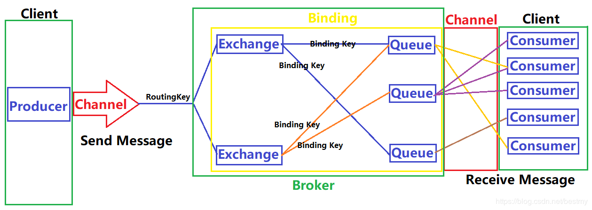
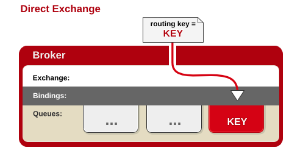
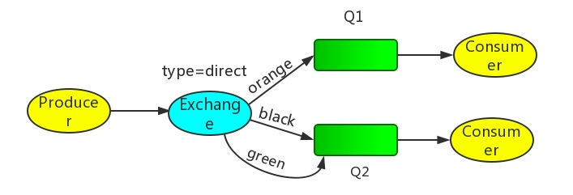
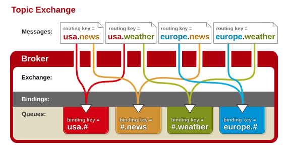
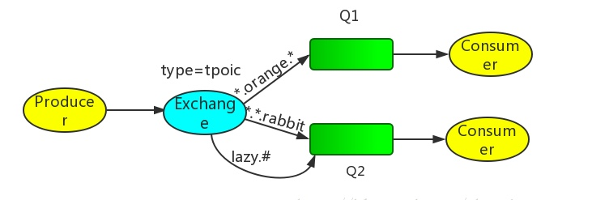
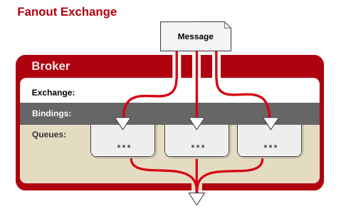
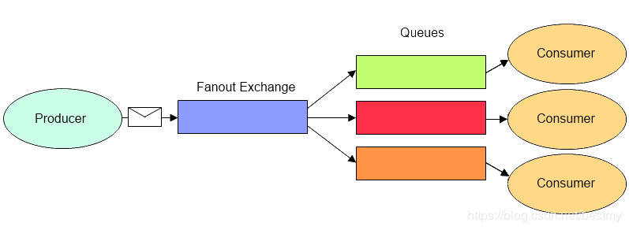
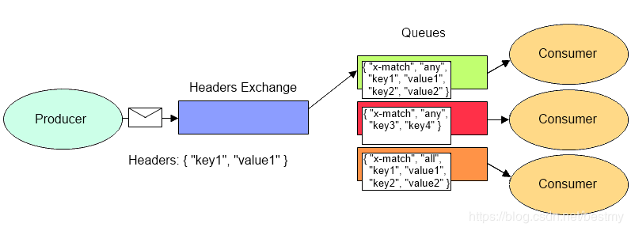

# 1 RabbitMQ 是什么

RabbitMQ 是一个开源的 AMQP 实现，服务器端用 Erlang 语言编写，支持多种客户端。它最初起源于金融系统，用于在分布式系统中存储转发消息。

RabbitMQ 在易用性、扩展性、高可用性等方面表现不俗。具体特点包括：

- **可靠性**（Reliability）：RabbitMQ 使用一些机制来保证可靠性，如持久化、传输确认、发布确认。
- **灵活的路由**（Flexible Routing）：在消息进入队列之前，是通过 Exchange 来路由消息的。对于典型的路由功能，RabbitMQ 已经提供了一些内置的 Exchange 来实现。针对更复杂的路由功能，可以将多个 Exchange 绑定在一起，也通过插件机制实现自己的 Exchange。
- **集群**（Clustering）：多个 RabbitMQ 服务器可以组成一个集群，形成一个逻辑 Broker。
- **高可用**（High Availability）：RabbitMQ 提供了基于 Raft 共识算法的仲裁队列（Quorum Queues），能够在部分节点故障的情况下保证队列仍然可用且不丢失已确认的消息；传统的镜像队列（Mirrored Queues）已在 RabbitMQ 4.0 中被移除。
- **多种协议**（Multi-protocol）：RabbitMQ 除了原生支持 AMQP 协议，还支持 STOMP、MQTT 等多种消息中间件协议。
- **多语言客户端**（Many Clients）：RabbitMQ 几乎支持所有常用语言，比如 Java、.NET、Ruby 等等。
- **管理界面**（Management UI）：RabbitMQ 提供了一个易用的用户界面，使得用户可以监控和管理消息 Broker 的许多方面。
- **跟踪机制**（Tracing）：如果消息异常，RabbitMQ 提供了消息跟踪机制，使用者可以找出发生了什么。
- **插件机制**（Plugin System）：RabbitMQ 提供了许多插件，来从多方面进行扩展，也可以编写自己的插件。

# 2 基本概念

- **生产者**（producer）：创建消息，发布到代理服务器（Message Broker）。
- **消费者**（consumer）：连接到代理服务器，并订阅到队列（queue）上，代理服务器会将消息发送给监听该队列的消费者；同一个队列允许多个消费者同时订阅，消息会在它们之间分摊。

- **消息**（Message）：包含消息头（即附属的配置信息）和消息体（即消息的实体内容）。消息体也可以称为 payload，消息体是不透明的，而消息头则由一系列的可选属性组成，这些属性包括 routing-key（路由键）、priority（相对于其他消息的优先权）、delivery-mode（指出该消息可能需要持久性存储）等。生产者把消息交由 RabbitMQ 后，RabbitMQ 会根据消息头把消息发送给感兴趣的 Consumer（消费者）。
- **交换器**（exchange）：在 RabbitMQ 中，消息并不是直接被投递到队列中的，中间还必须经过交换器这一层，交换器会把消息分配到对应的队列中。交换器用来接收生产者发送的消息并将这些消息路由给服务器中的队列中，如果路由不到，或许会返回给生产者，或许会被直接丢弃掉。RabbitMQ 内置了 4 种交换器类型，不同的类型对应着不同的路由策略：direct、fanout、topic 和 headers。其中 Direct 是 AMQP 规范要求服务器必须实现的类型，也是 RabbitMQ 默认提供的无名交换器所使用的类型，具体的路由规则在下文“路由策略”一节中展开。
- **队列**（queue）：用来保存消息直到发送给消费者。它是消息的容器，也是消息的终点。一个消息可投入一个或多个队列。消息一直在队列里面，等待消费者连接到这个队列将其取走。RabbitMQ 中消息只能存储在队列中，这一点和 Kafka 相反。Kafka 将消息存储在 Topic 的分区（Partition）中，消费进度则由消费者以偏移量（Offset）的形式记录。RabbitMQ 的生产者生产消息并最终投递到队列中，消费者可以从队列中获取消息并消费。多个消费者可以订阅同一个队列，这时队列中的消息会被平均分摊（Round-Robin，即轮询）给多个消费者进行处理，而不是每个消费者都收到所有的消息并处理，这样避免了消息被重复消费。RabbitMQ 不支持队列层面的广播消费，如果有广播消费的需求，需要在其上进行二次开发。值得一提的是，为了弥补传统队列在消息回溯和高吞吐量场景下的不足，RabbitMQ 从 3.9 版本开始引入了流（Streams）：与常规队列中消息被消费后即删除不同，Stream 是一种追加写入（append-only）的日志结构，允许消费者在不破坏消息的前提下进行多次非破坏性读取，并支持通过偏移量（Offset）回溯历史消息。这使得 RabbitMQ 在处理事件溯源、高吞吐日志收集等场景时具备了类似 Kafka 的能力，同时依然保留了 AMQP 的灵活路由优势。

- **路由键**（Routing Key）：消息头的一个属性（默认为空），交换器根据这个路由键将消息发送到匹配的队列中。

- **绑定键**（Binding Key）：绑定就是基于 Binding Key 将 Exchange 和 Queue 连接起来的路由规则，所以可以将交换器理解成一个由 Binding 构成的路由表。队列需要通过绑定键（默认为空）绑定到交换器上，交换器将消息的路由键与所绑定队列的绑定键进行匹配，正确匹配的消息将发送到队列中。路由键是偏向生产的概念，而绑定键是偏向消费的概念。

- **代理服务器**（Message Broker）：对于 RabbitMQ 来说，一个 RabbitMQ Broker 可以简单地看作一个 RabbitMQ 服务节点，或者 RabbitMQ 服务实例。大多数情况下也可以将一个 RabbitMQ Broker 看作一台 RabbitMQ 服务器。

- **虚拟主机**（vhost）：AMQP 概念的基础，其本质上就是一个 mini 版的代理服务器（拥有自己的队列、交换器和绑定，更重要的是，拥有自己的权限机制），RabbitMQ 默认的 vhost 为“/”（类似于网络中的 namespace）；一个用户可以被授权访问一个或多个 vhost（通常至少会被指派一个 vhost），进而只能访问授权范围内的队列、交换器和绑定，因此 vhost 之间在命名空间和权限上是相互隔离的。
- **信道**（channel）：建立在应用程序（生产者与/或消费者）和代理服务器之间 TCP 连接内的虚拟连接。由于创建和销毁 TCP 连接的开销较大，RabbitMQ 通过在单个 TCP 连接上复用多个 Channel 来解决连接数量限制并降低系统开销。每个信道拥有独立的 ID，现代客户端库通常会自动管理信道的生命周期和底层多路复用。

# 3 路由策略

路由策略是指 Exchange 在收到生产者发送的消息后依据什么规则把消息转发到一个或多个队列中保存。路由策略与三个因素相关：

- Exchange Type（Exchange 的类型）
- Binding Key（Exchange 和 Queue 的绑定关系）
- Routing Key & headers（消息的标记信息）

Exchange 根据消息的 Routing Key 和 Exchange 绑定 Queue 的 Binding Key 分配消息。生产者在将消息发送给 Exchange 的时候，一般会指定一个 Routing Key，来指定这个消息的路由规则，而这个 Routing Key 需要与 Exchange Type 及 Binding Key 联合使用才能最终生效。
在 Exchange Type 与 Binding Key 固定的情况下（一般这些内容都是固定配置好的），生产者就可以在发送消息给 Exchange 时，通过指定 Routing Key 来决定消息流向哪里。前三种策略（Direct、Topic、Fanout）都依赖 Routing Key 与 Binding Key 的匹配，而 Headers 策略不看 Routing Key，而是根据消息头的 headers 属性进行匹配。

除了上述四种基础类型外，RabbitMQ 官方还提供了插件形式的一致性哈希交换器（Consistent Hashing Exchange，由 rabbitmq_consistent_hash_exchange 插件提供），它根据消息的某个属性（如 Routing Key 或特定的 Header）计算哈希值，将消息均匀且稳定地分发到绑定的多个队列中：当队列节点增加或减少时，只有极少量的消息路由会发生改变。这在需要按特定维度（如用户 ID）将消息稳定路由到同一队列、以保证局部顺序性的场景中非常实用。

## 3.1 Direct 策略

当消息的 Routing Key 与 Exchange 和 Queue 之间的 Binding Key 完全匹配时，才会将消息分发到该 Queue。

RabbitMQ 默认提供了一个名称为空字符串（`""`）的 Direct 类型 Exchange，它隐式地绑定到了所有的 Queue（Binding Key 即为 Queue 的名称）。所以有时候我们感觉不需要交换器也可以发送和接收消息，但实际上使用的是 RabbitMQ 默认提供的 Exchange；不过在生产环境中，建议始终显式声明和使用自定义的 Exchange，以保证架构的清晰和可控。

Exchange 和两个队列绑定在一起：

- Q1 的 Binding Key 是 orange。
- Q2 的 Binding Key 是 black 和 green。
- 当 Producer 发送 Routing Key 为 orange 的消息时，Exchange 会把它路由到 Q1；Routing Key 为 black 或 green 时则路由到 Q2；其余的消息由于没有任何绑定与之匹配，会被丢弃。

## 3.2 Topic 策略

用消息的 Routing Key 与 Exchange 和 Queue 之间的 Binding Key 进行模糊匹配，如果匹配成功，将消息分发到该 Queue。

Binding Key 中可以存在两种特殊字符用于做模糊匹配：

- `*`：用于匹配一个单词
- `#`：用于匹配多个单词（可以是零个）

Producer 发送消息时需要设置 Routing Key。

Q1 的 Binding Key 是 `*.orange.*`，Q2 是 `*.*.rabbit` 和 `lazy.#`。

当生产者发送 Routing Key 为 `test.orange.mm` 的消息时，会路由到 Q1；而 `test.orange` 则无法路由到 Q1，因为 Q1 的绑定规则要求三个单词、中间一个为 orange。

Routing Key 为 `test.qq.rabbit` 或 `lazy.qq` 的消息都可以分发到 Q2：前者符合 `*.*.rabbit` 的规则（三个单词、最后一个为 rabbit），后者符合 `lazy.#` 的规则（第一个单词是 lazy，不限单词个数）。

如果发送的是 `test.orange.rabbit` 消息，则 Q1 和 Q2 都能收到（同时满足 `*.orange.*` 和 `*.*.rabbit`）。

## 3.3 Fanout 策略

与 Binding Key 和 Routing Key 无关，交换器会把所有发送到该交换器的消息路由到所有与该交换器绑定的消息队列中。订阅模式。类似于子网广播，子网内的每台主机都获得了一份复制的消息。Fanout 交换器转发消息是最快的。

## 3.4 Headers 策略

不依赖于 Routing Key 与 Binding Key，而是通过消息头的 Headers 属性来进行匹配转发的，类似 HTTP 请求的 Headers。

在绑定 Queue 与 Exchange 时指定一组键值对，键值对的 Hash 结构中要求携带一个键“x-match”，这个键的 Value 可以是 any 或 all，代表消息携带的 Hash 是需要全部匹配（all），还是仅匹配一个键（any）。

当消息发送到 Exchange 时，交换器会取到该消息的 headers，对比其中的键值对是否完全匹配 Queue 与 Exchange 绑定时指定的键值对；如果完全匹配则消息会路由到该 Queue，否则不会路由到该 Queue。Headers 交换器的优势是匹配的规则不被限定为字符串（String），而是 Object 类型。

不过，在实际应用当中，路由策略的选择范围以 Direct、Topic、Fanout 为主，Headers 策略很少使用。
