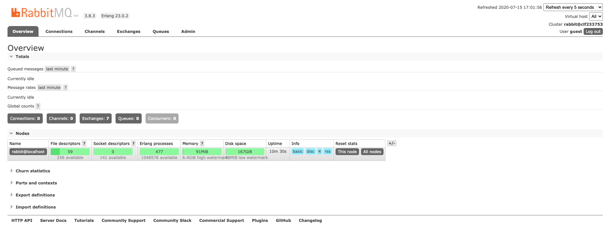

# 1 安装

RabbitMQ 安装好以后，进入安装目录下的 sbin 目录，里面有很多命令。本文以 macOS 上通过 Homebrew 安装的 3.8.3 版本为例，路径是`/usr/local/Cellar/rabbitmq/3.8.3/sbin`（Apple Silicon 的 Homebrew 为`/opt/homebrew/opt/rabbitmq/sbin`，Linux 与 Docker 安装则在各自发行包的目录下），这些命令在各平台是一致的：

```shell
> $  cd /usr/local/Cellar/rabbitmq/3.8.3/sbin
> $  ls

cuttlefish
rabbitmq-diagnostics
rabbitmq-plugins
rabbitmq-server
rabbitmqadmin
rabbitmq-defaults
rabbitmq-env
rabbitmq-queues
rabbitmq-upgrade
rabbitmqctl
```

例如，使用`rabbitmq-plugins` 开启控制台插件：

```shell
> $ ./rabbitmq-plugins enable rabbitmq_management ## 开启控制台插件

Enabling plugins on node rabbit@localhost:
rabbitmq_management
The following plugins have been configured:
  rabbitmq_amqp1_0
  rabbitmq_management
  rabbitmq_management_agent
  rabbitmq_mqtt
  rabbitmq_stomp
  rabbitmq_web_dispatch
Applying plugin configuration to rabbit@localhost...
Plugin configuration unchanged.

```

使用`rabbitmqctl` 添加账号：

```shell
> $ ./rabbitmqctl add_user admin admin ## 添加账号
Adding user "admin" ...

> $ ./rabbitmqctl set_permissions -p "/" admin ".*" ".*" ".*" ## 添加访问权限
Setting permissions for user "admin" in vhost "/" ...

> $ ./rabbitmqctl set_user_tags admin administrator ## 设置超级权限
Setting tags for user "admin" to [administrator] ...
```

使用`rabbitmq-server` 命令启动：

```shell
> $ ./rabbitmq-server ## 启动RabbitMQ

  ##  ##      RabbitMQ 3.8.3
  ##  ##
  ##########  Copyright (c) 2007-2020 Pivotal Software, Inc.
  ######  ##
  ##########  Licensed under the MPL 1.1. Website: https://rabbitmq.com

  Doc guides: https://rabbitmq.com/documentation.html
  Support:    https://rabbitmq.com/contact.html
  Tutorials:  https://rabbitmq.com/getstarted.html
  Monitoring: https://rabbitmq.com/monitoring.html

  Logs: /usr/local/var/log/rabbitmq/rabbit@localhost.log
        /usr/local/var/log/rabbitmq/rabbit@localhost_upgrade.log

  Config file(s): (none)

  Starting broker... completed with 6 plugins.
```

说明：以上命令与输出记录于 3.8.3 版本（当时的版权归属显示为 Pivotal Software, Inc.）。RabbitMQ 3.8.x 系列早已停止维护，版权归属也随收购几经变更（Pivotal → VMware → Broadcom），现在安装请直接使用官方最新版本（4.x 系列），命令用法与本文基本一致。

然后打开控制台 `http://localhost:15672/`，默认的账号密码为 `guest/guest`。登录后的页面如下：



# 2 代码实例

```java
   //消息队列名称
    private final static String QUEUE_NAME = "hello";

    @Test
    public void send () throws java.io.IOException, TimeoutException {

        //创建连接工厂
        ConnectionFactory factory = new ConnectionFactory();
        factory.setHost("127.0.0.1");
        factory.setPort(5672);
        factory.setUsername("admin");
        factory.setPassword("admin");

        //创建连接和消息通道（Connection 与 Channel 均实现了 AutoCloseable，会自动关闭资源）
        try (Connection connection = factory.newConnection();
             Channel channel = connection.createChannel()) {

            //生成一个消息队列
            channel.queueDeclare(QUEUE_NAME, true, false, false, null);

            for (int i = 0; i < 10; i++) {
                String message = "Hello World RabbitMQ count: " + i;

                //发布消息，第一个参数表示路由（Exchange名称），为空则表示使用默认消息路由
                channel.basicPublish("", QUEUE_NAME, null, message.getBytes());

                System.out.println(" [x] Sent '" + message + "'");
            }
        }

    }

    @Test
    public void consumer () throws java.io.IOException, java.lang.InterruptedException, TimeoutException {

        //创建连接工厂
        ConnectionFactory factory = new ConnectionFactory();
        factory.setHost("127.0.0.1");
        factory.setPort(5672);
        factory.setUsername("admin");
        factory.setPassword("admin");

        //创建连接
        Connection connection = factory.newConnection();

        //创建消息信道
        Channel channel = connection.createChannel();

        //消息队列
        channel.queueDeclare(QUEUE_NAME, true, false, false, null);
        System.out.println("[*] Waiting for message. To exit press CTRL+C");

        AtomicInteger count = new AtomicInteger(0);

        //消费者用于获取消息信道绑定的消息队列中的信息
        Consumer consumer = new DefaultConsumer(channel) {
            @Override
            public void handleDelivery (String consumerTag, Envelope envelope, AMQP.BasicProperties properties,
                    byte[] body) throws IOException {
                String message = new String(body, "UTF-8");

                try {
                    System.out.println(" [x] Received '" + message);
                } finally {
                    System.out.println(" [x] Done");
                    channel.basicAck(envelope.getDeliveryTag(), false);
                }
            }
        };
        channel.basicConsume(QUEUE_NAME, false, consumer);

        Thread.sleep(1000 * 60);
    }
```

# 3 参数

## 3.1 队列参数

声明队列的方法有五个参数：

```java
queueDeclare(String queue,
			boolean durable,
			boolean exclusive,
			boolean autoDelete,
			Map<String, Object> arguments);

```

- `queue`：队列名称。
- `durable`：是否持久化。非持久化队列的定义只保存在内存中，Broker 重启后会丢失；设为 true 时，队列定义等元数据会保存到 Erlang 自带的 Mnesia 数据库中，重启后可以恢复。需要注意，Mnesia 只存储元数据，消息体本身的持久化由磁盘上的消息存储（消息日志与队列索引文件）负责，且仅对设置了持久化投递模式的消息生效。

- `exclusive`：是否排外的，有两个作用，一：当连接关闭时 connection.close() 该队列是否会自动删除；二：该队列是否是私有的 private，如果不是排外的，可以使用两个消费者都访问同一个队列，没有任何问题，如果是排外的，会对当前队列加锁，其他通道 channel 是不能访问的，一般等于 true 的话用于一个队列只能有一个消费者来消费的场景。

- `autoDelete`：是否自动删除，当最后一个消费者断开连接之后队列是否自动被删除。

- `arguments`：扩展参数，可选项如下：
  - `x-message-ttl`：设置队列中的所有消息的生存周期（统一为整个队列的所有消息设置生命周期），也可以在发布消息的时候单独为某个消息指定剩余生存时间，单位毫秒。
  - `x-expires`：当队列在指定的时间内没有被访问时会被删除。
  - `x-max-length`：限定队列中允许存放的最大消息数量，超过该数量时会从队头删除最早的消息。
  - `x-max-length-bytes`：限定队列占用的最大空间大小，超过该阈值时会从队头删除最早的消息。
  - `x-dead-letter-exchange`：当消息成为死信（如超过最大长度被丢弃、TTL 过期，或被拒绝且不重新入队）时，会将其路由到指定的交换器，而不是直接丢弃。
  - `x-dead-letter-routing-key`：指定死信转发时使用的 Routing Key；不设置时沿用原消息的 Routing Key。通常与 x-dead-letter-exchange 配合设置。
  - `x-max-priority`：优先级队列，声明队列时先定义最大优先级值（定义最大值一般不要太大），在发布消息的时候指定该消息的优先级，优先级更高（数值更大的）的消息先被消费。
  - `x-queue-mode`：将队列设置为延迟模式（lazy），在磁盘上保留尽可能多的消息以减少 RAM 使用；如果未设置，队列将保持在内存中的缓存，以尽可能快地传递消息。注意：从 RabbitMQ 3.12 起，经典队列统一采用类似 lazy 模式的行为，该参数不再生效。
  - `x-queue-type`：指定队列类型，可选 `classic`（经典队列，默认）、`quorum`（仲裁队列，基于 Raft 协议提供高可用与数据安全性，是现代 RabbitMQ 推荐的高可用队列类型）和 `stream`（流队列，追加写入、支持非破坏性读取，适合高吞吐与消息回溯场景）。需要注意，仲裁队列必须声明为持久化队列（durable 为 true），且不支持排外（exclusive）。
  - `x-queue-master-locator`：用于经典队列指定队列主节点（Leader）所在的策略：min-masters 指将主节点设置在队列数量最少的节点，client-local 指设置在声明队列的客户端所连接的节点，random 指随机选择节点。该参数服务于经典镜像队列场景，而经典镜像队列已在 RabbitMQ 4.0 中被移除；新版本中节点放置由 queue_leader_locator 设置控制（适用于仲裁队列与流队列），高可用则应直接使用仲裁队列，其 Leader 由 Raft 协议自动选举。
  - `x-single-active-consumer`：设置为 true 时启用单活跃消费者模式：队列在同一时刻只会向一个消费者投递消息，其余已订阅的消费者处于待命状态；当前活跃消费者断开或故障时，RabbitMQ 会自动将其中一个待命消费者提升为新的活跃消费者。这在需要严格保证消息处理顺序、避免重复触发的场景下很有用，相当于在“单点消费”的前提下实现了消费者级别的高可用。

## 3.2 生产者参数

在生产者通过 channel 的 basicPublish 方法发布消息时，通常有几个参数需要设置，为此我们有必要了解清楚这些参数代表的具体含义及其作用，查看 Channel 接口，会发现存在 3 个重载的 basicPublish 方法：

```java
void basicPublish (String exchange, String routingKey, BasicProperties props, byte[] body) throws IOException;

void basicPublish (String exchange, String routingKey, boolean mandatory, BasicProperties props, byte[] body) throws IOException;

void basicPublish (String exchange, String routingKey, boolean mandatory, boolean immediate,
                   BasicProperties props, byte[] body) throws IOException;
```

参数分别是：

- `exchange`：交换器名称。
- `routingKey`：路由键。
- `props`：消息属性字段，比如消息头部信息等等。
- `body`：消息主体部分。
- `mandatory`：当 mandatory 标志位设置为 true 时，如果 exchange 根据自身类型和消息 routingKey 无法找到一个合适的 queue 存储消息，那么 broker 会调用 basic.return 方法将消息返还给生产者；当 mandatory 设置为 false 时，出现上述情况 broker 会直接将消息丢弃。通俗地讲，mandatory 标志告诉 broker 代理服务器至少将消息 route 到一个队列中，否则就将消息 return 给发送者。
- `immediate`：该标志自 RabbitMQ 3.0 起不再支持；Java 客户端中带此参数的重载方法仅为接口兼容而保留（官方注释明确说明服务端不支持该标志），可直接忽略。

除了关注消息能否正确路由外，生产环境还建议启用发布者确认机制（Publisher Confirms）：在信道中调用 `channel.confirmSelect()` 开启后，Broker 在成功接收并处理消息（对持久化消息而言是指已写入磁盘）后会向生产者异步发送 `basic.ack`；若 Broker 内部发生错误，则会发送 `basic.nack`。生产者可以通过 `addConfirmListener` 异步处理确认结果，也可以使用 `waitForConfirms` 同步等待。相比早期事务机制（txSelect）同步阻塞、性能损耗大的缺点，发布者确认采用异步方式，在保证可靠投递的同时维持较高的吞吐量，是目前实现可靠消息投递的主流做法。

## 3.3 消费者参数

向信道的每次投递都带有一个投递标签（Delivery Tag），该投递标签是一个 64 位长的值，从 1 开始每次增加 1，用于唯一标识信道的每次投递。

`channel.basicAck()` 方法的第一个参数为投递标签，用于标识对哪次消息投递进行确认，第二个参数表示是否进行消息的批量确认。若确认消息时开启批量确认，则所有投递标签小于当前消息投递标签的未确认消息也会被一并确认。

使用批量确认，可起到减少网络流量的作用。

若投递的消息数目已经超过消费者的处理能力，继续投递消息将会导致消息的积压。此时消费者可选择拒绝：

`void basicNack(long deliveryTag, boolean multiple, boolean requeue)`

- `deliveryTag`：表示被拒绝的消息的投递标签
- `multiple`：表示是否批量拒绝，若是则所有投递标签小于当前消息且未确认的消息也都将被拒绝，若否则仅拒绝当前消息
- `requeue`：表示被拒绝的消息是否重新放回队列，若是则消息会重新回到队列并选择新的消费者进行投递，若否则该条消息会被丢弃。

当有多个消费者同时监听一个队列时，RabbitMQ 默认将消息逐一顺序分配给各消费者，该消息分配机制称为轮询（Round-Robin）。

消息转发到队列后，分配是提前一次性完成的，称为**预取**（Prefetch），即 RabbitMQ 尽可能快速地将消息推送至客户端，由客户端缓存本地，而并非在消息消费时才逐一确定。

消息的轮询分配机制和尽可能快速推送消息的机制给实际使用带来困难。实际情况下，每个消费者处理消息的能力、每个消息处理所需时间可能都是不同的，若只是机械化地顺次分配，可能造成一个消费者由于处理的消息的业务复杂、处理能力低而积压消息，另一个消费者早早处理完所有的消息，处于空闲状态，造成系统的处理能力的浪费。且无法加入新的消费者以提高系统的处理能力。

希望达到的效果是每个消费者都根据自身处理能力合理分配消息处理任务，既无积压也无空闲，新加入的消费者也能分担消息处理任务，使系统的处理能力能够平行扩展。

为了解决上述负载不均的问题，RabbitMQ 提供了服务质量控制（QoS）机制，通过 `channel.basicQos(int prefetchCount)` 方法即可开启：prefetchCount 限制了 RabbitMQ 每次向单个消费者推送的未确认消息的最大数量（默认值为 0，表示不限制）。例如将其设置为 1 时，消费者只有在处理完当前消息并发出 `basicAck` 确认后，才会收到下一条消息。配合手动确认机制，消息的分发会从“尽可能快地推送”转变为按消费者实际处理能力“按需分配”：处理能力强的消费者确认得快、收到的消息自然更多，新加入的消费者也能立即分担负载，从而真正实现系统处理能力的平行扩展。
