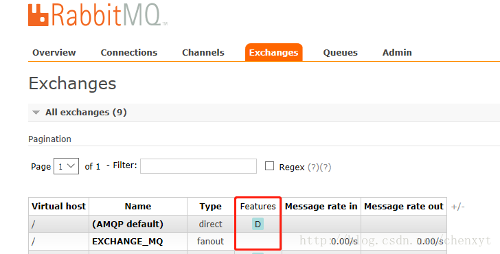

在生产过程中，难免会发生服务器宕机的事情，RabbitMQ 也不例外，可能由于某种特殊情况下的异常而导致 RabbitMQ 宕机重启，那么这个时候，对于消息队列里的数据，包括交换器、队列这类元数据以及队列中消息的恢复就显得尤为重要了。RabbitMQ 本身带有持久化机制，包括交换器、队列以及消息的持久化。持久化的主要机制就是将信息写入磁盘，当 RabbitMQ 服务宕机重启后，从磁盘中读取存入的持久化信息，恢复数据。

# 1 交换器的持久化

如果使用常规的方式声明交换器：

```java
channel.exchangeDeclare(EXCHANGE_NAME, "fanout");
```

默认不是持久化的，在服务器重启之后，交换器会消失。我们在管理台的 Exchange 页签下查看交换器，可以看到使用上述方法声明的交换器，Features 一列是空的，即没有任何附加属性。



我们换用另一种方式声明交换器：

```java
channel.exchangeDeclare(EXCHANGE_NAME, "fanout", true);
```

查看一下方法的说明：

```java
 * Actively declare a non-autodelete exchange with no extra arguments
 * @see com.rabbitmq.client.AMQP.Exchange.Declare
 * @see com.rabbitmq.client.AMQP.Exchange.DeclareOk
 * @param exchange the name of the exchange
 * @param type the exchange type
 * @param durable true if we are declaring a durable exchange (the exchange will survive a server restart)
 * @throws java.io.IOException if an error is encountered
 * @return a declaration-confirm method to indicate the exchange was successfully declared
 */
Exchange.DeclareOk(String exchange, String type, boolean durable) throws IOException;
```

我们可以看到第三个参数`durable`，如果为 true 则表示要做持久化，当服务重启时，交换器依然存在，所以使用该方法声明的交换器是下面这个样子的：


# 2 队列的持久化

与交换器的持久化相同，队列的持久化也是通过 durable 参数实现的，看一下方法的定义：

```java
 * Declare a queue
 * @see com.rabbitmq.client.AMQP.Queue.Declare
 * @see com.rabbitmq.client.AMQP.Queue.DeclareOk
 * @param queue the name of the queue
 * @param durable true if we are declaring a durable queue (the queue will survive a server restart)
 * @param exclusive true if we are declaring an exclusive queue (restricted to this connection)
 * @param autoDelete true if we are declaring an autodelete queue (server will delete it when no longer in use)
 * @param arguments other properties (construction arguments) for the queue
 * @return a declaration-confirm method to indicate the queue was successfully declared
 * @throws java.io.IOException if an error is encountered
 */
Queue.DeclareOk queueDeclare(String queue, boolean durable, boolean exclusive, boolean autoDelete, Map<String, Object> arguments) throws IOException;
```

第二个参数跟交换器方法的参数一样，true 表示做持久化，当 RabbitMQ 服务重启时，队列依然存在。

这里说一下另外两个参数（它们与持久化没有直接关系，但会影响队列的生命周期）：

- `exclusive`：排他队列。如果一个队列被声明为排他队列，那么这个队列只能被第一次声明它的连接所见，并在连接断开的时候自动删除。这里有三点需要说明：
  - 排他队列是基于连接可见的，同一连接的不同信道是可以同时访问同一连接创建的排他队列
  - 如果一个连接已经声明了一个排他队列，其他连接是不允许建立同名的排他队列的，这个与普通队列不同
  - 即使该队列是持久化的，一旦连接关闭或者客户端退出，该排他队列都会被自动删除，这种队列适用于一个客户端发送和读取消息的应用场景
- `autoDelete`：自动删除，如果该队列没有任何订阅的消费者，该队列会被自动删除。这种队列通常用作临时队列

# 3 消息的持久化

消息的持久化是指当消息从交换器发送到队列之后，被消费者消费之前，服务器突然宕机重启，消息仍然存在。消息持久化的前提是队列持久化，假如队列本身不是持久化的，那么消息的持久化无法在 broker 重启的场景下保证消息不丢失。

通过如下代码设置消息的持久化：

```java
channel.basicPublish(EXCHANGE_NAME, "", MessageProperties.PERSISTENT_TEXT_PLAIN, message.getBytes());
```

其中`MessageProperties.PERSISTENT_TEXT_PLAIN`是设置持久化的参数。

看一下 basicPublish 方法的定义：

```java
 * Publish a message
 * @see com.rabbitmq.client.AMQP.Basic.Publish
 * @param exchange the exchange to publish the message to
 * @param routingKey the routing key
 * @param props other properties for the message - routing headers etc
 * @param body the message body
 * @throws java.io.IOException if an error is encountered
 */
void basicPublish(String exchange, String routingKey, BasicProperties props, byte[] body) throws IOException;
```

再看下 BasicProperties 的类型：

```java
public BasicProperties(
    String contentType,
    String contentEncoding,
    Map<String,Object> headers,
    Integer deliveryMode,
    Integer priority,
    String correlationId,
    String replyTo,
    String expiration,
    String messageId,
    Date timestamp,
    String type,
    String userId,
    String appId,
    String clusterId)
```

其中`deliveryMode`是设置消息持久化的参数，等于 1 不设置持久化，等于 2 设置持久化。`PERSISTENT_TEXT_PLAIN`是一个预先实例化好的`deliveryMode = 2`对象，便于编程：

```java
public static final BasicProperties PERSISTENT_TEXT_PLAIN =
    new BasicProperties("text/plain",
                        null,
                        null,
                        2,
                        0, null, null, null,
                        null, null, null, null,
                        null, null);
```

保证在服务器重启的时候可以保持不丢失相关信息，重点解决服务器的异常崩溃而导致的消息丢失问题。但是，将所有的消息都设置为持久化，会严重影响 RabbitMQ 的性能，磁盘 I/O 的延迟远高于内存读写。对于可靠性不是那么高的消息可以不采用持久化处理以提高整体的吞吐率，在选择是否要将消息持久化时，需要在可靠性和吞吐量之间做一个权衡。

# 4 进一步思考

将 Exchange、Queue、Message 都设置了持久化之后就能 100% 保证数据不丢失了吗？

答案是否定的。

首先，从 consumer 端来说，如果这时 autoAck = true，那么当 consumer 接收到相关消息之后，还没来得及处理就 crash 掉了，那么这样也算数据丢失，这种情况也好处理，只需将 autoAck 设置为 false，然后在正确处理完消息之后进行手动 ack。

另外，还需要在 producer 端引入发布者确认（Publisher Confirms）机制，来确保消息已经正确地发送至 broker 端。在 channel 上调用`confirmSelect`开启确认模式后，每条消息都会获得一个投递标签（Delivery Tag）——每个 channel 各自维护一个从 1 开始单调递增的序列号，用于标识该 channel 上发布的消息；broker 处理完成后会向 producer 回执`basic.ack`（确认）或`basic.nack`（否定确认）。producer 可以通过`addConfirmListener`注册监听器来异步处理确认结果：`handleAck(deliveryTag, multiple)`表示消息已被 broker 接收，若 multiple 为 true，则表示投递标签小于等于 deliveryTag 的消息都已被确认；`handleNack(deliveryTag, multiple)`则表示 broker 内部处理失败，这类消息通常需要记录日志，并考虑重新发布（重试）。如果不想异步处理，也可以调用`waitForConfirms()`同步等待所有未确认的消息被确认，但这是阻塞操作，吞吐量会明显下降。

相比之下，早期用于保证消息不丢的事务机制（`txSelect`、`txCommit`）虽然也能达到类似的效果，但它是同步阻塞的，官方文档的对比数据显示，事务会使吞吐量下降约 250 倍，因此现在一般推荐使用发布者确认。

其次，关键的问题是消息在正确存入 RabbitMQ 之后，还需要有一段时间（这个时间很短，但不可忽视）才能存入磁盘之中。这里先澄清一下存储结构：队列、交换器、绑定、用户等元数据由元数据存储保存（传统上是 Erlang 的 Mnesia 数据库，从 RabbitMQ 4.2 起，新集群的默认元数据存储已切换为 Khepri），消息体不在其中——持久化消息由消息存储（message store）负责，以追加方式写入磁盘上的日志文件，并由队列索引记录其在日志中的位置。

持久化消息虽会尽快写入磁盘，但这一步通常只是把数据放进了操作系统的页缓存（Page Cache）——RabbitMQ 并不会在发出发布确认之前对消息执行 fsync，因此数据可能仅仅停留在页缓存中而尚未真正落到物理磁盘上。在这段时间内，如果 RabbitMQ broker 发生 crash，消息保存到页缓存但还没来得及落盘，那么这些消息将会丢失。

那么这个怎么解决呢？一个思路是让确认发生在数据真正落盘之后，从而消除"已确认但尚未落盘"的状态——这正是仲裁队列（Quorum Queues）的做法：消息先写入 Leader 节点的预写日志（WAL，Write-Ahead Log）并 fsync 落盘，随后基于 Raft 共识算法复制到各个 Follower 节点，只有当大多数节点都完成写入后，broker 才会向 producer 发送发布确认。因此，只要集群中大多数节点没有遭遇永久性故障，已被确认的消息就不会丢失。

需要注意的是，传统的镜像队列（Mirrored Queues）虽然通过配置副本、在节点故障时自动切换来保障高可用（HA），但该特性自 RabbitMQ 3.9 起已被弃用，并在 RabbitMQ 4.0 中被彻底移除，官方推荐以仲裁队列或流（Streams）替代。因此在新版本中配置副本以保障可靠性时，应直接选用仲裁队列。

RabbitMQ 的可靠性除了 Exchange、Queue、Message 的持久化，还涉及 producer 端的确认机制（Publisher Confirms）、broker 端的副本机制（仲裁队列）以及 consumer 端的确认机制。对可靠性的要求越高，性能也会随之下降，鱼和熊掌不可兼得，关键在于选择和取舍。