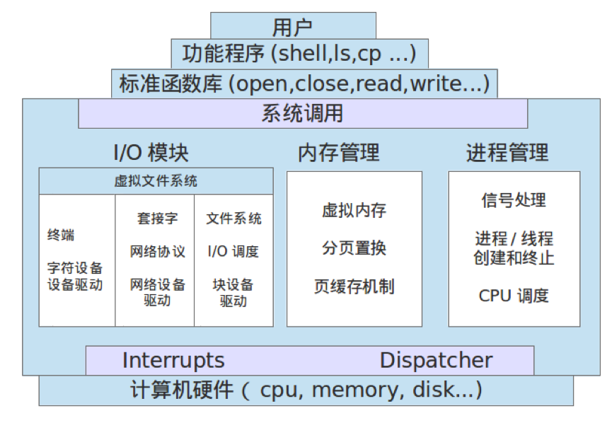
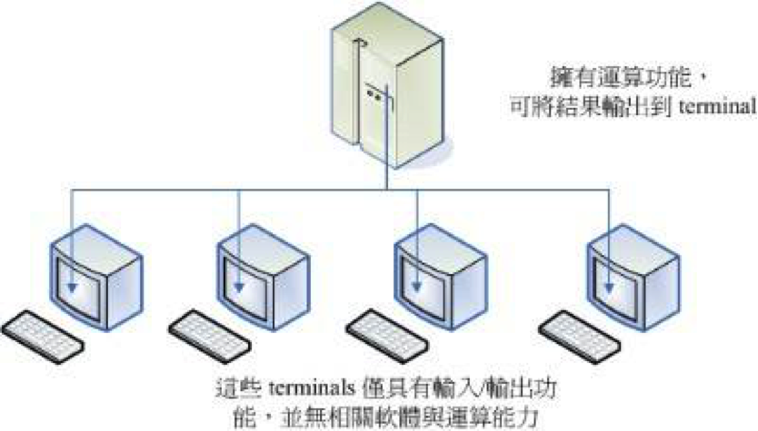
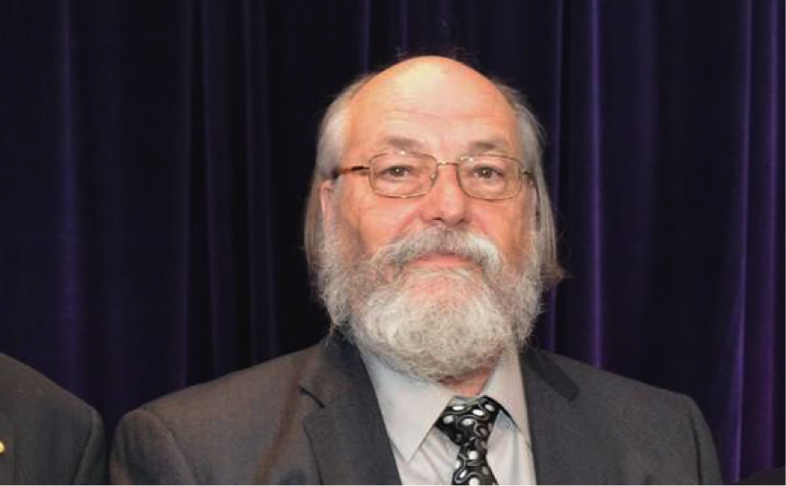
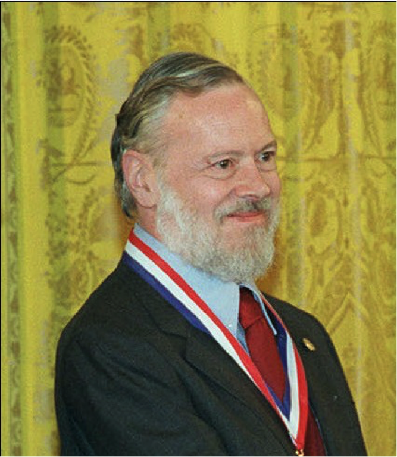
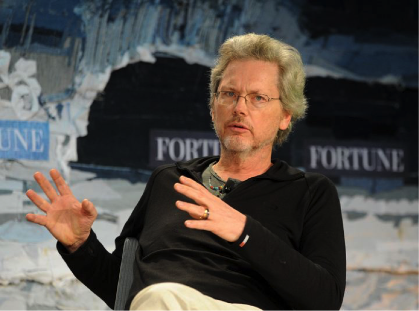
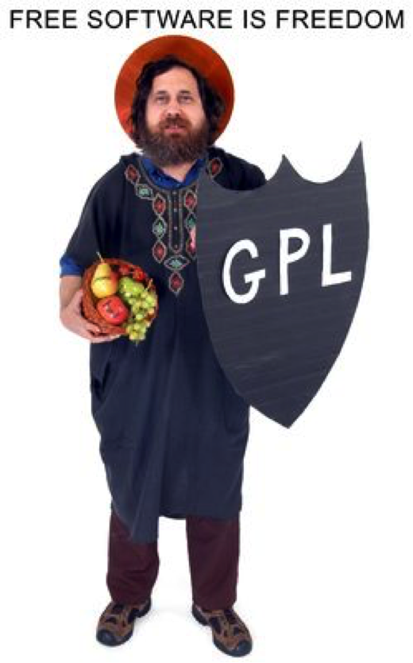
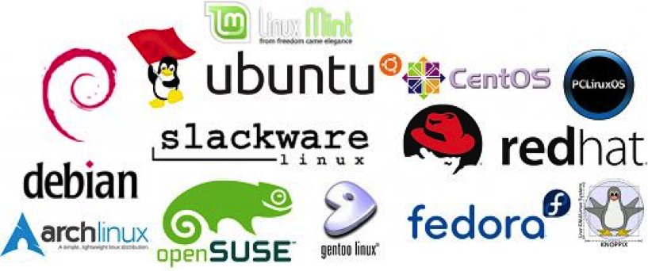

# Linux 的前世今生

# 1 操作系统

计算机本质上是一堆半导体元件堆成的装置，没有程序控制的计算机约等于一堆废铁。在早期想要让计算机执行程序就得要参考一堆硬件功能函数，并且学习机器语言，其中有些是很多程序都会使用到的基本功能，比如让 CPU 执行判断逻辑与运算数值、让内存读写数据与程序、让网卡传输数据、让打印机打印文件等。为了方便工程师开发软件，人们就将这些常用的硬件驱动程序汇集到一起，并提供一组标准的接口供工程师调用，这就是**操作系统**（Operating System，简称 OS）的原型。

简而言之，操作系统是一个“大管家”，指挥 CPU、内存、硬盘、键盘、鼠标、显示器等设备有条不紊地运行起来。

操作系统位于底层硬件与用户之间，是两者沟通的桥梁。用户可以通过操作系统的用户界面，输入命令。操作系统则对命令进行解释，驱动硬件设备，实现用户要求。

操作系统至少具有以下功能：

- **进程管理**
  进程是具有一定独立功能的程序关于某个数据集合上的一次运行活动，是系统进行资源分配和调度的一个独立单位。进程管理又称处理器管理，其主要任务是对处理器的时间进行合理分配、对处理器的运行实施有效的管理。
- **存储器管理**
  由于多道程序共享内存资源，所以存储器管理的主要任务是对存储器进行分配、保护和扩充。
- **设备管理**
  根据确定的设备分配原则对设备进行分配，使设备与主机能够并行工作，为用户提供良好的设备使用界面。
- **文件管理**
  文件管理主要涉及文件的逻辑组织和物理组织，目录的结构和管理。从系统角度来看，文件系统是对文件存储器的存储空间进行组织、分配和回收，负责文件的存储、检索、共享和保护。从用户角度来看，文件系统主要是实现“按名存取”，文件系统的用户只要知道所需文件的文件名，就可存取文件中的信息，而无需知道这些文件究竟存放在什么地方。
- **用户接口**
  用户操作计算机的界面称为**用户接口**（或用户界面），通过用户接口，用户只需进行简单操作，就能实现复杂的应用处理。用户接口有两种类型：
  - 命令接口：用户通过交互命令方式直接或间接地对计算机进行操作。
  - 程序接口：供用户以程序方式进行操作。程序接口也称为应用程序编程接口（Application Programming Interface，API），用户通过 API 可以调用系统提供的例行程序，实现既定的操作。

Linux 是一套风靡全球的操作系统，它的诞生颇具传奇色彩，有很多神一般存在的大牛都曾直接或间接地为它出力，就跟华山论剑一样，神人辈出，各领风骚，我等渣渣远观一下也就够了。

# 2 三巨头与 Multics

早期的计算机不像现在这样普及，是一件花费巨大的奢侈品，一般只有财大气粗的军事单位、科研机构、高校才能买得起。那时候，由于一台主机同时只能供一人使用，使用者经常需要排队，使用率异常低下。

20 世纪 60 年代初期，麻省理工学院（MIT）发展了所谓的“**兼容分时系统**”（Compatible Time-Sharing System，CTSS），它可以让大型主机通过提供数个终端机以联机进入主机，来利用主机的资源进行运算工作。架构有点像这样：

为了更加强化大型主机的系统，以让主机的资源可以提供更多使用者来利用，在 1965 年前后，由贝尔实验室（Bell）、麻省理工学院（MIT）和通用电气公司（GE）三方共同发起了 **Multics** 计划，Multics 的目的是想要让大型主机可以达成提供 300 个以上的终端机联机使用的目标。不过，到了 1969 年前后，计划进度落后，资金也短缺，贝尔实验室便退出了该计划（Multics 本身后来仍继续开发并投入商用，直到 2000 年才停用最后一套系统）。

# 3 Ken Thompson 与 Unics

参与 Multics 计划的人当中有一位来自贝尔实验室的大神——**肯·汤普森**（Ken Thompson）：

1969 年 8 月份左右，汤普森的妻儿去探亲，他为了让一款名为“太空旅行”（Space Travel）的游戏能在实验室一台闲置的 PDP-7 小型机上运行，经过三周左右的奋斗，用汇编语言写出来一个内核程序，同时包括一些工具及文件系统。当时汤普森将 Multics 庞大的复杂系统简化了不少，于是同实验室的朋友都戏称这个系统为“Unics”，这就是 Unix 的原型。

也就是这一年，Linux 之父 Linus Torvalds 在芬兰出生。

相传汤普森爷爷还有段佳话：他开发的操作系统最早被安装在贝尔实验室里供大家日常使用。很快大家就发现汤普森爷爷总能进入他们的账户，获得最高权限。贝尔实验室里的科学家都心比天高，当然被搞得郁闷无比。于是有高手怒了，跳出来分析了他的代码，找到后门，修改代码，然后重新编译。就在大家都以为“这个世界清净了”的时候，他们发现汤普森爷爷还是轻而易举地拿到他们的账户权限，百思不解后，只好继续郁闷。谁知道这一郁闷，就郁闷了 14 年，直到汤普森爷爷 1983 年获得图灵奖，在获奖演讲《Reflections on Trusting Trust》中道出了其中缘由。原来，代码里的确有后门，但后门不在代码里，而在编译代码的 C 编译器里。

顺便提一下，汤普森爷爷 2000 年从贝尔实验室退休后并没有闲着，2006 年加入 Google，与 Rob Pike、Robert Griesemer 一起设计了 Go 语言。他还是一名业余飞行员。

大神就是大神，向来不走寻常路。

# 4 Dennis Ritchie 与 Unix

汤普森有一个好基友——**丹尼斯·里奇**（Dennis Ritchie），两人均是计算机历史上开天辟地的人物。

Unix 本来是用汇编语言写成的，后来因为系统移植与性能的需求，汤普森设计了 B 语言并尝试用它改写系统。不过，性能依旧不是很好。后来，丹尼斯·里奇在 B 语言的基础上设计出了 C 语言，C 语言算是比较高级的编程语言，可以在不同的机器上面运行，因此丹尼斯·里奇被称为 **C 语言之父**。

1973 年，汤普森与里奇成功地用 C 语言重写了 Unix 第四版的内核。至此，Unix 这个操作系统修改、移植相当便利，为 Unix 日后的普及打下了坚实的基础。而 Unix 和 C 完美地结合成为一个统一体，C 与 Unix 很快成为世界的主导。

# 5 Bill Joy 与 BSD

虽然贝尔实验室属于 AT&T 公司，但是 AT&T 此时对于 Unix 是采取开放的态度。此外，Unix 是用高级的 C 语言写成的，具有很好的可移植性。所以，只要取得 Unix 的源代码，并且针对大型主机的特性加以修改，就可以将 Unix 移植到另一台不同的主机上了。所以在 1973 年以后，Unix 便得以与学术界合作开发。最重要的接触就是与加州大学伯克利分校（UC Berkeley）的合作了。伯克利的**比尔·乔伊**（Bill Joy）在取得了 Unix 的内核源代码后，着手修改成适合自己机器的版本，并且同时增加了很多工具软件与编译程序，最终将它命名为 Berkeley Software Distribution（**BSD**）。

比尔·乔伊也是一位大神级别的人物，随便举个例子。TCP/IP 协议出来以后，一直都没有人写出一个能用的 TCP/IP 栈，比尔·乔伊同学就写了一个放出来了，大家都很诧异，就问比尔·乔伊同学是怎么写的。比尔·乔伊回答说，我就是一边看着 RFC，一边写就好了啊……其他人唯有吐血而已。直到很多年以后，BSD 上的 TCP/IP 栈还都是网络世界的基石。

除此之外，他还是神器 vi、C Shell（csh）的作者，SPARC 处理器设计者之一，后来参与创立了 Sun 公司（名字源自 Stanford University Network）。20 世纪 90 年代的 Sun 是 Unix 工作站与互联网服务器领域举足轻重的巨头，该公司还是 Java 语言的诞生地，2010 年被 Oracle 收购。

不多说了，颤抖吧，无知的人类。

# 6 Richard Stallman 与 GNU

由于 Unix 的高度可移植性，加上当时并没有版权的纠纷，所以让很多商业公司开始了 Unix 操作系统的发展，例如 AT&T 自家的 System V、IBM 的 AIX 以及 HP 与 DEC 等公司，都有推出自家的主机搭配自己的 Unix 操作系统。

1979 年，AT&T 出于商业的考虑想将 Unix 的版权收回，造成 Unix 业界之间的紧张气氛，并且引爆了很多的商业纠纷。

AT&T 的这种商业态度，让当时许许多多的 Unix 爱好者和软件开发者们感到相当痛心和忧虑，他们认为商业化的种种限制并不利于产品的发展，相反还会导致产品出现诸多的问题。商业化 Unix 版本的种种限制和诸多问题，引起了大众的不满和反对。于是，大家开始有组织地结成“反叛联盟”，以此对抗欺行霸市的 AT&T 等商业化行为。这个新思潮对 IT 业产生了非常深远的影响，为整个计算机世界带来了革命性的价值观。

此时，一个名叫**理查德·斯托曼**（Richard Stallman）的领袖出现了，他认为 Unix 是一个相当好的操作系统，如果大家都能够将自己所学贡献出来，那么这个系统将会更加优异！他倡导**自由软件**（Free Software）的理念，就是针对 Unix 这一事实，反对实验室里的产品商业化、私有化。（“开源”（Open Source）一词 1998 年才出现，斯托曼本人一直强调自由软件与开源的区别。）

为了这个理想，理查德·斯托曼于 1984 年发起了 **GNU** 计划（GNU 是 GNU's Not Unix 的递归缩写），目标是开发一套与 Unix 相互兼容的软件。1985 年，理查德·斯托曼又创立了**自由软件基金会**（Free Software Foundation，FSF）来为 GNU 计划提供技术、法律以及财政支持。

为了构建开放、自由的 Unix 环境，GNU 计划开发出了一系列大名鼎鼎的软件，每个单独拿出来都够人骄傲一辈子：

- Emacs（斯托曼亲自编写）
- GCC（最初由斯托曼编写，原名 GNU C Compiler，现名 GNU Compiler Collection）
- GNU C Library（glibc）
- Bash shell

它们至今依然是 Unix 世界的中流砥柱。

到了 1989 年，为了避免 GNU 所开发的自由软件被其他人所利用而成为专有软件，斯托曼与律师草拟了有名的**通用公共许可证**（General Public License，**GPL**），并且幽默地称呼它为 copyleft（相对于专有软件的 copyright）。

首先，斯托曼对 GPL 一直是强调 Free 的，这个 Free 的意思是这样的：

> "Free software" is a matter of liberty, not price. To understand the concept, you should think of "free speech", not "free beer". "Free software" refers to the users' freedom to run, copy, distribute, study, change, and improve the software.

一个软件挂上了 GPL 版权宣告之后，它自然就成了自由软件，并具有以下特点：

- 取得软件与源代码：您可以根据自己的需求来执行这个自由软件；
- 复制：您可以自由地复制该软件；
- 修改：您可以将取得的源代码进行程序修改工作，使之适合您的工作；
- 再发行：您可以将您修改过的程序，再度自由地发行，而不会与原作者冲突；
- 公开源代码：您发行修改后的程序时，必须同样以 GPL 授权并提供其源代码，使后来的用户享有同样的自由（这就是 GPL 的“传染性”，也称 Copyleft；如果只是自己或公司内部使用、并不对外发行，则没有公开源代码的义务）。

从那时开始，许多程序员聚集起来开始开发自由的、高质量、易理解的软件，这使得 Unix 社区生机勃勃，一派繁荣景象。

# 7 Linus Torvalds 与 Linux

GNU 计划的最初构想是建立一个“自由的 Unix 操作系统”，但是当时并没有一款“自由的 Unix 内核”存在……所以 GNU 软件只能在那些专有的 Unix 平台上工作，一直到 Linux 的出现。

1991 年，**林纳斯·托瓦兹**（Linus Torvalds）还是芬兰赫尔辛基大学的一名学生，最初是用汇编语言写了一个在 80386 保护模式下处理多任务切换的程序，后来从 Minix（Andrew S. Tanenbaum 教授所写的很小的 Unix 操作系统，主要用于操作系统教学）得到灵感，进一步产生了自认为狂妄的想法——写一个比 Minix 更好的系统，于是开始写了一些硬件的设备驱动程序、一个小的文件系统。这样 0.01 版本的 Linux 就出来了，但是它只具有操作系统内核的勉强的雏形，甚至不能独立运行，必须在有 Minix 的机器上编译以后才能玩。这时候托瓦兹已经完全着迷而不想停止，决定踢开 Minix，使用 GNU 的 bash 操作接口与 gcc 编译器等自由软件来开发一套独立的操作系统内核。

开发过程中，他希望这个程序可以获得大家的一些修改建议，于是在 1991 年 8 月 25 日，他在 Usenet 新闻组 comp.os.minix 上贴了一则消息：

> **Hello everybody out there using minix -**
>
> **I'm doing a (free) operating system (just a hobby,**
>
> **won't be big and professional like gnu) for 386(486) AT clones.**

同年 9 月 17 日，他将 0.01 版本的内核上传到赫尔辛基理工大学的 FTP 服务器（ftp.funet.fi）上，但并未公开宣布，只通知了少数几个人；10 月 5 日，他在新闻组上正式公开发布了 0.02 版本。因为 FTP 管理员把存放内核的目录命名为 Linux（托瓦兹本人原本想叫它 Freax），从此，大家便称这个内核为 Linux 了。

同时，为了让自己的 Linux 能够兼容于 Unix 系统，托瓦兹开始将一些能够在 Unix 上面运行的软件拿来在 Linux 上面跑。不过，他发现有很多的软件无法在 Linux 这个内核上运行，于是托瓦兹开始参考标准的 **POSIX 规范**。POSIX 表示**可移植操作系统接口**（Portable Operating System Interface of UNIX），POSIX 标准定义了操作系统应该为应用程序提供的接口标准，是 IEEE 为要在各种 UNIX 操作系统上运行的软件而定义的一系列 API 标准的总称。只要是依据这些标准规范来设计的内核与软件，理论上就可以搭配在一起运行了。而 Linux 的发展就是依据这个 POSIX 的标准规范，Unix 上面的软件也是遵循这个规范来设计的，如此一来，让 Linux 很容易就与 Unix 兼容共享互有的软件。

在自由软件之父理查德·斯托曼的精神感召下，托瓦兹于 1992 年将 Linux 改用 GPL 授权发布。Linux 内核本身并未正式加入 GNU 计划，但它与 GNU 软件结合在一起，构成了一套完整的自由操作系统。

无疑，正是托瓦兹的这一举措带给了 Linux 和他自己巨大的成功和极高的声誉。短短几年间，在 Linux 身边已经聚集了成千上万的狂热分子，大家不计得失地为 Linux 增补、修改，并随之将开源运动的自由主义精神传扬下去，人们几乎像看待神明一样对林纳斯顶礼膜拜。

三十多年过去，Linux 内核的开发模式也早已今非昔比。2005 年，托瓦兹为管理内核代码亲手编写了 Git，如今内核依然通过 Git 与邮件列表进行全球分布式协作，每个版本都有约两千名开发者参与贡献。为了提升内存安全性，2022 年 12 月发布的 Linux 6.1 正式引入了对 Rust 语言的支持，使其成为继 C 语言之后第二种可用于编写内核代码的主要编程语言；在 2025 年 12 月的内核维护者峰会上，开发者们一致认为 Rust 已不再是“实验性”功能，而是内核中长期保留的组成部分。这标志着拥有三十多年历史的 Linux 内核正在积极拥抱现代编程技术。

# 8 Linux 发行版

严格来讲，Linux 这个词本身只表示 Linux 内核，但在实际上人们已经习惯了用 Linux 来形容整个基于 Linux 内核，并且使用 GNU 工程各种工具和应用程序的操作系统（也被称为 GNU/Linux）。很多的商业公司或非营利团体，将 Linux 内核（含工具）与可运行的软件整合起来，加上自己具有创意的工具程序，组装成一套可完整安装的系统，我们称之为 **Linux 发行版**（Linux distribution）。一般来讲，一个 Linux 发行版包含大量的软件，比如软件开发工具、数据库、Web 服务器（例如 Apache、Nginx）、图形显示系统（传统的 X Window System 及其继任者 Wayland，GNOME、KDE Plasma 等主流桌面已转向 Wayland，并陆续移除 X11 会话）、桌面环境（比如 GNOME 和 KDE）、办公套件（比如 LibreOffice）等等。

不过，由于发展 Linux 发行版的公司实在太多了，例如有名的 Red Hat、Fedora、Debian、SUSE、Ubuntu、Rocky Linux、AlmaLinux 等（曾经流行的 CentOS Linux 已于 2024 年停止维护，Rocky Linux 和 AlmaLinux 是其主要后继者），所以很多人都很担心，如此一来每个发行版是否都不相同呢？这就无需担心了，因为每个 Linux 发行版使用的内核都源自 [kernel.org](https://www.kernel.org) 所发布的版本，而他们所选择的软件，几乎都是目前很知名的软件，重复性相当高。此外，为了让所有的 Linux 发行版开发不至于差异太大，各发行版普遍遵循**文件系统层次结构标准**（Filesystem Hierarchy Standard，**FHS**）来规范目录架构。唯一的差别，就是该开发者自家所开发出来的管理工具，以及软件包管理的模式等。所以说，基本上，每个 Linux 发行版除了架构的严谨度与选择的软件包内容外，其实差异并不太大。

近年来，随着云计算和容器技术的普及，Linux 发行版的形态也在发生变化。一种被称为“不可变操作系统”（Immutable OS）的新型发行版逐渐兴起：服务器端有专为运行容器设计的 Fedora CoreOS、Flatcar Container Linux，桌面端有 Fedora Silverblue、openSUSE Aeon 等。这类系统将核心系统文件设为只读，应用程序主要通过 Flatpak、容器等方式与基础系统隔离运行，系统更新则以原子化方式整体替换，更新失败时可以回滚到上一个版本。这种设计显著提升了系统的一致性、安全性和可维护性，成为云原生时代 Linux 发行版的重要发展方向之一。

# 9 结语

从 1969 年汤普森在 PDP-7 上写出 Unix 的雏形，到 1991 年托瓦兹发布 Linux 0.01，再到今天，Linux 已经成为数字世界的基础设施：绝大多数云服务器和全部 TOP500 超级计算机都运行着 Linux，Android 手机、路由器、智能汽车等嵌入式设备也都基于 Linux 内核，训练大模型的 GPU 集群同样跑在 Linux 之上。内核本身也在持续进化：eBPF 技术允许开发者在不修改内核源代码、不加载内核模块的前提下，安全、高效地在内核中运行自定义程序，已广泛用于云原生网络（如 Cilium）、系统可观测性与安全防护；Linux 6.12 引入的 sched_ext 更是允许用 eBPF 编写 CPU 调度器。回顾这段历史，Unix 奠定了设计哲学，GNU 提供了自由软件的工具链与许可证，Linux 补上了最后一块内核拼图——正是一代代大神的开放与分享，才成就了今天持续进化的 Linux。