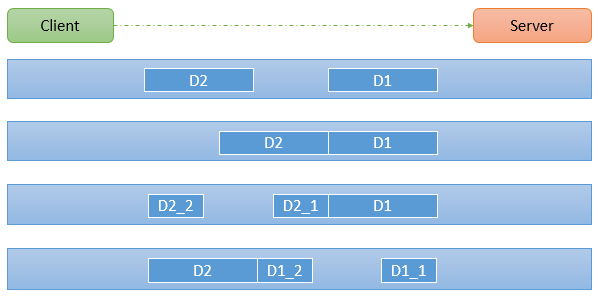
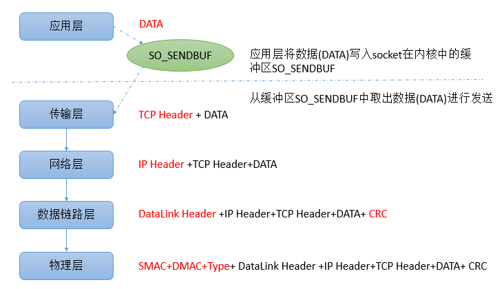
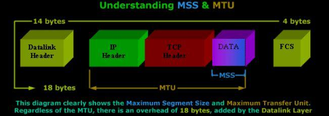

# 计算机网络-粘包、拆包与通信协议

在 TCP 编程中，通常 Server 端与 Client 端通信时的消息都有着固定的消息格式，称之为应用层**协议**（protocol），例如 HTTP/1.1、Redis 使用的 RESP 协议、Dubbo 协议等，很多公司也会自己设计私有协议。

那么协议到底是干什么的呢？协议的作用之一是定义数据通信的格式，其中最基本的一项，就是规定如何在没有边界的字节流中划分出一条条消息，即分帧（framing）。因此在 TCP 编程中，协议首先要解决的就是**粘包**和**拆包**问题。

TCP（Transmission Control Protocol，传输控制协议）是面向连接、面向字节流的，提供高可靠性服务。收发两端都要有一一成对的 socket，因此，发送端为了将多个发往接收端的包更有效地发到对方，使用了优化方法（Nagle 算法），将多次间隔较小且数据量小的数据合并成一个大的数据块，然后进行封包。这样接收端就难以分辨出原来的消息了，必须提供科学的拆包机制。即**面向流的通信是无消息保护边界的**。

UDP（User Datagram Protocol，用户数据报协议）是无连接、面向消息的，提供高效率服务。它不会使用块的合并优化算法，由于 UDP 支持的是一对多的模式，所以接收端的 `skbuff`（套接字缓冲区）采用了链式结构来记录每一个到达的 UDP 包，在每个 UDP 包中就有了消息头（消息来源地址、端口等信息），这样对于接收端来说就容易进行区分处理了。应用每次调用 `recvfrom` 读到的都是一个完整的数据报，如果提供的缓冲区比数据报小，多出的部分会被截断丢弃，而不会留到下一次读取。即**面向消息的通信是有消息保护边界的**。

由于 TCP 无消息保护边界，需要在消息接收端处理消息边界问题，也就是我们所说的粘包、拆包问题；而 UDP 通信则不需要考虑此问题（但 UDP 需要自己处理丢包、乱序等问题）。需要强调的是，粘包、拆包并不是 TCP 的缺陷：TCP 只保证字节流可靠、有序地到达，本来就不负责维护应用层消息的边界，“粘包”本质上是应用层如何对字节流进行分帧（framing）的问题。

基于 UDP 的 QUIC（HTTP/3 的传输层）也没有让这个问题消失。QUIC 的每个流（stream）和 TCP 一样是有序的字节流，承载流数据的 STREAM 帧边界并不会原样交给应用，因此 HTTP/3 仍然在流上定义了带“类型 + 长度”字段的帧。QUIC 改进的是另一件事：一条连接上的多个流互不阻塞，消除了 TCP 层的队头阻塞；如果一个请求独占一个流，还可以用流的结束来标记消息结束。只有 QUIC 的不可靠数据报扩展（RFC 9221）才像 UDP 一样保留消息边界。

# 1 TCP 粘包、拆包图解



假设客户端分别发送了两个数据包 D1 和 D2 给服务端，由于服务端一次读取到的字节数是不确定的，故可能存在以下四种情况：

- 服务端分两次读取到了两个独立的数据包，分别是 D1 和 D2，没有粘包和拆包；
- 服务端一次接收到了两个数据包，D1 和 D2 粘合在一起，称之为 **TCP 粘包**；
- 服务端分两次读取到了数据包，第一次读取到了完整的 D1 包和 D2 包的部分内容，第二次读取到了 D2 包的剩余内容，这称之为 **TCP 拆包**；
- 服务端分两次读取到了数据包，第一次读取到了 D1 包的部分内容 D1_1，第二次读取到了 D1 包的剩余部分内容 D1_2 和完整的 D2 包，即拆包和粘包同时发生。

特别要注意的是，如果 TCP 的接收滑动窗口非常小，而数据包 D1 和 D2 比较大，很有可能会发生第五种情况，即服务端分多次才能将 D1 和 D2 包完全接收，期间发生多次拆包。

# 2 粘包、拆包发生原因

粘包、拆包问题的产生原因主要有以下 3 种：

- socket 缓冲区与滑动窗口
- MSS/MTU 限制
- Nagle 算法

## 2.1 socket 缓冲区与滑动窗口

先明确一个概念：每个 TCP socket 在内核中都有一个发送缓冲区（`SO_SNDBUF`）和一个接收缓冲区（`SO_RCVBUF`），TCP 的全双工工作模式以及 TCP 的滑动窗口便是依赖于这两个独立的 buffer 以及 buffer 的填充状态。`SO_SNDBUF` 和 `SO_RCVBUF` 在早期 Windows 操作系统中默认都是 8 KB；现代操作系统普遍支持缓冲区自动调优，例如 Linux 通过 `net.ipv4.tcp_rmem`、`net.ipv4.tcp_wmem` 配置最小值、默认值和最大值，并在运行时动态调整。

### 2.1.1 SO_SNDBUF

进程发送数据的时候（假设调用了 `send` 方法），最简单的情况（也是一般情况）是将数据拷贝进 socket 的内核发送缓冲区之中，然后 `send` 便会在上层返回。换句话说，`send` 返回之时，数据不一定已经发送到对端（和 `write` 写文件有点类似），`send` 仅仅是把应用层 buffer 的数据拷贝进 socket 的内核发送 buffer 中。

### 2.1.2 SO_RCVBUF

内核会把接收到的数据缓存起来，如果应用进程一直没有调用 `read` 进行读取，这些数据会一直缓存在相应 socket 的接收缓冲区内。不管进程是否读取 socket，对端发来的数据都会经由内核接收并且缓存到 socket 的内核接收缓冲区之中。`read` 所做的工作，就是把内核缓冲区中的数据拷贝到应用层用户的 buffer 里面，仅此而已。

### 2.1.3 滑动窗口

TCP 连接在三次握手的时候，会将自己的**窗口大小**（window size）发送给对方，它取决于接收缓冲区（`SO_RCVBUF`）当前的可用空间（并不严格等于 `SO_RCVBUF` 的设定值，内核还会预留一部分空间作为管理开销）。之后在发送数据时，发送方必须要先确认接收方的窗口没有被填充满，如果没有填满，则可以发送。

每次发送数据后，发送方将自己维护的对方的 window size 减小，表示对方的 `SO_RCVBUF` 可用空间变小。

当接收方开始处理 `SO_RCVBUF` 中的数据时，会将数据从 socket 在内核中的接收缓冲区读出，此时接收方的 `SO_RCVBUF` 可用空间变大，即 window size 变大，接收方会通过 ACK 报文将自己最新的 window size 通告给发送方，此时发送方将自己维护的接收方的 window size 设置为 ACK 报文中的 window size。

此外，发送方可以连续地给接收方发送消息，只要保证对方的 `SO_RCVBUF` 空间可以缓存数据即可，即 `window size > 0`。当接收方的 `SO_RCVBUF` 被填充满时，此时 `window size = 0`，发送方不能再继续发送数据，要等待接收方的 ACK 报文，以获得最新可用的 window size（期间发送方会定时发送零窗口探测报文，防止窗口更新的 ACK 丢失导致双方互相等待）。

现在来看一下 `SO_RCVBUF` 和滑动窗口是如何造成粘包、拆包的。

**粘包**：假设发送方的每 256 字节表示一个完整的报文，接收方由于数据处理不及时，这 256 个字节的数据都会被缓存到 `SO_RCVBUF` 中。如果接收方的 `SO_RCVBUF` 中缓存了多个报文，那么对于接收方而言，这就是粘包。

**拆包**：考虑另外一种情况，假设接收方的 window size 只剩了 128 字节，意味着发送方最多还可以发送 128 字节，而由于发送方的数据大小是 256 字节，因此只能发送前 128 字节，等到接收方 ACK 后，才能发送剩余字节。这就造成了拆包。

## 2.2 MSS 和 MTU 分片

MSS 是 `Maximum Segment Size`（最大报文段长度）的缩写，表示 TCP 报文中 data 部分的最大长度，是 TCP 协议在五层网络模型中传输层（transport layer）对一次可以发送的最大数据的限制。

MTU 最大传输单元是 `Maximum Transmission Unit` 的缩写，是五层网络模型中数据链路层对一次可以发送的最大数据（即网络层数据包）的限制。

当需要传输的数据大于 MSS 或者 MTU 时，数据会被拆分成多个包进行传输。由于 MSS 是根据 MTU 计算出来的，因此当发送的数据满足 MSS 时，必然满足 MTU。归根结底：**限制一次可发送数据大小的是 MTU，MSS 只是 TCP 协议在 MTU 限制的基础上推算出的传输层一次可传输的数据大小**。

为了更好地理解，我们先介绍一下在五层网络模型中应用通过 TCP 发送数据的流程：



- 对于应用层来说，只关心发送的数据 DATA，将数据写入 socket 在内核中的缓冲区 `SO_SNDBUF` 即返回，操作系统会将 `SO_SNDBUF` 中的数据取出来进行发送。
- 传输层会在 DATA 前面加上 TCP Header，构成一个完整的 TCP 报文。
- 当数据到达网络层时，网络层会在 TCP 报文的基础上再添加一个 IP Header，也就是将自己的网络地址加入到报文中。
- 到数据链路层时，还会加上 Datalink Header 和 `CRC`。以太网的 Datalink Header 由 `DMAC`（Destination MAC，数据接收方的 MAC 地址）、`SMAC`（Source MAC，数据发送方的 MAC 地址）和 Type 域组成。
- 当到达物理层时，会在帧前面加上前导码（Preamble）和帧开始定界符（SFD），然后转换成比特流发送出去。需要注意，图中画在物理层一侧的 SMAC、DMAC 和 Type 属于数据链路层的帧头。

可以发现数据在发送前，每一层都会在上一层的基础上增加一些内容，下图演示了 MSS、MTU 在这个过程中的作用。



以太网的 MTU 来自以太网帧长度的限制：不计前导码和 SFD，标准以太网帧最小为 64 字节，最大为 1518 字节。减去以太网帧的帧头 14 字节（目的 MAC 地址 DMAC 48 bit 即 6 字节、源 MAC 地址 SMAC 6 字节、Type 域 2 字节）和帧尾 CRC 校验部分 4 字节（这个部分有时候也叫作 `FCS`），剩下承载上层协议的 Data 域最大就只能有 1500 字节，这个值就称为 MTU。如果帧中带有 802.1Q VLAN 标签（4 字节），帧的最大长度为 1522 字节，但 MTU 仍是 1500；数据中心内部常用的巨型帧（Jumbo Frame）则可以把 MTU 提高到 9000 字节左右。

由于 MTU 限制了一次最多可以发送 1500 个字节，而 TCP 协议在发送 DATA 时，还会加上额外的 TCP Header 和 IP Header，因此减去这两个部分，就是 TCP 协议一次可以发送的实际应用数据的最大大小，也就是 MSS。

> `MSS 长度 = MTU 长度 - IP Header 长度 - TCP Header 长度`

TCP Header 的长度（不含选项）是 20 字节，IPv4 中 IP Header 长度（不含选项）是 20 字节，IPv6 中 IP Header 长度是 40 字节，因此：在 IPv4 中，以太网 MSS 可以达到 1460 字节；在 IPv6 中，以太网 MSS 可以达到 1440 字节。实际中如果启用了时间戳等 TCP 选项，每个报文段能承载的数据还会再少一些，例如常见的 1448 字节。

需要注意的是，MSS 表示的是一次可以发送的 DATA 的最大长度，而不是 DATA 的真实长度。发送方发送数据时，当 `SO_SNDBUF` 中的数据量大于 MSS 时，操作系统会将数据进行拆分，使得每一部分都不超过 MSS，这就是拆包，然后每一部分都加上 TCP Header，构成多个完整的 TCP 报文进行发送，当然经过网络层和数据链路层的时候，还会分别加上相应的内容。

现代网卡和内核还会在此基础上做分段卸载与合并：发送时，TSO/GSO 让内核先交出一大块数据，由网卡或协议栈的最后一步按 MSS 切成多个报文段；接收时，GRO/LRO 会把同一连接上连续到达的多个报文段合并成一个大包再往上交。这些优化只改变报文段的“形状”，应用从 socket 读到的始终是同一条字节流，它们不是粘包、拆包的新成因，但再次说明了应用层不能依赖报文段边界来划分消息。

如果用 Wireshark 抓取本机回环地址上的通信，会发现 TCP 三次握手的前两个报文（SYN 和 SYN+ACK）中都包含了 MSS=65495 的字样。这是因为抓包案例中的 client 和 server 都运行在本地，走的是回环接口，不需要走以太网，所以不受以太网 MTU=1500 的限制。回环接口的 MTU 在早期内核中是 65535，较新的内核中是 65536，但 IPv4 首部的总长度字段只有 16 位，一个 IP 数据报最长 65535 字节，内核会把路由 MTU 限制在这个值以内，因此 MSS 仍是 65495：

> `MSS(65495) = IP 数据报最大长度(65535) - IP Header(20) - TCP Header(20)`

在 Linux 服务器上可以用 `ip link show` 查看各网卡的 MTU 大小（早期常用的 `ifconfig` 属于 net-tools，较新的发行版已不再默认安装），输出类似：

```bash
$ ip link show
1: lo: <LOOPBACK,UP,LOWER_UP> mtu 65536 qdisc noqueue state UNKNOWN mode DEFAULT group default qlen 1000
    link/loopback 00:00:00:00:00:00 brd 00:00:00:00:00:00
2: eth0: <BROADCAST,MULTICAST,UP,LOWER_UP> mtu 1500 qdisc fq_codel state UP mode DEFAULT group default qlen 1000
    link/ether 00:16:3e:02:0e:ea brd ff:ff:ff:ff:ff:ff
```

可以看到，默认情况下，与外部通信的网卡 eth0 的 MTU 大小是 1500 个字节；而回环接口 lo 的 MTU 为 65536，这是因为本地通信的数据不需要经过物理网卡，所以不受以太网 1500 的限制。

MTU 的大小可以通过类似以下命令修改（例如开启巨型帧，需要网卡和链路上的交换机都支持）：

```bash
ip link set dev eth0 mtu 9000
```

## 2.3 Nagle 算法

TCP/IP 协议中，无论发送多少数据，总是要在数据前面加上协议头，同时，对方接收到数据，也需要发送 ACK 表示确认。

即使从键盘输入一个字符，只占用一个字节，在传输时也可能产生 41 字节的包，其中包括 1 字节的有用信息和 40 字节的首部数据。这种情况意味着 4000% 的额外开销，这对于重负载的网络来说是无法接受的。

为了尽可能地利用网络带宽，TCP 总是希望尽可能地发送足够大的数据（一个连接会设置 MSS 参数，因此，TCP/IP 希望每次都能够以 MSS 尺寸的数据块来发送数据）。Nagle 算法就是为了尽可能发送大块数据，避免网络中充斥着许多小数据块。

Nagle 算法的基本定义是：任意时刻，最多只能有一个未被确认的小段。所谓“小段”，指的是小于 MSS 尺寸的数据块；所谓“未被确认”，是指一个数据块发送出去后，没有收到对方发送的 ACK 确认该数据已收到。

**Nagle 算法的规则**：

1. 如果 `SO_SNDBUF` 中的数据长度达到 MSS，则允许发送；
2. 如果 `SO_SNDBUF` 中含有 FIN，表示请求关闭连接，则先将 `SO_SNDBUF` 中的剩余数据发送，再关闭；
3. 设置了 `TCP_NODELAY=true` 选项，则允许发送，`TCP_NODELAY` 的作用就是禁用 Nagle 算法；
4. 未设置 `TCP_CORK` 选项时，若所有发出去的小数据包（包长度小于 MSS）均被确认，则允许发送。

上述条件都不满足时，小段会暂存在 `SO_SNDBUF` 中，直到之前数据的 ACK 到达，或者数据积累到 MSS 大小再发送，Nagle 算法本身并没有超时定时器。常被提到的“200ms 超时”其实是 Linux 中 `TCP_CORK` 的上限：设置 `TCP_CORK` 后，不足 MSS 的数据最多被保留 200ms 就会发出。

`TCP_NODELAY` 和 TCP 的延迟确认（Delayed ACK）机制是两回事。延迟确认是指：接收方收到数据后，并不马上发送 ACK，而是等待一小段时间，希望在这段时间内有应答数据要发回对端，这样 ACK 就能够和应答数据一起发送，就像是应答数据捎带着 ACK 过去。RFC 1122 只要求这个延迟必须小于 0.5 秒，具体时长由各操作系统决定：Windows 默认是 200ms；Linux 的延迟最短为 40ms，会根据数据包到达的间隔动态调整，并且不超过连接测得的 RTT（交互模式下上限为 200ms，整体上限为 500ms）。在 Linux 中还可以通过设置 `TCP_QUICKACK` 选项来取消确认延迟，但该设置不是永久生效的，协议栈后续可能重新进入延迟确认模式。

Nagle 算法与延迟确认同时作用时，发送方在等 ACK，接收方又在推迟 ACK，小包交互就可能出现几十毫秒的额外延迟，因此对延迟敏感的场景通常会开启 `TCP_NODELAY`，Netty 等框架默认就会开启它。

# 3 粘包、拆包的解决方案

粘包、拆包问题给接收方的数据解析带来了麻烦。例如 `SO_RCVBUF` 中存在了多个连续的完整包（粘包），因为每个包可能都是一个完整的请求或者响应，那么接收方需要能对此进行区分。如果存在不完整的数据（拆包），则需要继续等待数据，直至可以构成一条完整的请求或者响应。

这个问题可以通过定义应用的协议（protocol）来解决。协议的作用就是定义传输数据的格式。这样在接收到数据的时候，如果粘包了，就可以根据这个格式来区分不同的包；如果拆包了，就等待数据可以构成一个完整的消息再来处理。目前业界主流的协议方案可以归纳如下。

## 3.1 定长协议

假设我们规定每 3 个字节表示一个有效报文，如果我们分 4 次总共发送以下 9 个字节：

```text
   +---+----+------+----+
   | A | BC | DEFG | HI |
   +---+----+------+----+
```

那么根据协议，我们可以判断出来，这里包含了 3 个有效的请求报文：

```text
   +-----+-----+-----+
   | ABC | DEF | GHI |
   +-----+-----+-----+
```

定长协议实现简单，但消息不足定长时需要补齐（例如填充空格或 0），会浪费带宽，适用于消息长度本身就固定的场景。

## 3.2 特殊字符分隔符协议

在包尾部增加回车或者空格符等特殊字符进行分割。

例如，按行解析，遇到字符 `\n`、`\r\n` 的时候，就认为是一个完整的数据包。对于以下二进制字节流：

```text
   +--------------+
   | ABC\nDEF\r\n |
   +--------------+
```

那么根据协议，我们可以判断出来，这里包含了 2 个有效的请求报文：

```text
   +-----+-----+
   | ABC | DEF |
   +-----+-----+
```

分隔符协议适合文本协议，但要求消息内容本身不能出现分隔符（否则需要转义），并且接收方需要逐字节扫描才能找到消息边界。

## 3.3 长度编码

将消息分为消息头和消息体，消息头中用一个 int 型数据（4 个字节）作为表示消息体长度的字段。在解析时，先读取内容长度 Length，其值为实际消息体内容占用的字节数，之后必须读取到这么多字节的内容，才认为是一个完整的数据报文。

```text
  header    body
+--------+----------+
| Length |  Content |
+--------+----------+
```

长度编码是最通用的方案，大多数二进制协议和 RPC 框架都采用这种方式；HTTP/1.1 则是组合使用了分隔符（头部以 `\r\n` 分行、以空行结束）和长度字段（`Content-Length`）。

## 3.4 编码与解码

总的来说，通信协议就是通信双方约定好的数据格式，发送方按照这个数据格式来发送，接收方按照这个格式来解析。因此发送方和接收方要完成的工作不同，发送方要将发送的数据转换成协议规定的格式，称之为**编码**（encode）；接收方需要根据协议的格式，对二进制数据进行解析，称之为**解码**（decode）。

实际开发中一般不需要从零实现解码逻辑。以 Netty 为例，它为上述三种方案都提供了现成的解码器：定长协议对应 `FixedLengthFrameDecoder`；分隔符协议对应 `LineBasedFrameDecoder`（按 `\n` 或 `\r\n` 分割）和 `DelimiterBasedFrameDecoder`（自定义分隔符）；长度编码对应 `LengthFieldBasedFrameDecoder`，编码端可配合 `LengthFieldPrepender` 使用。生产环境中的自定义协议通常会在长度字段的基础上，再加入魔数、版本号、序列化方式、消息类型、请求 ID 等字段，用于快速识别非法数据、兼容协议升级以及匹配请求与响应。

分帧问题不只存在于通信双方。近年流行的基于 eBPF 的可观测性工具（如 Pixie）可以在不修改业务代码的情况下，通过挂载 socket 相关系统调用来采集应用收发的数据，对于 HTTPS 流量则在 OpenSSL 等库的 `SSL_read`/`SSL_write` 函数上挂载 uprobe，直接拿到加密前或解密后的明文，再解析出 HTTP、MySQL、Redis 等协议的请求与响应。由于采集到的同样是字节流，这些工具也必须按各协议的分帧规则处理粘包、拆包，才能还原出一条条完整的消息。

# 4 总结

TCP 是面向字节流的协议，只保证数据可靠、有序地到达，不维护应用层消息的边界，因此接收方一次读到的数据可能是多条消息粘在一起，也可能只是一条消息的一部分。造成粘包、拆包的原因主要有 socket 缓冲区与滑动窗口、MSS/MTU 限制以及 Nagle 算法；而 UDP 面向数据报，天然保留消息边界，不存在这个问题；基于 UDP 的 QUIC 的流仍是字节流，HTTP/3 依然需要自己分帧。解决的思路是在应用层定义协议来划分消息边界，常见方案有定长、特殊字符分隔和长度编码三种，其中长度编码最为通用。实际开发中可以直接使用 Netty 等框架提供的解码器，再按需设计包含魔数、版本号、序列化方式等字段的自定义协议。
