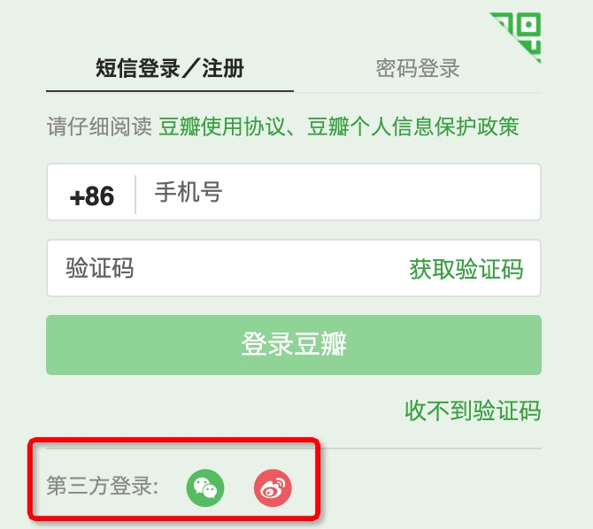
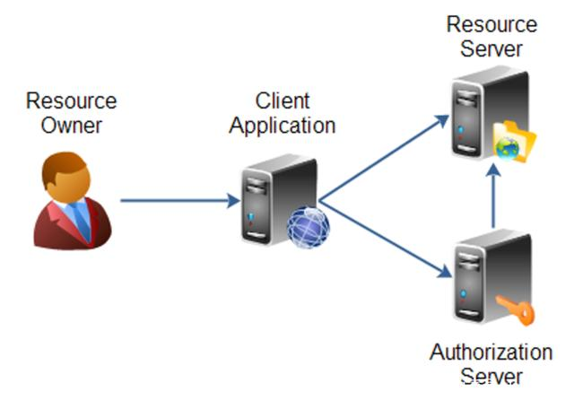
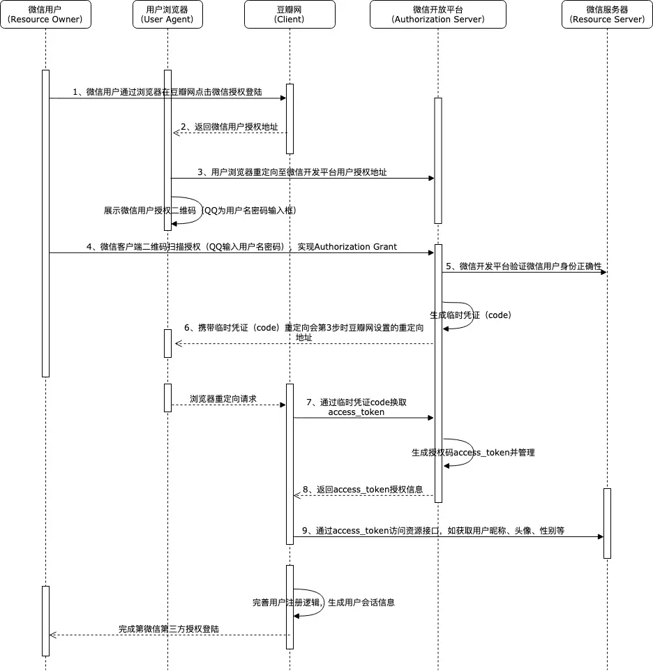
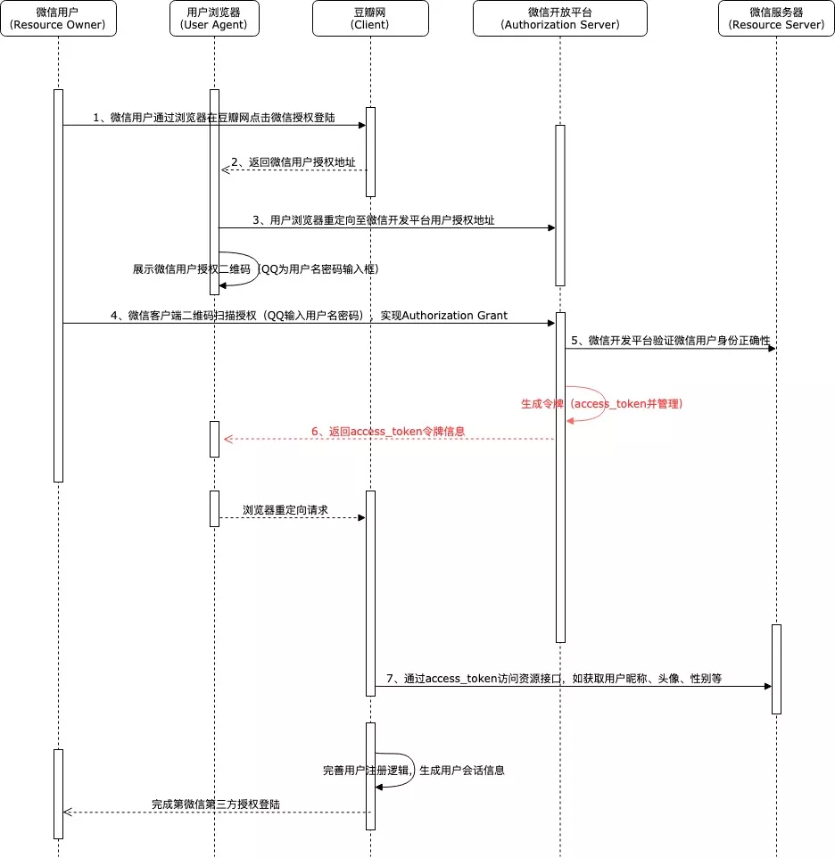
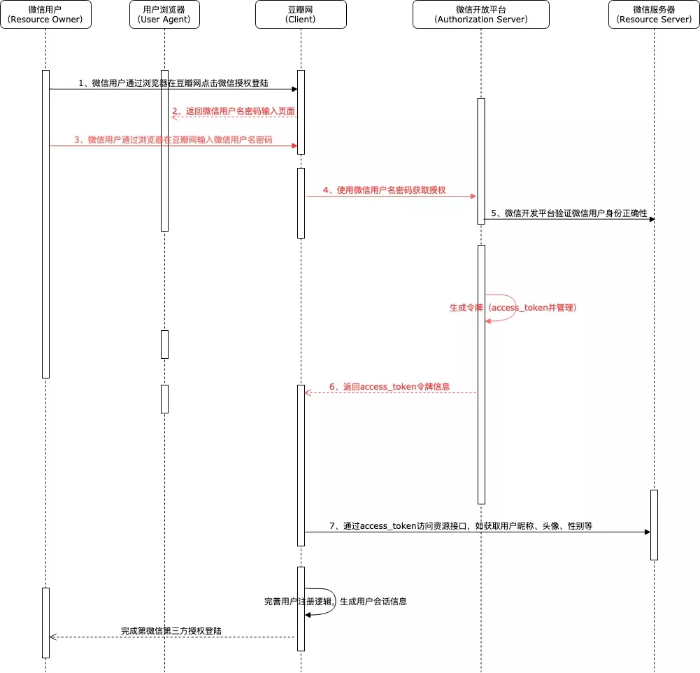

# OAuth 协议

# 1 什么是 OAuth

大家也许都有过这样的体验，我们登录一些软件或网站的时候可以使用 QQ、微信或者微博等账号进行授权登录。例如我们登录豆瓣网的时候，如果不想单独注册豆瓣网账号的话，就可以选择用微博或者微信账号进行授权登录。



那么这样的第三方登录方式到底是怎么实现的呢？难道是腾讯把我们 QQ 或者微信的账号密码交给了这些网站吗？当然不是。实际上，这种登录方式的实现基础就是本文要介绍的 **OAuth 2.0**（严格来说，“登录”属于身份认证，OAuth 2.0 本身只负责授权，详见 2.4 节）。类似地，在公司内部，如果公司有多套不同的软件系统，例如我们日常使用的 GitLab 代码管理、公司内网系统、财务报销系统以及很多业务系统的管理后台，是不是也可以实现一个员工账号就能授权访问以上所有系统，而不需要每个系统都开通单独的账号、设置独立的密码呢？实际上很多公司都实现了这种效果，这也就是我们通常所说的**单点登录**（SSO，Single Sign-On）系统，它也常常基于 OAuth 2.0 及构建在其之上的 OpenID Connect 来实现。

> **OAuth** 的英文全称是 `Open Authorization`，它是一种**开放授权协议**，允许第三方应用程序在获得资源所有者授权后，无需获知其账号密码，即可获得对受保护资源的有限访问权限。

OAuth 2.0 是目前的主流版本，于 2012 年 10 月以 RFC 6749 的形式正式发布，Google、Yahoo、Microsoft、Facebook 等公司都是它的早期采用者。之所以标注为 2.0，是因为最初有一个 1.0 协议（2010 年发布为 RFC 5849），但 1.0 协议依赖复杂的请求签名机制，易用性差，而且早期版本还曝出过会话固定（Session Fixation）安全漏洞（后由 1.0a 修复），所以普及程度有限。2.0 是一个全新的设计，它改为依靠 HTTPS 保障传输安全，协议简单清晰，但它并不兼容 1.0，与 1.0 没什么关系。

例如在前面的例子中，通过微信登录豆瓣网的过程，就相当于微信允许豆瓣网作为第三方应用程序，在经过微信用户授权后，通过**微信颁发的授权凭证**有限地访问用户的微信头像、昵称等受保护的资源，从而构建自身的登录逻辑。

当然，微信是不会直接将用户的用户名、密码等信息作为凭证返回给豆瓣的。这种**授权访问凭证**一般来说是一个由字符串组成的**访问令牌**（Access Token），它代表了特定的访问范围（scope）、有效期和访问权限。在这种模式下，OAuth 2.0 协议通过引入一个**授权层**，将第三方应用程序（客户端）的角色与资源所有者的角色分离开来，而承担这个授权层职责的就是**授权服务器**。在实际系统中，授权服务器往往同时负责用户的登录认证，所以也常被叫作“认证中心”或 SSO 服务器，但就 OAuth 2.0 协议本身而言，它的职责是授权（两者的区别见 2.4 节）。

# 2 协议详解

## 2.1 角色

在 OAuth 2.0 协议中定义了以下四个角色：



- **资源所有者（Resource Owner）**：有权授予对受保护资源访问权限的实体。例如我们通过微信账号登录豆瓣网，微信账号信息的实际所有者就是微信用户。当资源所有者是人时，也被称为最终用户。
- **资源服务器（Resource Server）**：承载受保护资源的服务器，能够接收并响应使用访问令牌对受保护资源发起的请求。它与授权服务器可以是同一服务器，也可以是不同服务器。在上述例子中，该角色就是提供用户信息接口的微信服务器。
- **客户端（Client）**：代表资源所有者、在其授权下对受保护资源发出请求的应用程序。在上面的例子中，豆瓣网就是这样的角色。
- **授权服务器（Authorization Server）**：在成功验证资源所有者身份并获得其授权后，向客户端颁发访问令牌的服务器，即服务提供商专门用来处理认证授权的服务器，例如微信开放平台提供授权服务的服务器。

## 2.2 授权模式

OAuth 2.0（RFC 6749）定义了四种授权模式（Grant Type），它们分别是：

- 授权码模式（Authorization Code）
- 简化模式（Implicit，也称隐式授权）
- 密码模式（Resource Owner Password Credentials）
- 客户端模式（Client Credentials）

需要注意的是，这是 2012 年 RFC 6749 制定时的情况。随着攻击手段的演进，2025 年 1 月发布的 OAuth 2.0 安全最佳实践（RFC 9700）已明确不建议（SHOULD NOT）使用简化模式，并禁止（MUST NOT）使用密码模式；正在制定中的 OAuth 2.1 草案更是直接移除了这两种模式，并要求授权码模式配合 PKCE 使用（见 2.2.1 节）。因此在今天，新系统通常只会用到“授权码模式 + PKCE”和客户端模式，再加上用于续期的刷新令牌流程（见 2.3 节）。

### 2.2.1 授权码模式

授权码模式是**功能最完整、流程最严密的授权模式**。它的特点是通过客户端的后台服务器与服务提供商的授权服务器（如微信开放平台）进行交互。

这种模式下，授权码并不是客户端直接从资源所有者那里获取的，而是以授权服务器作为中介来获取；授权认证的过程也是资源所有者直接在授权服务器上完成身份认证，避免了资源所有者的身份凭证被客户端获取的可能。而且访问令牌是由客户端后台直接向授权服务器换取的，不经过浏览器，因此是十分安全的。例如，微信用户授权登录豆瓣网的过程中，微信授权认证是直接在微信的页面上进行的，即便输入用户名和密码，也只有微信的授权服务器可以获取，豆瓣网是感知不到的，从而避免了微信用户账号信息在第三方网站泄露的风险。

还是以微信授权登录豆瓣网举例，流程如下：



1. 首先微信用户点击豆瓣网的微信授权登录按钮后，豆瓣网会通过 URL 重定向的方式将浏览器跳转至微信的用户授权页面；
2. 此时微信用户实际上是在微信上进行身份认证，与豆瓣网并无交互了，这一点非常类似于我们使用网银支付的场景；
3. 用户使用微信客户端扫描二维码或者输入用户名密码后，微信会验证用户的身份信息，验证通过且用户确认授权后，微信会生成一个临时凭证——授权码（code），并通过用户浏览器将请求重定向回豆瓣网在第一次重定向时携带的回调地址（`redirect_uri`）；
4. 之后用户浏览器会携带授权码 `code` 访问豆瓣网服务，豆瓣网后台则携带此授权码以及自身的 AppID、AppSecret 调用微信的令牌接口，换取正式的访问令牌 `access_token`；
5. 在豆瓣网获取到访问令牌 `access_token` 后，用户的授权基本上就完成了，后续豆瓣网要做的只是通过此令牌访问微信提供的相关接口，获取微信允许授权开放的用户信息，如头像、昵称等，并据此完成自身的用户逻辑及登录会话逻辑。

用标准 OAuth 2.0 的 HTTP 请求来表示，第 1 步跳转到授权服务器的授权地址大致如下（为便于阅读，`redirect_uri` 未做 URL 编码）：

```http
GET /authorize?response_type=code&client_id=CLIENT_ID&redirect_uri=https://douban.example.com/callback&scope=userinfo&state=af0ifjsldkj HTTP/1.1
Host: auth.example.com
```

其中几个关键参数的含义如下：

- `response_type`：固定为 `code`，表示使用授权码模式；
- `client_id`：客户端在授权服务器注册后获得的客户端标识（Client ID），微信中称为 AppID；
- `redirect_uri`：授权完成后的回调地址，必须与客户端事先在授权服务器登记的地址精确匹配，防止授权码被重定向到攻击者的地址；
- `scope`：申请的权限范围，授权页面会据此向用户展示“该应用将获得以下权限”，最终颁发的令牌也只能访问这些范围内的资源；
- `state`：客户端生成的随机值，授权服务器会在回调时原样带回，客户端校验它是否与发出时一致，用来防止 CSRF 攻击。

第 4 步豆瓣网后台用授权码换取令牌的请求大致如下，这一步发生在服务器之间，不经过浏览器：

```http
POST /token HTTP/1.1
Host: auth.example.com
Content-Type: application/x-www-form-urlencoded

grant_type=authorization_code&code=SplxlOBeZQQYbYS6WxSbIA&redirect_uri=https://douban.example.com/callback&client_id=CLIENT_ID&client_secret=CLIENT_SECRET
```

授权服务器校验通过后返回访问令牌：

```json
{
  "access_token": "2YotnFZFEjr1zCsicMWpAA",
  "token_type": "Bearer",
  "expires_in": 7200,
  "refresh_token": "tGzv3JOkF0XG5Qx2TlKWIA",
  "scope": "userinfo"
}
```

授权码只能使用一次，且有效期很短（RFC 6749 建议最长 10 分钟），即使被截获，没有 Client Secret 也无法换取令牌。

OAuth 按能否安全保存 Client Secret 把客户端分为两类：像豆瓣网后台这样，Secret 只存放在自己服务器上的应用，称为**机密客户端**（confidential client）；而手机 App、单页应用（SPA）的代码运行在用户设备上，其中的 Secret 很容易被提取出来，这类应用称为**公开客户端**（public client）。对于公开客户端，授权码一旦被截获仍有被冒用的风险。为此，RFC 7636 定义了 **PKCE**（Proof Key for Code Exchange）扩展：客户端在发起授权请求前先生成一个随机字符串 `code_verifier`，把它的 SHA-256 摘要（再做 Base64URL 编码）作为 `code_challenge`，连同 `code_challenge_method=S256` 一起放在授权请求中；用授权码换令牌时再提交原始的 `code_verifier`，由授权服务器校验两者是否匹配。这样，即使攻击者截获了授权码，也会因为拿不到 `code_verifier` 而无法换取令牌。RFC 9700 要求公开客户端必须使用 PKCE，并建议机密客户端也使用；OAuth 2.1 草案则将 PKCE 作为授权码模式的标配。

### 2.2.2 简化模式

简化模式是对授权码模式的简化，用于在浏览器中使用 JavaScript 等脚本语言实现的客户端。它的特点是不通过客户端应用程序的服务器，而是直接在浏览器中向授权服务器申请令牌，跳过了“授权码”这个临时凭证步骤。其所有步骤都在浏览器中完成，令牌对访问者是可见的，且客户端不需要认证。如果我们使用此种授权方式来实现微信登录豆瓣网的过程，流程如下：



从上面的流程中可以看到，在第 4 步用户完成授权后，授权服务器直接将访问令牌 `access_token` 返回至用户浏览器端，而并没有先返回授权码、再由客户端的后端服务通过授权码去获取 `access_token`，从而省去了一个步骤，提高了交互效率。

但是由于这种方式中访问令牌 `access_token` 会放在重定向 URL 的片段（`#` 之后的部分）中传输，可能通过浏览器历史记录、页面中的恶意脚本等途径泄露给未经授权的第三方，而且客户端也无法确认收到的令牌确实是颁发给自己的，所以安全性并不高。

> 现状说明：简化模式诞生于 2012 年，当时浏览器普遍还不支持跨域资源共享（CORS），纯前端应用无法直接调用授权服务器的令牌接口，只能退而求其次。如今 CORS 早已普及，RFC 9700 明确建议不再使用简化模式，OAuth 2.1 草案也已将其移除，单页应用等浏览器端客户端应改用“授权码模式 + PKCE”。

### 2.2.3 密码模式

在密码模式中，用户需要向客户端提供自己的用户名和密码，客户端使用这些信息向服务提供商索要授权。这相当于在豆瓣网中使用微信登录时，我们需要在豆瓣网输入微信的用户名和密码，然后由豆瓣网使用我们的微信用户名和密码去向微信服务器获取授权信息。

这种模式一般用在用户对客户端高度信任的情况下（例如服务提供商自家的官方 App），因为虽然协议规定客户端在拿到访问令牌后必须丢弃用户密码，但是实际上这一点并不好强制约束。就像在豆瓣网输入了微信的用户名和密码，豆瓣网究竟有没有存储我们并不清楚，所以安全性是非常低的。

假设微信登录豆瓣网的过程使用了密码模式，其流程如下：



以上模式的逻辑主要在服务器端实现，无法避免客户端应用程序对用户身份凭证的存储，所以一般情况下是不会采用这种授权模式的。

> 现状说明：RFC 9700 已明确规定不得（MUST NOT）使用密码模式，OAuth 2.1 草案也已将其移除。除了会把用户密码暴露给客户端之外，它也难以支持短信验证码、扫码、硬件密钥等多因素认证方式。即便是服务提供商自家的官方 App，现在也推荐使用“授权码模式 + PKCE”。

### 2.2.4 客户端模式

客户端模式是指客户端以自己的名义，而不是以用户的名义，向服务提供商进行认证。严格地说，这种模式没有用户参与授权，并不涉及 OAuth 2.0 所要解决的“用户把自己的资源授权给第三方”这一核心问题。在这种模式下，用户并不需要对客户端授权，用户直接向客户端注册，客户端以自己的名义要求服务提供商提供服务。

在实际开发中，客户端模式最典型的场景是**服务与服务之间的调用**（Machine-to-Machine），例如后台定时任务调用另一个内部服务的接口。客户端直接用自己的 Client ID 和 Client Secret 向授权服务器的令牌接口申请令牌即可：

```http
POST /token HTTP/1.1
Host: auth.example.com
Content-Type: application/x-www-form-urlencoded

grant_type=client_credentials&client_id=CLIENT_ID&client_secret=CLIENT_SECRET&scope=order.read
```

这一模式在 OAuth 2.1 草案中依然保留。

除了 RFC 6749 定义的这四种模式，2019 年发布的 RFC 8628 还为智能电视、游戏主机、命令行工具这类没有浏览器或输入不便的设备定义了**设备授权模式**（Device Authorization Grant）。设备先向授权服务器申请一个设备码 `device_code` 和一个简短的用户码 `user_code`，然后在屏幕上显示用户码和验证网址 `verification_uri`（也可以显示成二维码）；用户用手机或电脑打开这个网址，输入用户码并确认授权。在此期间，设备拿着 `device_code` 按一定间隔轮询授权服务器的令牌接口，用户确认后即可拿到访问令牌。Google 为电视、游戏主机提供的登录，以及 GitHub 为命令行工具提供的登录，都采用了这种方式。

### 2.2.5 小结

虽然在 OAuth 2.0 协议中定义了四种授权模式，但是在需要用户授权的实际应用场景中，**大部分使用的都是授权码模式**，如微信开放平台、微博开放平台等。简化模式和密码模式如今已被安全最佳实践弃用；客户端模式则在没有用户参与的服务间调用中仍被广泛使用；没有浏览器的设备则可以使用设备授权模式。

## 2.3 刷新令牌

出于安全考虑，访问令牌的有效期通常很短（例如微信的 `access_token` 有效期为 2 小时），过期后如果每次都让用户重新授权，体验会很差。为此，授权服务器在颁发访问令牌时可以同时颁发一个**刷新令牌**（Refresh Token）。访问令牌过期后，客户端可以使用刷新令牌向授权服务器的令牌接口申请新的访问令牌，整个过程不需要用户参与：

```http
POST /token HTTP/1.1
Host: auth.example.com
Content-Type: application/x-www-form-urlencoded

grant_type=refresh_token&refresh_token=tGzv3JOkF0XG5Qx2TlKWIA&client_id=CLIENT_ID&client_secret=CLIENT_SECRET
```

刷新令牌有以下几个特点：

- 刷新令牌只发送给授权服务器，不会发送给资源服务器；
- 刷新令牌的有效期比访问令牌长得多（微信为 30 天），因此客户端需要更加妥善地保管；
- 简化模式不会颁发刷新令牌，客户端模式通常也不需要刷新令牌，因为客户端随时可以用自己的凭证重新申请；
- RFC 9700 要求公开客户端的刷新令牌必须与发送方绑定，或者采用**刷新令牌轮换**（每次刷新都颁发新的刷新令牌并作废旧的），以降低刷新令牌泄露后的风险。

上面提到的“与发送方绑定”，针对的是 Bearer 令牌的固有弱点：Bearer 意为“持有者”，谁拿到令牌谁就能用，令牌一旦泄露就可能被冒用。RFC 9700 推荐用两种方式把令牌绑定到客户端持有的密钥上：一种是基于双向 TLS 证书的 mTLS（RFC 8705），另一种是 2023 年发布的 **DPoP**（Demonstrating Proof of Possession，RFC 9449）。使用 DPoP 时，客户端先生成一对非对称密钥，之后每次请求令牌或访问资源，都附带一个用私钥签名的 JWT（即 DPoP 证明），其中包含公钥以及本次请求的 HTTP 方法、URL、时间和唯一标识；授权服务器把颁发的令牌与该公钥绑定，资源服务器则校验 DPoP 证明的签名是否来自这把绑定的密钥。这样即使访问令牌或刷新令牌被截获，攻击者没有私钥也无法使用。

## 2.4 OAuth 与身份认证

需要强调的是，OAuth 2.0 本质上是一个**授权**（Authorization）协议，解决的是“第三方应用能访问用户的哪些资源”，而不是一个**认证**（Authentication）协议，并不直接回答“当前用户是谁”。访问令牌是交给资源服务器去校验的，对客户端而言它通常只是一个不透明的字符串，客户端仅凭“拿到了一个访问令牌”并不能可靠地确认用户身份。

前面所说的“微信登录”“微博登录”，实际上是服务提供商在 OAuth 2.0 之上做了扩展：例如微信在返回 `access_token` 的同时会返回用户在该应用下的唯一标识 `openid`，客户端再据此完成登录。为了把这类做法标准化，OpenID 基金会于 2014 年发布了 **OpenID Connect**（OIDC）协议，它在 OAuth 2.0 的基础上增加了一个名为 `openid` 的 scope 和一个 **ID Token**。ID Token 是一个由授权服务器签名的 JWT，其中包含用户标识（`sub`）、签发者（`iss`）、接收方（`aud`）、过期时间（`exp`）等声明，客户端验证签名后即可确认用户身份。如今 Google、Microsoft 等提供的第三方登录以及企业内部的 SSO 系统大多基于 OIDC 实现。

# 3 总结

OAuth 2.0 是一个开放授权协议，它通过引入授权服务器这一授权层，让用户在不向第三方暴露账号密码的前提下，把对受保护资源的有限访问权限以访问令牌的形式授予第三方应用。协议定义了资源所有者、资源服务器、客户端和授权服务器四个角色，以及授权码、简化、密码和客户端四种授权模式，并通过刷新令牌在不打扰用户的情况下延续授权。以今天的安全最佳实践（RFC 9700）和 OAuth 2.1 草案来看，需要用户参与的场景应当使用“授权码模式 + PKCE”，服务间调用使用客户端模式，没有浏览器的设备使用设备授权模式，简化模式和密码模式已不再推荐；对安全要求更高的场景，还可以用 DPoP 或 mTLS 把令牌与客户端的密钥绑定。最后要记住，OAuth 2.0 解决的是授权问题，如果要做第三方登录或 SSO 这类身份认证，应当使用构建在其上的 OpenID Connect。
