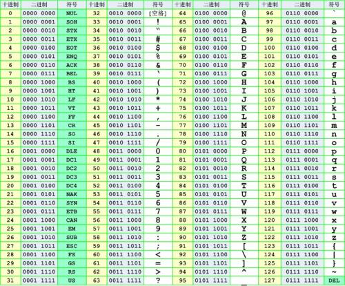

# 字符编码

# 1 引言

在显示器上看见的文字、图片等信息在计算机里面其实并不是我们看见的样子，即使你知道所有信息都存储在硬盘里，把它拆开也看不见任何文字或图片。机械硬盘（HDD）的盘片表面是一层磁性涂层，被划分成无数个微小的磁化区域，用不同的磁化方向分别代表 1 和 0；固态硬盘（SSD）则用闪存单元中存储的电荷多少来区分不同的状态。无论哪种介质，底层都只能用 0 和 1 来表示所有文字、图片等信息。那么字母“A”在硬盘上是如何存储的呢？

可能小张的计算机存储字母“A”是 1000001，而小王存储字母“A”是 11000001，这样双方交换信息时就会误解。比如小张把 1000001 发送给小王，小王并不认为 1000001 是字母“A”，而可能认为这是别的字符，于是小王在用记事本访问存储在硬盘上的 1000001 时，在屏幕上显示的就不是字母“A”。也就是说，小张和小王使用了不同的编码表。小张用的编码表是 ASCII，ASCII 编码表把英文字母、数字和常用符号一一地对应到二进制的 1 和 0 上；小王用的编码表可能是 EBCDIC，只不过 EBCDIC 编码与 ASCII 编码中的字母和 01 的对应关系不同。

一般地说，开放的操作系统（Linux、Windows 等）采用 ASCII 编码（如今普遍使用兼容 ASCII 的 UTF-8），而大型主机系统（MVS、OS/390，即如今的 z/OS 等）采用 EBCDIC 编码。在发送数据给对方前，需要事先告知对方自己所使用的编码，或者通过转码，使不同编码方案的两个系统可沟通自如。

# 2 ASCII 编码

ASCII 是基于拉丁字母的一套计算机编码系统，它主要用于显示现代英语，是现今最通用的单字节编码系统，并等同于国际标准 ISO/IEC 646。

请注意，ASCII 是 `American Standard Code for Information Interchange` 的缩写，而不是 ASC2，有很多人在这个地方产生误解。

**标准 ASCII 码**也叫**基础 ASCII 码**，严格定义只有 7 位、共 128 个字符（通常所说的 8 位、256 个字符是后文的扩展 ASCII，并不属于 ASCII 标准本身），使用 7 位二进制数来表示所有的大写和小写字母、数字 0 到 9、标点符号，以及在美式英语中使用的特殊控制字符。其中：

- 0～31 及 127（共 33 个）是控制字符或通信专用字符（其余为可显示字符）
- 32～126（共 95 个）是字符（32 是空格），其中 48～57 为 0 到 9 十个阿拉伯数字
- 65～90 为 26 个大写英文字母，97～122 为 26 个小写英文字母，其余为一些标点符号、运算符号等

标准 ASCII 码如下：

同时还要注意，标准 ASCII 只用了 7 位，用一个字节存储时，其最高位（b7）在数据传输中常用作**奇偶校验位**。所谓奇偶校验，是指在代码传送过程中用来检验是否出现错误的一种方法，一般分奇校验和偶校验两种：

- 奇校验：正确的代码一个字节中 1 的个数必须是奇数，若非奇数，则在最高位 b7 添 1；
- 偶校验：正确的代码一个字节中 1 的个数必须是偶数，若非偶数，则在最高位 b7 添 1。

**扩展 ASCII 字符**是从 128 到 255（`0x80`-`0xFF`）的字符。许多基于 x86 的系统都支持使用扩展（或“高”）ASCII。它将每个字符的第 8 位用于确定附加的 128 个特殊符号字符、外来语字母和图形符号。**针对扩展的 ASCII 码，不同的国家有不同的字符集，所以它并不是国际标准。**

# 3 ISO-8859-1 编码

ISO-8859-1 编码是单字节编码，向下兼容 ASCII，其编码范围是 `0x00`-`0xFF`，`0x00`-`0x7F` 之间完全和 ASCII 一致，`0x80`-`0x9F` 之间是控制字符，`0xA0`-`0xFF` 之间是文字符号。

ISO-8859-1 收录的字符除 ASCII 收录的字符外，还包括法语、德语、西班牙语等西欧语言所需的带重音字母和符号。希腊语、阿拉伯语、希伯来语、泰语则分别由同系列的 ISO-8859-7、ISO-8859-6、ISO-8859-8、ISO-8859-11 覆盖。欧元符号出现得比较晚，没有被收录在 ISO-8859-1 当中，而是收录在后来的 ISO-8859-15 中。

ISO-8859-1 的较低部分（从 0 到 127 之间的代码）是最初的 7 位 ASCII。

ISO-8859-1 的较高部分（从 160 到 255 之间的代码）在 HTML 中全都有实体名称（如 `&nbsp;`、`&copy;`）。

因为 ISO-8859-1 编码范围使用了单字节内的所有空间（即 8 位，0~255），在支持 ISO-8859-1 的系统中传输和存储其他任何编码的字节流都不会被抛弃。换言之，把其他任何编码的字节流当作 ISO-8859-1 编码看待都没有问题。这是个很重要的特性，MySQL 5.7 及以前版本的默认编码是 Latin1，就是利用了这个特性（MySQL 8.0 起默认字符集已改为 utf8mb4）。ASCII 编码是一个 7 位的容器，ISO-8859-1 编码是一个 8 位的容器。

Latin1 是 ISO-8859-1 的别名，有些环境下写作 Latin-1。

# 4 多字节字符集与 ANSI 编码

ASCII 是美国标准，所以它不能良好满足其他国家的需要。例如英国的英镑符号（£），拉丁语字母表重音符号，希腊语、希伯来语、阿拉伯语，以及使用西里尔字母的俄语，还有使用汉字的中文、日语和朝鲜语等等。

**多字节字符集**（MBCS，Multi-Byte Character Set）是支持无法用单字节表示的字符集（如日文和中文）的一种旧方法。最常见的 MBCS 实现是双字节字符集（DBCS，Double-Byte Character Set）。在 DBCS 系列标准里，最大的特点是两字节长的汉字字符和一字节长的英文字符并存于同一套编码方案里，因此程序为了支持中文处理，必须要注意字符串里的每一个字节的值，如果这个值是大于 127 的，那么就认为一个双字节字符集里的字符出现了。

为了扩充 ASCII 编码，以用于显示本国的语言，不同的国家和地区制定了不同的标准，由此产生了 GB2312、GBK、Big5、Shift_JIS 等各自的编码标准。这些使用 2 个字节来代表一个字符的各种延伸编码方式，称为 **ANSI 编码**，也称为 **MBCS 编码**。“ANSI 编码”其实是 Windows 的俗称，和 ANSI（American National Standards Institute，美国国家标准学会）并没有直接关系，本质上指的是 Windows 当前使用的“代码页”（Code Page）。在简体中文 Windows 下，ANSI 编码代表 GBK 编码（代码页 936，兼容 GB2312）；在日文 Windows 下，ANSI 编码代表 Shift_JIS 编码（代码页 932）。所以在中文 Windows 下，要转码成 GB2312/GBK，只需要把文本保存为 ANSI 编码即可。

不同 ANSI 编码之间互不兼容，当信息在国际间交流时，无法将属于两种语言的文字，存储在同一段 ANSI 编码的文本中。一个很大的缺点是，同一个编码值，在不同的编码体系里代表着不同的字，这样就容易造成混乱，这也直接促成了 Unicode 的诞生。

当然对于 ANSI 编码而言，`0x00`~`0x7F`（即十进制下的 0 到 127）之间的字符，依旧是 1 个字节代表 1 个字符。这一点与 UTF-16、UTF-32 等至少用 2 个字节表示一个字符的 Unicode 编码方式明显不同（UTF-8 同样用 1 个字节表示这些字符，因而也兼容 ASCII）。

# 5 GB2312 编码

GB2312 是 ANSI 编码里的一种，它在 ASCII 编码的基础上进行了扩充。为了满足国内在计算机中使用汉字的需要，中国国家标准总局发布了一系列的汉字字符集国家标准编码，统称为 **GB 码**，或**国标码**。其中最有影响的是于 1980 年发布的《信息交换用汉字编码字符集基本集》，标准号为 GB 2312-1980，因其使用非常普遍，也常被通称为国标码。GB2312 编码通行于我国内地；新加坡等地也采用此编码。几乎所有的中文系统和国际化的软件都支持 GB2312。

一个小于等于 127 的字符的意义与原来相同，但两个大于 127 的字符连在一起时，就表示一个汉字，前面的一个字节（称之为高字节）从 `0xA1` 用到 `0xF7`，后面一个字节（低字节）从 `0xA1` 到 `0xFE`，这样我们就可以组合出 7000 多个简体汉字了。在这些编码里，我们还把数学符号、罗马希腊的字母、日文的假名们都编进去了，连在 ASCII 里本来就有的数字、标点、字母都统统重新编了两个字节长的编码，这就是常说的“全角”字符，而原来在 127 号以下的那些就叫“半角”字符了。

为避免同西文的存储发生冲突，GB2312 字符在进行存储时，通过将原来的每个字节的第 8 位（最高位）设置为 1 同西文加以区别，如果第 8 位为 0，则表示西文字符，否则表示 GB2312 中的字符。

GB2312 是一个简体中文字符集，由 6763 个常用汉字和 682 个全角的非汉字字符组成。其中汉字根据使用的频率分为两级：一级汉字 3755 个，二级汉字 3008 个。

# 6 GBK 编码

GB2312 的出现，基本满足了汉字的计算机处理需要，但对于人名、古汉语等方面出现的罕用字，GB2312 不能处理，这导致了后来 GBK 及 GB 18030 汉字字符集的出现。GBK 是对 GB2312 的扩展。

GBK 采用双字节表示，总体编码范围为 `8140`-`FEFE`，首字节在 `81`-`FE` 之间，尾字节在 `40`-`FE` 之间，剔除 `xx7F` 一条线。总计 23940 个码位，GBK 编码标准兼容 GB2312，共收录汉字 21003 个、符号 883 个，并提供 1894 个造字码位，简、繁体字融于一库。

GB 18030 则是 GBK 的进一步扩展，它兼容 GBK，采用 1、2、4 字节的变长编码，可以覆盖 Unicode 的全部码位，是我国强制性的国家标准，现行版本为 GB 18030-2022。

# 7 Big5 编码

Big5 码，又称为**大五码**或者**五大码**，是通行于台湾、香港地区的一个繁体字编码方案，相当于港台地区的 GB2312 编码，也是 ANSI 编码的一种。

# 8 UTF 编码

## 8.1 Unicode 字符集

如前文 ANSI 编码一节所述，世界上存在着多种编码方式，在 ANSI 编码下，同一个编码值，在不同的编码体系里代表着不同的字。在简体中文系统下，ANSI 编码代表 GBK 编码，在日文操作系统下，ANSI 编码代表 Shift_JIS 编码，可能最终显示的是中文，也可能显示的是日文。在 ANSI 编码体系下，要想打开一个文本文件，不但要知道它的编码方式，还要安装有对应编码表，否则就可能无法读取或出现乱码。过去电子邮件和网页之所以经常出现乱码，就是因为信息的提供者使用的可能是日文的 ANSI 编码，而信息的读取者使用的可能是中文的编码，双方对同一个二进制编码值进行显示时采用了不同的编码，导致乱码。这个问题促使了 Unicode 的诞生。

如果有一种编码，将世界上所有的符号都纳入其中，无论是英文、日文、还是中文等，大家都使用这个编码表，就不会出现编码不匹配现象。每个符号对应一个唯一的编码，乱码问题就不存在了。这就是 Unicode 编码。

**通用字符集**（Universal Character Set，UCS）是由 ISO 制定的 ISO 10646（或称 ISO/IEC 10646）标准所定义的标准字符集。编码层面上，UCS-2 就是用两个字节编码，UCS-4 就是用 4 个字节（实际上只用了 31 位，最高位必须为 0）编码。UCS-2 有 `2¹⁶ = 65536` 个码位，UCS-4 理论上有 `2³¹ = 2147483648` 个码位，不过从 2003 年起，ISO 10646 已将码位范围限制在 `0x10FFFF` 以内（即 UTF-16 所能表示的范围），从而与 Unicode 的码位空间保持一致。

Unicode 当然是一个很大的集合，它的码位空间从 `U+0000` 到 `U+10FFFF`，共 1114112 个码位，可以容纳 100 多万个符号；而实际已分配的字符要少得多（截至 2026 年 9 月发布的 Unicode 18.0，已收录约 17.3 万个字符）。每个符号的编码都不一样，比如，`U+0639` 表示阿拉伯字母 `Ain`，`U+0041` 表示英语的大写字母 `A`，“汉”这个字的 Unicode 编码是 `U+6C49`。

需要注意的是，Unicode 只是一个字符集，它只规定了符号与二进制代码之间的对应关系，却没有规定这个二进制代码应该如何存储。

比如，汉字“严”的 Unicode 是十六进制数 `4E25`，转换成二进制数足足有 15 位（100111000100101），也就是说这个符号的表示至少需要 2 个字节。表示其他更大的符号，可能需要 3 个字节或者 4 个字节，甚至更多。

这里就有两个严重的问题，第一个问题是，如何才能区别 Unicode 和 ASCII？计算机怎么知道三个字节表示一个符号，而不是分别表示三个符号呢？第二个问题是，我们已经知道，英文字母只用一个字节表示就够了，如果 Unicode 统一规定，每个符号用三个或四个字节表示，那么每个英文字母前都必然有二到三个字节是 0，这对于存储来说是极大的浪费，文本文件的大小会因此大出二三倍，这是无法接受的。

它们造成的结果是：

- 出现了 Unicode 的多种存储方式，也就是说有许多种不同的二进制格式，可以用来表示 Unicode。
- Unicode 在很长一段时间内无法推广，直到互联网的出现。

## 8.2 UTF-8 编码

UTF-8 是 Unicode 的实现方式之一。

UTF-8（UCS Transformation Format 8bit）就是在互联网上使用最广的一种 Unicode 的实现方式。其他实现方式还包括 UTF-16（字符用两个字节或四个字节表示）和 UTF-32（字符用四个字节表示）。它们在互联网传输和文件存储中用得很少，但在程序内部仍很常见：Windows API、Java、JavaScript 的字符串都以 UTF-16 为基础；而在 Linux、macOS 下，C/C++ 的 `wchar_t` 通常占 4 个字节，存放的就是 UTF-32。

UTF-8 最大的一个特点，就是**它是一种变长的编码方式**。它可以使用 1~4 个字节表示一个符号，根据不同的符号而变化字节长度。

UTF-8 的编码规则很简单，只有两条：

- 对于单字节的符号，字节的第一位设为 0，后面 7 位为这个符号的 Unicode 码。因此对于英语字母，UTF-8 编码和 ASCII 码是相同的。
- 对于 n 字节的符号（n > 1），第一个字节的前 n 位都设为 1，第 n + 1 位设为 0，后面字节的前两位一律设为 10。剩下的没有提及的二进制位，全部为这个符号的 Unicode 码。

从 Unicode 到 UTF-8 的编码方式如下：

| Unicode 编码（十六进制） | UTF-8 字节流（二进制）              |
| --------------------- | ----------------------------------- |
| 000000 - 00007F       | 0xxxxxxx                            |
| 000080 - 0007FF       | 110xxxxx 10xxxxxx                   |
| 000800 - 00FFFF       | 1110xxxx 10xxxxxx 10xxxxxx          |
| 010000 - 10FFFF       | 11110xxx 10xxxxxx 10xxxxxx 10xxxxxx |

例如，“汉”字的 Unicode 编码是 `0x6C49`。`0x6C49` 在 `0x0800`-`0xFFFF` 之间，使用 3 字节模板：

`1110xxxx 10xxxxxx 10xxxxxx`

将 `0x6C49` 写成二进制是：

`0110 1100 0100 1001`

用这个比特流依次代替模板中的 x，得到：

`11100110 10110001 10001001`

即 `E6 B1 89` 就是“汉”的 UTF-8 码。

一个经典的编码误判案例是“联通”乱码：在 Windows 7 等旧版系统中，用记事本新建文本文件，只输入“联通”二字保存后再重新打开，会显示乱码。原因在于旧版记事本默认以 ANSI（即 GBK）编码保存，“联通”的 GBK 编码是 `C1 AA CD A8`，写成二进制为 `11000001 10101010 11001101 10101000`，恰好符合 UTF-8 的 2 字节模板 `110xxxxx 10xxxxxx`。文件中没有 BOM 时，记事本只能根据字节特征推测编码，于是误把它当作 UTF-8 来解码。从 Windows 10 1903 版本（2019 年）开始，记事本默认以无 BOM 的 UTF-8 保存文件，这个问题也就成了历史。

近年来，越来越多的编程语言把 UTF-8 作为默认甚至强制的选择。Rust 的字符串类型 `str`/`String` 保证始终是合法的 UTF-8，从字节构造字符串（如 `String::from_utf8`）时必须经过校验，非法的字节序列会返回错误；Swift 5 把 `String` 的内部存储改为原生 UTF-8；Java 18（JEP 400）将默认字符集统一为 UTF-8，不再随操作系统的区域设置变化；2026 年 10 月发布的 Python 3.15（PEP 686）也默认启用了 UTF-8 模式，`open()` 等文本读写在不指定编码时默认使用 UTF-8。从语言层面统一编码，能大大减少过去因平台默认编码不同而导致的乱码问题。

# 9 Little Endian 和 Big Endian

UTF-8、UTF-16、UTF-32 等实现了 Unicode 的编码方式，但是还有一个问题，编码后应该如何存储？

这里就要引出两个名词：

- **LE**（Little Endian）：小端序，意思是多字节数据在内存中存放时，按照低位字节在前（低地址）、高位字节在后（高地址）的顺序存放。
- **BE**（Big Endian）：大端序，和 LE 相反，是高位字节在前，低位字节在后。

字节序只影响以多个字节为一个编码单元的 UTF-16 和 UTF-32；UTF-8 以单个字节为编码单元，不存在字节序问题。比如“汉”字的 UTF-16 编码为 `0x6C49`，如果是 LE，那么在文件中的存放顺序应该是 `49 6C`；如果是 BE，那么顺序应该是 `6C 49`。

这两个古怪的名称来自英国作家斯威夫特的《格列佛游记》。在该书中，小人国里爆发了内战，战争起因是人们争论，吃鸡蛋时究竟是从大头（Big-Endian）敲开还是从小头（Little-Endian）敲开。为了这件事情，前后爆发了六次战争，一个皇帝送了命，另一个皇帝丢了王位。

那么很自然地，就会出现另一个问题：计算机怎么知道某一个文件到底采用哪一种方式编码？

Unicode 规范中定义，在文件的最前面加入一个表示编码顺序的字符，这个字符的名字叫做“**零宽度非换行空格**”（ZERO WIDTH NO-BREAK SPACE），码位为 `U+FEFF`，正好是两个字节。它字节颠倒后的 `U+FFFE` 在 Unicode 中被定义为非字符（noncharacter），不会出现在正常文本中，所以不用担心两种顺序会混淆。

这种方式叫做 **BOM**（Byte Order Mark）头，意思是字节序标志头。通过它基本能确定编码格式和字节序。

如果一个文本文件的头两个字节是 `FE FF`，就表示该文件采用大端序；如果头两个字节是 `FF FE`，就表示该文件采用小端序。UTF-8 也可以带 BOM（`EF BB BF`），但它只用来标识编码，并不表示字节序，而且通常不推荐使用。

UTF-8 文件带 BOM 在实践中常常引发问题。Unicode 标准明确指出，UTF-8 既不要求也不推荐使用 BOM：BOM 会干扰那些要求文件以特定 ASCII 字符开头的协议或格式，例如带 BOM 的 Shell 脚本，首行的 `#!/bin/bash` 无法被识别为 Shebang，导致执行失败；JSON 规范 RFC 8259 也规定，在网络上传输的 JSON 文本不得添加 BOM。因此，现代编辑器和 IDE 普遍以无 BOM 的 UTF-8 作为默认保存格式。少数场景是例外，比如 Excel 打开 CSV 文件时依赖 BOM 来识别 UTF-8，不带 BOM 的中文 CSV 可能显示为乱码。

如果文件没有 BOM，就只能根据字节的取值范围从概率上推测编码，虽然准确度比较高，但是不能保证 100% 正确——前文的“联通”就是典型例子。所以，时常看到检测错误的软件，也不奇怪了。

# 10 总结

字符编码的演进，本质上是从“各自为政”走向“大一统”：ASCII 解决了英文字符的表示；ISO-8859、GB2312、GBK、Big5、Shift_JIS 等编码各自扩展了本地语言，却彼此不兼容，导致乱码频发；Unicode 为全世界的字符统一分配码位，UTF-8、UTF-16、UTF-32 则是它的不同存储实现。如今 UTF-8 已成为互联网和绝大多数操作系统、编程语言的事实标准，实践中的建议是：文件、数据库（MySQL 用 utf8mb4）、网络传输统一使用 UTF-8，并且通常不要带 BOM。