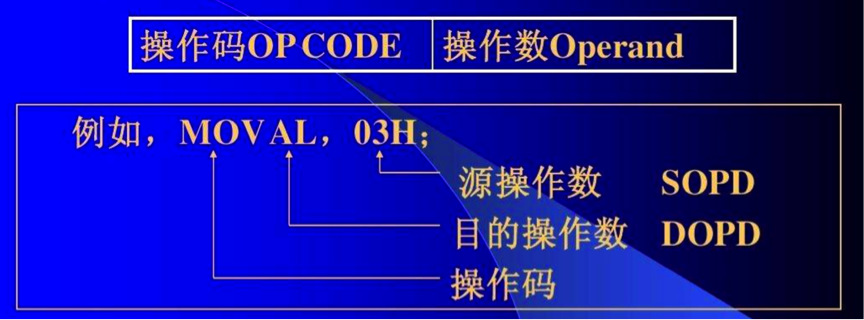
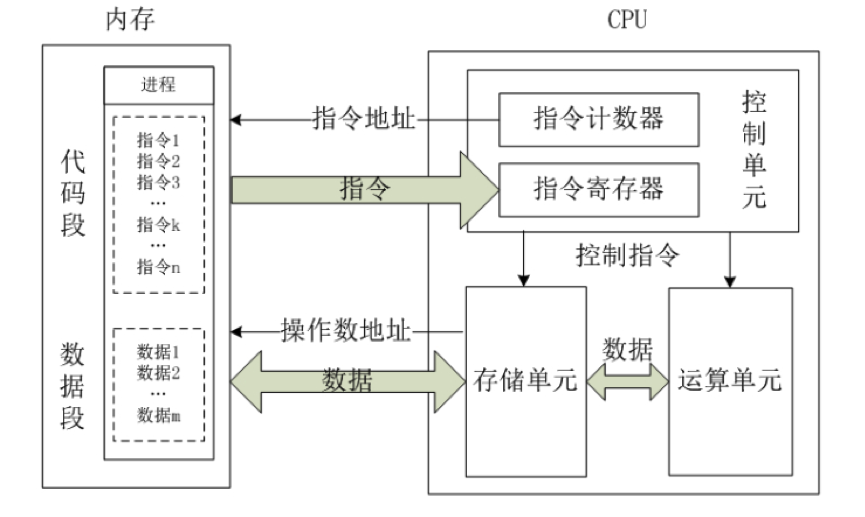
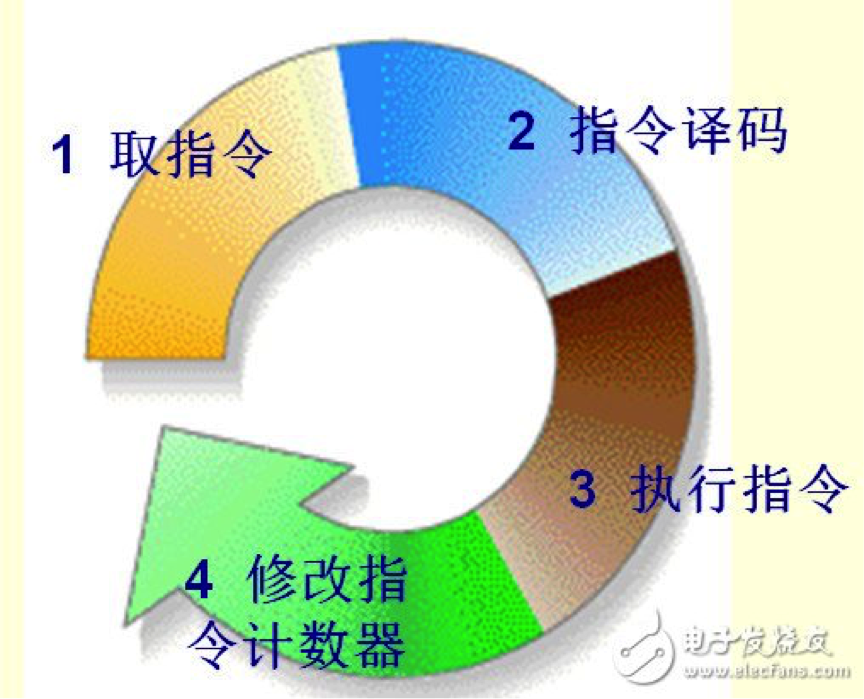
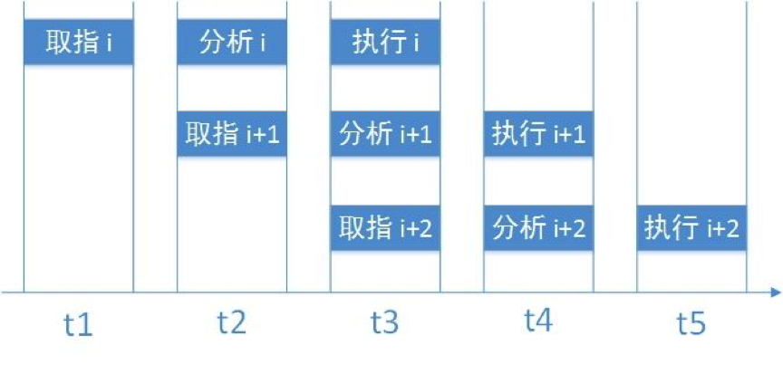
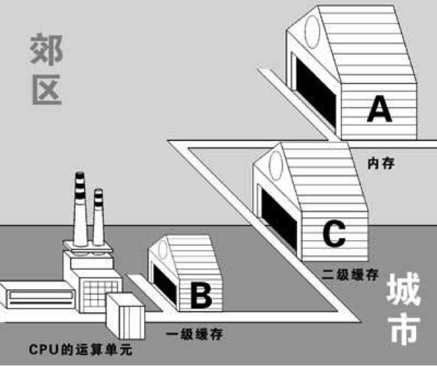
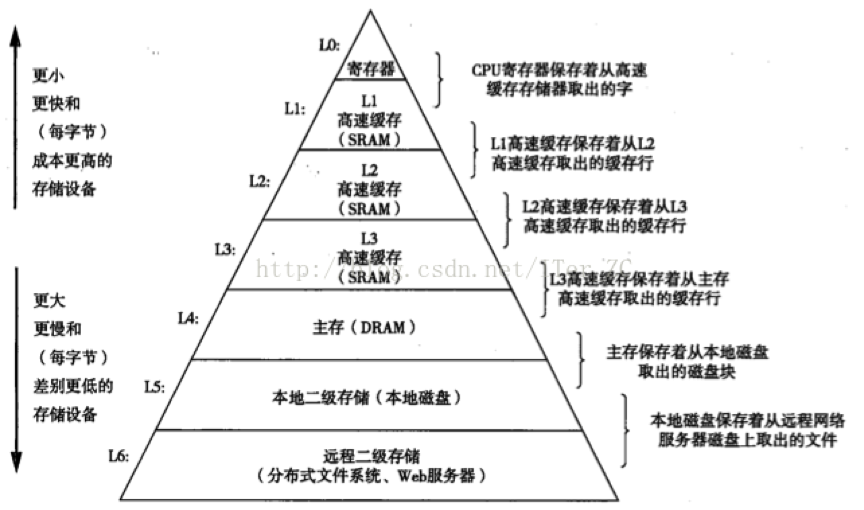

# CPU 浅谈

# 1 指令系统

## 1.1 x86 架构

要讲 CPU，就必须先讲一下指令系统。指令系统指的是一个 CPU 所能够处理的全部指令的集合，是一个 CPU 的根本属性。

目前主流的个人电脑和服务器中，大多数 CPU 都采用 **x86 架构**，即采用了 x86 指令集的 CPU。这是因为 Intel 在 1978 年推出了一颗代号为 8086 的 CPU，后来依此架构又开发出 80286、80386、80486……因此这种架构的 CPU 就被称为 x86 架构了。Intel 的 x86 架构 CPU 先是从 16 位（8086）升级到了 32 位（1985 年的 80386），2003 年 AMD 又依此架构推出了 64 位的新一代 CPU（AMD64），为了区别两者的差异，64 位的 x86 CPU 又被统称为 **x86_64 架构**（也叫 AMD64 或 x64）。另一种主流架构是 ARM 架构：手机、平板几乎全部采用 ARM 芯片；在个人电脑领域，苹果 Mac 的 M 系列芯片和高通骁龙 X 系列 Windows 笔记本都基于 ARM；在服务器领域，AWS Graviton、Google Axion、Microsoft Azure Cobalt 等云厂商自研的 ARM 服务器芯片也已大规模部署。

之所以说指令系统是一个 CPU 的根本属性，是因为指令系统决定了一个 CPU 能够运行什么样的程序。所有采用高级语言编出的程序，都需要翻译（编译或解释）成为机器语言后才能运行，这些机器语言中所包含的就是一条条的指令。

## 1.2 指令的格式

一条指令一般包括两个部分：操作码和地址码。

操作码其实就是指令序列号，用来告诉 CPU 需要执行的是哪一条指令，类似于汇编语言里的 `mov`、`add`、`jmp` 等符号码。地址码则复杂一些，主要包括源操作数地址、目的地址和下一条指令的地址。在某些指令中，地址码可以部分或全部省略，比如一条空指令就只有操作码而没有地址码。

举个例子，某个指令系统的指令长度为 32 位，操作码长度为 8 位，每个地址码长度也为 8 位，且操作码 00000001 表示加法，00000010 表示减法。当它收到一个“00000010 00000100 00000001 00000110”的指令时，先取出它的前 8 位操作码，即 00000010，分析得出这是一个减法操作，有 3 个地址，分别是两个源操作数地址和一个目的地址。于是，CPU 就到内存地址 00000100 处取出被减数，到 00000001 处取出减数，送到 ALU 中进行减法运算，然后把结果送到 00000110 处。

当然，这只是一个相当简单化的例子，实际情况要复杂得多。

## 1.3 指令的分类与寻址方式

一般说来，现在的指令系统有以下几种类型的指令：

- 算术逻辑运算指令：包括加减乘除等算术运算指令，以及与、或、非、异或等逻辑运算指令。现在的指令系统还加入了一些十进制运算指令以及字符串运算指令等。
- 浮点运算指令：用于对浮点数进行运算。浮点运算要大大复杂于整数运算，所以 CPU 中一般还会有专门负责浮点运算的浮点运算单元。
- 向量（SIMD）指令：SIMD 即单指令多数据流（Single Instruction Multiple Data），现代 CPU 普遍配备了独立的 SIMD 向量指令集（如 x86 的 SSE/AVX、ARM 的 NEON/SVE），可以用一条指令同时对一组浮点数或整数进行并行运算，对于多媒体、3D 处理以及 AI 计算很有用。
- 位操作指令：在很多高级语言如 C、Java 中都有一组位操作语句，相对应地，指令系统中也有一组位操作指令，如左移一位、右移一位等。对于计算机内部以二进制补码表示的数据来说，这种操作是非常简单快捷的。
- 其他指令：上面几种都是运算型指令，除此之外还有许多非运算的其他指令。这些指令包括数据传送指令、堆栈操作指令、转移类指令、输入输出指令和一些比较特殊的指令，如特权指令、多处理器控制指令和等待、停机、空操作等指令。

对于指令中的地址码，也会有许多不同的寻址（编址）方式，主要有直接寻址、间接寻址、寄存器寻址、基址寻址、变址寻址等，某些复杂的指令系统会有几十种甚至更多的寻址方式。

## 1.4 CISC 与 RISC

**RISC**：Reduced Instruction Set Computer，精简指令系统计算机

**CISC**：Complex Instruction Set Computer，复杂指令系统计算机

一开始，计算机的指令系统只有很少一些基本指令，而其他的复杂指令全靠软件编译时通过简单指令的组合来实现。举个最简单的例子，一个 a 乘以 b 的操作就可以转换为 a 个 b 相加来做，这样就用不着乘法指令了。当然，最早的指令系统就已经有乘法指令了，这是为什么呢？因为用硬件实现乘法比加法组合来得快得多。

由于那时的计算机部件相当昂贵，而且速度很慢，为了提高速度，越来越多的复杂指令被加入了指令系统中。但是，很快又有一个问题：一个指令系统的指令数是受指令操作码的位数所限制的，如果操作码为 8 位，那么指令数最多为 256 条（`2⁸ = 256`）。

那么怎么办呢？指令的宽度是很难增加的，聪明的设计师们又想出了一种方案：操作码扩展。前面说过，操作码的后面跟的是地址码，而有些指令是用不着地址码或只用少量的地址码的。那么，就可以把操作码扩展到这些位置。

举个简单的例子，如果一个指令系统的操作码为 2 位，那么可以有 00、01、10、11 四条不同的指令。现在把 11 作为保留，把操作码扩展到 4 位，那么就可以有 00、01、10、1100、1101、1110、1111 七条指令。其中 1100、1101、1110、1111 这四条指令的地址码必须少两位。

然后，为了达到操作码扩展的先决条件——减少地址码，设计师们又动足了脑筋，发明了各种各样的寻址方式，如基址寻址、相对寻址等，用以最大限度地压缩地址码长度，为操作码留出空间。

就这样，慢慢地，CISC 指令系统就形成了。大量的复杂指令、可变的指令长度、多种的寻址方式是 CISC 的特点，也是 CISC 的缺点：因为这些都大大增加了解码的难度，而在现在的高速硬件发展下，复杂指令所带来的速度提升早已不及在解码上浪费的时间。

1975 年，IBM 的设计师 John Cocke 研究了当时的 IBM System/370 CISC 系统，发现其中占总指令数仅 20% 的简单指令却在程序执行中占了 80%，而占指令数 80% 的复杂指令却只有 20% 的机会用到。由此，他提出了精简指令集的设计思想（“RISC”这个名称则是 1980 年前后由加州大学伯克利分校的 David Patterson 提出的）。

事实证明，RISC 是成功的。20 世纪 80 年代末，各公司的 RISC CPU（如 MIPS、SPARC 等）如雨后春笋般大量出现，占据了大量的工作站和服务器市场。

RISC 的最大特点是指令长度固定，指令格式种类少，寻址方式种类少，大多数是简单指令且都能在一个时钟周期内完成，易于设计超标量与流水线，寄存器数量多，大量操作在寄存器之间进行。

RISC 的成功反过来也影响了 CISC 的实现方式。从 20 世纪 90 年代中期的 Intel Pentium Pro 开始，x86 CPU 在内部会先把复杂的 x86 指令翻译成类似 RISC 的微操作（μop）再执行，相当于“外部 CISC、内部 RISC”。凭借这种设计和海量 x86 软件的兼容性，x86 至今仍主导着个人电脑和服务器市场；而基于 RISC 的 ARM 架构则统治了手机等移动设备，并逐步进入了个人电脑和服务器领域。

近年来备受关注的则是 RISC-V。它于 2010 年由加州大学伯克利分校发起，是一套开放、免授权费的指令集架构，采用模块化设计：在精简的基础整数指令集之上，按需选配乘除法、原子操作、浮点、向量（RVV 1.0）等标准扩展，厂商还可以加入自定义指令。这种灵活性使它率先在嵌入式、物联网和 AI 加速器等芯片中得到广泛应用。为了避免扩展组合过多导致软件生态碎片化，RISC-V 国际基金会于 2024 年批准了面向应用处理器的 RVA23 规范（Profile），把向量扩展等列为必选项，为 Linux 发行版等通用软件提供了统一的目标平台；面向 AI 计算的矩阵扩展（如 IME、AME）目前仍在标准化过程中。

# 2 CPU 内核结构

CPU（**C**entral **P**rocessing **U**nit，中央处理器）是一块超大规模的集成电路，主要由**运算单元、控制单元、存储单元**三部分组成。

## 2.1 控制单元

控制单元是整个 CPU 的指挥控制中心，由**指令寄存器 IR**（Instruction Register）、**指令译码器 ID**（Instruction Decoder）和**操作控制器 OC**（Operation Controller）等组成，对协调整个电脑有序工作极为重要。它根据用户预先编好的程序，依次从存储器中取出各条指令，放在指令寄存器 IR 中，通过指令译码（分析）确定应该进行什么操作，然后通过操作控制器 OC，按确定的时序，向相应的部件发出微操作控制信号。操作控制器 OC 中主要包括节拍脉冲发生器、控制矩阵、时钟脉冲发生器、复位电路和启停电路等控制逻辑。

## 2.2 运算单元

运算单元包括**算术逻辑单元 ALU**（Arithmetic and Logic Unit）和**浮点运算单元 FPU**（Floating Point Unit）。

ALU 主要完成对二进制数据的定点算术运算（加减乘除）、逻辑运算（与、或、非、异或）以及移位操作。在某些 CPU 中还有专门用于处理移位操作的移位器。

通常 ALU 有两个输入端和一个输出端。整数单元有时也称为 IEU（Integer Execution Unit）。**我们通常所说的“CPU 是 XX 位的”就是指 ALU 所能处理的数据的位数**（即字长，一般也和通用寄存器的宽度一致）。

FPU 主要负责浮点运算和高精度整数运算。有些 FPU 还具有向量运算的功能，另外一些则有专门的向量处理单元。

## 2.3 存储单元

存储单元包括 CPU 片内缓存和寄存器组，是 CPU 中暂时存放数据的地方，里面保存着那些等待处理的数据，或已经处理过的数据。CPU 访问寄存器所用的时间要比访问内存的时间短，采用寄存器，可以减少 CPU 访问内存的次数，从而提高 CPU 的工作速度。但因为受到芯片面积和集成度所限，寄存器组的容量不可能很大。寄存器组可分为**专用寄存器**和**通用寄存器**。

专用寄存器用于特定的用途，如程序计数器 PC、指令寄存器 IR、状态（标志）寄存器等，通常由 CPU 自己控制，用来保存控制信息或表明某种状态，程序一般不能随意改变它们。

通用寄存器组是一组最快的存储器，用来保存参加运算的操作数和中间结果。用途广泛并可由程序员规定其用途，通用寄存器的数目因微处理器而异。

# 3 CPU 工作原理

CPU 的工作过程大体上可分为提取、解码、执行、写回四步。

## 3.1 提取

从存储器或缓存中检索指令（为数值或一系列数值），由程序计数器（Program Counter，PC）指定存储器的位置。（程序计数器保存供识别程序位置的数值。换言之，程序计数器记录了 CPU 在程序里的踪迹。）

## 3.2 解码

CPU 根据从存储器提取到的指令来决定其执行行为。在解码阶段，指令被拆解为有意义的片段，CPU 根据指令集的定义将数值解译为指令。

## 3.3 执行

在提取和解码阶段之后，紧接着进入执行阶段。该阶段中，指令会被送到能够进行所需运算的 CPU 部件上执行。

例如，要求一个加法运算，算术逻辑单元 ALU 将会连接到一组输入和一组输出。输入提供了要相加的数值，而输出将含有总和的结果。ALU 内含电路系统，能够在输出端得出简单的算术运算和逻辑运算（比如加法和位运算）的结果。如果加法运算产生一个对该 CPU 处理而言过大的结果，在标志寄存器里可能会设置运算溢出（Arithmetic Overflow）标志。

## 3.4 写回

以一定格式将执行阶段的结果简单地写回。运算结果经常被写进 CPU 内部的寄存器，以供随后的指令快速存取。在有些情况下，运算结果可能写进速度较慢，但容量较大且较便宜的主存中。某些类型的指令会操作程序计数器，而不直接产生结果。这些一般称作“跳转”（Jump），并在程序中带来循环、条件执行（通过条件跳转）和函数调用等行为。许多指令会改变标志寄存器的状态位，这些标志可用来影响程序的行为，因为它们往往反映了各种运算的结果。例如，以一个“比较”指令判断两个值的大小，根据比较结果在标志寄存器上设置一个数值，随后的跳转指令就可以借助这个标志来决定程序的走向。由于程序计数器在提取指令后就已经递增（跳转指令则会直接修改它），所以在执行指令并写回结果之后，整个过程反复进行，下一个指令周期会正常地提取下一条顺序指令。

总结一下，CPU 的运行原理就是：控制单元在时序脉冲的作用下，将程序计数器所指向的指令地址（这个地址是在内存里的）送到地址总线上去，然后 CPU 将这个地址里的指令读到指令寄存器进行译码。对于执行指令过程中所需要用到的数据，会将数据地址也送到地址总线，然后 CPU 把数据读到 CPU 的内部存储单元（就是内部寄存器）暂存起来，最后命令运算单元对数据进行处理加工。周而复始，一直这样执行下去，天荒地老，海枯石烂，直到停电。

# 4 CPU 性能

## 4.1 主频、外频与倍频

CPU 的**主频**，即 CPU 内核工作的时钟频率（CPU Clock Speed）。一个时钟周期内 CPU 能完成一次最基本的动作，比如某个 CPU 的主频为 2.7 GHz，即代表它每秒可以完成 `2.7 × 10⁹`（27 亿）次最基本的动作，一条指令一般由多个基本动作组成。

CPU 的主频不代表 CPU 的速度，但提高主频对于提高 CPU 运算速度却是至关重要的。

在计算机主板上，以 CPU 为主，内存和各种外围设备为辅，有许多设备要共同在一起工作。这些设备之间的联络、数据的交换，都必须正确无误，分秒不差。因此，它们必须要有一个固定的时钟来做时间上的校正、协调或者参考。这个时钟由主板上的时钟发生器产生，就是所谓的**外频**。

在早期的计算机中，内存与主板之间同步运行的速度等于外频，在这种方式下，可以理解为 CPU 外频直接与内存相连通，实现两者间的同步运行状态。由于 CPU 工作频率不断提高，而 PC 的一些其他设备（如插卡、硬盘等）却受到工艺的限制，不能承受更高的频率，因此限制了 CPU 频率的进一步提高。因此出现了倍频技术，该技术能够使 CPU 内部工作频率变为外部频率的倍数，从而通过提升倍频而达到提升主频的目的。

倍频系数是指 CPU 主频与外频之间的相对比例关系。它的作用是使系统总线工作在相对较低的频率上，而 CPU 速度可以通过倍频来提升。CPU 主频计算方式为：

> `主频 = 外频 × 倍频`

比如外频 100 MHz、倍频 36，主频就是 3.6 GHz。如今的 CPU 早已把内存控制器集成到芯片内部，传统的前端总线（FSB）已经被淘汰，外频一般指 100 MHz 左右的基准时钟（BCLK），CPU 核心、缓存等部件的工作频率都以它为基准、乘以各自的倍频得到。主频也不再固定，会根据负载、温度和功耗限制，在基础频率与最大加速频率之间动态调整（如 Intel 的 Turbo Boost、AMD 的 Precision Boost）。

## 4.2 超标量

CPU 的性能是由什么决定的呢？单纯的一个 ALU 速度在一个 CPU 中并不起决定性作用，因为 ALU 的速度都差不多。而一个 CPU 的性能表现的决定性因素就在于 CPU 内核的设计。

既然无法大幅提高 ALU 的速度，有什么替代的方法呢？并行处理的方法又一次产生了强大的作用。所谓的超标量 CPU，就是指集成了多个 ALU、多个 FPU、多个译码器和多条流水线的 CPU，以并行处理的方式来提高性能。这种技术能够在相同的 CPU 主频下实现更高的 CPU 吞吐率。

## 4.3 流水线与超流水线

流水线技术是一种将每条指令分解为多步，并让各步操作重叠，从而实现几条指令并行处理的技术。程序中的指令仍是一条条顺序执行，但可以预先取若干条指令，并在当前指令尚未执行完时，提前启动后续指令的另一些操作步骤。这样显然可加速一段程序的运行过程。

对于一条具体的指令执行过程，通常可以分为五个部分：取指令、指令译码、取操作数、运算（ALU）、写结果。其中前三步一般由指令控制器完成，后两步则由运算器完成。按照传统的方式，所有指令顺序执行，那么先是指令控制器工作，完成第一条指令的前三步，然后运算器工作，完成后两步；然后指令控制器工作，完成第二条指令的前三步，再是运算器，完成第二条指令的后两步……很明显，当指令控制器工作时运算器基本上在休息，而当运算器在工作时指令控制器却在休息，造成了相当大的资源浪费。解决方法很容易想到，当指令控制器完成了第一条指令的前三步后，直接开始第二条指令的操作，运算单元也是。这样就形成了流水线系统，这是一条 2 级流水线。

如果把这 5 个步骤进一步拆开，分别交给 5 个独立的部件（3 个指令控制部件和 2 个运算部件）来完成，那么就可以在完成了第一条指令的取指工作后直接开始第二条指令的取指，这时第一条指令在进行译码；然后第三条指令取指，第二条指令译码，第一条指令取操作数……这样就是一个 5 级流水线。

**超流水线**（Superpipeline）以增加流水线级数的方法来细分每一级的工作、缩短时钟周期（从而提高主频），使相同的时间内执行更多的机器指令。比如 Intel 的 Pentium 4（NetBurst 架构）流水线一度长达 20～31 级。而前面说的超标量，则是配置多个功能部件和指令译码电路，采用多条流水线并行处理，在一个时钟周期内可以发射多条指令。

超标量是指在 CPU 中有一条以上的流水线，并且每时钟周期内可以完成一条以上的指令，其实质是以空间换取时间。而超流水线是通过细化流水、提高主频，使得在一个机器周期内完成一个甚至多个操作，其实质是以时间换取空间。

流水线系统最大限度地利用了 CPU 资源，使每个部件在每个时钟周期都工作，大大提高了效率。但是，流水线有两个非常大的问题：相关和转移。

在一个流水线系统中，如果第二条指令需要用到第一条指令的结果，这种情况叫做**相关**（也叫数据冒险，Data Hazard）。以上面那个 5 级流水线为例，当第二条指令需要取操作数时，第一条指令的运算还没有完成，如果这时第二条指令就去取操作数，就会得到错误的结果。所以，这时整条流水线不得不停顿下来，等待第一条指令的完成。这是一个严重影响性能的问题，特别是对于比较长的流水线，比如 20 级，这种停顿通常要损失十几个时钟周期。目前解决这个问题的方法主要有数据前递（Forwarding，把运算结果直接送给后续指令）和**乱序执行**。乱序执行的原理是在两条相关指令中插入不相关的指令，使整条流水线顺畅。比如上面的例子中，开始执行第一条指令后直接开始执行第三条指令（假设第三条指令不相关），然后才开始执行第二条指令，这样当第二条指令需要取操作数时第一条指令刚好完成，而且第三条指令也快要完成了，整条流水线不会停顿。当然，流水线的阻塞现象还是不能完全避免的，尤其是当相关指令非常多的时候。

另一个大问题是**条件转移**。在上面的例子中，如果第一条指令是一个条件转移指令，那么系统就会不清楚下面应该执行哪一条指令，这时就必须等第一条指令的判断结果出来才能执行第二条指令。条件转移所造成的流水线停顿甚至比相关还要严重得多。所以，现在采用**分支预测技术**来处理转移问题。虽然我们的程序中充满着分支，而且哪一条分支都是有可能的，但大多数情况下总是选择某一分支。比如一个循环的末尾是一个分支，除了最后一次我们需要跳出循环外，其他的时候我们总是选择继续循环这条分支。根据这些原理，分支预测技术可以在没有得到结果之前预测下一条指令是什么，并执行它。现代 CPU 的分支预测器在大多数程序中能达到 95% 以上的正确率，但是，一旦预测错误，CPU 仍然不得不清理整条流水线并回到分支点，这将损失大量的时钟周期。

分支预测与乱序执行在提升性能的同时也带来了安全隐患。2018 年 1 月公开的 Spectre（幽灵）和 Meltdown（熔断）漏洞表明：CPU 在推测执行或乱序执行时，会提前访问本不该被访问的数据，虽然执行错误的指令结果最终会被丢弃，但它们在缓存中留下的痕迹不会被清除，攻击者可以通过测量内存访问时间（缓存侧信道）推断出这些数据。此后，操作系统、编译器、微码更新以及新一代 CPU 的硬件设计都陆续加入了防护措施，其中部分软件防护会带来一定的性能损失。

越是长的流水线，相关和转移两大问题也越严重，所以，流水线并不是越长越好，超标量也不是越多越好，找到一个速度与效率的平衡点才是最重要的。

## 4.4 缓存

说到 CPU，不得不说的就是 CPU 缓存，目前 CPU 的缓存已经成了衡量 CPU 性能的一个必要指标，那么 CPU 缓存到底对 CPU 性能的影响有多大呢？

我们知道，CPU 执行指令时，会将执行结果放在一个叫“寄存器”的元件中，由于“寄存器”集成在 CPU 内部，与 ALU 等构成 CPU 的重要元件，因此寄存器中的数据能很快被 CPU 所访问，但毕竟寄存器的容量太小，CPU 所需的大量指令和数据还在内存（RAM）当中，所以 CPU 为了完成指令操作，需要频繁地向内存发送、接收指令和数据。由于 CPU 运算速度要比内存读写速度快很多，这样会使 CPU 花费很长时间等待数据到来或把数据写入内存，所以传统的系统瓶颈在这里就产生了。

实际工作时，CPU 往往需要重复读取同样的数据块，所以人们在 CPU 和内存之间加入了一个比内存快许多的“Cache”，这就是“高速缓存”。早期的缓存放在主板上，后来才逐步集成到 CPU 内部（Intel 从 1989 年的 80486 开始在芯片内集成一级缓存）。

按照数据读取顺序和与 CPU 结合的紧密程度，CPU 缓存可以分为一级缓存（L1）、二级缓存（L2）和三级缓存（L3）。早年只有部分高端 CPU 才有三级缓存，如今主流 CPU 基本都具备三级缓存：一级缓存通常又分为指令缓存和数据缓存，它和二级缓存一般由每个核心独享，三级缓存则由多个核心共享。

在包含式（Inclusive）缓存设计中，每一级缓存中所存储的全部数据都是下一级缓存的一部分（现代 CPU 也有不少采用非包含式或独占式设计）。这三种缓存的技术难度和制造成本是相对递减的，所以其容量也是相对递增的。当 CPU 要读取一个数据时，首先从一级缓存中查找，如果没有找到再从二级缓存中查找，如果还是没有就从三级缓存或内存中查找。缓存命中率与程序的访问模式密切相关，并没有固定的数值。对大多数程序来说，得益于程序访问的局部性，L1 缓存的命中率通常可达 90% 以上；由于容易命中的访问已经被 L1 拦截，L2、L3 的命中率往往要低一些。最终只有一小部分访问需要逐级查找到内存，由此可见一级缓存是整个 CPU 缓存架构中最为重要的部分。

CPU 从不同介质读写数据的对比如下图所示：

可以发现：

- 越往上存储容量越小，存取速度越快，成本越高，反之亦然；
- 每一层存储器只和相邻的下一层存储器打交道，不会跨级访问，上层作为下层的一个缓存。

**CPU 要访问的数据最终一般都要经过主存，主存可以看作下层其他设备的一个缓存，其他设备的数据最终都要进入主存才能被 CPU 访问到**。比如磁盘文件读取操作，CPU 只发起操作请求，具体的数据操作不需要经过 CPU，由 DMA（Direct Memory Access，直接内存访问）来操作 I/O 设备和主存之间的交互，当操作完成后，再通过中断通知 CPU 操作完成。

## 4.5 多核与超线程

到了 2005 年前后，单纯提高主频遇到了功耗和散热的瓶颈（“功耗墙”），主频基本停留在 3～5 GHz 的水平，于是厂商转而在一颗芯片上集成多个 CPU 核心，每个核心都有自己的控制单元、运算单元和一、二级缓存，可以同时执行不同的线程。同时，超线程（SMT，Intel 称为 Hyper-Threading）技术让一个物理核心能同时运行两个线程，充分利用流水线中空闲的执行单元。如今主流桌面 CPU 已有 6～24 个核心，服务器 CPU 可达上百个核心，例如 2024 年发布的 AMD EPYC 9005 系列最高 192 核，Intel Xeon 6 的能效核版本（Xeon 6900E）最高 288 核。手机芯片和苹果 M 系列还采用了“大小核”（性能核 + 能效核）的混合设计；Intel 从第 12 代酷睿（Alder Lake）开始也引入了性能核（P-core）+ 能效核（E-core）的混合架构，酷睿 Ultra 系列的部分型号又在 SoC 模块中加入了功耗更低的低功耗能效核（LP E-core）：Meteor Lake、Panther Lake 为 P + E + LP E 三级，Lunar Lake 为 4 个 P 核加 4 个位于低功耗岛上的 E 核，桌面版 Arrow Lake 则只有 P + E 两级。另外，Intel 从 Lunar Lake、Arrow Lake 开始在性能核上取消了超线程。与此同时，GPU、NPU 等专用加速器正承担越来越多的 AI 计算，CPU 则更多地负责通用计算和任务调度。

另一个重要趋势是 **Chiplet**（芯粒）设计：不再把所有功能做在一整块大芯片上，而是拆成多个小芯片分别制造，再通过先进封装连成一体。小芯片的良率更高、成本更低，不同模块还可以各自采用最合适的制程。AMD 从 2019 年的第二代 EPYC 和锐龙 3000 系列开始，把 CPU 核心放在采用先进制程的 CCD（核心芯片）上，把内存控制器、PCIe 等 I/O 部分放在制程较老的 IOD（I/O 芯片）上；Intel 则从 Meteor Lake 开始，用 Foveros 3D 封装把计算、图形、SoC（含 NPU）、I/O 等多个模块（Tile）集成在一块基底芯片上。AMD 的 3D V-Cache 技术还把额外的 L3 缓存与 CPU 核心芯片垂直堆叠，大幅提升了游戏等对缓存敏感的应用的性能。

# 5 总结

CPU 的根本属性是指令系统，围绕 CISC 与 RISC 两条路线形成了 x86、ARM、RISC-V 等指令集架构。CPU 内部由控制单元、运算单元和存储单元组成，按照提取、解码、执行、写回四个步骤周而复始地执行指令。提升 CPU 性能的手段，一是提高主频，二是通过流水线、超标量、乱序执行和分支预测挖掘指令级并行，三是借助多级缓存缓解 CPU 与内存之间的速度差距。当主频提升遇到功耗墙之后，多核、超线程、大小核以及 Chiplet 设计又成为性能提升的主要方向。
