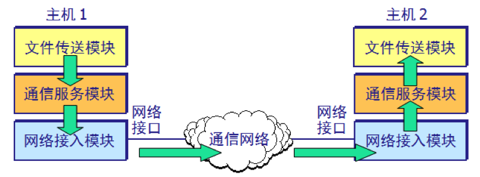
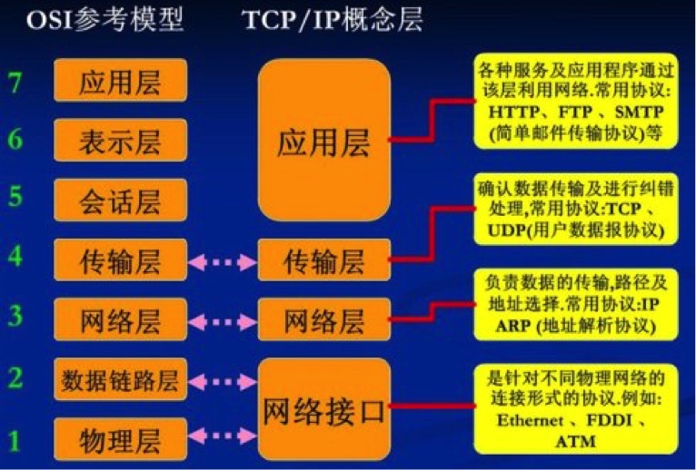
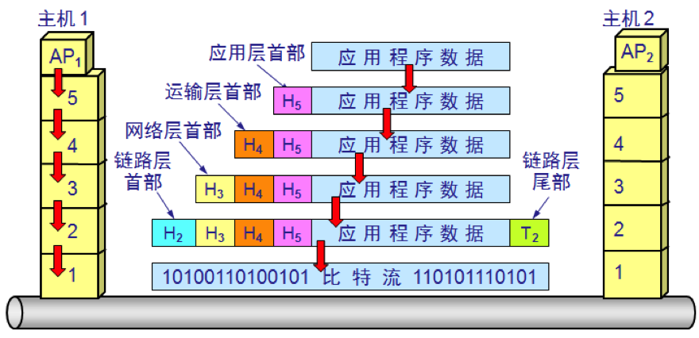

# 计算机网络-体系结构

# 1 网络协议与分层

在计算机网络中要做到有条不紊地交换数据，就必须遵守一些事先约定好的规则，这些规则明确规定了所交换的数据的格式以及有关的同步问题。

这些为进行网络中的数据交换而建立的规则、标准或约定称为**网络协议**（network protocol）。网络协议主要由以下三个要素组成：

- 语法：数据与控制信息的结构或格式
- 语义：需要发出何种控制信息、完成何种动作以及做出何种响应
- 同步：事件实现顺序（即时序）的详细说明

对于非常复杂的计算机网络协议，其结构应该是层次式的。例如，假定我们在主机 1 和主机 2 之间通过一个通信网络传送文件，可以将要做的工作划分为三类。

第一类工作与传送文件直接相关，如发送端的文件传送应用程序应当确信接收端的文件管理程序已做好接收和存储文件的准备；若两个主机所用的文件格式不一样，则至少其中的一个主机应完成文件格式转换。这两项工作可用一个文件传送模块来完成。这样，两个主机可将文件传送模块作为最高层。

但是，我们并不想让文件传送模块完成全部工作的细节，这样会使文件传送模块过于复杂。可以再设立一个通信服务模块，用来保证文件和文件传送命令可靠地在两个系统之间交换。也就是说，让位于上面的文件传送模块利用下面的通信服务模块所提供的服务。可以发现，如果将位于上面的文件传送模块换成电子邮件模块，那么电子邮件模块同样可以利用它下面的通信服务模块所提供的可靠通信的服务，这就是分层的一个优势。

同样的道理，我们再构造一个网络接入模块，让这个模块负责做与网络接口细节有关的工作，并向上层提供服务，使上面的通信服务模块能够完成可靠通信的任务。

从上述简单例子可以更好地理解分层带来的好处：各层之间是独立的，某一层并不需要知道它的下一层是如何实现的，而仅仅需要知道下一层通过层间接口所提供的服务。当任何一层发生变化时，只要层间的接口关系保持不变，则在这层以上或以下各层均不受影响。此外，某一层提供的服务还可以进行修改；当某层提供的服务不再需要时，甚至可以将这一层取消。各层都可以采用最合适的技术来实现。

我们把计算机网络的各层及其协议的集合称为**网络的体系结构**。

# 2 OSI 与 TCP/IP

国际标准化组织（ISO，International Organization for Standardization）提出过一个标准框架，就是著名的开放系统互连基本参考模型 `OSI/RM`（Open Systems Interconnection Reference Model，简称 OSI），只要都遵循 OSI 标准，分布在世界各地的不同系统之间就能实现互连互通。

但是得到最广泛应用的不是法律上的国际标准 OSI，而是非国际标准 TCP/IP，TCP/IP 常常被认为是事实上的国际标准。时至今日，整个互联网仍然运行在 TCP/IP 协议族之上，OSI 则主要作为教学和描述问题时的参考框架（如业界常说的“二层交换机”，以及根据 HTTP 等应用层协议内容进行转发的“七层负载均衡”，其命名就是沿用 OSI 的层次编号）。

OSI 模型将计算机网络划分为七层（物理层、数据链路层、网络层、传输层、会话层、表示层、应用层），概念清楚，理论也较完整，但它既复杂又不实用。TCP/IP 是一个四层的体系结构，包含**应用层**、**传输层**、**网际层**（也称网络层或 IP 层）和**网络接口层**（RFC 1122 中称为链路层）。不过从实质上讲，TCP/IP 只有最上面的三层，网络接口层并没有什么具体内容（实际使用的是以太网、Wi-Fi 等各种已有的链路层和物理层技术）。也就是说，TCP/IP 的网络接口层笼统地涵盖了 OSI 的数据链路层和物理层，而这两层恰恰是理解数据如何在一段段链路上传送的关键。为了把原理讲清楚，学习计算机网络时往往采取折中的办法，即综合 OSI 和 TCP/IP 的优点，把网络接口层拆分为数据链路层和物理层，采用一种五层协议的体系结构：应用层、传输层、网络层、数据链路层和物理层。

# 3 五层协议的体系结构

## 3.1 应用层

**应用层**（application layer）是体系结构中的最高层。应用层直接为用户的应用进程提供服务，应用层交互的数据单元称为**报文**（message）。在互联网中的应用层协议很多，如支持万维网的 HTTP 协议、用于发送电子邮件的 SMTP 协议和用于读取邮件的 IMAP（或 POP3）协议、支持文件传送的 FTP 协议、负责域名解析的 DNS 协议等。

## 3.2 传输层

**传输层**（transport layer）的任务就是负责向两个主机中进程之间的通信提供通用的数据传输服务。由于一个主机可同时运行多个进程，因此传输层有复用和分用的功能。复用就是多个应用层进程可同时使用下面传输层的服务，分用则是传输层把收到的信息分别交付给上面应用层中的相应进程。

传输层主要使用以下两种协议：

- 传输控制协议 **TCP**（Transmission Control Protocol）——面向连接的，数据传输的单位是**报文段**（segment），能够提供**可靠的交付**。
- 用户数据报协议 **UDP**（User Datagram Protocol）——无连接的，数据传输的单位是**用户数据报**（user datagram），不保证提供可靠的交付，只能提供“**尽最大努力交付**（best-effort delivery）”。

近年来，传输层还出现了一个重要的新协议 **QUIC**。它最初由 Google 设计，2021 年由 IETF 标准化为 RFC 9000。QUIC 建立在 UDP 之上（通常在用户空间实现），把可靠传输、拥塞控制、多路复用以及 TLS 1.3 加密集成在同一个协议中：首次连接只需 1 个 RTT（往返时间）就能同时完成传输层握手和加密握手，恢复连接时甚至可以在 0-RTT 内发送数据，而传统的 TCP + TLS 至少需要 2 个 RTT；同一连接中的多个数据流相互独立，某个流丢包不会阻塞其他流，从而避免了 TCP 的队头阻塞问题。2022 年发布的 HTTP/3（RFC 9114）就是运行在 QUIC 之上的 HTTP，目前主流浏览器、大型网站和 CDN 均已支持。

## 3.3 网络层

**网络层**（network layer）负责为分组交换网上的不同主机提供通信服务。在发送数据时，网络层会把传输层产生的报文段或用户数据报封装成**分组**（packet，也叫包）进行传送。在 TCP/IP 体系中，由于网络层使用 IP 协议，因此分组也叫作 **IP 数据报**。

需要指出的是，最初的 IPv4 地址只有 32 位（约 43 亿个），早已无法满足海量设备接入互联网的需求，IANA 的 IPv4 地址池在 2011 年就已分配完毕。为此，IETF 设计了新一代的 IPv6：地址长度扩展到 128 位，地址空间几乎取之不尽；首部采用固定 40 字节的基本首部加扩展首部的结构，取消了首部校验和，路由器转发时也不再对分组进行分片，从而提高了转发效率。目前互联网正处于 IPv4 与 IPv6 长期共存的阶段，双栈和各种过渡技术被广泛使用。据 Google 统计，通过 IPv6 访问其服务的用户比例在 2026 年 3 月首次超过 50%。

网络层的另一个任务就是要选择合适的路由，使源主机传输层所传下来的分组能够通过网络中的路由器找到目的主机。

从功能上看，网络层可以分为两个层面：**数据层面**（data plane，也叫转发层面）负责根据转发表，把收到的分组从合适的端口转发出去；**控制层面**（control plane）则负责运行路由选择协议，计算并生成转发表。传统路由器的这两个层面都在每台设备内部实现，路由选择由各路由器分布式地完成。而**软件定义网络**（SDN，Software Defined Network）把控制层面从设备中分离出来，交给逻辑上集中的远程控制器统一计算，再把转发表下发给只负责转发的各台设备，使网络变得可编程、便于集中管理。SDN 已在大型云数据中心和广域网（如 Google 的 B4 网络）中得到应用。需要注意的是，SDN 改变的是网络设备的控制方式，并没有改变本文所讲的协议分层。

## 3.4 数据链路层

我们知道，两个主机之间的数据传输，总是在一段一段的链路上传送的，也就是说，在两个相邻结点之间（主机和路由器之间或两个路由器之间）传送数据是直接传送的。这就需要使用专门的链路层协议，即**数据链路层**（data link layer）协议。数据链路层将网络层交下来的 IP 数据报组装成**帧**（frame），在两个相邻结点间的链路上透明地传送帧中的数据，每一帧包括数据和必要的控制信息（如同步信息、地址信息、差错控制等）。接收端可以根据控制信息检测出所收到的帧中有无差错，如发现差错，以太网等有线链路就简单地丢弃这个帧，纠正差错的工作交给上层（如 TCP 的超时重传）来完成；而在误码率较高的无线链路中（如 Wi-Fi 所用的 IEEE 802.11），数据链路层自身就会采用确认和重传机制。

所谓透明，是指无论什么样的比特组合都能通过这个数据链路层，因此，对所传送的数据来说，数据链路层就好像“看不见”一样。

## 3.5 物理层

**物理层**（physical layer）的任务就是透明地传送比特流，在物理层上所传数据的单位是**比特**（bit）。也就是说，发送方发送 1（或 0）时，接收方应当收到 1（或 0）而不是 0（或 1）。因此物理层要考虑用多大的电压代表 1 或 0，以及接收方如何识别出发送方发出的比特。需要注意的是，传递信息所利用的具体传输媒体（如双绞线、光纤、无线信道，以及有线电视网中仍在使用的同轴电缆等）并不在物理层协议之内，而是在物理层协议的下面，因此也有人把传输媒体当作第 0 层。

# 4 数据在各层之间的传递

下图模拟了两个主机的通信数据在各层之间所经历的变化：

主机 1 的应用进程 AP₁ 把数据交给本主机的应用层后，数据每向下经过一层，就被加上该层的首部（图中的 H₅～H₂，数据链路层还要加上尾部 T₂），这一过程称为**封装**；到了物理层，帧被当作比特流在传输媒体上发送出去。主机 2 收到比特流后，则自下而上逐层剥去相应的首部和尾部（即**解封装**），最终把应用程序数据交给应用进程 AP₂。

可以用一个简单例子来比喻上述过程：有一封信从最高层向下传，每经过一层就包上一个新的信封，写上必要的地址信息。包有多个信封的信件传送到目的站后，从第一层开始，每层拆开一个信封后就把信封中的信交给它的上一层，传到最高层后，取出发信人所发的信交给收信人。

虽然应用进程数据要经过上图所示的复杂过程才能送达终点的应用进程，但这些复杂过程对用户来说都被屏蔽掉了，以致应用进程 AP₁ 觉得好像是直接把数据交给了应用进程 AP₂。

# 5 总结

网络协议是为网络中的数据交换而建立的规则，而分层则把复杂的通信任务拆解为相对独立、可替换的模块。OSI 七层模型是法律上的国际标准，概念完整但未能在实际中普及；TCP/IP 四层体系是事实上的国际标准，支撑着今天的互联网。学习时通常采用折中的五层模型，自上而下依次为应用层、传输层、网络层、数据链路层和物理层，各层传送的数据单元分别为报文、报文段（或用户数据报）、分组（IP 数据报）、帧和比特。常见网络设备中，路由器工作在网络层（三层交换机也具备网络层转发能力），以太网交换机工作在数据链路层，中继器、光电转换器等工作在物理层（早期的集线器同样工作在物理层，如今已基本被交换机取代），负载均衡器、防火墙等设备则可能工作在传输层甚至应用层。发送端自上而下逐层封装，接收端自下而上逐层解封装，这一过程对应用进程是透明的，后续几篇也将沿着这一分层结构依次展开。
