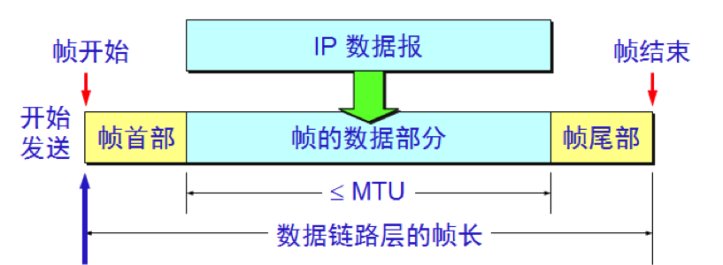
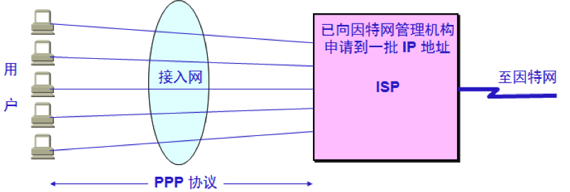
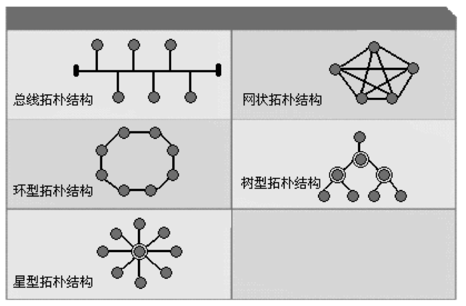
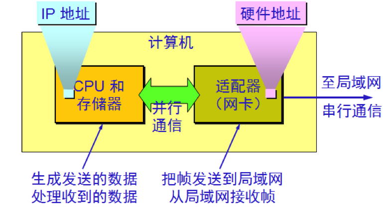
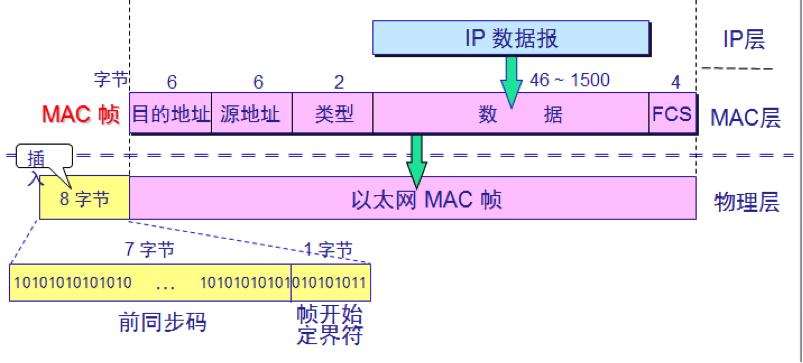
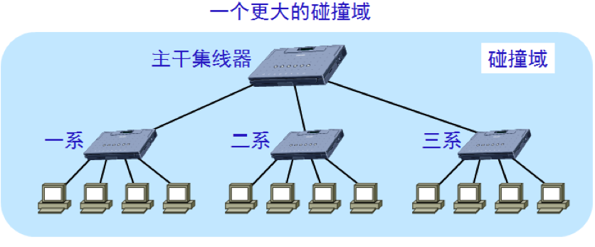
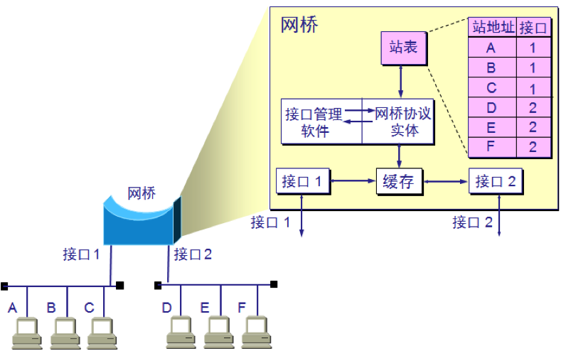
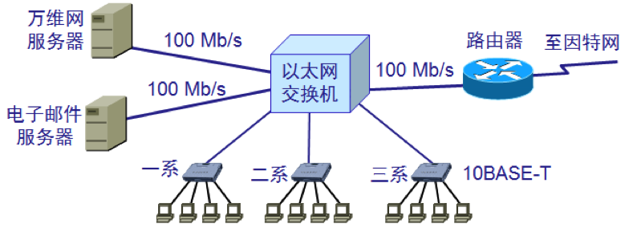
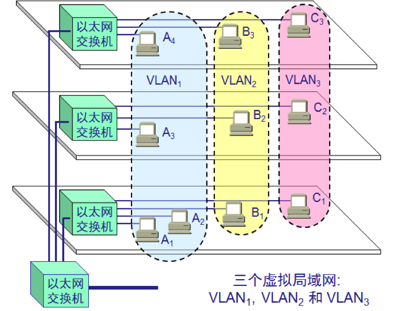
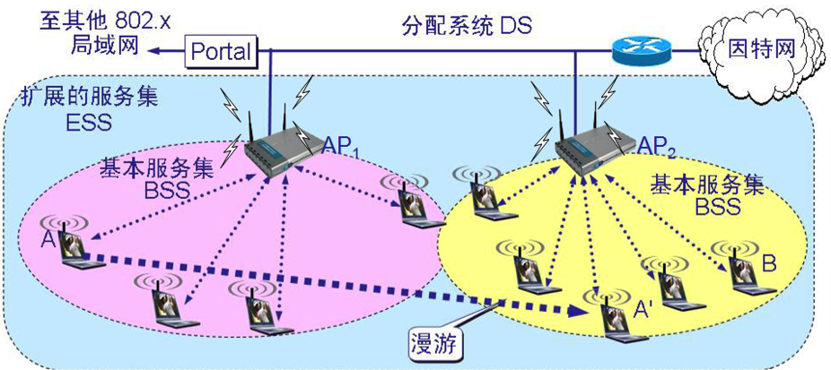

# 计算机网络-链路层

# 1 协议

数据链路层协议有许多种，但是有三个基本问题则是共同的：**封装成帧**、**透明传输**和**差错检测**。

## 1.1 封装成帧

在互联网中，数据链路层要传送的主要是网络层交下来的 **IP 数据报**（此外也有 ARP 报文等），IP 数据报传送到数据链路层就成为帧的数据部分，在帧的数据部分的前面和后面添加上首部和尾部，构成一个完整的**帧**。

每一种链路层协议都规定了帧的数据部分的长度上限——**最大传送单元 MTU**（Maximum Transmission Unit）。以太网的 MTU 通常为 1500 字节。

## 1.2 透明传输

透明传输，即无论什么样的比特流都能够通过数据链路层传输。

帧的开始和结束标记是专门指明的控制字符，因此，所传输的数据中的任何 8 比特组合一定不允许和这些控制字符的编码相同，否则就会出现帧的定界错误。

解决这种矛盾的方法是，在数据中可能出现的控制字符的前面插入转义字符“ESC”，而在接收端再删除该转义字符，这种方法被称为**字节填充**。如果转义字符本身也出现在数据中，就在它前面再插入一个转义字符，接收端遇到连续两个转义字符时删除前一个即可。

## 1.3 差错检测

现实的通信线路都不会是理想的，比特在传输过程中可能会产生差错：1 可能会变成 0，0 也可能会变成 1。为了保证数据传输的可靠性，必须采用各种差错检测措施。目前在数据链路层广泛使用的是**循环冗余检验 CRC**（Cyclic Redundancy Check）。发送端根据数据计算出 CRC 冗余码并作为**帧检验序列 FCS**（Frame Check Sequence）附在帧尾，接收端重新计算并比对。

需要注意，CRC 只能检测出差错而不能纠正差错，接收端发现有差错的帧会直接丢弃。因此链路层的差错检测只能做到“无比特差错”，并不等于可靠传输，帧的丢失、重复、失序等问题需要由上层协议（如 TCP）来处理。

# 2 点对点协议 PPP

对于点对点的链路，**PPP**（Point-to-Point Protocol）是目前使用最广泛的数据链路层协议。

我们知道，互联网用户通常都要连接到某个 ISP 才能接入互联网。PPP 协议就是用户计算机和 ISP 进行通信时所使用的数据链路层协议。早期用户通过电话线拨号上网时直接使用 PPP；如今的家庭宽带（如光纤入户）普遍使用 **PPPoE**（PPP over Ethernet），即把 PPP 帧封装在以太网帧中传输，光猫或路由器上的“宽带拨号”用的就是它。

PPP 协议由三个部分组成：

- 一个将 IP 数据报封装到串行链路的方法。
- 一个用来建立、配置和测试数据链路连接的**链路控制协议 LCP**（Link Control Protocol）。
- 一套**网络控制协议 NCP**（Network Control Protocol）。

当用户拨号接入 ISP 后，就建立了一条从用户 PC 机到 ISP 的物理连接。这时，用户 PC 机向 ISP 发送一系列的 LCP 分组（封装成多个 PPP 帧），以便建立 LCP 连接。这些分组及其响应选择了将要使用的一些 PPP 参数。LCP 连接建立后，通常还要进行身份鉴别（如 PAP 或 CHAP）。接着还要进行网络层配置，NCP（对 IP 而言即 IPCP）给新接入的用户 PC 机分配一个临时的 IP 地址。这样，用户 PC 机就成为一个拥有 IP 地址的主机了。

当用户通信完毕时，NCP 释放网络层连接，收回原来分配出去的 IP 地址。接着，LCP 释放数据链路层连接。最后释放的是物理层的连接。

# 3 局域网的数据链路层

局域网最主要的特点是：网络为一个单位所拥有，且地理范围和站点数目均有限。

局域网具有广播功能，从一个站点可很方便地访问全网，局域网上的主机可共享连接在局域网上的各种硬件和软件资源。

局域网按照拓扑结构可分为**总线结构**、**环形结构**、**星形结构**、**网状结构**、**树形结构**以及**混合型结构**。

# 4 以太网

以太网最初是美国施乐公司研制的基于基带总线的局域网，以曾经在历史上表示传播电磁波的以太（Ether）来命名。

DIX Ethernet V2 是世界上第一个局域网产品（以太网）的规约，在此基础上，IEEE 制定了 802.3 标准，DIX Ethernet V2 标准与 IEEE 的 802.3 标准只有很小的差别，因此可以将 **802.3 局域网简称为“以太网”**。

为了使数据链路层能更好地适应多种局域网标准，IEEE 802 委员会就将局域网的数据链路层拆成两个子层：

- **逻辑链路控制 LLC**（Logical Link Control）子层
- **媒体接入控制 MAC**（Medium Access Control）子层

与接入到传输媒体有关的内容都放在 MAC 子层，而 LLC 子层则与传输媒体无关，不管采用何种协议的局域网，对 LLC 子层来说都是透明的。

以太网在局域网市场中已取得了垄断地位，几乎成了局域网的代名词。由于互联网发展很快，TCP/IP 体系中经常使用的局域网只剩下 DIX Ethernet V2，而不是 IEEE 802.3 标准中的局域网，因此现在 802 委员会制定的逻辑链路控制子层 LLC 的作用已经消失了，很多厂商生产的适配器上仅装有 MAC 协议而没有 LLC 协议。

以太网的速率也在不断提升：从最初的 10 Mb/s 发展到 100 Mb/s（快速以太网）、1 Gb/s（吉比特以太网）、10 Gb/s，如今桌面和家庭网络以 1 Gb/s 为主、2.5 Gb/s 逐渐普及，数据中心则普遍使用 25/100/400 Gb/s，800 Gb/s 以太网标准（IEEE 802.3df-2024）也已于 2024 年 2 月获批发布。

在 AI 训练集群等对时延极为敏感的场景中，以太网还在向“无损”方向演进。**RDMA**（Remote Direct Memory Access，远程直接内存访问）允许网卡绕过操作系统内核，直接读写远端主机的内存；**RoCE**（RDMA over Converged Ethernet）则把 RDMA 搬到了以太网上：RoCE v1 直接封装在以太网帧中，只能在同一个二层网络内使用，RoCE v2 则封装在 UDP/IP 之上（UDP 目的端口 4791），可以跨三层路由。由于 RDMA 对丢包非常敏感，这类网络通常要借助链路层的**优先级流量控制 PFC**（Priority-based Flow Control，IEEE 802.1Qbb）和 IP 层的**显式拥塞通知 ECN**（Explicit Congestion Notification）来尽量避免丢包。2025 年 6 月，超以太网联盟（Ultra Ethernet Consortium，UEC）发布了 1.0 规范，为 AI 和高性能计算定义了从物理层到传输层的新一代以太网技术栈。

计算机与外界局域网的连接是通过**适配器**（即网卡，NIC）。适配器上装有处理器和存储器，适配器和局域网之间通过双绞线、光纤（早期还有同轴电缆）以串行方式传输比特流；适配器和计算机之间则通过主板上的 I/O 总线通信，早期的 ISA、PCI 是并行总线，如今普遍使用的 PCIe 则是高速串行总线。适配器通常借助 **DMA**（Direct Memory Access，直接内存访问）直接与主机内存交换数据，并负责帧的收发以及信号的编码和解码，完成主机内存中的数据与线路上的信号之间的转换。

适配器接收和发送各种帧时不使用计算机的 CPU。当适配器收到正确的帧时，它就使用中断来通知该计算机并交付给协议栈中的网络层；当计算机要发送 IP 数据报时，就由协议栈把 IP 数据报向下交给适配器，组装成帧后发送到局域网。

需要注意，计算机的硬件地址就在适配器的 ROM 中，而计算机的 IP 地址则在计算机的存储器中。

# 5 CSMA/CD 协议

为了通信的简便，以太网采取了以下两种措施：

- 第一，采用无连接的工作方式，即不必先建立连接就可以直接发送数据。因此，以太网提供的服务是尽最大努力的交付，即不可靠的交付。
- 第二，传统的 10 Mb/s 以太网发送的数据都使用**曼彻斯特编码**的信号；100 Mb/s 及更高速率的以太网则改用 4B/5B、8B/10B、64B/66B、PAM 等更高效的编码方式。

我们知道，总线上只要有一台计算机在发送数据，总线的传输资源就被占用，因此，在同一时间只能允许一台计算机发送信息，否则各计算机之间就会相互干扰，结果大家都无法正常发送数据。

早期以太网采用的协调方法是使用一种特殊的协议 **CSMA/CD**，即**载波监听多点接入/碰撞检测**（Carrier Sense Multiple Access with Collision Detection）。

- “**多点接入**”就是说明这是总线型网络，许多计算机以多点接入的方式连接在一根总线上，协议的实质是“载波监听”和“碰撞检测”。
- “**载波监听**”就是“发送前先监听”，即每一个站在发送数据前先要检测一下总线上是否有其他站在发送数据，如果有，则要等到信道空闲时再发送。
- “**碰撞检测**”就是“边发送边监听”，即适配器边发送数据边检测信道上的信号电压的变化情况，以便判断自己在发送数据时其他站是否也在发送数据。一旦发生了碰撞，适配器就要立即停止发送。

停止发送后，适配器还要再发送若干比特的人为干扰信号，让所有站都知道发生了碰撞，然后按照**截断二进制指数退避算法**等待一段随机时间后再重传。为了保证在帧发送完毕之前一定能检测到碰撞，10 Mb/s 以太网把争用期定为 51.2 μs（即发送 512 比特的时间），并据此规定**最短有效帧长为 64 字节**，凡长度小于 64 字节的帧都是由于碰撞而异常中止的无效帧。

显然，在使用 CSMA/CD 协议时，一个站不可能同时进行发送与接收，因此使用 CSMA/CD 协议的以太网不可能进行全双工通信而**只能进行半双工通信**。

需要强调的是，CSMA/CD 只适用于共享媒体的半双工以太网（总线或集线器组网）。如今的以太网几乎都是用交换机连接的全双工网络，每条链路两端独占信道、收发互不干扰，根本不会发生碰撞，因此不再使用 CSMA/CD；10 Gb/s 及以上速率的以太网标准更是只支持全双工，已经完全不再包含 CSMA/CD。不过以太网的帧格式和最短帧长等规定仍然保留了下来。

# 6 MAC 地址

在局域网中，**硬件地址**又称为**物理地址**，或 **MAC 地址**。

IEEE 802 标准为局域网规定了一种 48 位的全球地址，是指**局域网上的每一台计算机中固化在适配器的 ROM 中的地址**。严格地说，MAC 地址标识的是适配器（网络接口）而不是计算机，一台计算机装有多个网卡就有多个 MAC 地址。MAC 地址通常写成 6 组十六进制数，如 `00-1A-2B-3C-4D-5E` 或 `00:1a:2b:3c:4d:5e`。

IEEE 的注册管理机构 RA（Registration Authority）负责向厂家分配地址字段的高位部分。最经典的方式是分配前三个字节（即高位 24 位），称为**组织唯一标识符 OUI**（Organizationally Unique Identifier），地址字段中的后三个字节（即低位 24 位）由厂家自行指派，称为扩展标识符，必须保证生产出的适配器没有重复地址。这种 24 位前缀的地址块如今称为 MA-L（MAC Address Block Large），可容纳约 1677 万个地址；对需要地址较少的厂家，IEEE 还提供 28 位前缀的 MA-M（约 104 万个地址）和 36 位前缀的 MA-S（4096 个地址）。

另外，MAC 地址虽然固化在 ROM 中，但操作系统可以用软件修改实际使用的地址，这也是 MAC 地址随机化的基础。早期的随机化（如 iOS 8）只用于扫描网络时发出的探测请求帧，真正连接时仍使用真实地址；从 iOS 14、Android 10 开始，系统默认为每个 Wi-Fi 网络生成一个固定的随机地址（即“私有地址”），同一网络下保持不变、不同网络之间互不相同，既能防止设备被跨网络跟踪，又不影响路由器基于 MAC 地址的绑定和准入控制。iOS 18 还新增了“轮换”选项，会定期更换地址；Windows 也提供了“随机硬件地址”设置。

适配器有过滤功能，适配器从网络上每收到一个 MAC 帧就先用硬件检查 MAC 帧中的目的地址，如果是发往本站的帧则收下，否则丢弃。发往本站的帧包括以下三种帧：

- **单播帧**，即收到的帧的目的 MAC 地址与本站的硬件地址相同。
- **广播帧**，即发送给本局域网上所有站点的帧（目的地址为全 1，即 `FF-FF-FF-FF-FF-FF`）。
- **多播帧**，即发送给本局域网上一部分站点的帧。

以太网最常用的是以太网 V2 格式的 MAC 帧，格式如下：

由五个字段组成：

- 前两个字段为目的地址和源地址，各 6 字节。
- 第三个字段是 2 字节的类型字段，用来标识上一层使用的是什么协议，以便把收到的 MAC 帧的数据上交给上一层的这个协议，如 `0x0800` 表示 IPv4、`0x0806` 表示 ARP、`0x86DD` 表示 IPv6。
- 第四个字段是数据字段，长度为 46～1500 字节（上限即以太网的 MTU，下限 46 字节是由最短帧长 64 字节减去 18 字节的首部和尾部得出的，数据不足时要填充）。
- 最后一个是 4 字节的帧检验序列 FCS（使用 CRC 检验）。

因此，以太网 V2 MAC 帧的长度在 64～1518 字节之间。在物理层传输时，还要在帧的前面插入 8 字节（7 字节前同步码和 1 字节帧开始定界符），它们不属于 MAC 帧。

# 7 局域网的扩展

## 7.1 集线器

早期曾使用集线器（hub）在**物理层扩展局域网**：

集线器把原来分属不同碰撞域的网段连成一个更大的碰撞域，使其中的计算机能够相互通信，也扩大了局域网覆盖的地理范围；但碰撞域增大后总的吞吐量并未提高，而且数据率不同的网段无法用集线器互连。集线器只是简单地转发比特，使用集线器的以太网在物理上是星形网，但在逻辑上仍是总线网，各站仍然使用 CSMA/CD 协议共享带宽。如今集线器已被以太网交换机全面取代，属于历史技术。

## 7.2 网桥

**在数据链路层扩展局域网是使用网桥**（network bridge），它也是现代以太网交换机的前身。网桥根据 MAC 帧的目的地址对收到的帧进行转发。

网桥具有过滤帧的功能。当网桥收到一个帧时，并不是向所有的接口转发此帧，而是先检查此帧的目的 MAC 地址，然后再确定将该帧转发到哪一个接口。常用的透明网桥通过自学习的方式建立转发表，并使用**生成树协议 STP**（Spanning Tree Protocol）避免网络中出现环路，这些核心机制后来都被以太网交换机继承了下来。

- **优点**
  - 过滤通信量。
  - 扩大了物理范围。
  - 提高了可靠性。
  - 可互连不同物理层、不同 MAC 子层和不同速率（如 10 Mb/s 和 100 Mb/s 以太网）的局域网。
- **缺点**
  - 存储转发增加了时延。
  - 在 MAC 子层并没有流量控制功能。
  - 具有不同 MAC 子层的网段桥接在一起时时延更大。
  - 网桥只适合于用户数不太多（不超过几百个）和通信量不太大的局域网，否则有时还会因传播过多的广播信息而产生网络拥塞，这就是所谓的**广播风暴**。

## 7.3 交换机

以太网交换机通常有几个到几十个接口（常见的有 8 口、24 口、48 口）。以太网交换机实质上就是一个多接口的网桥，可见**交换机工作在数据链路层**。如今独立的网桥设备已很少见，其功能已被交换机取代。

对于共享式以太网（如用集线器组网），若共有 N 个用户，则每个用户占有的平均带宽只有总带宽的 N 分之一。

使用以太网交换机时，一个用户在通信时是独占而不是和其他网络用户共享传输媒体的带宽。以 1 Gb/s 接口为例，虽然每个接口到主机的带宽还是 1 Gb/s，但拥有 N 对接口的交换机的总容量可达 `N × 1 Gb/s`，这正是交换机的最大优点。图中标注的 10/100 Mb/s 是早期的接口速率，如今交换机接口通常为 1 Gb/s 及以上，但原理相同。

交换机的每个接口都是一个独立的碰撞域，工作在全双工方式时则根本不存在碰撞；但交换机默认会把广播帧转发到所有接口，因此连接在同一交换机上的所有主机仍然属于同一个**广播域**。

利用以太网交换机可以很方便地实现**虚拟局域网**，虚拟局域网 VLAN 是由一些局域网网段构成的与物理位置无关的逻辑组。每一个 VLAN 的帧都有一个明确的标识符，指明发送这个帧的工作站是属于哪一个 VLAN。这个标识符由 IEEE 802.1Q 标准定义：在以太网帧的源地址和类型字段之间插入 4 字节的 VLAN 标签，其中 12 位的 VLAN ID 最多可区分 4094 个 VLAN（0 和 4095 保留），带标签的帧最大长度相应变为 1522 字节。

虚拟局域网其实只是局域网给用户提供的一种服务，而并不是一种新型局域网。每个 VLAN 是一个独立的广播域，广播帧不会跨 VLAN 传播，这样可以有效限制广播风暴的范围；不同 VLAN 之间的通信则需要经过路由器或三层交换机。

## 7.4 无线局域网

无线局域网常简写为 **WLAN**（Wireless Local Area Network）。

1997 年 IEEE 制定出无线局域网的协议标准 802.11。802.11 是个相当复杂的标准，简单来说，它是无线以太网的标准，使用星形拓扑，其中心叫作接入点 **AP**（Access Point），在 MAC 层使用 **CSMA/CA** 协议，即载波监听多点接入/碰撞避免（Carrier Sense Multiple Access with Collision Avoidance）。

无线局域网之所以不用 CSMA/CD，是因为无线信号衰减很大，站点在发送时很难检测到其他站的信号，而且还存在“隐蔽站”等问题，无法做到可靠的碰撞检测。因此 802.11 改为尽量“避免”碰撞：信道空闲时也要先等待一段时间并随机退避后再发送，接收方正确收到数据帧后还要回复确认帧（ACK），发送方收不到确认就重传。

**Wi-Fi** 是 Wi-Fi 联盟（Wi-Fi Alliance）的商标，通过该联盟互操作性认证的 802.11 产品才能使用这一名称，人们也习惯把使用 802.11 系列协议的无线局域网统称为 Wi-Fi。Wi-Fi 常被解释为 Wireless Fidelity（无线保真），但它其实并不是正式的缩写。如今 Wi-Fi 联盟用代际名称来称呼各版本：Wi-Fi 4（802.11n）、Wi-Fi 5（802.11ac）、Wi-Fi 6/6E（802.11ax）和 Wi-Fi 7（802.11be），工作频段包括 2.4 GHz、5 GHz 和 6 GHz。

Wi-Fi 7 最具代表性的新特性是**多链路操作 MLO**（Multi-Link Operation）：设备可以与 AP 在 2.4 GHz、5 GHz、6 GHz 等多个频段上同时建立链路，并在这些链路之间动态分配流量，从而提高吞吐量、降低时延，在某条链路受到干扰时也能迅速切换。不过 MLO 有多种实现模式，只有具备多套射频的设备才能在多条链路上同时收发（STR），不少手机等终端采用的是 EMLSR（增强型多链路单射频）模式，即在多条链路上监听，但同一时刻只在其中一条链路上收发数据。Wi-Fi 联盟于 2024 年 1 月推出 Wi-Fi CERTIFIED 7 认证，IEEE 802.11be-2024 标准则于 2025 年 7 月正式发布。

802.11 标准规定无线局域网的最小构件是基本服务集 **BSS**（Basic Service Set）。一个基本服务集 BSS 包括一个基站和若干移动站，所有的站在本 BSS 以内都可以直接通信，但在和本 BSS 以外的站通信时都必须通过本 BSS 的基站。

BSS 中的基站就是接入点 AP，当网络管理员安装 AP 时，必须为该 AP 分配一个不超过 32 字节的服务集标识符 **SSID**（Service Set Identifier）和一个信道。

一个 BSS 所覆盖的地理范围叫作一个基本服务区 **BSA**（Basic Service Area），直径一般不超过 100 米。

一个 BSS 可以是孤立的，也可以通过接入点 AP 连接到一个分配系统 **DS**（Distribution System），然后再连接到另一个 BSS，这样就构成了一个扩展的服务集 **ESS**（Extended Service Set）。ESS 还可以为无线用户提供到非 802.11 局域网（如有线以太网）的接入。这种接入是通过 **Portal**（门户）来实现的，Portal 的作用就相当于一个网桥。

# 8 总结

数据链路层负责在相邻节点之间传送帧，各种链路层协议都要解决封装成帧、透明传输和差错检测三个基本问题，其中差错检测普遍采用 CRC，但它只保证“无比特差错”而不保证可靠传输。点对点链路使用 PPP，如今在宽带接入中以 PPPoE 的形式继续存在。局域网领域以太网一家独大，以太网 V2 帧由 6 字节目的地址、6 字节源地址、2 字节类型、46～1500 字节数据和 4 字节 FCS 组成，MAC 地址长 48 位。早期共享总线的以太网依靠 CSMA/CD 解决争用问题，而现代以太网已全面转向交换机加全双工，不再需要 CSMA/CD，并可借助 VLAN 划分广播域；在 AI 数据中心里，以太网还借助 RoCE、PFC、ECN 等技术向无损网络演进。无线局域网 802.11（Wi-Fi）由于无法可靠检测碰撞，改用 CSMA/CA 加确认重传的机制，Wi-Fi 7 则通过多链路操作 MLO 进一步提升速率和可靠性。
