# 计算机网络-应用层

# 1 域名系统

域名系统 **DNS**（Domain Name System）是互联网使用的命名系统，用于把便于人们使用的机器名字转换为 IP 地址。许多应用层软件经常直接使用域名系统，但计算机的用户只是间接而不是直接使用域名系统。

## 1.1 域名结构

互联网采用了层次树状结构的命名方法。

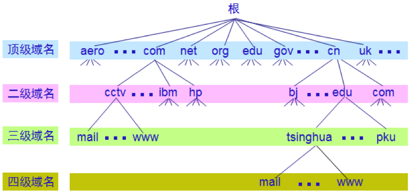

任何一个连接在互联网上的主机或路由器，都有一个唯一的层次结构的名字，即**域名**。

域名的结构由标号序列组成，各标号之间用点隔开：

`… . 三级域名 . 二级域名 . 顶级域名`

DNS 规定，域名中的标号由英文字母和数字组成，不区分大小写。标号中除了连字符（-）外不能使用其他标点符号。级别最低的域名写在最左边，而级别最高的顶级域名则写在最右边。

各级域名由其上一级的域名管理机构管理，而最高的顶级域名则由 **ICANN** 进行管理，每一个域名在整个互联网范围内是唯一的。

顶级域名可分为以下三类：

- （1）国家顶级域名，如：
  - `.cn` 表示中国
  - `.us` 表示美国
  - `.uk` 表示英国
- （2）通用顶级域名，如：
  - `.com`（公司和企业）
  - `.net`（网络服务机构）
  - `.org`（非营利性组织）
  - `.edu`（教育机构，主要是美国的高校）
  - `.gov`（美国政府部门）
  - `.mil`（美国军事部门）
  - `.int`（国际组织）
  - 此后 ICANN 多次扩充通用顶级域名：2000 年底批准了 `.biz`、`.info`、`.name` 等 7 个；2013 年起的新通用顶级域名（New gTLD）计划又陆续开放了 `.app`、`.xyz`、`.shop`、`.top` 等上千个；时隔十多年的第二轮申请于 2026 年 4 月 30 日至 8 月 12 日开放，共收到 1615 份申请，目前仍在评估中
- （3）基础结构域名，这种顶级域名只有一个，即 `arpa`，用于反向域名解析（由 IP 地址查域名），因此又称为反向域名。

## 1.2 域名服务器

互联网采用层次结构的命名树作为主机的名字，并使用分布式的域名系统 DNS。名字到 IP 地址的解析是由若干个域名服务器程序完成的。域名服务器程序在专设的节点上运行，运行该程序的机器称为**域名服务器**。

一个服务器所负责管辖的（或有权限的）范围叫做**区**（zone）。各单位根据具体情况来划分自己管辖范围的区，但在一个区中的所有节点必须是能够连通的。每一个区设置相应的**权限域名服务器**，用来保存该区中的所有主机的域名到 IP 地址的映射。

互联网上的 DNS 域名服务器也是按照层次安排的。每一个域名服务器都只对域名体系中的一部分进行管辖。

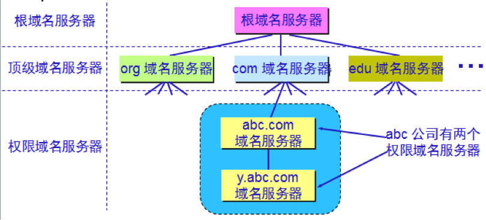

域名服务器有以下四种类型：

- **根域名服务器**是最重要的域名服务器。所有的根域名服务器都知道所有的顶级域名服务器的域名和 IP 地址。不管是哪一个本地域名服务器，若要对互联网上任何一个域名进行解析，只要自己无法解析（且缓存中也没有相关记录），就首先求助于根域名服务器。根域名服务器共有 13 个名字（`a.root-servers.net` 至 `m.root-servers.net`），由 12 个独立的机构运营。每个名字背后都通过任播（anycast）技术在全球部署了许多个服务器实例，总数已超过 2000 个（2026 年 10 月 root-servers.org 的统计为 2047 个）。
- **顶级域名服务器**（TLD 服务器，Top Level Domain）负责管理在该顶级域名服务器注册的所有二级域名。
- **权限域名服务器**是负责一个区的域名服务器。当权限域名服务器还不能给出最后的查询回答时，就会告诉发出查询请求的 DNS 客户，下一步应当找哪一个权限域名服务器。
- **本地域名服务器**对域名系统非常重要。当一个主机发出 DNS 查询请求时，这个查询请求报文就发送给本地域名服务器。每一个互联网服务提供者（ISP），或一个大学，甚至一个大学里的系，都可以拥有一个本地域名服务器，这种域名服务器有时也称为**默认域名服务器**。

DNS 域名服务器都把数据复制到几个域名服务器来保存，其中的一个是主域名服务器，其他的是辅助域名服务器。当主域名服务器出故障时，辅助域名服务器可以保证 DNS 的查询工作不会中断。主域名服务器定期把数据复制到辅助域名服务器中，而更改数据只能在主域名服务器中进行。这样就保证了数据的一致性。

每个域名服务器都维护一个高速缓存，存放最近用过的名字以及从何处获得名字映射信息的记录，可大大减轻根域名服务器的负荷，使互联网上的 DNS 查询请求和回答报文的数量大为减少。为保持高速缓存中的内容正确，域名服务器应为每项内容设置计时器，并处理超过合理时间的项。这个存放时长由权限域名服务器在每条记录的 TTL（Time To Live，生存时间）字段中指定，常见取值从几分钟到一天不等。

## 1.3 域名解析过程

DNS 报文通常使用 UDP 传输，服务器端口为 53；当响应报文过长，或主、辅域名服务器之间进行区域传送（复制区数据）时，则使用 TCP 的 53 端口。

传统的 DNS 报文是明文传输的，沿途的网络可以看到用户在查询哪些域名，甚至篡改应答（DNS 劫持）。为此出现了几种加密 DNS 方案：**DoT**（DNS over TLS，RFC 7858）在 TCP 之上用 TLS 加密 DNS 报文，使用专门的 853 端口；**DoH**（DNS over HTTPS，RFC 8484）把 DNS 查询放在 HTTPS 报文中传送，使用 443 端口，与普通网页流量混在一起，不像 DoT 那样一看端口就能识别；**DoQ**（DNS over QUIC，RFC 9250）则运行在 QUIC 之上。目前 Windows 11、Android 9 起的“私人 DNS”（DoT）、iOS 14 和 macOS 11 起的系统都已内置加密 DNS 支持，Chrome、Firefox 等浏览器也可以单独开启 DoH。需要注意，加密 DNS 只保护用户到递归解析服务器这一段，解析服务器本身仍能看到全部查询。

域名的解析有两种查询方式：

- **递归查询**：主机向本地域名服务器的查询一般采用递归查询。如果本地域名服务器不知道被查询域名的 IP 地址，就以 DNS 客户的身份，代替该主机继续向其他域名服务器发出查询请求，最终把查询结果（所要查询的 IP 地址，或者报错）返回给主机。
- **迭代查询**：本地域名服务器向根域名服务器的查询通常采用迭代查询。根域名服务器收到查询请求后，要么给出所要查询的 IP 地址，要么告诉本地域名服务器“你下一步应当向哪一个域名服务器查询”（通常是某个顶级域名服务器），然后由本地域名服务器自己继续进行后续的查询。

例如，主机要解析 `www.tsinghua.edu.cn`，且各级缓存中都没有相关记录：主机先向本地域名服务器发出递归查询；本地域名服务器再依次向根域名服务器、`cn` 顶级域名服务器以及下级的权限域名服务器发出迭代查询，拿到 IP 地址后再返回给主机，并把结果写入缓存。

域名服务器中保存的映射信息称为**资源记录**（Resource Record），常见的类型有：

- A：域名到 IPv4 地址的映射
- AAAA：域名到 IPv6 地址的映射
- CNAME：别名记录，把一个域名指向另一个规范域名
- NS：指明该区的权限域名服务器
- MX：邮件交换记录，指明负责接收该域邮件的邮件服务器
- PTR：指针记录，用于反向解析（IP 地址到域名）
- TXT：任意文本，常用于域名所有权验证、反垃圾邮件（SPF）等

# 2 文件共享

## 2.1 FTP

文件传送协议 **FTP**（File Transfer Protocol）曾经是互联网上使用最广泛的文件传送协议。

FTP 提供交互式的访问，允许客户指明文件的类型与格式，并允许文件具有存取权限。FTP 屏蔽了各计算机系统的细节，因而适合于在异构网络中任意计算机之间传送文件。

文件传送协议 FTP 只提供文件传送的一些基本的服务，它使用 TCP 可靠的传输服务。FTP 的主要功能是减少或消除在不同操作系统下处理文件的不兼容性。

FTP 使用客户服务器方式。一个 FTP 服务器进程可同时为多个客户进程提供服务。FTP 的服务器进程由两大部分组成：

- 一个主进程，负责接受新的请求
- 另外有若干个从属进程，负责处理单个请求

主进程的工作步骤如下：

- 打开熟知端口（端口号为 21），使客户进程能够连接上。
- 等待客户进程发出连接请求。
- 启动从属进程来处理客户进程发来的请求。从属进程对客户进程的请求处理完毕后即终止，但从属进程在运行期间根据需要还可能创建其他一些子进程。
- 回到等待状态，继续接受其他客户进程发来的请求。主进程与从属进程的处理是并发进行的。

FTP 的工作进程如下图所示：

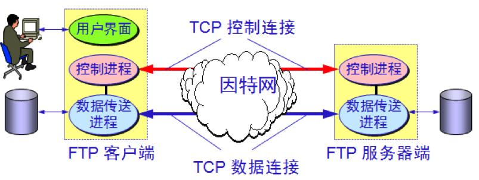

FTP 的客户和服务器之间要建立两个并行的 TCP 连接：控制连接和数据连接。

控制连接在整个会话期间一直保持打开，FTP 客户发出的传送请求通过控制连接发送给服务器端的控制进程，但控制连接不用来传送文件。

实际用于传输文件的是“数据连接”。服务器端的控制进程在接收到 FTP 客户发送来的文件传输请求后就创建“数据传送进程”和“数据连接”，用来连接客户端和服务器端的数据传送进程。

数据传送进程实际完成文件的传送，在传送完毕后关闭“数据传送连接”并结束运行。

当客户进程向服务器进程发出建立连接请求时，要寻找连接服务器进程的熟知端口（21），同时还要告诉服务器进程自己的另一个端口号码，用于建立数据传送连接。

接着，服务器进程用自己传送数据的熟知端口（20）与客户进程所提供的端口号码建立数据传送连接。

由于 FTP 使用了两个不同的端口号，所以数据连接与控制连接不会发生混乱。

上面描述的是 FTP 的**主动模式**（PORT 模式），即由服务器主动向客户发起数据连接。由于客户常常位于 NAT 或防火墙之后，服务器发起的连接容易被拦截，因此现在更常用的是**被动模式**（PASV 模式）：服务器通过控制连接告诉客户一个临时端口号，再由客户主动连接该端口建立数据连接，此时服务器端不使用 20 端口。

另外，FTP 以明文传送用户名、口令和文件内容，现在通常改用基于 SSH 的 SFTP 或基于 TLS 的 FTPS。Chrome、Firefox 等主流浏览器也已在 2021 年移除了对 `ftp://` 的支持，日常的文件下载基本都通过 HTTPS 完成。

## 2.2 NFS

除了 FTP，文件共享协议中的另一大类是联机访问（on-line access）。联机访问意味着允许多个程序同时对一个文件进行存取，如网络文件系统 **NFS**（Network File System）。

NFS 允许应用进程打开一个远地文件，并能在该文件的某一个特定的位置上开始读写数据。NFS 可使用户只复制一个大文件中的一个很小的片段，而不需要复制整个大文件。在网络上传送的只是少量的修改数据。

例如，计算机 A 上的应用进程要在远地计算机 B 的一个很大的文件末尾添加一行信息。若使用 FTP，需要先把整个文件从 B 复制到 A，添加信息后再用 FTP 把整个文件传回 B，非常耗时。而使用 NFS 时，计算机 A 的 NFS 客户软件把要添加的数据和在文件后面写数据的请求一起发送到远地的计算机 B 的 NFS 服务器，NFS 服务器更新文件后返回应答信息。

## 2.3 TFTP

TCP/IP 协议族中还有一个简单文件传送协议 **TFTP**（Trivial File Transfer Protocol）。

TFTP 是一个很小且易于实现的文件传送协议，使用客户服务器方式和 UDP 数据报（服务器端口为 69），因此 TFTP 需要有自己的差错改正措施。TFTP 只支持文件传输而不支持交互。

TFTP 的工作很像停止等待协议，发送完一个文件块后就等待对方的确认，确认时应指明所确认的块编号。发完数据后在规定时间内收不到确认就要重发数据。发送确认 PDU 的一方若在规定时间内收不到下一个文件块，也要重发确认。这样就可保证文件的传送不致因某一个数据报的丢失而告失败。

# 3 远程终端协议

**TELNET** 是一个简单的远程终端协议。用户用 TELNET 就可在其所在地通过 TCP 连接注册（即登录）到远地的另一个主机上（使用主机名或 IP 地址）。

TELNET 能将用户的击键传到远地主机，同时也能将远地主机的输出通过 TCP 连接返回到用户屏幕。这种服务是透明的，因为用户感觉到好像键盘和显示器是直接连在远地主机上。

TELNET 也使用客户服务器方式。在本地系统运行 TELNET 客户进程，而在远地主机则运行 TELNET 服务器进程。和 FTP 的情况相似，服务器中的主进程等待新的请求，并产生从属进程来处理每一个连接。

TELNET 定义了数据和命令应怎样通过互联网，这些定义就是所谓的网络虚拟终端 **NVT**（Network Virtual Terminal）。

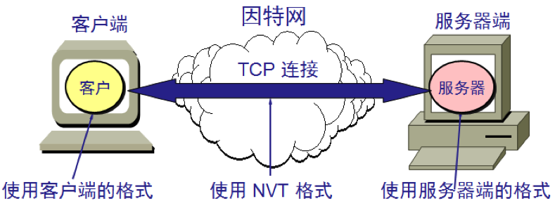

客户软件把用户的击键和命令转换成 NVT 格式，并送交服务器。

服务器软件把收到的数据和命令，从 NVT 格式转换成远地系统所需的格式。

向用户返回数据时，服务器把远地系统的格式转换为 NVT 格式，本地客户再从 NVT 格式转换到本地系统所需的格式。

TELNET 服务器使用 TCP 的 23 端口。由于 TELNET 以明文传送包括口令在内的所有数据，如今的远程登录基本都改用加密的 SSH（端口 22），TELNET 只在调试网络设备或测试端口连通性时偶尔使用。

# 4 万维网

万维网（World Wide Web，WWW）并非某种特殊的计算机网络，而是一个大规模的、联机式的信息储藏所。

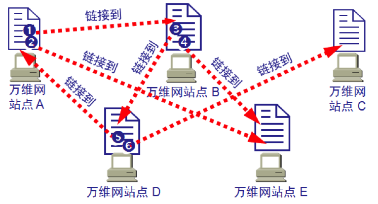

万维网用链接的方法能非常方便地从互联网上的一个站点访问另一个站点，从而主动地按需获取丰富的信息。这种访问方式称为**链接**。

万维网以客户服务器方式工作。浏览器就是在用户计算机上的万维网客户程序。万维网文档所驻留的计算机则运行服务器程序，因此这个计算机也称为万维网服务器。

客户程序向服务器程序发出请求，服务器程序向客户程序送回客户所要的万维网文档。

## 4.1 统一资源定位符 URL

统一资源定位符 **URL**（Uniform Resource Locator）使每一个文档在整个互联网的范围内具有唯一的标识符。

URL 由以冒号隔开的两大部分组成（冒号左边是协议，右边是资源的位置）。其中协议和主机名不区分大小写，但路径部分是否区分大小写取决于服务器（例如 Linux 上的服务器通常区分）。

URL 的一般形式是：

`<协议>://<主机>:<端口>/<路径>?<查询>#<片段>`

协议指使用什么协议来获取万维网文档，现在最常用的协议是 `https`，其次是 `http`。端口使用协议的默认端口（HTTP 为 80，HTTPS 为 443）时可以省略；`?` 后面的查询部分用于向服务器传递参数（如 `?id=1&page=2`）；`#` 后面的片段只在浏览器内部使用，用于定位页面中的某个位置，不会发送给服务器。

## 4.2 超文本传送协议 HTTP

超文本传送协议 HTTP（HyperText Transfer Protocol）定义了浏览器怎样向万维网服务器请求万维网文档，以及服务器怎样把文档传送给浏览器。

从层次的角度看，HTTP 是**面向事务**的（transaction-oriented）应用层协议，它是万维网上能够可靠地交换文件（包括文本、声音、图像等各种多媒体文件）的重要基础。

万维网的大致工作过程如下：

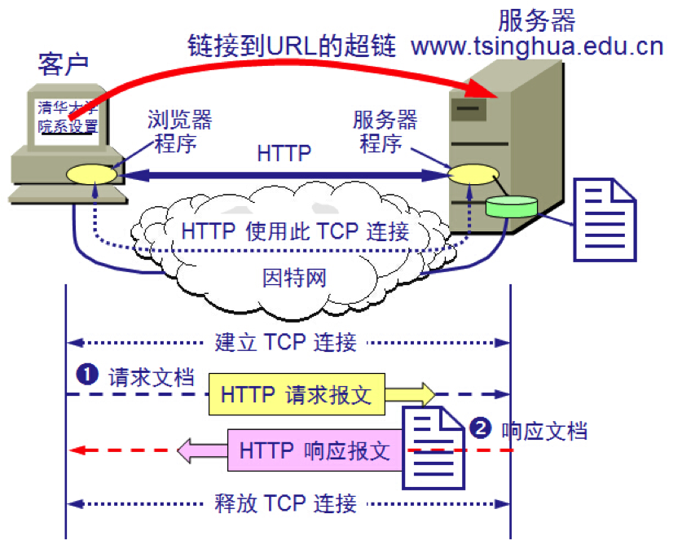

每个万维网网点都有一个服务器进程，它不断地监听 TCP 的端口 80（HTTPS 为 443），以便发现是否有浏览器向它发出连接建立请求。一旦监听到连接建立的请求并建立了 TCP 连接之后，浏览器就向万维网服务器发出某个页面的请求，服务器接着就返回所请求的页面作为响应。最后，TCP 连接被释放。

假如我们点击了一个指向 `www.tsinghua.edu.cn/chn/yxsz/index.htm` 的超链接，在 HTTP/1.0 标准下会发生下面几个事件：

- （1）浏览器分析超链接指向页面的 URL。
- （2）浏览器向 DNS 请求解析 `www.tsinghua.edu.cn` 的 IP 地址。
- （3）域名系统 DNS 解析出清华大学服务器的 IP 地址。
- （4）浏览器与服务器建立 TCP 连接。
- （5）浏览器发出取文件命令：`GET /chn/yxsz/index.htm`。
- （6）服务器给出响应，把文件 `index.htm` 发给浏览器。
- （7）TCP 连接释放。
- （8）浏览器显示“清华大学院系设置”文件 `index.htm` 中的所有文本。

HTTP 协议是无状态的（HTTP/1.0 及之后的各个版本都是如此）。也就是说，同一个客户第二次访问同一个服务器上的页面时，服务器的响应与第一次被访问时的响应相同。服务器不记得曾经访问过的这个用户，更不记得访问过多少次。

为了让服务器能够识别用户（如保持登录状态、购物车），万维网站点使用 **Cookie** 来跟踪用户：服务器在响应中用 `Set-Cookie` 首部给浏览器下发一个标识，浏览器在之后发往该站点的请求中，用 `Cookie` 首部带上这个标识。服务器端通常把与该标识对应的用户状态保存为**会话**（Session），Cookie 中只存放会话 ID。

HTTP 协议本身也是无连接的。注意这里的“无连接”是就 HTTP 这一层而言的：HTTP 报文要靠下层面向连接的 TCP 来传送，TCP 连接必须先建立；但在 TCP 连接建立之后，双方不需要再进行任何 HTTP 层的连接建立过程，浏览器直接发出请求报文即可。

与 HTTP/1.0 不同，HTTP/1.1 默认使用**持续连接**（HTTP/1.0 只能通过非标准的 `Connection: keep-alive` 首部来协商）。即万维网服务器在发送响应后仍然在一段时间内保持这条连接，使同一个客户（浏览器）和该服务器可以继续在这条连接上传送后续的 HTTP 请求报文和响应报文。

这并不局限于传送同一个页面上链接的文档，而是只要这些文档都在同一个服务器上就行。

HTTP 有两类报文：

- 请求报文——从客户向服务器发送请求报文。
- 响应报文——从服务器到客户的回答。

请求报文的结构如下：

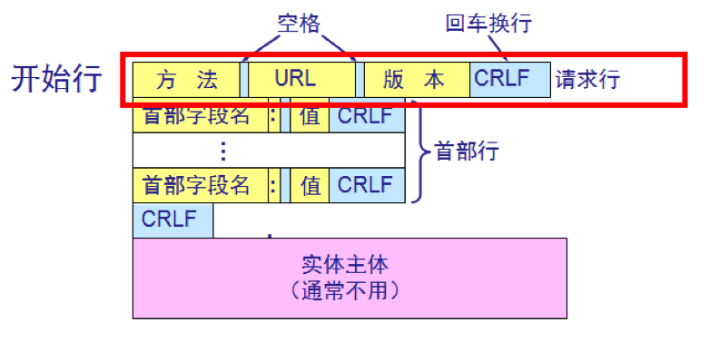

报文由三个部分组成，即开始行、首部行和实体主体。在请求报文中，开始行就是请求行，由方法、请求资源的 URL 和 HTTP 版本组成，例如 `GET /chn/yxsz/index.htm HTTP/1.1`。首部行用来说明浏览器、服务器或报文主体的一些信息，常见的有 `Host`（HTTP/1.1 中必须携带）、`Content-Type`、`Content-Length`、`Cookie`、`Cache-Control` 等。

常用的请求方法如下（“安全”指不修改服务器上的资源，“幂等”指同一请求执行一次和执行多次的效果相同）：

| 方法 | 含义 | 安全 | 幂等 |
|------|------|------|------|
| GET | 请求读取由 URL 所标识的资源 | 是 | 是 |
| HEAD | 只请求读取首部，不返回实体主体 | 是 | 是 |
| POST | 向目标资源提交数据，由服务器按该资源自身的规则处理（如提交表单、上传文件、新建资源） | 否 | 否 |
| PUT | 用请求中的数据创建或替换目标资源 | 否 | 是 |
| DELETE | 删除目标资源 | 否 | 是 |
| PATCH | 对目标资源进行部分修改 | 否 | 否 |
| OPTIONS | 查询服务器支持的方法（跨域预检请求也使用它） | 是 | 是 |
| CONNECT | 建立到目标服务器的隧道（如通过代理访问 HTTPS 网站） | 否 | 否 |

关于 GET 和 POST，有两个常见的误解：一是“GET 请求有长度限制”，实际上 HTTP 协议本身并未限制 URL 长度，限制来自浏览器和服务器的实现；二是“POST 比 GET 更安全”，实际上二者在 HTTP 下都是明文传输，POST 只是不把数据暴露在 URL 和浏览历史中，真正防止窃听要靠 HTTPS。

响应报文的结构如下：

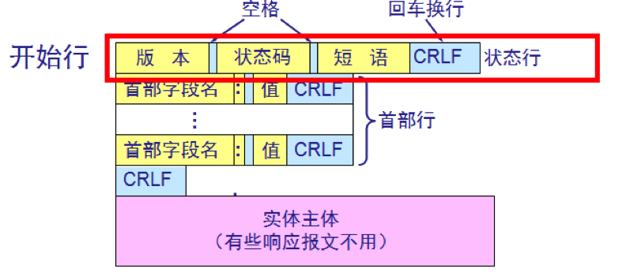

响应报文的开始行是状态行。状态行包括三项内容，即 HTTP 的版本、状态码以及解释状态码的简单短语。

状态码都是三位数字：

- 1xx 表示通知信息，如请求收到了或正在进行处理。
- 2xx 表示成功，如接受或知道了。
- 3xx 表示重定向，表示要完成请求还必须采取进一步的行动。
- 4xx 表示客户的差错，如请求中有错误的语法或不能完成。
- 5xx 表示服务器的差错，如服务器失效无法完成请求。

常见的状态码有 `200 OK`、`301 Moved Permanently`（永久重定向）、`302 Found`（临时重定向）、`304 Not Modified`（资源未修改，可使用缓存）、`400 Bad Request`、`401 Unauthorized`（未认证）、`403 Forbidden`（无权限）、`404 Not Found`、`500 Internal Server Error`、`502 Bad Gateway` 和 `503 Service Unavailable` 等。

## 4.3 HTTP 的版本演进

上面以 HTTP/1.0 和 HTTP/1.1 为例介绍了 HTTP 的工作方式，HTTP 至今的主要版本如下：

- **HTTP/1.0**（1996 年，RFC 1945）：每次请求都要建立一个新的 TCP 连接，响应结束后即释放。
- **HTTP/1.1**（1997 年首次发布，1999 年的 RFC 2616 为广泛使用的版本）：默认使用持续连接，并要求携带 `Host` 首部，使同一台服务器可以托管多个网站（虚拟主机）。HTTP/1.1 还支持流水线（pipelining），即不等响应到达就连续发送多个请求，但响应必须按请求顺序返回，前一个响应慢了就会阻塞后面的响应（队头阻塞），所以浏览器基本没有启用流水线，而是对同一个域名同时建立多个（通常 6 个左右）TCP 连接。
- **HTTP/2**（2015 年，RFC 7540，现行规范为 RFC 9113）：由 Google 的 SPDY 协议发展而来（SPDY 已于 2016 年前后被各浏览器弃用）。HTTP/2 采用**二进制分帧**，把报文拆成更小的帧；在一个 TCP 连接上**多路复用**多个并发的流，解决了 HTTP 层的队头阻塞；使用 **HPACK** 算法压缩首部。HTTP/2 还定义了服务器推送，但实际效果不佳，Chrome 已在 2022 年默认禁用。由于底层仍是 TCP，一旦丢包，该连接上的所有流都要等待重传，即 TCP 层的队头阻塞依然存在。
- **HTTP/3**（2022 年，RFC 9114）：运行在 **QUIC** 协议（RFC 9000，2021 年）之上，而 QUIC 基于 UDP。QUIC 内置了 TLS 1.3，传输层握手与加密握手合并，首次连接只需 1-RTT，恢复连接时可做到 0-RTT；各个流在传输层就相互独立，某个流丢包不会阻塞其他流；连接以连接 ID 标识，切换网络（如 Wi-Fi 换成移动网络）时连接不必中断。首部压缩改用 QPACK。

QUIC 的用途也不再局限于 HTTP/3：前面提到的 DoQ 就是用 QUIC 传送 DNS 报文，IETF 的 MoQ 工作组正在制定用 QUIC 传送直播等实时媒体的 Media over QUIC 协议。与 MPTCP 类似（见《计算机网络-传输层》），让一个 QUIC 连接同时使用 Wi-Fi 和蜂窝网络等多条路径的多路径 QUIC 扩展也在制定中，截至 2026 年 10 月仍是互联网草案（draft-ietf-quic-multipath），尚未成为 RFC。

2022 年发布的 RFC 9110（HTTP 语义）、RFC 9111（HTTP 缓存）和 RFC 9112（HTTP/1.1）取代了 RFC 7230～7235（而它们在 2014 年取代了 RFC 2616），成为现行的 HTTP 标准。

此外，**HTTPS** 就是运行在 TLS 之上的 HTTP，默认端口为 443。如今绝大多数网站都已使用 HTTPS，浏览器也只在 HTTPS 下使用 HTTP/2，HTTP/3 更是强制加密（详见本系列的安全控制篇）。到 2026 年，HTTP/2 和 HTTP/3 已是主流浏览器和 CDN 的默认选择，HTTP/1.1 则仍广泛用于服务间调用和兼容场景。

HTTPS 加密了 HTTP 报文，但 TLS 握手的第一个报文 ClientHello 中的服务器名称指示（Server Name Indication，SNI）字段过去一直是明文，沿途的网络仍能知道用户访问的是哪个网站。**加密客户端问候**（Encrypted Client Hello，ECH，RFC 9849，2026 年 3 月发布）就是为此设计的：客户端先通过 DNS 的 HTTPS 记录拿到服务器的 ECH 公钥，再把包含真实 SNI 的“内层” ClientHello 加密后放进“外层” ClientHello 中发送。外层 ClientHello 仍然是明文，只携带一个公共名称（通常是 CDN 等前端服务的名字），因此 ECH 在大量网站共用同一个前端时保护效果最好。Firefox 119 和 Chrome 117 起已默认启用 ECH，Cloudflare 也在 2024 年为其托管的网站默认开启；由于 ECH 依赖 DNS 获取公钥，通常要配合 DoH 等加密 DNS 使用才有意义。

## 4.4 代理服务器

**代理服务器**（proxy server）又称为**万维网高速缓存**（Web cache），它代表浏览器发出 HTTP 请求。

万维网高速缓存把最近的一些请求和响应暂存在本地磁盘中。当与暂时存放的请求相同的新请求到达时，万维网高速缓存就把暂存的响应发送出去，而不需要按 URL 的地址再去互联网访问该资源。

使用高速缓存可减少访问互联网服务器的时延，没有使用高速缓存的示意图如下：

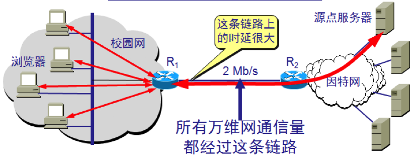

使用高速缓存的情况如下：

- （1）浏览器访问互联网的服务器时，要先与校园网的高速缓存建立 TCP 连接，并向高速缓存发出 HTTP 请求报文。
- （2）若高速缓存已经存放了所请求的对象，则将此对象放入 HTTP 响应报文中返回给浏览器。

  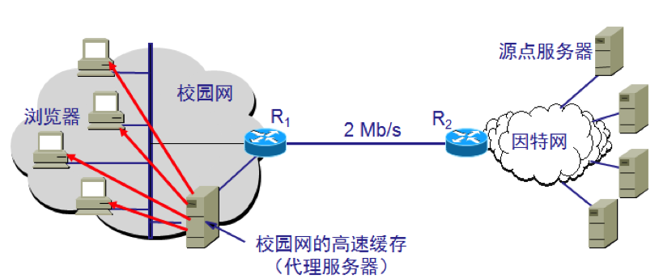

- （3）否则，高速缓存就代表发出请求的用户浏览器，与互联网上的源点服务器建立 TCP 连接，并发送 HTTP 请求报文。

  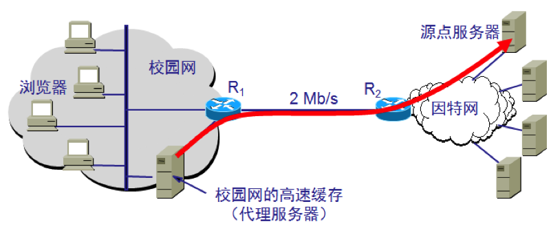

- （4）源点服务器将所请求的对象放在 HTTP 响应报文中返回给校园网的高速缓存。
- （5）高速缓存收到此对象后，先复制在其本地存储器中（为今后使用），然后再将该对象放在 HTTP 响应报文中，通过已建立的 TCP 连接，返回给请求该对象的浏览器。

# 5 电子邮件

## 5.1 电子邮件系统

一个电子邮件系统应具有三个主要组成部分：

- 用户代理
- 邮件服务器
- 邮件发送协议（如 SMTP）与邮件读取协议（如 POP3、IMAP）

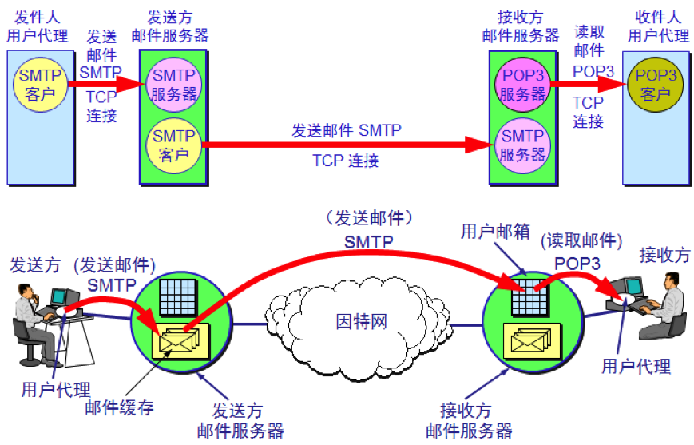

用户代理（User Agent）就是用户与电子邮件系统的接口，在大多数情况下它就是运行在用户 PC 中的一个程序，一般具有撰写、显示、处理、通信等功能。

互联网上有许多邮件服务器可供用户选择，邮件服务器 24 小时不间断地工作，并且具有大容量的邮件信箱。邮件服务器的功能是发送和接收邮件，同时还要向发信人报告邮件传送的情况（已交付、被拒绝、丢失等）。邮件服务器按照客户服务器方式工作。邮件服务器需要使用发送和读取两个不同的协议。

应当注意的是，一个邮件服务器既可以作为客户，也可以作为服务器。

例如，当邮件服务器 A 向另一个邮件服务器 B 发送邮件时，邮件服务器 A 就作为 SMTP 客户，而 B 是 SMTP 服务器；当邮件服务器 A 从另一个邮件服务器 B 接收邮件时，邮件服务器 A 就作为 SMTP 服务器，而 B 是 SMTP 客户。

发送和接收电子邮件的几个重要步骤：

- （1）发件人调用 PC 中的用户代理撰写和编辑要发送的邮件。
- （2）发件人的用户代理把邮件用 SMTP 协议发给发送方邮件服务器。
- （3）SMTP 服务器把邮件临时存放在邮件缓存队列中，等待发送。
- （4）发送方邮件服务器的 SMTP 客户与接收方邮件服务器的 SMTP 服务器建立 TCP 连接，然后就把邮件缓存队列中的邮件依次发送出去。
- （5）运行在接收方邮件服务器中的 SMTP 服务器进程收到邮件后，把邮件放入收件人的用户邮箱中，等待收件人进行读取。
- （6）收件人在打算收信时，就运行 PC 中的用户代理，使用 POP3（或 IMAP）协议读取发送给自己的邮件。请注意，POP3 服务器和 POP3 客户之间的通信是由 POP3 客户发起的。

## 5.2 简单邮件传送协议 SMTP

简单邮件传送协议 **SMTP**（Simple Mail Transfer Protocol）所规定的就是在两个相互通信的 SMTP 进程之间应如何交换信息。

由于 SMTP 使用客户服务器方式，因此负责发送邮件的 SMTP 进程就是 SMTP 客户，而负责接收邮件的 SMTP 进程就是 SMTP 服务器。

SMTP 使用 TCP 连接，邮件服务器之间传送邮件使用 25 端口；用户代理向邮件服务器提交邮件时，现在通常使用 587 端口（配合 STARTTLS 加密）或 465 端口（直接使用 TLS）。

## 5.3 邮件读取协议 POP 和 IMAP

邮局协议 **POP**（Post Office Protocol）是一个非常简单、但功能有限的邮件读取协议。现在使用的是它的第三个版本 POP3。

POP 也使用客户服务器的工作方式。在接收邮件的用户 PC 中必须运行 POP 客户程序，而在用户所连接的 ISP 的邮件服务器中则运行 POP 服务器程序。

POP 协议支持离线邮件处理：邮件到达邮件服务器后，用户运行电子邮件客户端程序，下载所有未阅读的电子邮件（这种离线访问模式是一种存储转发服务）。邮件从邮件服务器下载到个人计算机后，邮件服务器默认会删除该邮件（但是目前很多 POP3 服务器都支持“下载邮件，服务器并不删除邮件”）。

另一个读取邮件的协议是互联网报文存取协议 **IMAP**（Internet Message Access Protocol），它比 POP 协议复杂很多。

IMAP 也是按客户服务器方式工作，现在使用的是版本 4，即 IMAP4（其最新修订版为 2021 年的 IMAP4rev2，RFC 9051）。

用户在自己的 PC 上就可以操纵邮件服务器的邮箱，就像在本地操纵一样。IMAP 最大的好处就是用户可以在不同的地方使用不同的计算机随时上网阅读和处理自己的邮件。

POP3 使用 TCP 的 110 端口（加密的 POP3S 为 995），IMAP 使用 TCP 的 143 端口（加密的 IMAPS 为 993）。

注意，不要将邮件读取协议 POP 或 IMAP 与邮件传送协议 SMTP 弄混。

发信人的用户代理向源邮件服务器发送邮件，以及源邮件服务器向目的邮件服务器发送邮件，都是使用 SMTP 协议。

而 POP 协议或 IMAP 协议则是用户从目的邮件服务器上读取邮件所使用的协议。

## 5.4 基于万维网的电子邮件

现在个人用户大多使用基于万维网的电子邮件（Webmail）或手机上的邮件 App，Outlook、Thunderbird、Apple Mail 等独立的邮件客户端程序在企业和个人用户中也仍有大量使用。

不管在什么地方，只要能够上网，就可以借助浏览器收发电子邮件。这时，邮件系统中的用户代理就是普通的万维网浏览器。

需要注意的是，浏览器从邮件服务器读取邮件，或者向邮件服务器发送邮件使用的是 HTTP（HTTPS）协议，而不是 IMAP（POP）或 SMTP。

例如，一个网易邮箱用户向新浪邮箱用户通过浏览器发送邮件，各阶段使用的协议如下：

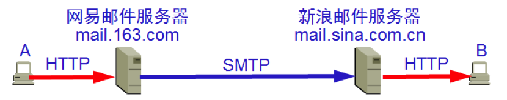

## 5.5 多用途互联网邮件扩充 MIME

SMTP 有以下不足：

- SMTP 不能传送可执行文件或其他的二进制对象。
- SMTP 限于传送 7 位的 ASCII 码。许多其他非英语国家的文字（如中文、俄文，甚至带重音符号的法文或德文）就无法传送。
- SMTP 服务器会拒绝超过一定长度的邮件。

于是就提出了多用途互联网邮件扩充 **MIME**（Multipurpose Internet Mail Extensions）。MIME 并没有改动 SMTP 或取代它。MIME 的意图是继续使用目前的格式，但增加了邮件主体的结构，并定义了传送非 ASCII 码的编码规则。

MIME 和 SMTP 的关系如下：

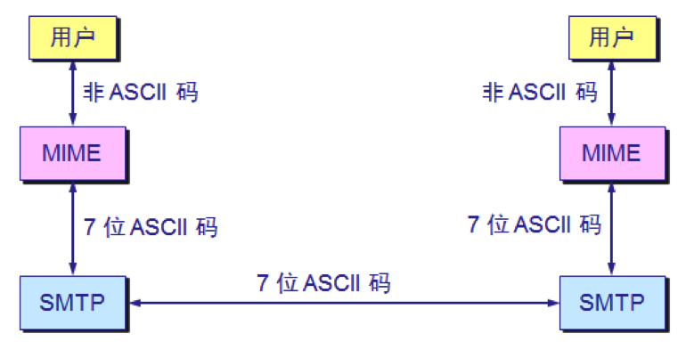

MIME 类型（又称媒体类型，Media Type）的格式为 `类型/子类型`，如 `text/html`、`image/png`、`application/json`。它最初用来标识邮件中各部分内容的类型，后来被 HTTP 沿用：服务器在 `Content-Type` 首部中给出响应内容的 MIME 类型，浏览器据此决定如何处理这些内容（渲染网页、显示图片、交给其他程序打开或直接下载等），而不是只看文件的扩展名。

# 6 动态主机配置协议

为了将软件协议做成通用的和便于移植的，协议软件的编写者不会把所有细节都固定在源代码中，而是把协议软件参数化，这就使得在很多台计算机上使用同一个经过编译的二进制代码成为可能。

一台计算机和另一台计算机的区别，都可通过一些不同的参数来体现。在软件协议运行之前，必须给每一个参数赋值。例如，连接到互联网的计算机的协议软件需要配置的项目包括：

- IP 地址
- 子网掩码
- 默认路由器的 IP 地址
- 域名服务器的 IP 地址

这些信息通常存储在一个配置文件中，计算机可以对这个文件进行存取。

使用人工配置既不方便，又容易出错，现在广泛使用的是动态主机配置协议 **DHCP**（Dynamic Host Configuration Protocol）。DHCP 提供了即插即用联网的机制，这种机制允许一台计算机加入新的网络和获取 IP 地址而不用手工参与。

**DHCP 使用 UDP 协议工作**，DHCP 服务器使用 UDP 端口 67，DHCP 客户使用端口 68。

需要 IP 地址的主机在启动时就向 DHCP 服务器广播发送发现报文（DHCP DISCOVER），这时该主机就成为 DHCP 客户。

本地网络上所有主机都能收到此广播报文，但只有 DHCP 服务器才回答此广播报文。

DHCP 服务器先在其数据库中查找该计算机的配置信息。若找到，则返回找到的信息。若找不到，则从服务器的 IP 地址池中取一个地址分配给该计算机。DHCP 服务器的回答报文叫做提供报文（DHCP OFFER）。

DHCP 客户可能收到多个 DHCP 服务器的提供报文，它从中选择一个，并广播发送请求报文（DHCP REQUEST）；被选中的 DHCP 服务器回复确认报文（DHCP ACK）后，DHCP 客户才可以开始使用所分配的 IP 地址。这一“发现—提供—请求—确认”的过程常简称为 DORA。

如果每个网络上都设置 DHCP 服务器，DHCP 服务器的数量就会太多，因此并不是每个网络上都有 DHCP 服务器，而是每一个网络至少有一个 **DHCP 中继代理**（通常由路由器充当），它配置了 DHCP 服务器的 IP 地址信息。

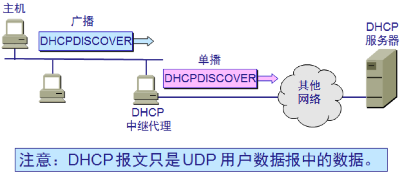

当 DHCP 中继代理收到主机发送的发现报文后，就以单播方式向 DHCP 服务器转发此报文，并等待其回答。收到 DHCP 服务器回答的提供报文后，DHCP 中继代理再将此提供报文发回给主机。

DHCP 服务器分配给 DHCP 客户的 IP 地址是临时的，因此 DHCP 客户只能在一段有限的时间内使用这个分配到的 IP 地址。DHCP 协议称这段时间为**租用期**。

租用期的数值应由 DHCP 服务器自己决定。DHCP 客户也可在自己发送的报文中（例如，发现报文）提出对租用期的要求。租用期过了一半时，DHCP 客户会向原 DHCP 服务器请求续租；租用期到期仍未续租成功，就必须停止使用原来的 IP 地址，重新申请。

以上讲的是 IPv4 的 DHCP。IPv6 主机获取配置的方式有所不同，主要有两种：

- **无状态地址自动配置**（Stateless Address Autoconfiguration，SLAAC，RFC 4862）：路由器周期性地发送路由器通告（Router Advertisement，RA）报文，其中带有本网络的 64 位前缀，主机再自己生成后 64 位的接口标识符，拼成完整的 IPv6 地址，整个过程不需要服务器分配地址。接口标识符早期由 MAC 地址推算（EUI-64），由于这会暴露硬件地址、便于跟踪，现在的操作系统默认改用随机生成的稳定标识符（RFC 7217）和定期更换的临时地址（RFC 8981）。DNS 服务器地址可以放在 RA 报文的 RDNSS 选项（RFC 8106）中下发，也可以再用无状态 DHCPv6 获取。
- **DHCPv6**（RFC 8415）：与 IPv4 的 DHCP 类似，由服务器分配地址并记录租用情况，客户使用 UDP 端口 546，服务器使用 547。DHCPv6 还可以给家用路由器等设备分配整个前缀（前缀委派），运营商宽带常用这种方式为家庭网络下发 IPv6 前缀。

需要注意，Android 至今不支持用 DHCPv6 获取地址，因此要让手机等设备接入的 IPv6 网络一般都要开启 SLAAC。

# 7 套接字 Socket

当某个应用进程启动系统调用时，控制权就从应用进程传递给了系统调用接口。

此接口再将控制权传递给计算机的操作系统。操作系统将此调用转给某个内部过程，并执行所请求的操作。

内部过程一旦执行完毕，控制权就又通过系统调用接口返回给应用进程。

系统调用接口实际上就是应用进程的控制权和操作系统的控制权进行转换的一个接口，即应用编程接口 API（Application Programming Interface）。

关于 TCP/IP 协议最著名的 API 就是伯克利 UNIX（BSD UNIX）操作系统定义的**套接字接口**（socket interface）。微软公司在其操作系统中采用了套接字接口 API，形成了一个稍有不同的 API，并称之为 Windows Sockets（Winsock）。

请注意，**在套接字以上的进程是受应用程序控制的，而在套接字以下的传输层协议软件则是受计算机操作系统的控制**。因此，只要应用程序使用 TCP/IP 协议进行通信，它就必须通过套接字与操作系统交互并请求其服务。

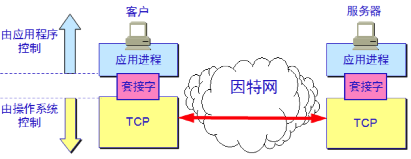

当应用进程需要使用网络进行通信时就发出系统调用，请求操作系统为其创建套接字，以便把网络通信所需要的系统资源分配给该应用进程。

操作系统把这些资源的总和用一个叫做**套接字描述符**的号码来表示，并把此号码返回给应用进程。应用进程所进行的网络操作都必须使用这个号码。

通信完毕后，应用进程通过一个关闭套接字的系统调用通知操作系统回收与该“号码”相关的所有资源。

下图描述了操作系统所创建的套接字描述符与套接字数据结构的关系：

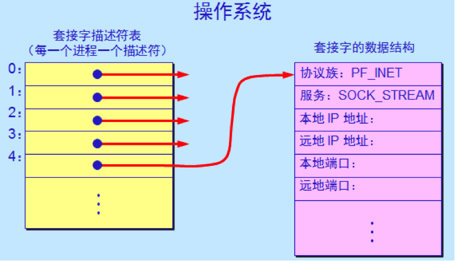

由于在一个机器中可能同时出现多个套接字，因此需要一个存放套接字描述符的表，而每一个套接字描述符有一个指针指向存放套接字的地址。

当套接字被创建后，它的端口号和 IP 地址都是空的，因此应用进程要调用 bind（绑定）来指明套接字的本地地址。在服务器端调用 bind 时就是把熟知端口号和本地 IP 地址填写到已创建的套接字中。这就叫做把本地地址绑定到套接字。

服务器在调用 bind 后，还必须调用 listen（收听）把套接字设置为被动方式，以便随时接受客户的服务请求。UDP 服务器由于只提供无连接服务，不使用 listen 系统调用。

服务器紧接着就调用 accept（接受），以便把远地客户进程发来的连接请求提取出来。系统调用 accept 的一个参数就是要指明从哪一个套接字发起的连接。accept 会为这条新连接创建一个新的套接字，服务器用这个新套接字与该客户通信，而原来的套接字则继续监听其他客户的连接请求。

客户端创建套接字后，调用 connect（连接）向服务器发起连接，对 TCP 而言就是进行三次握手。客户端一般不需要调用 bind，操作系统会自动为它分配一个临时端口号。

连接建立后，双方使用 send 和 recv（或 write 和 read）收发数据，通信结束后调用 close 释放套接字。归纳起来，TCP 服务器的调用顺序是 socket → bind → listen → accept → recv/send → close，客户端是 socket → connect → send/recv → close。

UDP 套接字的流程要简单得多：服务器调用 socket 和 bind 之后，不需要 listen 和 accept，直接调用 recvfrom 接收数据报，recvfrom 会同时给出发送方的地址，服务器再用 sendto 按这个地址回复；客户端调用 socket 后也不需要 connect，直接用 sendto 指明目的地址发送数据报。UDP 套接字也可以调用 connect，但这只是在本地记下默认的对方地址，不会向对方发送任何报文。

# 8 总结

应用层协议直接为用户的应用进程提供服务，它们大多采用客户服务器方式工作，并建立在传输层的 TCP 或 UDP 之上。DNS 通过分层的域名服务器和递归、迭代查询把域名解析为 IP 地址，是几乎所有网络应用的起点，如今还可以通过 DoT、DoH 加密传输。FTP、TELNET 等早期协议因明文传输，如今已基本被 SFTP、SSH 和 HTTPS 取代。万维网依靠 URL 定位资源、依靠 HTTP 传送资源，HTTP 本身无状态，需借助 Cookie 和 Session 保持会话，其版本也从 HTTP/1.1 演进到了基于 QUIC 的 HTTP/3，ECH 则进一步加密了 TLS 握手中暴露的网站名称。电子邮件用 SMTP 发送、用 POP3 或 IMAP 读取，并借助 MIME 传送非 ASCII 内容；DHCP 让主机自动获取网络配置，IPv6 主机还可以通过 SLAAC 自行生成地址；而套接字则是应用程序使用这些网络服务的编程接口。
