# 计算机网络-网络层

互联网采用的设计思路是这样的：网络层向上只提供简单灵活的、无连接的、尽最大努力交付的数据报服务。

也就是说，**网络层不保证服务的可靠性**。所传送的包可能出错、丢失、重复和失序，当然也不保证交付的时限。如果主机间需要可靠的通信，由网络层上面的传输层负责。

采用这种设计思路的好处是：网络的造价大大降低，运行方式灵活，能够适应多种应用。

# 1 IP 地址

整个互联网就是一个单一的、抽象的网络。IP 地址就是给互联网上的每一个主机（或路由器）的每一个接口分配一个在全世界范围内唯一的 32 位的标识符。

IP 地址的编址方法经历了分类编址、划分子网和无分类编址 CIDR 三个阶段。分类编址是互联网早期的做法，如今已被 CIDR 取代，但了解它有助于理解子网掩码和 CIDR 的由来，而且 A 类、B 类、C 类和默认子网掩码的说法至今仍很常见。

所谓分类的 IP 地址，就是将 IP 地址划分为若干固定类，每一类地址都由两个固定长度的字段组成，其中一个字段是网络号 `net-id`，它标志主机（或路由器）所连接到的网络，一个网络号在整个互联网范围内必须是唯一的；另一个字段则是主机号 `host-id`，它标志该主机（或路由器），一个主机号在它前面的网络号所指明的网络范围内必须是唯一的。由此可见，一个 IP 地址在整个互联网范围内是唯一的。

由于一个路由器至少应当连接到两个网络（这样它才能将 IP 数据报从一个网络转发到另一个网络），因此一个路由器至少应当有两个不同的 IP 地址。

用转发器或网桥连接起来的若干个局域网仍为一个网络，因此这些局域网都具有同样的网络号。

路由器只根据目的站的 IP 地址的网络号进行路由选择。

两级的 IP 地址可以记为：

`IP 地址 ::= { <网络号>, <主机号>}`

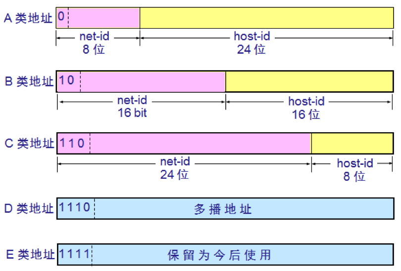

上图中的 A 类、B 类、C 类地址都是单播地址（一对一通信），是最常用的。D 类地址（类别位为 1110）用于多播（一对多通信），E 类地址（类别位为 1111）保留为以后使用。

网络号字段的最前面有 1～4 位的类别位，A 类、B 类、C 类地址的类别位分别为 0、10、110。

为了提高可读性，我们常常把 32 位的 IP 地址中的每 8 位用其等效的十进制数字表示，这就是点分十进制记法。

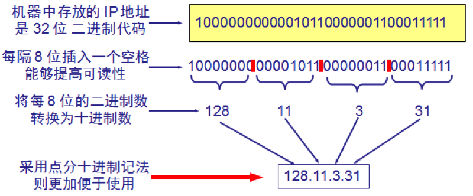

A 类地址的网络号字段占 1 个字节，除去固定为 0 的类别位，只有 7 位可供使用，可指派的网络号是 126 个（`2⁷ − 2`）：网络号全为 0 的地址是保留地址，表示“本网络”；网络号 127（01111111）则保留作为本地软件环回测试本主机的进程间通信，常用的 `127.0.0.1` 就属于这一类。B 类、C 类地址的网络号分别占 2 个和 3 个字节，除去类别位后分别有 14 位和 21 位可供分配。

A 类、B 类、C 类地址的主机号分别占 3、2、1 个字节，因此每个网络中的最大主机数分别为 `2²⁴ − 2`、`2¹⁶ − 2` 和 `2⁸ − 2`。减 2 是因为全为 0 的主机号表示该网络本身的网络地址，全为 1 的主机号表示该网络上的所有主机（即广播地址），这两个地址都不能分配给主机。这条规则在后面的划分子网和 CIDR 中同样适用。

下表列出了各类地址的指派范围，其中 B 类、C 类的可指派网络数比 `2¹⁴`、`2²¹` 少 1，是因为早期规定 `128.0.0.0` 和 `192.0.0.0` 这两个网络号不指派。

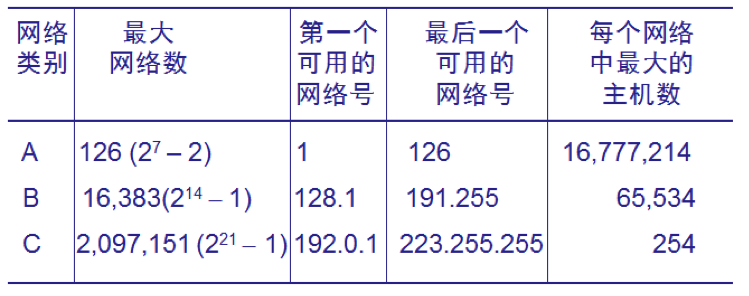

分类编址把网络规模僵硬地限定为三档，造成了严重的地址浪费：例如一个单位有 2000 台主机，C 类网络装不下，申请一个 B 类网络又会浪费 6 万多个地址。因此它从 1993 年起被无分类编址 CIDR 取代（见第 3 节），上面这些可指派网络数只具有历史意义。

硬件地址是数据链路层和物理层使用的地址，而 IP 地址是网络层和以上各层使用的地址，是一种逻辑地址。

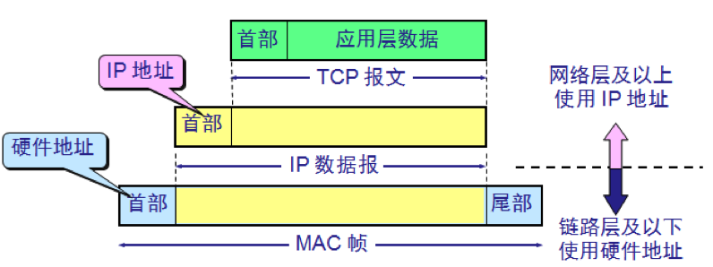

发送数据时，数据从高层下到低层，然后才到通信链路上传输。使用 IP 地址的 IP 数据报一旦交给了数据链路层，就被封装成了 MAC 帧。MAC 帧在传送时使用的源地址和目的地址都是硬件地址，这两个硬件地址都写在 MAC 帧的首部。

连接在通信链路上的设备在接收 MAC 帧时，其根据是 MAC 帧首部中的硬件地址。在数据链路层看不见隐藏在 MAC 帧的数据中的 IP 地址。只有在剥去了 MAC 帧的首部和尾部，把 MAC 层的数据上交给网络层后，网络层才能在 IP 数据报的首部中找到源 IP 地址和目的 IP 地址。

# 2 划分子网

一个拥有许多物理网络的单位，可将所属的物理网络划分为若干个**子网**（subnet）。划分子网纯属一个单位内部的事情，单位对外仍然表现为一个网络。

划分子网的方法是从主机号借用若干个位作为子网号 `subnet-id`，而主机号 `host-id` 也就相应减少了若干个位。于是两级 IP 地址在本单位内部就变为三级 IP 地址：

`IP 地址 ::= {<网络号>, <子网号>, <主机号>}`

凡是从其他网络发送给本单位某个主机的 IP 数据报，仍然是根据 IP 数据报的目的网络号 `net-id`，先找到连接在本单位网络上的路由器。然后此路由器在收到 IP 数据报后，再按目的网络号 `net-id` 和子网号 `subnet-id` 找到目的子网。最后就将 IP 数据报直接交付目的主机。

下面通过一个例子来展示划分子网的方法与效果。

下图表示某单位拥有一个 B 类 IP 地址，网络地址是 `145.13.0.0`（网络号是 `145.13`）。

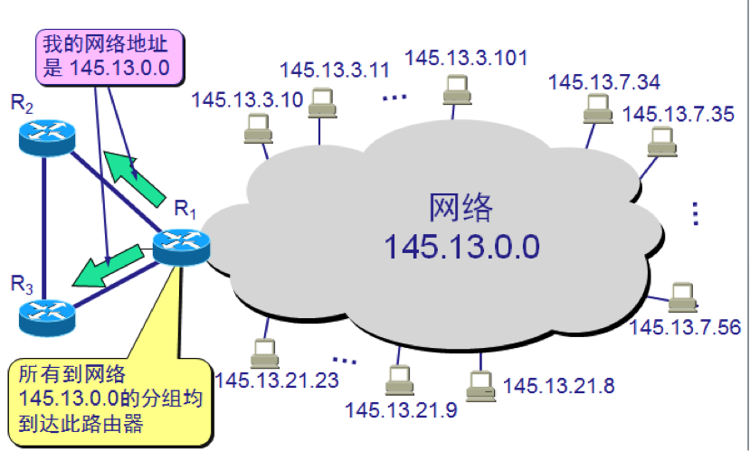

现把上图中的网络划分为三个子网，这里假定子网号占用 8 位，因此主机号只剩 8 位。所划分的子网分别是：`145.13.3.0`、`145.13.7.0`、`145.13.21.0`。

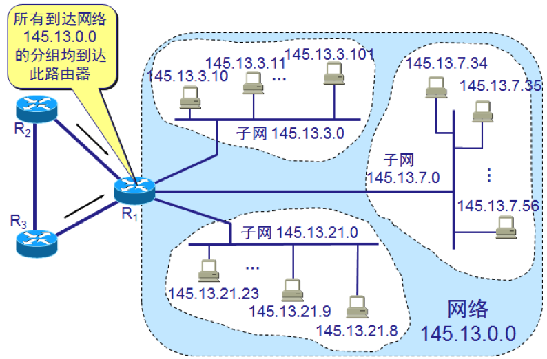

划分子网后，整个网络对外仍表现为一个网络，其网络地址仍为 `145.13.0.0`，但是路由器 R1 在收到外来的数据报后，再根据数据报的目的地址把它转发到相应的子网。

假定有一个目的地址为 `145.13.3.10` 的数据报已经到达路由器 R1，那么这个路由器如何把它转发到子网 `145.13.3.0` 呢？这就需要借助**子网掩码**（subnet mask）来实现了。

路由器会把子网掩码和收到的数据报的目的 IP 地址 `145.13.3.10` 进行按位“与”操作，得出所要找的子网的网络地址。

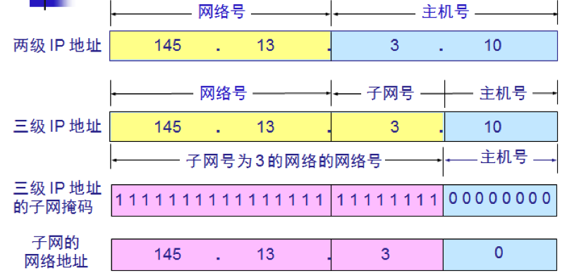

子网掩码与 IP 地址进行“与”操作之后，就将主机号“过滤”掉了，只剩下了网络号与子网号。

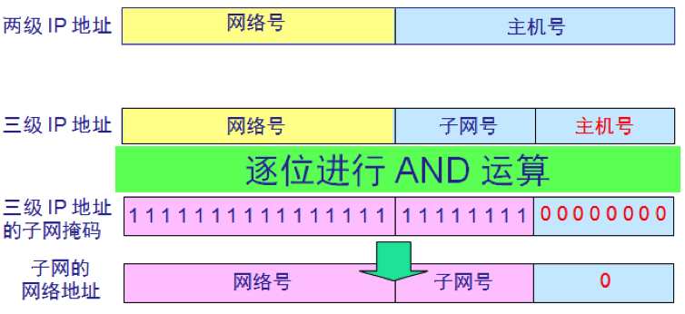

实际上，互联网的标准规定：所有网络必须使用子网掩码。即便一个网络没有划分子网，也要使用默认子网掩码。默认子网掩码中 1 的位置和 IP 地址中的网络号字段正好相对应，因此，两者进行“与”操作后，就能得出该 IP 地址的网络地址。A 类、B 类、C 类地址的默认子网掩码是固定的：

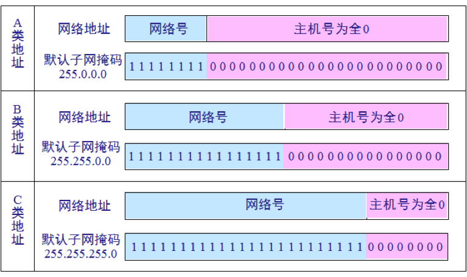

例：已知 IP 地址是 `141.14.72.24`，子网掩码是 `255.255.192.0`，试求网络地址。

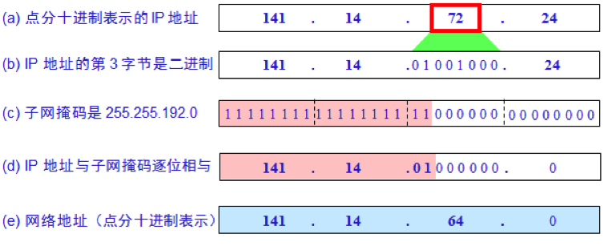

前两个字节与 255 相“与”保持不变；第三个字节 72（01001000）与 192（11000000）相“与”得 64（01000000）；第四个字节与 0 相“与”得 0。因此网络地址是 `141.14.64.0`。

应当注意，划分子网后，路由表必须包含以下三项内容：

- 目的网络地址
- 子网掩码
- 下一跳地址

在划分子网的情况下路由器转发分组的算法：

1. 从收到的分组的首部提取目的 IP 地址 D。
2. 先判断是否为直接交付：用与路由器直接相连的各网络的子网掩码和 D 逐位相“与”，看是否和相应的网络地址匹配。若匹配，则将分组直接交付；否则就是间接交付，执行第 3 步。
3. 若路由表中有目的地址为 D 的特定主机路由，则将分组传送给指明的下一跳路由器；否则，执行第 4 步。
4. 对路由表中的每一行，用该行的子网掩码和 D 逐位相“与”，若其结果与该行的目的网络地址匹配，则将分组传送给该行指明的下一跳路由器；否则，执行第 5 步。
5. 若路由表中有一个默认路由，则将分组传送给路由表中所指明的默认路由器；否则，执行第 6 步。
6. 报告转发分组出错。

# 3 无分类编址 CIDR

划分子网在一定程度上缓解了分类编址的问题，但到 20 世纪 90 年代初，B 类地址即将分配完毕、互联网主干路由表急剧膨胀的问题越来越突出。于是 IETF 在 1993 年提出了**无分类域间路由选择**（Classless Inter-Domain Routing，CIDR）。

CIDR 消除了传统的 A 类、B 类、C 类地址以及划分子网的概念，把 IP 地址重新划分为两部分：前面是**网络前缀**（network prefix），后面是主机号：

`IP 地址 ::= {<网络前缀>, <主机号>}`

CIDR 使用“斜线记法”，即在 IP 地址后面加上斜线 `/` 和网络前缀所占的位数。例如 `128.14.35.7/20` 表示前 20 位是网络前缀，剩下的 12 位是主机号。网络前缀相同的连续 IP 地址组成一个 **CIDR 地址块**：`128.14.35.7/20` 所在地址块的第三个字节 35 为 00100011，前 4 位 0010 属于前缀，因此最小地址是 `128.14.32.0`，最大地址是 `128.14.47.255`，共 `2¹² = 4096` 个地址。`/20` 对应的子网掩码是 `255.255.240.0`（前 20 位为 1）。

由于一个 CIDR 地址块可以包含很多个原来的分类网络，路由表中就可以用一个地址块来代替许多条原来的路由，这叫作**路由聚合**（route aggregation），也称为构成超网，它大大减少了路由表的条目数。

使用 CIDR 后，查路由表时一个目的地址可能同时匹配多个表项，此时应选择网络前缀最长的那一项，这叫作**最长前缀匹配**（longest prefix match），因为前缀越长，地址块越小，路由就越具体。今天互联网上的路由器都是基于 CIDR 和最长前缀匹配来转发分组的。

# 4 专用地址与 VPN

假如一个机构没有接入互联网，但是内部的计算机通信也是采用 TCP/IP 协议，那么从原则上讲，对于这些仅在机构内部使用的计算机就可以由本机构自行分配 IP 地址（这种地址称为本地地址）。

但是，如果任意选择一些 IP 地址作为本机构内部使用的本地地址，那么在某种情况下可能会引起一些麻烦。例如，有时机构内部的某个主机需要和互联网连接，那么这种仅在内部使用的本地地址就可能和互联网中某个 IP 地址重合。

为解决这一问题，IP 地址中保留了一些专用地址，只能用于机构的内部通信，而不能用于互联网上的主机通信。互联网中的所有路由器，对目的地址是**专用地址的数据报一律不进行转发**。

这些专用地址（RFC 1918）如下：

- `10.0.0.0` 到 `10.255.255.255`（`10.0.0.0/8`）
- `172.16.0.0` 到 `172.31.255.255`（`172.16.0.0/12`）
- `192.168.0.0` 到 `192.168.255.255`（`192.168.0.0/16`）

采用这样的专用 IP 地址的互联网称为**专用互联网**或**本地互联网**。

有时一个很大的机构有许多部门分布在相距很远的一些地点，而每一个地点都有自己的专用网。假如这些分布在不同地点的专用网需要经常通信，有两种解决办法：一是租用电信公司的通信线路为本机构专用，但是往往租金太高；二是利用公用的互联网作为本机构各专用网之间的通信载体，这样的专用网又称**虚拟专用网**（Virtual Private Network，VPN）。

假定某机构在两个相隔较远的场所建立了专用网 A 和 B，其网络地址分别为专用地址 `10.1.0.0` 和 `10.2.0.0`。现在，这两个场所需要通过公用的互联网构成一个 VPN。

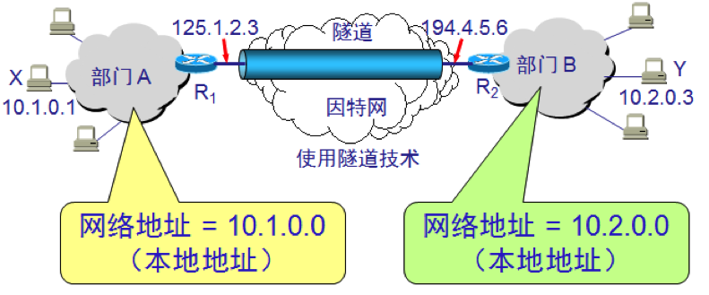

显然，每一个场所至少要有一个路由器具有合法的全球 IP 地址，这两个路由器和互联网的接口地址是全球 IP 地址，和内部网络的接口地址则是专用网的本地地址。

有的公司可能没有分布在不同场所的部门，但有很多流动员工在外地工作。公司需要和他们保持联系，远程接入 VPN 可满足这种需求。

在外地工作的员工通过宽带、Wi-Fi 或蜂窝移动网络接入互联网，再利用终端上的 VPN 客户端软件，与公司的 VPN 网关之间建立加密的 VPN 隧道，因而外地员工与公司通信的内容是保密的，员工们感到好像就是使用公司内部的本地网络。近年来不少企业还在向**零信任网络访问**（Zero Trust Network Access，ZTNA）演进：不再默认信任已接入内网的用户，而是根据用户身份和设备状态对每一个应用单独授权，避免接入 VPN 后就能访问整个内网。

# 5 网络地址转换 NAT

**网络地址转换**（Network Address Translation，NAT）可以将私网地址转换成公网地址，缓解 IP 地址的不足，并且可以隐藏内部网络的细节，起到一定的安全作用。

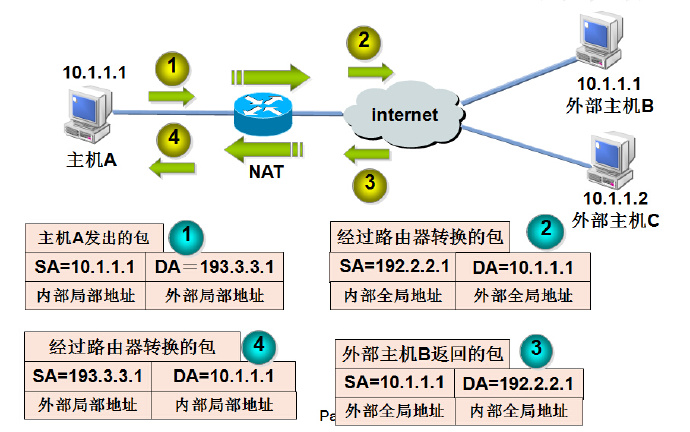

内部主机 X 用本地地址 IPx 和互联网上主机 Y 通信所发送的数据报必须经过 NAT 路由器。

NAT 路由器将数据报的源地址 IPx 转换成全球地址 IPg，但目的地址 IPy 保持不变，然后发送到互联网。

NAT 路由器收到主机 Y 发回的数据报时，知道数据报中的源地址是 IPy 而目的地址是 IPg。

根据 NAT 转换表，NAT 路由器将目的地址 IPg 转换为 IPx，转发给最终的内部主机 X。

这样就可以使专用网内较多数量的主机，轮流使用 NAT 路由器有限数量的全球 IP 地址。

上面描述的是最基本的 NAT，一个全球地址同一时刻只能供一个内部主机使用。实际中更常用的是**网络地址与端口号转换**（Network Address and Port Translation，NAPT），它同时转换 IP 地址和传输层的端口号，使多个内部主机可以同时共用一个全球 IP 地址，家用路由器和运营商级 NAT 用的都是这种方式。

显然，**通过 NAT 路由器通信必须由专用网内的主机发起**。设想互联网上的主机发起通信，当 IP 数据报到达 NAT 路由器时，NAT 路由器就不知道应当把目的 IP 地址转换成哪一个本地地址，所以在默认情况下，专用网内部的主机不能充当服务器，因为互联网上的用户无法主动请求服务。如果确实需要对外提供服务，可以在 NAT 路由器上配置静态映射（端口转发），或者借助 NAT 穿透等技术。

需要指出的是，NAT 只是缓解 IPv4 地址不足的权宜之计。IPv4 地址总共只有 `2³²`（约 43 亿）个，IANA 已在 2011 年分配完最后的地址块，各地区互联网注册机构（RIR）的常规地址池也相继告罄：APNIC 在 2011 年进入最后阶段，ARIN、RIPE NCC 和 LACNIC 分别在 2015 年、2019 年和 2020 年耗尽，APNIC 和 AFRINIC 则只能限量配给剩余地址。根本的解决办法是 **IPv6**，它把地址长度从 32 位扩展到 128 位（`2¹²⁸` 个地址），不再需要依靠 NAT 节省地址。如今 IPv6 已在移动网络、主流云服务和大型网站中大规模部署，但 IPv4 和 NAT 仍会长期并存。

IPv6 在移动网络中普及得尤其快。据国家 IPv6 发展监测平台的数据，截至 2025 年底，我国 IPv6 活跃用户已达 8.69 亿，占网民总数的 77.38%；2025 年 12 月移动网络的 IPv6 流量占比已达 70.85%，但到 2026 年 6 月，全网总流量中 IPv6 也只占 34.55%，固定网络仍以 IPv4 为主。从全球看，Google 统计的 IPv6 用户比例在 2026 年 3 月 28 日首次超过 50%，此后基本稳定在 50% 上下。一些运营商（如美国的 T-Mobile）已让手机只分配 IPv6 地址，访问仅支持 IPv4 的网站时再借助 NAT64、464XLAT 等转换技术，这说明 NAT 并没有消失，只是从“节省地址”变成了 IPv4 与 IPv6 互通的过渡手段。NAT 破坏了互联网最初的端到端通信原则，给 P2P 应用、设备直连和网络排障都带来了麻烦，而 IPv6 地址充足，每台设备都能拥有全球唯一的地址，从而有望回归端到端通信（出于安全考虑，入站连接通常仍由防火墙控制）。

# 6 路由器与分组交换

将网络互相连接起来要使用一些中间设备，**中间设备**又称为**中间系统**或中继（relay）系统。根据中间设备所在的层次，可以有以下几种不同的中间设备：

- 物理层中继系统：**转发器**（repeater）。
- 数据链路层中继系统：**网桥**或**桥接器**（bridge）。
- 网络层中继系统：**路由器**（router）。
- 网络层以上的中继系统：**网关**（gateway）。

如今网桥的功能已由以太网交换机承担，兼具二层交换和三层路由功能的三层交换机也很常见。另外，早期的 TCP/IP 文献把路由器称为网关，这一习惯一直保留在“默认网关”等说法中，主机配置的默认网关其实就是路由器。

其中，路由器是实现**分组交换**（packet switching）的关键构件，其任务是转发收到的分组，这是网络核心部分最重要的功能。

分组交换是用**存储转发技术**实现的。通常我们把要发送的整块数据称为一个**报文**（message），发送报文之前，先把较长的报文划分为一个个更小的等长数据段，在每一个数据段前面加上一些必要的控制信息组成的首部（header）后，就构成了一个**分组**（packet）。分组又称为**包**，而分组的首部也称为**包头**。**包是在互联网中传送的数据单元**。

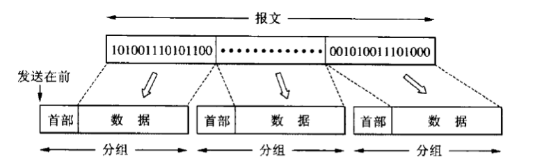

互联网的核心部分是由许多网络和把它们互连起来的路由器组成的，而主机处在互联网的边缘部分。主机和路由器都是计算机，但它们的作用很不一样。主机是为用户进行信息处理的，并且可以和其他主机通过网络交换信息。路由器则是用来转发分组的，即进行分组交换的。

路由器收到一个分组，先暂时存储下来，再检查其首部，查找转发表，按照首部中的目的地址，找到合适的接口转发出去，把分组交给下一个路由器。这样一步一步地以存储转发的方式，把分组交付到最终的目的主机。

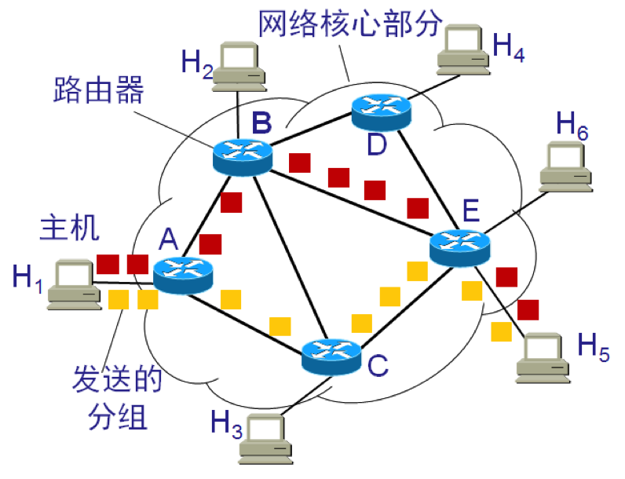

上图中，假如主机 H1 向主机 H5 发送数据，主机 H1 先将分组逐个地发往与它直接相连的路由器 A，路由器 A 把主机 H1 发送的分组放入缓存，假定从路由器 A 的转发表中查出应把分组转发到链路 A-C，于是分组就传送到路由器 C。路由器 C 继续按照上述方式查找转发表，假定查出应转发到路由器 E，当分组到达路由器 E 后，路由器 E 就把分组直接交给主机 H5。

假定在某一个分组的传送过程中，链路 A-C 的通信量太大，那么路由器 A 可以把分组沿另一个路由转发到路由器 B，再转发到路由器 E，最后把分组送到主机 H5。

需要注意的是，路由器暂时存储的是一个个短分组，而不是整个的长报文，短分组是暂存在路由器的内存中而不是磁盘等外存中，这就保证了较高的交换速率。

互联网的核心部分通常采用网状拓扑结构，具有很强的健壮性：当网络中的某些结点或链路突然发生故障时，在各路由器中运行的路由选择协议能够自动找到其他路径转发分组，而不致引起通信中断。

从上述可知，采用存储转发的分组交换，实质上是采用了在数据通信的过程中断续分配传输带宽的策略，这对于传送突发式的计算机数据非常合适，使得通信线路的利用率大大提高了。

需要说明的是，上面描述的是传统路由器的工作方式：每台路由器都运行路由选择协议，各自计算出转发表，路由选择是分布式完成的。在大型云数据中心和部分广域网中，**软件定义网络** SDN 则把路由计算这部分工作（控制层面）交给逻辑上集中的控制器，由控制器掌握全局拓扑并把转发规则下发给各台设备，设备本身只负责按表转发（数据层面），使流量调度更加灵活（详见《计算机网络-体系结构》）。不过整个互联网的骨干仍然依靠 BGP、OSPF 等分布式路由选择协议运行。

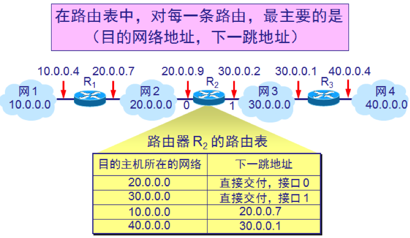

上图中有四个 A 类网络通过三个路由器连接在一起。每一个网络上都可能有成千上万个主机。可以想象，若按目的主机号来制作路由表，则所得出的路由表就会过于庞大（如果每个网络有一万台主机，路由表就有 4 万个记录）。但若按照主机所在的网络地址来制作路由表，那么每一个路由器中的路由表只包含 4 条记录就够了，每一条记录对应一个网络。

以路由器 R2 为例，由于 R2 同时连接在网络 2 和网络 3 上，因此只要目的站在这两个网络上，都可通过接口 0 或 1 由路由器 R2 直接交付。若目的主机在网络 1 中，则下一跳路由器应为 R1；若目的主机在网络 4 中，则下一跳路由器应为 R3。

再次重申，路由器是按照 IP 地址的网络号来转发分组的，就是说按照目的主机所在的网络转发分组。但是大多数情况下都允许有这样的特例：对特定的目的主机指明一个路由，这种路由叫做特定主机路由。

采用特定主机路由可使网络管理人员能更方便地控制网络和测试网络，同时也可在需要考虑某种安全问题时采用这种特定主机路由。

分组转发算法如下：

1. 从数据报的首部提取目的主机的 IP 地址 D，得出目的网络地址为 N。
2. 若网络 N 与此路由器直接相连，则把数据报直接交付目的主机 D；否则是间接交付，执行第 3 步。
3. 若路由表中有目的地址为 D 的特定主机路由，则把数据报传送给路由表中所指明的下一跳路由器；否则，执行第 4 步。
4. 若路由表中有到达网络 N 的路由，则把数据报传送给路由表指明的下一跳路由器；否则，执行第 5 步。
5. 若路由表中有一个默认路由，则把数据报传送给路由表中所指明的默认路由器；否则，执行第 6 步。
6. 报告转发分组出错。

上述转发方式都是逐跳查表：每台路由器只根据目的地址决定下一跳，源点无法指定分组经过的完整路径。近年来在运营商网络中得到较多部署的**段路由**（Segment Routing）则采用了源路由的思路，其基于 IPv6 的实现称为 **SRv6**（Segment Routing over IPv6，主要标准为 2020 年的 RFC 8754 和 2021 年的 RFC 8986）。在 SRv6 网络中，源节点（通常是网络的入口路由器）会在数据报中加入一个段路由首部（IPv6 的一种扩展首部），按顺序列出分组需要经过的一系列“段”，每个段用一个 IPv6 地址标识，可以代表某个节点、某条链路或某种处理动作。分组每到达一个段的端点，该节点就把目的地址改为列表中的下一个段，沿途的其他路由器仍按普通 IPv6 分组转发。由于路径信息都携带在分组中，中间节点无需为每条路径维护额外的状态，这简化了流量工程和 VPN 等业务的部署。

# 7 IP 协议族

与 IP 协议配套使用的还有三个协议：

- **地址解析协议**（Address Resolution Protocol，ARP）
- **网际控制报文协议**（Internet Control Message Protocol，ICMP）
- **网际组管理协议**（Internet Group Management Protocol，IGMP）

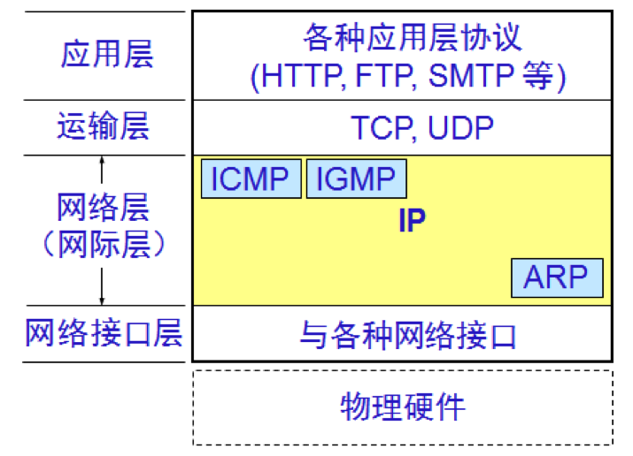

以上是 IPv4 中的情况。在 IPv6 中，这些功能都并入了 ICMPv6（RFC 4443）：地址解析由**邻居发现协议** NDP（Neighbor Discovery Protocol，RFC 4861）完成，它用组播的邻居请求、邻居通告报文取代了 ARP 的广播，还负责路由器发现和重复地址检测；组成员管理则由**多播监听者发现** MLD（Multicast Listener Discovery，MLDv2 为 RFC 3810）取代 IGMP。

## 7.1 地址解析协议 ARP

不管网络层使用的是什么协议，在实际网络的链路上传送数据帧时，最终还是必须使用硬件地址。这就需要解决一个问题：如何根据一个机器的 IP 地址找出其对应的硬件地址；或反过来，如何根据硬件地址找到其对应的 IP 地址。地址解析协议 ARP 与逆地址解析协议 RARP 就是用来解决这样的问题的（RARP 如今已基本被 DHCP 取代，很少使用）。

每一个主机都设有一个 ARP 高速缓存（ARP cache），里面有所在的局域网上的各主机和路由器的 IP 地址到硬件地址的映射表，这个映射表还经常动态更新。

当主机 A 欲向本局域网上的某个主机 B 发送 IP 数据报时，就先在其 ARP 高速缓存中查看有无主机 B 的 IP 地址。如有，就可查出其对应的硬件地址，再将此硬件地址写入 MAC 帧，然后通过局域网将该 MAC 帧发往此硬件地址。

如果查不到主机 B 的 IP 地址，主机 A 就会在本局域网上广播发送一个 ARP 请求分组，本局域网上的所有主机都会收到此 ARP 请求分组，但是只有主机 B 会向主机 A 单播发送一个 ARP 响应分组，主机 A 收到后会将这一映射写入 ARP 高速缓存。

需要注意，ARP 只解决同一个局域网上的主机或路由器的 IP 地址和硬件地址的映射问题。如果目的主机不在本局域网上，主机 A 要解析的是本网络上路由器的硬件地址，把分组交给路由器，由路由器继续转发。

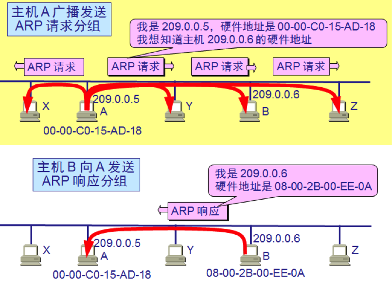

## 7.2 网际控制报文协议 ICMP

为了提高 IP 数据报交付成功的机会，在网际层使用了网际控制报文协议 ICMP。ICMP 允许主机或路由器报告差错情况和提供有关异常情况的报告。

ICMP 不是高层协议，而是 IP 层的协议。ICMP 报文作为 IP 层数据报的数据，加上数据报的首部，组成 IP 数据报发送出去。

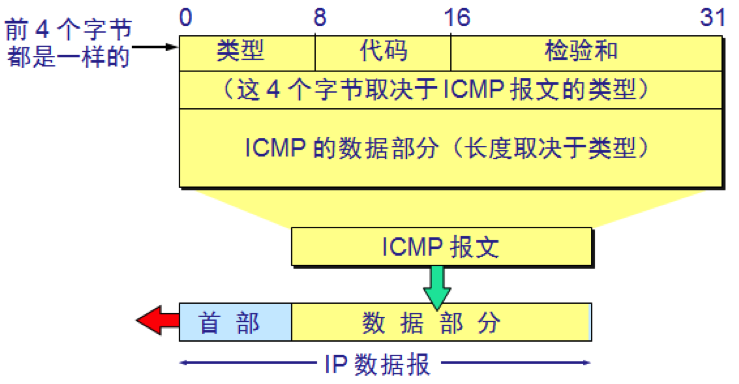

ICMP 报文有两种：

- ICMP 差错报告报文
- ICMP 询问报文

ICMP 差错报告报文共有 5 种：

- 终点不可达
- 源点抑制（Source Quench）
- 时间超过
- 参数问题
- 改变路由（重定向，Redirect）

其中源点抑制报文已在 2012 年被 RFC 6633 废弃，因此较新的教材中差错报告报文通常只列 4 种。

ICMP 询问报文有两种：

- 回送请求和回答报文
- 时间戳请求和回答报文

ICMP 的一个重要应用就是分组网间探测 **PING**（Packet InterNet Groper），**用来测试两个主机之间的连通性**，它使用的是 ICMP 回送请求和回答报文。PING 是应用层直接使用网络层 ICMP 的一个例子，它没有通过传输层的 TCP 或 UDP。

另一个常用工具 **traceroute**（Windows 下为 `tracert`）则利用 IP 首部中的生存时间（TTL）字段和 ICMP 时间超过报文来跟踪分组经过的路由器：它依次发送 TTL 为 1、2、3…… 的数据报，路由器每转发一次就把 TTL 减 1，TTL 减为 0 的路由器会丢弃该数据报并返回时间超过报文，于是路径上的每一跳就依次暴露出来。

## 7.3 网际组管理协议 IGMP

IGMP 是用于支持主机和路由器进行多播的**网际组管理协议**。

网络层的组播用于向某些特定的主机群发消息，而不必给每一个主机都单独发送消息。IP 组播使用 D 类地址（`224.0.0.0`～`239.255.255.255`）作为组地址。与单播路由相比，相同点是路由算法在网络层仍发挥着重要作用，但是不同点是处理组播包的路由器必须建立和维护组播连接的状态信息。

组播通常采用间接的方式：每一组接收者有一个统一的“标识符”（即组地址），将包传送到与该“标识符”相连的所有接收者，而不是采用把所有接收者的目的地址都放在 IP 组播包里面的直接法。原因显而易见，当某个组播的主机很多的时候，地址太多会严重影响消息传递的效率。发送方不需要知道组里面有哪些成员，成员可以随意加入和退出，但路由器应该知道怎么把组播数据包传递给所有连接有该组成员主机的路由器。如下图所示：

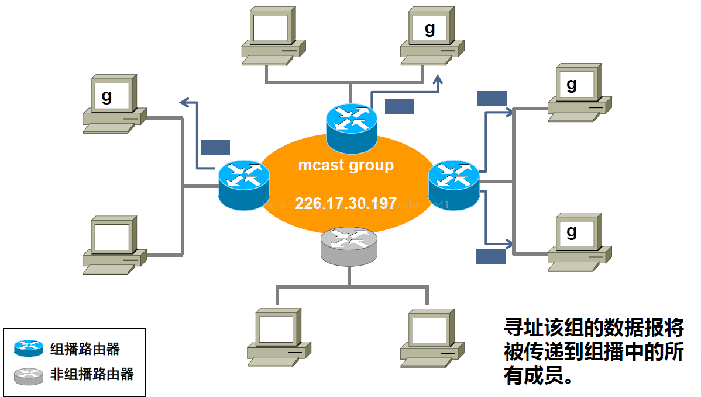

图中蓝色的是组播路由器，带 g 符号的是参加某一个组播的主机。假设某个源是组播源，它想发送消息给所有加入某个组播的主机，那么首先消息要被送达所有连接有该组成员的组播路由器；之后各组播路由器再把消息发送给自己网络中加入该组播的主机。

从上面的步骤来看，主要就两个部分，所以网络层的组播协议主要也由两个部分组成：IGMP 协议以及组播路由协议。**主机通过 IGMP 协议提出加入/退出某个组的请求**，也就是说，路由器通过这个协议了解自己局域网下面哪些主机加入了哪些组；组播路由协议用于保证所有组播路由器都能收到组播包。

IGMP 协议工作在主机与其直接相连的路由器之间，主机用它来通告它想加入某个组播组，路由器用它来发现所连网络上是否有主机属于某个组播组。

# 8 总结

网络层向上只提供无连接、尽最大努力交付的数据报服务，可靠性交给传输层负责。IP 地址经历了从分类编址到划分子网、再到无分类编址 CIDR 的演进，路由器根据目的地址的网络前缀查表，按最长前缀匹配逐跳转发分组，而 SDN 和 SRv6 等技术正在改变路由的计算方式和分组的转发路径。专用地址和 NAT 让大量内网主机共用少量公网地址，缓解了 IPv4 地址耗尽的问题，而根本出路是 128 位地址的 IPv6，它在移动网络中已占据主流。ARP、ICMP、IGMP 是与 IP 配套使用的协议，分别负责 IP 地址到硬件地址的解析、差错和询问报告（ping 和 traceroute 都基于它），以及多播组成员的管理；在 IPv6 中，它们的职责由 ICMPv6 及其上的 NDP、MLD 承担。
