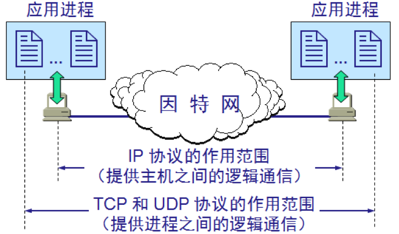
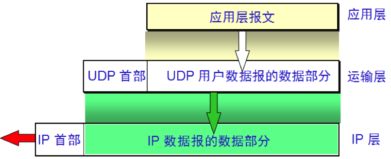
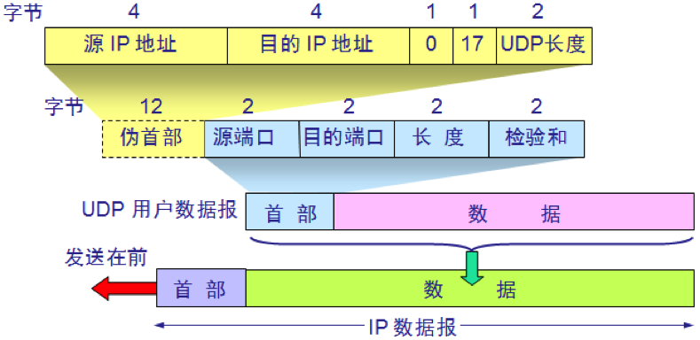
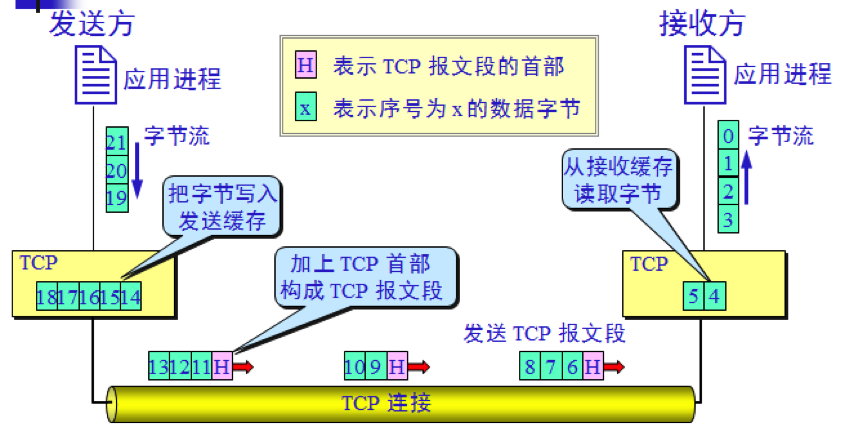
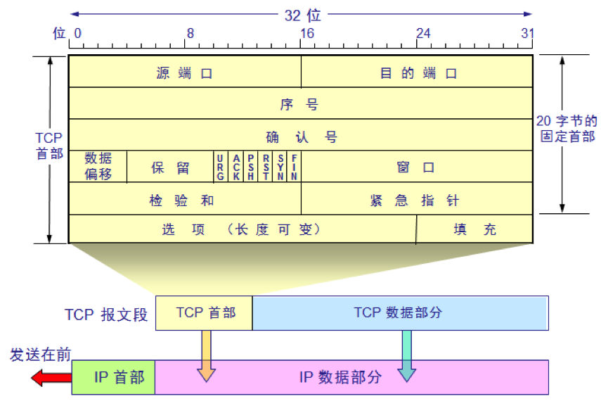
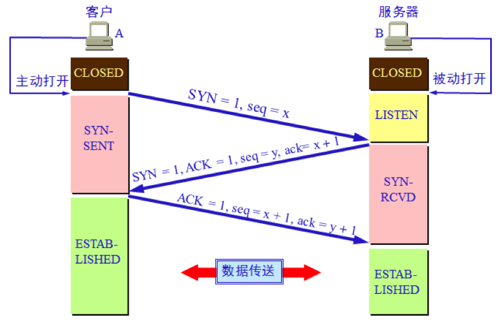
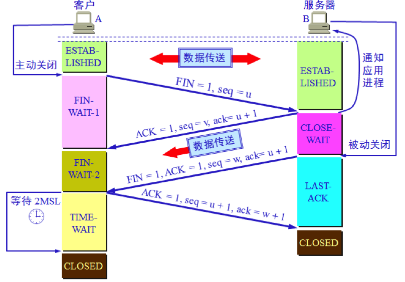
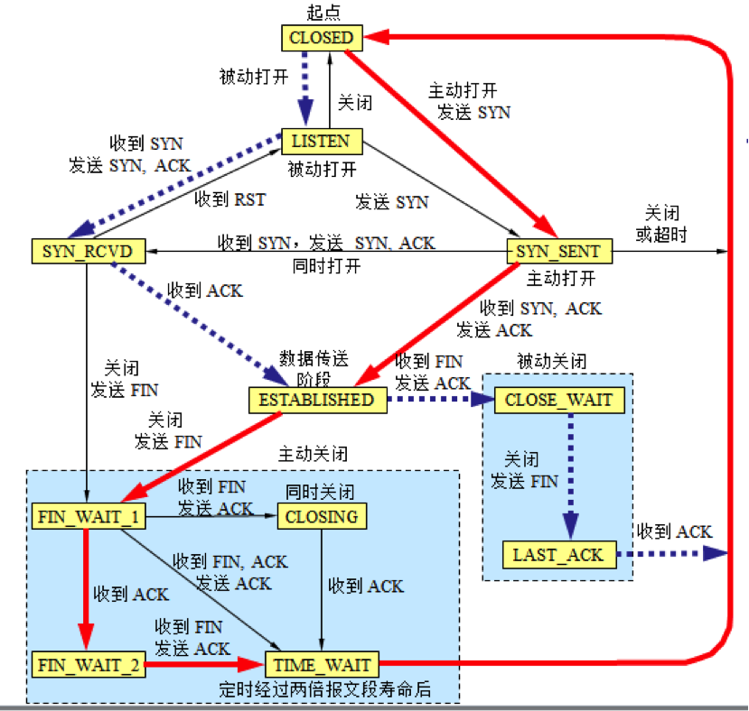

# 计算机网络-传输层

# 1 概述

传输层向它上面的应用层提供通信服务。它是负责通信的各层中最高的一层，也是只在主机中实现、直接为应用服务的各层中最低的一层（路由器一般只实现到网络层）。

两个主机进行通信实际上就是两个主机中的应用进程互相通信，应用进程之间的通信又称为端到端的通信。

应用层不同进程的报文通过不同的端口向下交到传输层，再往下就共用网络层提供的服务。



传输层为应用进程之间提供端到端的逻辑通信（而网络层是为主机之间提供逻辑通信）。传输层还要对收到的报文进行差错检测。

传输层需要有两种不同的传输协议：

- **用户数据报协议（User Datagram Protocol，UDP）**：UDP 在传送数据之前不需要先建立连接。对方的传输层在收到 UDP 报文后，不需要给出任何确认。虽然 UDP 不提供可靠交付，但在某些情况下 UDP 是一种最有效的工作方式。
- **传输控制协议（Transmission Control Protocol，TCP）**：TCP 则提供面向连接的服务。TCP 不提供广播或多播服务。由于 TCP 要提供可靠的、面向连接的传输服务，因此不可避免地增加了许多开销。

# 2 端口号

为了使运行不同操作系统的计算机的应用进程能够互相通信，就必须用统一的方法对 TCP/IP 体系的应用进程进行标识。解决这个问题的方法就是在传输层使用**协议端口号**（protocol port number），或通常简称为**端口**（port）。

虽然通信的终点是应用进程，但我们可以把端口想象成通信的终点，因为我们只要把要传送的报文交到目的主机的某一个合适的目的端口，剩下的工作（即最后交付目的进程）就由 TCP 或 UDP 来完成。

端口用一个 16 位端口号进行标识，取值范围为 0~65535。

端口号只具有本地意义，即端口号只是为了标识本计算机应用层中的各进程。在互联网中不同计算机的相同端口号是没有联系的。

## 2.1 服务端使用的端口号

这里又分为两类，最重要的一类叫做**熟知端口**（well-known port number），数值一般为 0~1023。管理机构互联网号码分配局（Internet Assigned Numbers Authority，IANA）把这些端口指派给 TCP/IP 最重要的一些应用程序，让所有用户都知道。

| 端口号 | 描述 |
| ------ | ---- |
| 21 | FTP（文件传输协议），明文传输，如今多被 SFTP、HTTPS 取代 |
| 22 | SSH（安全外壳协议） |
| 23 | Telnet（远程终端协议），明文传输，如今基本被 SSH 取代 |
| 25 | SMTP（简单邮件传输协议） |
| 53 | DNS（域名系统） |
| 69 | TFTP（简单文件传输协议），现主要用于局域网内设备引导（如 PXE 网络启动）和配置下发 |
| 80 | HTTP（超文本传输协议） |
| 110 | POP3（邮局协议版本 3） |
| 143 | IMAP（互联网邮件访问协议） |
| 161 | SNMP（简单网络管理协议），代理接收查询 |
| 162 | SNMP（简单网络管理协议），管理站接收 Trap 报文 |
| 443 | HTTPS（基于 TLS 的 HTTP） |
| 520 | RIP（路由信息协议），路由协议也可以借助 UDP 传送报文，如今主要用于小型网络 |

另一类叫**登记端口号**，数值为 1024~49151，供没有熟知端口号的应用程序使用。使用这个范围的端口号必须在 IANA 登记，以防止重复。后端开发中常见的 MySQL 的 3306、Redis 的 6379 就属于登记端口号，而不是熟知端口。

## 2.2 客户端使用的端口号

数值为 49152~65535，留给客户进程选择暂时使用，仅在客户进程运行时才动态选择，因此又叫**短暂端口号**（ephemeral port，也叫临时端口）。当服务器进程收到客户进程的报文时，就知道了客户进程所使用的短暂端口号。通信结束后，这个端口号可供其他客户进程以后使用。

需要注意，49152~65535 是 IANA 建议的范围，各操作系统实际使用的范围可以配置：Windows（Vista 起）默认使用 49152~65535，而 Linux 默认使用 32768~60999（由内核参数 `net.ipv4.ip_local_port_range` 控制）。

# 3 用户数据报协议 UDP

UDP 只在 IP 的数据报服务之上增加了很少一点的功能，即端口的功能和差错检测的功能。

UDP 是无连接的，即发送数据之前不需要建立连接。

UDP 使用**尽最大努力交付**，即不保证可靠交付。

UDP 没有拥塞控制，网络出现拥塞时也不会降低源主机的发送速率，很适合实时多媒体通信的要求。

UDP 支持一对一、一对多、多对一和多对多的交互通信。

UDP 的首部开销小，只有 8 个字节。



UDP 是面向报文的。发送方 UDP 对应用程序交下来的报文，在添加首部后就向下交付 IP 层，既不合并，也不拆分，而是保留这些报文的边界。应用层交给 UDP 多长的报文，UDP 就照样发送，即一次发送一个报文。接收方 UDP 对 IP 层交上来的 UDP 用户数据报，在去除首部后就原封不动地交付上层的应用进程，一次交付一个完整的报文。所以应用程序必须选择合适大小的报文：报文太长，IP 层就要分片，降低效率；报文太短，首部的相对开销又太大。

UDP 首部格式如下：



UDP 首部只有 4 个字段，每个字段 2 字节：

- 源端口：在需要对方回信时使用，不需要时可全置 0。
- 目的端口：在终点交付报文时使用。
- 长度：UDP 用户数据报的总长度（首部加数据），最小值为 8。
- 检验和：检测 UDP 用户数据报在传输中是否有错。计算时要在前面临时加上一个伪首部（IPv4 下为 12 字节，包含源 IP 地址、目的 IP 地址等），伪首部只用于计算检验和，既不向下传送也不向上递交。检验和在 IPv4 中是可选的（全 0 表示不使用），在 IPv6 中必须使用。

如今 UDP 的地位越来越重要：DNS 查询、实时音视频、在线游戏大多基于 UDP；HTTP/3 所使用的 QUIC 协议（RFC 9000）也运行在 UDP 之上，由 QUIC 在用户态自行实现可靠传输、拥塞控制和加密。

QUIC 之所以选择 UDP，是因为 TCP 实现在操作系统内核中，并且大量中间设备（防火墙、NAT 等）只认识现有的 TCP 行为，修改 TCP 很难推广；而 UDP 几乎什么都不做，正好可以作为在用户态构建新协议的底座。与 TCP + TLS 相比，QUIC 主要有三点改进：

- **握手更快**：QUIC 把传输层握手和 TLS 1.3 加密握手合并在一起，首次连接 1 个 RTT 后即可发送应用数据（TCP + TLS 1.3 需要 2 个 RTT），恢复之前的会话时还可以做到 0-RTT。
- **没有传输层的队头阻塞**：一个 QUIC 连接内可以有多个相互独立的流（stream），某个流丢包只会阻塞这个流，不会像 TCP 那样让后面所有的数据都等待重传。
- **连接迁移**：TCP 连接由四元组标识，手机从 Wi-Fi 切换到移动网络后 IP 地址变了，连接就会中断；QUIC 连接由连接 ID（Connection ID）标识，地址变化后连接仍可以继续使用。

# 4 传输控制协议 TCP

TCP 是面向连接的传输层协议，就是说应用程序在使用 TCP 协议之前，必须先建立 TCP 连接，传送完数据之后，必须释放连接。

每一条 TCP 连接只能有两个端点（endpoint），每一条 TCP 连接只能是点对点的（一对一）。

有一种扩展叫**多路径 TCP**（Multipath TCP，MPTCP，RFC 8684）：一条 MPTCP 连接仍然只有两个端点，但可以在底层同时建立多条子流（subflow），分别走不同的网络路径，例如手机同时使用 Wi-Fi 和蜂窝网络，一条路径断开时数据可以转到另一条路径上继续传送。苹果自 2013 年的 iOS 7 起就在 Siri 中使用 MPTCP，iOS 11 起向开发者开放了相应的接口；Linux 内核自 5.6 起也内置了 MPTCP 支持。

**TCP 提供可靠交付的服务，保证数据无差错、不丢失、不重复、按序到达。**

TCP 提供全双工通信。

TCP 是面向字节流的，下图展示了字节流的发送、接收过程：



TCP 连接是一条虚连接而不是一条真正的物理连接。TCP 对应用进程一次把多长的报文发送到 TCP 的缓存中是不关心的。TCP 根据对方给出的窗口值和当前网络拥塞的程度来决定一个报文段应包含多少个字节（UDP 发送的报文长度是应用进程给出的）。TCP 可把太长的数据块划分短一些再传送。TCP 也可等待积累有足够多的字节后再构成报文段发送出去。

TCP 连接的端点不是主机，不是主机的 IP 地址，不是应用进程，也不是传输层的协议端口。TCP 连接的端点叫做套接字（socket）或插口。

端口号拼接到 IP 地址即构成了套接字：

`套接字 socket = (IP 地址: 端口号)`

每一条 TCP 连接唯一地被通信两端的两个端点（即两个套接字）所确定，即：

`TCP 连接 ::= {socket1, socket2} = {(IP1: port1), (IP2: port2)}`

TCP 虽然是面向字节流的，但 TCP 传送的数据单元却是报文段。一个 TCP 报文段分为首部和数据两部分。

TCP 报文段首部的前 20 个字节是固定的，后面的选项部分是根据需要增加的（最长 40 字节），因此 TCP 首部最长为 60 字节。首部格式如下：



各字段的含义如下：

- 源端口和目的端口：各 16 位。
- 序号（seq）：32 位。TCP 对字节流中的每一个字节都按顺序编号，序号字段的值是本报文段所发送数据的第一个字节的序号。
- 确认号（ack）：32 位，是期望收到对方下一个报文段数据的第一个字节的序号。若确认号为 N，则表明到序号 `N − 1` 为止的所有数据都已正确收到。
- 数据偏移：4 位，指出 TCP 首部的长度，单位是 4 字节，因此首部最长为 `15 × 4 = 60` 字节。
- 保留：留作今后使用，应置为 0。RFC 793 中保留字段为 6 位（即上图所示），后来 RFC 3168 把其中紧挨控制位的 2 位定义为显式拥塞通知（Explicit Congestion Notification，ECN）所用的 CWR、ECE 标志，现行标准 RFC 9293 中保留字段只剩 4 位。
- 控制位：经典的 6 个控制位是 URG（紧急）、ACK（确认）、PSH（推送）、RST（复位）、SYN（同步）、FIN（终止），加上 CWR（拥塞窗口已减小）和 ECE（ECN 回显），现在共有 8 个控制位。只有 ACK = 1 时确认号字段才有效，连接建立后所有报文段的 ACK 都置 1。
- 窗口：16 位，指出发送本报文段的一方的接收窗口大小，即现在允许对方发送的数据量，用于流量控制。
- 检验和：16 位，检验范围包括首部和数据，计算时和 UDP 一样要加上伪首部。
- 紧急指针：16 位，仅在 URG = 1 时才有意义，指出本报文段中紧急数据的字节数。
- 选项：长度可变，常用的有最大报文段长度（Maximum Segment Size，MSS）、窗口扩大、选择确认（SACK）和时间戳等。

# 5 TCP 的连接控制

传输连接有三个阶段：

- 连接建立
- 数据传送
- 连接释放

传输连接的管理就是使传输连接的建立和释放都能正常地进行。

连接建立过程中要解决以下三个问题：

- 要使每一方能够确知对方的存在。
- 要允许双方协商一些参数（如最大报文段长度 MSS、最大窗口大小、服务质量等）。
- 能够对传输实体资源（如缓存大小、连接表中的项目等）进行分配。

TCP 连接的建立都是采用客户/服务器方式。主动发起连接建立的应用进程叫做客户（client），被动等待连接建立的应用进程叫做服务器（server）。

## 5.1 连接建立（三次握手）



上图中，B 的服务器进程先创建传输控制块（Transmission Control Block，TCB），准备接受客户进程的连接请求。然后服务器进程就处于 `LISTEN`（监听）状态，等待客户的连接请求。

A 的 TCP 客户进程也是首先创建传输控制块 TCB，然后向 B 发出连接请求报文段，这时首部中的同步位 `SYN=1`，同时选择一个初始序号 `seq=x`。TCP 规定，SYN 报文段不能携带数据（启用 TCP Fast Open 扩展时除外），但要消耗掉一个序号。这时，TCP 客户进程进入 `SYN-SENT`（同步已发送）状态。

TCP Fast Open（TFO，RFC 7413）允许客户端在再次连接同一服务器时，凭此前获得的 Cookie 在 SYN 中直接携带数据，省去一个 RTT。不过 RFC 7413 只是实验性标准，又存在中间设备兼容性和隐私跟踪方面的问题，Chrome 已在大多数桌面平台上移除了对它的支持，实际部署并不广泛。如今要减少建连时延，更多是依靠 TLS 1.3 的会话恢复和 QUIC 的 0-RTT。

B 收到连接请求报文段后，如同意建立连接，则向 A 发送确认。在确认报文段中应把 `SYN` 位和 `ACK` 位都置 1，确认号 `ack=x+1`，同时也为自己选择一个初始序号 `seq=y`。这个报文段也不能携带数据，但同样要消耗一个序号。这时 TCP 服务器进程进入 `SYN-RCVD`（同步收到）状态。

TCP 客户进程收到 B 的确认后，还要向 B 给出确认。确认报文段的 `ACK` 置 1，确认号 `ack=y+1`，而自己的序号 `seq=x+1`。

TCP 的标准规定，ACK 报文段可以携带数据，但如果不携带数据则不消耗序号，在这种情况下，下一个数据报文段的序号仍是 `seq=x+1`。这时，TCP 连接已建立，A 进入 `ESTABLISHED`（已建立连接）状态。

当 B 收到 A 的确认后，也进入 `ESTABLISHED` 状态。

上面的过程称为**三次握手**。

## 5.2 为什么需要三次握手

三次握手主要有两个目的：

- 防止已失效的连接请求报文段突然又传到服务器而产生错误。假设 A 发出的第一个连接请求在网络中长时间滞留，A 超时后重发请求并完成了通信。如果只用两次握手，滞留的旧请求到达 B 时，B 发出确认就会建立一个新连接，并一直等待 A 发来数据，白白浪费资源。采用三次握手后，A 不会确认这个旧连接（实际会回复 RST），B 收不到确认，连接就不会建立。
- 同步双方的初始序号（Initial Sequence Number，ISN）。TCP 是全双工的，双方各自随机选择初始序号，都需要得到对方的确认：第二次握手确认了 A 的 `x`，第三次握手确认了 B 的 `y`。只用两次握手，只能保证一个方向的初始序号得到确认。

## 5.3 连接释放（四次挥手）



数据传输结束后，A 和 B 都还处于 `ESTABLISHED` 状态。A 的应用进程先向其 TCP 发出连接释放报文段，并停止再发送数据，主动关闭 TCP 连接。A 把连接释放报文段首部的 `FIN` 置 1，其序号 `seq=u`，等于前面已经传送过的数据的最后一个字节的序号加 1。这时 A 进入 `FIN-WAIT-1`（终止等待 1）状态，等待 B 的确认。

B 收到连接释放报文段后即发出确认，确认号是 `ack=u+1`，而这个报文段自己的序号是 `seq=v`，等于 B 前面已经传送过的数据的最后一个字节的序号加 1。然后 B 进入 `CLOSE-WAIT`（关闭等待）状态。TCP 服务器进程这时应通知高层应用进程，因而从 A 到 B 这个方向的连接就释放了，这时的 TCP 连接处于半关闭（half-close）状态，即 A 已经没有数据要发送了，但 B 若发送数据，A 仍要接收。

A 收到来自 B 的确认后，就进入 `FIN-WAIT-2`（终止等待 2）状态，等待 B 发出的连接释放报文段。

若 B 已经没有要向 A 发送的数据，其应用进程就通知 TCP 释放连接。这时 B 发出的报文段必须使 `FIN=1`。现假定 B 的序号为 `seq=w`（在半关闭状态 B 可能又发送了一些数据）。B 还必须重复上次已经发送过的确认号 `ack=u+1`。这时 B 就进入 `LAST-ACK`（最后确认）状态，等待 A 的确认。

A 在收到 B 的连接释放报文段后，必须对此发出确认。在确认报文段中把 `ACK` 置 1，确认号 `ack=w+1`，而自己的序号是 `seq=u+1`。然后进入到 `TIME-WAIT`（时间等待）状态。请注意，现在 TCP 连接还没有释放掉。必须经过时间等待计时器设置的时间 `2MSL` 后，A 才进入到 `CLOSED` 状态。时间 MSL 叫做**最长报文段寿命**（Maximum Segment Lifetime）。而 B 只要收到了 A 发出的确认，就进入 `CLOSED` 状态。

上面的过程称为**四次挥手**。之所以比建立连接多一次，是因为 TCP 是全双工的，B 收到 FIN 时可能还有数据要发送，所以 B 的 ACK 和 FIN 一般要分两次发送；如果 B 恰好没有数据要发送，也可以把 ACK 和 FIN 合并在一个报文段中，变成三次。

## 5.4 为什么 TIME-WAIT 要等待 2MSL

RFC 793 建议 MSL 为 2 分钟，但这只是工程上的建议值，实际实现可以使用更小的值，例如 Linux 的 TIME-WAIT 时长固定为 60 秒（`netstat`、`ss` 等工具中显示为 `TIME_WAIT`）。A 在 TIME-WAIT 状态等待 2MSL 有两个理由：

- 保证 A 发送的最后一个 ACK 报文段能够到达 B。这个 ACK 可能丢失，B 收不到确认就会超时重传 FIN，A 能在 2MSL 时间内收到这个重传的 FIN，于是重传一次确认，并重新启动 2MSL 计时器。如果 A 发完 ACK 立即释放连接，就无法再确认 B 重传的 FIN（只会回复 RST），B 也就无法按正常步骤进入 `CLOSED` 状态。
- 防止已失效的报文段出现在新连接中。经过 2MSL，本连接持续时间内所产生的所有报文段都已从网络中消失，这样下一个使用相同四元组（源 IP、源端口、目的 IP、目的端口）的新连接中就不会出现旧连接的报文段。

# 6 TCP 的有限状态机

TCP 有限状态机的图中每一个方框都是 TCP 可能具有的状态。每个方框中的大写英文字符串是 TCP 标准所使用的 TCP 连接状态名。状态之间的箭头表示可能发生的状态变迁。箭头旁边的字，表明引起这种变迁的原因，或表明发生状态变迁后又出现什么动作。



图中有三种不同的箭头：

- 粗实线箭头表示对客户进程的正常变迁。
- 粗虚线箭头表示对服务器进程的正常变迁。
- 另一种细线箭头表示异常变迁。

# 7 TCP 的可靠传输、流量控制与拥塞控制

## 7.1 可靠传输：滑动窗口与超时重传

TCP 的可靠传输是基于以字节为单位的**滑动窗口**实现的。发送方维持一个发送窗口，窗口内的数据可以连续发送，而不必每发一个报文段就停下来等待确认；收到确认后，窗口就向前滑动。接收方一般采用**累积确认**，只确认按序到达的数据（确认号为下一个期望收到的字节序号）；失序到达的数据可以先缓存，再通过选择确认（SACK）选项告诉发送方哪些数据块已经收到，以减少不必要的重传。

发送方每发送一个报文段就设置一次**超时重传计时器**，到时仍未收到确认就重传。超时重传时间（Retransmission Timeout，RTO）不能固定，而要根据测得的往返时间（Round-Trip Time，RTT）动态计算：RFC 6298 用平滑往返时间 SRTT 和 RTT 偏差 RTTVAR 计算 `RTO = SRTT + 4 × RTTVAR`。报文段每重传一次，RTO 就加倍（指数退避）；并且重传报文段的 RTT 样本不参与计算（Karn 算法），以免无法判断确认对应的是原报文段还是重传报文段。

## 7.2 流量控制

流量控制（flow control）就是让发送方的发送速率不要太快，使接收方来得及接收。接收方在确认报文段的窗口字段中通告自己的接收窗口 rwnd，发送方的发送窗口不能超过这个值。当接收方缓存满时会通告零窗口，发送方此时启动**持续计时器**，定期发送零窗口探测报文段，以免窗口更新报文丢失后双方互相等待而形成死锁。

窗口字段只有 16 位，最大只能表示 `2¹⁶ − 1 = 65535` 字节，在高带宽、高时延的网络中远远不够，因此 TCP 在三次握手时可以通过**窗口扩大选项**协商一个移位因子（最大为 14），使窗口最大可达约 1 GB（`65535 × 2¹⁴`）。

## 7.3 拥塞控制

拥塞控制（congestion control）就是防止过多的数据注入网络，使网络中的路由器或链路不致过载。它与流量控制的区别是：流量控制是点对点的问题，只与发送方和接收方有关；拥塞控制则是一个全局性的过程，涉及所有主机、路由器，以及与降低网络传输性能有关的所有因素。发送方维持一个拥塞窗口 cwnd，实际的发送窗口取 `min(rwnd, cwnd)`。

经典的 TCP Reno 拥塞控制包括四种算法：

- **慢开始**（slow start）：连接刚建立或发生超时后，cwnd 从一个较小的初始值开始（早期为 1 个 MSS，RFC 6928 把初始窗口提高到 10 个 MSS，Linux 默认即为 10），每收到一个对新数据的确认，cwnd 就增加 1 个 MSS，因此每经过一个 RTT，cwnd 就翻倍。“慢”指的是起点低，而不是增长慢。
- **拥塞避免**（congestion avoidance）：当 cwnd 达到慢开始门限 ssthresh 后，改为每经过一个 RTT，cwnd 只增加 1 个 MSS，按线性规律缓慢增长（加法增大）。
- **快重传**（fast retransmit）：接收方收到失序的报文段后立即发出重复确认，发送方只要连续收到 3 个重复确认，就立即重传对方尚未收到的报文段，而不必等待超时重传计时器到期。
- **快恢复**（fast recovery）：执行快重传后，发送方把 ssthresh 设为当前 cwnd 的一半（乘法减小），并把 cwnd 设为新的 ssthresh（实现上常再加 3 个 MSS），然后直接进入拥塞避免，而不是重新慢开始。

如果发生的是超时重传，说明网络拥塞可能比较严重，此时 ssthresh 设为当前发送窗口的一半，cwnd 重置为 1 个 MSS，重新执行慢开始。

Reno 是教科书中的经典算法，它以丢包作为拥塞信号，采用“加法增大、乘法减小”（AIMD）的策略。如今实际部署的算法已有很大变化：

- **CUBIC**：用关于“距上次拥塞的时间”的三次函数来增长 cwnd，遇到丢包时窗口只降到原来的 0.7 倍，更适合高带宽、长时延的网络。Linux 自 2.6.19 起把 CUBIC 作为默认算法，Windows 和 macOS 目前也默认使用 CUBIC，该算法已标准化为 RFC 9438。
- **BBR**：Google 于 2016 年提出，不再以丢包作为主要的拥塞信号，而是持续测量瓶颈带宽和最小 RTT 来控制发送速率，在存在随机丢包的网络中吞吐量明显更高。最初的 BBRv1 完全不理会丢包，与 CUBIC 共存时容易抢占过多带宽、造成大量重传，因此后续的 BBRv2、BBRv3 又把丢包率和 ECN 标记纳入了模型。Google 自 2023 年起已在内部流量和 YouTube 等服务上部署 BBRv3，IETF 的 CCWG 工作组也在把它整理为实验性 RFC（draft-ietf-ccwg-bbr）。不过 Linux 自 4.9 起内置的 `bbr` 模块至今仍是 BBRv1，要使用 BBRv3 需要 Google 维护的内核分支。不少 QUIC 实现也支持 BBR。

数据中心的网络时延只有几十微秒，对排队时延非常敏感，因此又有专门的拥塞控制算法。**DCTCP**（RFC 8257）让交换机在队列超过阈值时给分组打上 ECN 标记，接收方通过 ECE 标志把标记回送给发送方，发送方再按被标记分组的比例成比例地减小 cwnd，而不是像 Reno 那样直接减半，从而在保持高吞吐的同时让队列保持很短。2023 年发布的 **L4S**（Low Latency, Low Loss, Scalable throughput，RFC 9330～9332）把类似 DCTCP 的思路推广到了公网：支持 L4S 的流量用 ECN 字段中的专用码点标识，路由器为它单独设一个很浅的队列，及早用 ECN 标记通知发送方降速，从而让云游戏、视频通话等应用在高吞吐的同时保持极低的排队时延。Apple 从 iOS 17、macOS 14 起开始支持 L4S，部分有线宽带运营商也已在接入网中部署。AI 训练集群中大量使用的 RDMA 网络（RoCEv2，见《计算机网络-链路层》）则根本不经过 TCP，拥塞控制由网卡硬件完成，典型的是 **DCQCN**：交换机同样用 ECN 标记拥塞，接收端网卡收到后向发送端发回拥塞通知报文（CNP），发送端网卡据此降低发送速率，并与 PFC 配合减少丢包。

在 Linux 上可以这样查看当前使用的拥塞控制算法：

```bash
sysctl net.ipv4.tcp_congestion_control
```

# 8 总结

传输层在网络层“主机到主机”的通信之上，通过端口号实现了“进程到进程”的端到端逻辑通信。UDP 无连接、面向报文、首部只有 8 字节，简单高效，如今还承载着 DNS、实时音视频以及 QUIC/HTTP/3，QUIC 借助 UDP 在用户态实现了更快的握手、无队头阻塞的多路复用和连接迁移。TCP 面向连接、面向字节流，通过三次握手建立连接、四次挥手释放连接，并让主动关闭方在 TIME-WAIT 状态等待 2MSL，以保证连接可靠地关闭。在数据传送阶段，TCP 依靠序号、确认、滑动窗口和超时重传实现可靠传输，用接收窗口实现流量控制，用拥塞窗口配合慢开始、拥塞避免、快重传、快恢复（以及如今主流的 CUBIC、BBR，数据中心中的 DCTCP 和面向低时延的 L4S）实现拥塞控制；MPTCP 则让一条 TCP 连接可以同时利用多条网络路径。
