# 计算机网络-安全控制

# 1 对称加密与非对称加密

所谓对称加密，就是加密密钥与解密密钥相同的密码体制，这种加密系统又称为**对称密钥系统**。

对称加密模型如下图所示：

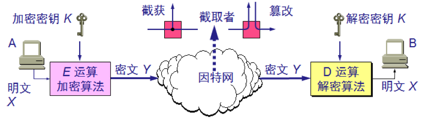

用户 A 向 B 发送明文 X，通过加密算法 E 运算后，就得到密文 Y。

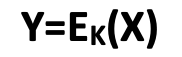

图中所示的加密和解密用的密钥 K 是一串秘密的字符串（或比特串）。在传送过程中可能出现密文的截获和篡改。

B 利用解密算法 D 运算和解密密钥 K，解出明文 X。解密算法是加密算法的逆运算。在进行解密运算时如果不使用事先约定好的密钥就无法解出明文。

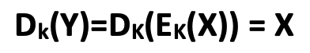

数据加密标准（Data Encryption Standard，**DES**）属于对称密钥密码体制，DES 是一种分组密码。在加密前先对整个明文进行分组，每个分组的长度为 64 位。

然后对每一个 64 位二进制数据进行加密处理，产生一组 64 位密文数据。

最后将各组密文串接起来，即得出整个的密文。使用的密钥为 64 位（实际密钥长度为 56 位，有 8 位用于奇偶校验）。

DES 的保密性仅取决于对密钥的保密，而算法是公开的。人们在破译 DES 方面取得过不少理论进展：差分分析需要约 2⁴⁷ 个选择明文，线性分析需要约 2⁴³ 个已知明文，计算量都低于穷举 2⁵⁶ 个密钥，但实际中几乎不可能收集到这么多的明文-密文对。DES 真正的弱点是 56 位的密钥太短了：1998 年 EFF 的专用破解机 Deep Crack 只用了约 56 小时就穷举出了 DES 密钥。1999 年发布的 FIPS 46-3 已规定单重 DES 只用于遗留系统，推荐改用三重 DES（3DES）；2005 年 5 月，NIST 正式撤销了 DES 标准。3DES 的分组长度同样只有 64 位，NIST 也已规定 2023 年底之后不再允许用它加密数据。

DES 是世界上第一个公认的实用密码算法标准，它曾对密码学的发展做出了重大贡献。

DES 之后出现了 **IDEA**（International Data Encryption Algorithm），使用 128 位密钥，因而更不容易被攻破。2001 年，NIST 又发布了高级加密标准（Advanced Encryption Standard，**AES**），分组长度为 128 位，密钥长度可选 128、192 或 256 位，它是如今使用最广泛的对称加密算法。

非对称加密就是使用不同的加密密钥与解密密钥，又称为**公钥密码体制**。

现有最著名的公钥密码体制是 **RSA** 体制，它基于数论中的大数分解问题，由美国三位科学家 Rivest、Shamir 和 Adleman 于 1977 年提出，并在 1978 年正式发表。

在公钥密码体制中，加密密钥（即公钥）PK 是公开信息，而解密密钥（即私钥）SK 是需要保密的。

加密算法 E 和解密算法 D 也都是公开的。

虽然私钥 SK 与公钥 PK 是成对产生、在数学上相关的，但却不能根据 PK 计算出 SK。

公钥加密模型如下：

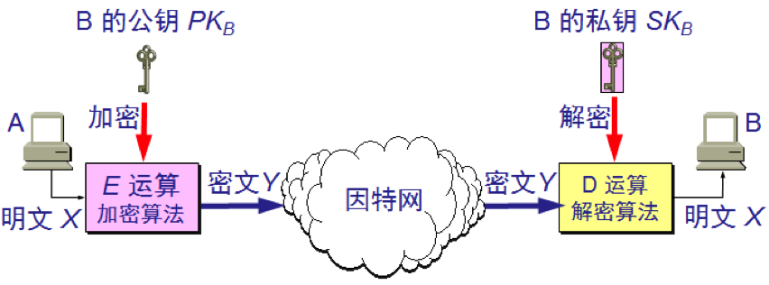

发送者 A 用 B 的公钥 PKB 对明文 X 加密（E 运算）后，接收者 B 用自己的私钥 SKB 解密（D 运算），即可恢复出明文：

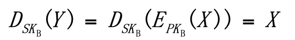

解密密钥是接收者专用的私钥，对其他人都保密。加密密钥是公开的，但不能用它来解密，即：

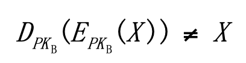

对 RSA 来说，加密和解密的运算还可以对调（这一性质并非所有公钥算法都有），即：

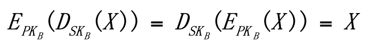

在计算机上可以容易地产生成对的 PK 和 SK。从已知的 PK 实际上不可能推导出 SK，即从 PK 到 SK 是“计算上不可能的”。加密和解密算法都是公开的。

公钥运算比对称加密慢得多，所以实际中通常把两者结合起来：用公钥密码体制来协商或传递一个临时的对称密钥（会话密钥），再用对称加密（如 AES）来加密大量数据，后面的 SSL/TLS 就是这样做的。

在公钥密码体制中，似乎只要每个用户都具有其他用户的公钥，就可实现安全通信，其实不然。设想用户 A 要欺骗用户 B，A 可以向 B 发送一个伪造的、声称是 C 的公钥（实际上是 A 自己的公钥），再用自己的私钥签名报文来冒充 C，B 如何知道这个公钥不是 C 的呢？

这就需要有一个值得信赖的机构，即认证中心（Certification Authority，**CA**），来将公钥与其对应的实体（人或机器）进行绑定。

认证中心可以由政府机构或企业建立，如今互联网上的 CA 大多是商业公司（如 DigiCert、Sectigo、GlobalSign）或非营利组织（如 Let's Encrypt）。每个实体都有 CA 发来的**证书**（certificate），里面有公钥及其拥有者的标识信息，格式一般遵循 X.509 标准。此证书被 CA 进行了数字签名。任何用户都可从可信的地方获得认证中心 CA 的公钥，此公钥用来验证某个公钥是否为某个实体所拥有。

实际中，根 CA 一般不直接签发网站证书，而是先签发中间 CA 的证书，再由中间 CA 签发服务器证书，形成一条**证书链**。操作系统和浏览器内置了受信任的根证书，验证时沿着证书链逐级检查签名，直到某个内置的根证书为止。自 Let's Encrypt 于 2015 年底开始免费签发证书以来，免费证书已经十分普及，绝大多数网站都已启用 HTTPS。证书的有效期也在不断缩短：根据 CA/浏览器论坛 2025 年通过的 SC-081 决议，公开信任的 TLS 证书最长有效期从 2026 年 3 月 15 日起由 398 天降为 200 天，2027 年 3 月降为 100 天，2029 年 3 月降为 47 天。这样即使私钥泄露，影响时间也更短，但人工续期已经不现实，网站需要借助 ACME 协议（RFC 8555，Let's Encrypt 所用的协议）自动申请和续期证书。

RSA 以及后文 TLS 中用到的椭圆曲线算法，安全性都建立在大数分解、离散对数等数学难题之上，而将来足够强大的量子计算机可以用 Shor 算法高效地求解这些问题。目前的量子计算机还远不足以破解实际使用的密钥，但攻击者可以“先存储、后解密”：现在截获并保存密文，等量子计算机成熟后再解密。因此 NIST 从 2016 年起公开征集**后量子密码**（Post-Quantum Cryptography，PQC）算法，并于 2024 年 8 月 13 日发布了首批三项标准：

- FIPS 203（ML-KEM）：基于格的密钥封装机制，用于协商密钥；
- FIPS 204（ML-DSA）：基于格的数字签名；
- FIPS 205（SLH-DSA）：基于散列函数的数字签名。

2025 年 3 月，NIST 又选定基于编码的 HQC 作为 ML-KEM 的备用算法；基于 FALCON 的签名标准 FN-DSA 仍在制定中。对称加密受量子计算的影响要小得多，一般认为使用足够长的密钥（如 AES-256）即可应对。在迁移时间表上，NIST 于 2024 年 11 月发布的 IR 8547 初稿提出：RSA、ECDSA、ECDH 等易受量子攻击的公钥算法中，112 位安全强度的（如 RSA-2048）在 2030 年后弃用，所有这类算法在 2035 年后一律禁用。

# 2 数字签名

数字签名必须保证以下三点：

- 报文鉴别——接收者能够核实发送者对报文的签名，确认报文确实是该发送者发出的；
- 报文的完整性——接收者能够确信收到的报文没有被篡改过，因而接收者也不能伪造对报文的签名；
- 不可否认——发送者事后不能抵赖对报文的签名。

现在已有多种实现数字签名的方法，但采用公钥算法更容易实现，其核心是**私钥签名、公钥验证**：只有拥有私钥的人才能产生签名，而任何人都可以用对应的公钥来验证签名。下面沿用教材对 RSA 签名的简化描述，用 D 运算和 E 运算来说明这一过程。

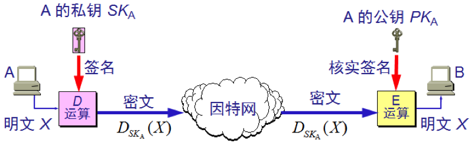

为了进行签名，A 用其私钥 SKA 对报文 X 进行 D 运算。D 运算本来叫做解密运算，但这里 X 并没有被加密过，D 运算的作用是利用 RSA 运算可以对调的性质，得到一段只有 A 才能产生的数据，即签名。A 把经过 D 运算得到的签名传送给 B。B 为了核实签名，用 A 的公钥进行 E 运算，还原出明文 X。请注意，任何人用 A 的公钥 PKA 进行 E 运算后都可以得出 A 发送的明文。可见，上图中 D 运算和 E 运算不是为了解密和加密，而是为了进行签名和核实签名。

实际中签名的对象是报文的摘要（见第 3 节），RSA 签名还要配合 PSS 等填充方案；而 ECDSA、Ed25519 等签名算法根本没有对应的“加密”运算，只有签名和验证两种运算。

下面分析一下为什么数字签名具有上述的三点功能：

因为除 A 外没有别人能具有 A 的私钥，所以除 A 外没有别人能产生这个密文。因此 B 相信报文 X 是 A 签名发送的。

若 A 要抵赖曾发送报文给 B，B 可将明文和对应的密文出示给第三者。第三者很容易用 A 的公钥去证实 A 确实发送 X 给 B。

反之，若 B 将 X 伪造成 X′，则 B 不能在第三者前出示对应的密文。这样就证明了 B 伪造了报文。

但是上述过程仅对报文进行了签名，却没有加密。因为截获了密文并知道发送者身份的任何人，通过查阅手册即可获得发送者的公钥，因而能知道报文的内容。采用下图所示的方法，就可同时实现秘密通信和数字签名：

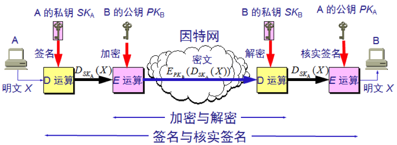

# 3 报文鉴别

许多报文并不需要加密但却需要数字签名，以便让报文的接收者能够鉴别报文的真伪。然而对很长的报文进行数字签名会使计算机增加很大的负担（需要进行很长时间的运算）。当我们传送不需要加密的报文时，应当使接收者能用很简单的方法鉴别报文的真伪。

报文摘要（Message Digest，**MD**）是进行报文鉴别的简单方法。

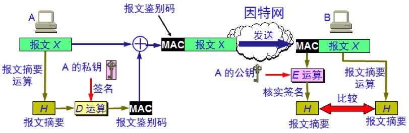

A 将报文 X 经过报文摘要算法运算后得出很短的报文摘要 H，然后用自己的私钥对 H 进行 D 运算，即进行数字签名。得出已签名的报文摘要 D(H) 后，将其追加在报文 X 后面发送给 B。

B 收到报文后首先把已签名的 D(H) 和报文 X 分离，然后再做两件事：

- 用 A 的公钥对 D(H) 进行 E 运算，得出报文摘要 H；
- 对报文 X 进行报文摘要运算，看是否能够得出同样的报文摘要 H。如一样，就能以极高的概率断定收到的报文是 A 产生的，否则就不是。

仅对短得多的定长报文摘要 H 进行数字签名，要比对整个长报文进行数字签名简单得多，所耗费的计算资源也小得多。

但对鉴别报文 X 来说，效果是一样的。也就是说，报文 X 和已签名的报文摘要 D(H) 合在一起是不可伪造的，是可检验的和不可否认的。

报文摘要算法就是一种**散列函数**。这种散列函数也叫做**密码编码的检验和**。报文摘要算法用来防止报文被人恶意篡改。

注意散列不是加密：散列是单向的，没有密钥，也无法“解密”还原出原文。另外，只对报文计算摘要而不签名是不够的，因为攻击者篡改报文后可以重新计算摘要。所以摘要要么经过签名，要么使用带密钥的散列，即报文鉴别码（Message Authentication Code，MAC），最常用的是 HMAC（如 HMAC-SHA256）。

可以很容易地计算出一个长报文 X 的报文摘要 H，但要想从报文摘要 H 反过来找到原始的报文 X，则实际上是不可能的。

若想找到任意两个报文，使得它们具有相同的报文摘要，那么实际上也是不可能的。

**MD5**（Message-Digest Algorithm 5）曾获得广泛的应用。它对任意长的报文进行运算，然后得出 128 位的 MD5 报文摘要代码。但 MD5 早已被证明不安全：2004 年王小云团队公布了构造 MD5 碰撞的方法，如今在普通计算机上很快就能找到碰撞。因此 MD5 不能再用于数字签名、证书、口令存储等安全场景，只适合做文件校验之类的非安全用途。

另一种标准叫做安全散列算法（Secure Hash Algorithm，**SHA**），它和 MD5 相似，最早广泛使用的 SHA-1 码长为 160 位，比 MD5 更安全，但计算起来也比 MD5 要慢些。不过 SHA-1 同样已被攻破：2017 年 Google 与 CWI 公布了第一个 SHA-1 实际碰撞（SHAttered），浏览器和 CA 也早已停用 SHA-1 证书。如今应使用 SHA-2 系列（如 SHA-256，码长 256 位）或 SHA-3。

# 4 安全套接层 SSL

安全套接层（Secure Sockets Layer，**SSL**）由 Netscape 研发，用以保障在互联网上数据传输的安全，利用数据加密技术，可确保数据在网络上传输的过程中不会被截取及窃听。

**SSL 协议位于 TCP/IP 协议与各种应用层协议之间**，为数据通信提供安全支持。SSL 可对万维网客户与服务器之间传送的数据进行加密和鉴别，它在双方的联络阶段（也就是握手阶段）对将要使用的加密算法（如 DES 或 RSA 等）和双方共享的会话密钥进行协商，完成客户与服务器之间的鉴别。在联络阶段完成之后，所有传送的数据都使用在联络阶段商定的会话密钥。

SSL 不仅被所有常用的浏览器和万维网服务器所支持，而且也是传输层安全协议（Transport Layer Security，**TLS**）的基础。

SSL 的演进过程大致是：SSL 2.0（1995 年）、SSL 3.0（1996 年），之后由 IETF 标准化并改名为 TLS，先后有 TLS 1.0（1999 年）、TLS 1.1（2006 年）、TLS 1.2（2008 年，RFC 5246）和 TLS 1.3（2018 年，RFC 8446）。SSL 2.0/3.0 因存在严重漏洞早已被禁用，TLS 1.0/1.1 也于 2021 年被 RFC 8996 正式废弃，如今实际使用的只有 TLS 1.2 和 TLS 1.3。所以现在说的“SSL”“SSL 证书”，实际指的都是 TLS。HTTPS 就是运行在 TLS 之上的 HTTP，默认端口为 443。

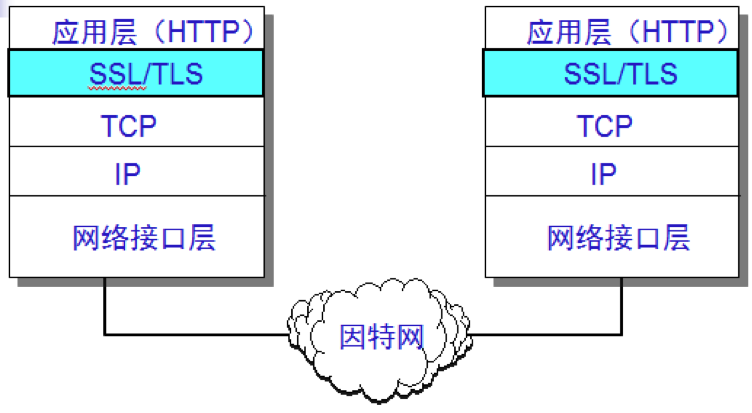

在发送方，SSL 接收应用层的数据（如 HTTP 或 IMAP 报文），对数据进行加密，然后把加了密的数据送往 TCP 套接字。在接收方，SSL 从 TCP 套接字读取数据，解密后把数据交给应用层。

SSL 提供以下三种服务：

- 认证用户和服务器，确保数据发送到正确的客户机和服务器；
- 加密数据以防止数据中途被窃取；
- 维护数据的完整性，确保数据在传输过程中不被改变。

SSL 工作原理的示意图如下：

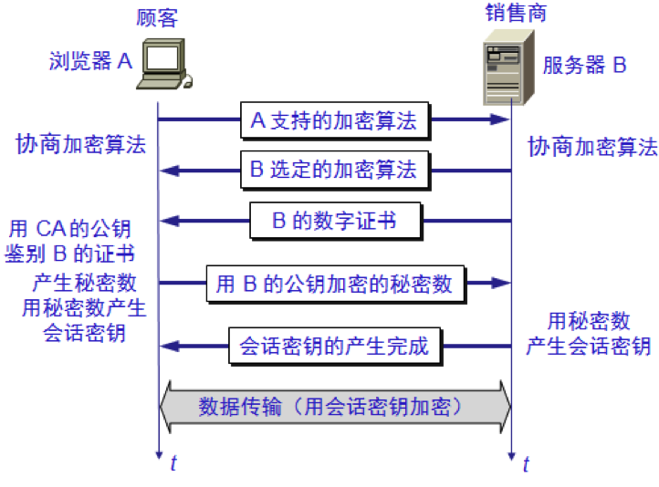

图中客户端用服务器的公钥加密一个秘密数发送给服务器，双方再用这个秘密数生成会话密钥，这就是 SSL 及 TLS 1.2 以前常用的 RSA 密钥交换方式，完整握手需要 2 个 RTT。它有一个缺陷：一旦服务器私钥日后泄露，攻击者就能解密以前截获的所有通信，即不具备**前向安全性**（forward secrecy）。

因此 TLS 1.3 做了较大改动：

- 删除了 RSA 密钥交换和静态 DH，只保留具有前向安全性的 ECDHE/DHE 密钥交换，服务器证书只用于签名认证身份；
- 删除了 RC4、3DES、CBC 模式等不安全或易受攻击的算法，只保留 AES-GCM、ChaCha20-Poly1305 等 AEAD 加密算法；
- 完整握手缩短为 1 个 RTT，会话恢复时还支持 0-RTT（但 0-RTT 数据存在重放风险）；
- 握手中证书等大部分消息也被加密传输，但 ClientHello 中的服务器名称指示（SNI）仍是明文，加密它的 ECH 扩展（RFC 9849）见《计算机网络-应用层》。

此外，为了应对第 1 节提到的“先存储、后解密”威胁，Firefox 132（2024 年 10 月，桌面版）和 Chrome 131（2024 年 11 月）起已默认在 TLS 1.3 中启用 X25519MLKEM768 这种“传统 + 后量子”的混合密钥交换：把经典的 X25519 与 ML-KEM-768 结合起来，只要两者中有一个未被攻破，会话密钥就是安全的。目前改变的只是密钥交换，证书和签名仍在使用传统算法。

# 5 SSH

**SSH** 为 Secure Shell 的缩写，SSH 是建立在应用层、运行于 TCP 之上的安全协议。SSH 是目前较可靠、专为远程登录会话和其他网络服务提供安全性的协议。利用 SSH 协议可以有效防止远程管理过程中的信息泄露问题。

传统的网络服务程序，如 FTP、POP 和 Telnet 在本质上都是不安全的，因为它们在网络上用明文传送口令和数据，攻击者很容易在网络链路上截获这些口令和数据。而且，这些服务程序的安全验证方式也是有其弱点的，就是很容易受到“**中间人**”（man-in-the-middle）这种方式的攻击。所谓“中间人”的攻击方式，就是“中间人”冒充真正的服务器接收你传给服务器的数据，然后再冒充你把数据传给真正的服务器。服务器和你之间的数据传送被“中间人”一转手做了手脚之后，就会出现很严重的问题。通过使用 SSH，可以把所有传输的数据进行加密，并且客户端会用服务器的主机公钥（保存在 `~/.ssh/known_hosts` 中）来核实服务器的身份，这样“中间人”这种攻击方式就难以实现了，也能够防止 DNS 欺骗和 IP 欺骗。SSH 还支持对传输的数据进行压缩（OpenSSH 默认关闭，可用 `ssh -C` 开启），在低速链路上可以加快传输的速度。SSH 有很多功能，它既可以代替 Telnet，又可以为 FTP、POP，甚至为 PPP 提供一个安全的“通道”。

从客户端来看，SSH 提供两种级别的安全验证。

- 第一种级别（基于口令的安全验证）

只要你知道自己的账号和口令，就可以登录到远程主机。所有传输的数据都会被加密，但口令本身要发送给服务器。如果首次连接时没有核对服务器的主机公钥指纹就直接接受，就不能保证你正在连接的服务器就是你想连接的服务器，可能会有别的服务器在冒充真正的服务器，也就是受到“中间人”这种方式的攻击，口令也就泄露了。

- 第二种级别（基于密钥的安全验证）

需要依靠密钥，也就是你必须为自己创建一对密钥（如用 `ssh-keygen` 生成），并把公钥放在需要访问的服务器上（一般是 `~/.ssh/authorized_keys`）。如果你要连接到 SSH 服务器上，客户端软件就会向服务器发出请求，请求用你的密钥进行安全验证，请求中带有你的公钥。服务器收到请求之后，先在该服务器上你的主目录下查找是否有这个公钥。如果有，客户端就用你的私钥对本次会话的相关数据进行签名并发送给服务器，服务器用公钥验证签名，验证通过即允许登录。（早期的 SSH-1 采用的是服务器用公钥加密一个“质询”（challenge），客户端用私钥解密后再发回服务器的方式。）

用这种方式，如果你为私钥设置了口令，就必须知道这个口令。但是，与第一种级别相比，第二种级别不需要在网络上传送口令。

第二种级别不仅加密所有传送的数据，而且“中间人”也无法冒充你登录真正的服务器（因为“中间人”没有你的私钥）。

SSH 同样面临“先存储、后解密”的威胁，而且它的迁移比 TLS 更早：OpenSSH 9.0（2022 年 4 月）起默认使用把 NTRU Prime 与 X25519 结合的混合密钥交换 sntrup761x25519-sha512，OpenSSH 10.0（2025 年 4 月）起又改为默认使用基于 ML-KEM 的 mlkem768x25519-sha256。与 TLS 一样，目前改变的只是密钥交换，主机密钥和用户密钥仍使用 Ed25519、RSA 等传统签名算法。

SSL 与 SSH 虽然只有一个字母的差别，但两者是相互独立的协议，不是一个范畴。SSH 并不是基于 SSL 构建的，它有自己的传输层协议（RFC 4253）来完成密钥交换、服务器认证和加密。如果硬要将两者作比较，可以粗略地理解为：SSH 相当于“Telnet + 一套自带的、类似 SSL/TLS 的安全层”；而 SSL/TLS 是一个通用的安全层，可以为 HTTP、SMTP 等多种应用协议提供保护。

# 6 防火墙

防火墙是由软件、硬件构成的系统，是一种特殊编程的路由器，用来在两个网络之间实施接入控制策略。接入控制策略是由使用防火墙的单位自行制订的，为的是可以最适合本单位的需要。

防火墙内的网络称为“可信的网络”，而将外部的互联网称为“不可信的网络”。防火墙可用来解决内联网和外联网的安全问题。

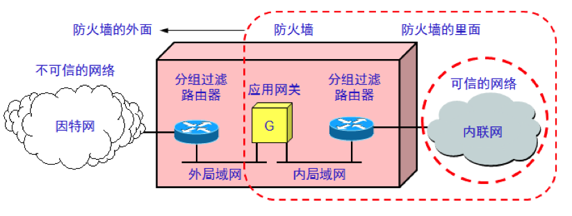

防火墙的功能有两个：阻止和允许。

“阻止”就是阻止某种类型的通信量通过防火墙（从外部网络到内部网络，或反过来）。“允许”的功能与“阻止”恰好相反。

防火墙必须能够识别通信量的各种类型。不过在大多数情况下防火墙的主要功能是“阻止”。

按照检查的层次和方式，防火墙技术大致可以分为以下几类：

- 分组过滤防火墙——工作在网络层和传输层，根据分组首部中的源 IP 地址、目的 IP 地址、协议和端口号等字段，按照事先制订好的规则，逐个分组决定放行还是丢弃。
- **状态检测**（stateful inspection）防火墙——在分组过滤的基础上跟踪每条连接的状态，只放行属于已建立连接的分组。
- 应用级防火墙——从应用程序来进行接入控制。通常使用应用网关或代理服务器来区分各种应用。例如，可以只允许访问万维网的应用通过，而阻止 FTP 应用通过。
- 下一代防火墙（Next-Generation Firewall，NGFW）——把上述功能与应用识别、入侵防御等功能融合在一起。

分组过滤是靠查找系统管理员所设置的表格来实现的。表格列出了可接受的或必须进行阻拦的目的站和源站，以及其他的一些通过防火墙的规则。

我们知道，TCP 的端口号指出了在 TCP 上面的应用层服务。例如，端口号 23 是 Telnet，3389 是 Windows 远程桌面（RDP），445 是 Windows 文件共享（SMB）。如果在从互联网进入防火墙的分组过滤路由器中，将所有目的端口号为 23 和 3389 的分组都进行阻拦，那么外单位用户就不能通过 Telnet 或远程桌面登录到本单位的主机，这两个端口长期都是暴力破解口令的重点目标。同理，阻拦从外部进入的 445 端口的分组，可以防止像 2017 年的 WannaCry 勒索病毒那样，利用 SMB 漏洞直接从互联网侵入内网主机。

不过，仅靠端口号来识别应用越来越不可靠。一方面，有的应用会动态分配端口号，例如 FTP 的数据连接（见《计算机网络-应用层》）；另一方面，如今大量应用都运行在 HTTPS 的 443 端口上，只看端口无法区分它们。UDP 也不能简单地全部阻拦，因为 DNS、QUIC（HTTP/3）等都依赖 UDP。

应用网关是从应用层的角度来检查每一个分组。例如，一个邮件网关在检查每一个邮件时，要根据邮件的首部或报文的大小，甚至报文内容（例如，有没有某些像“导弹”“核弹头”等敏感词汇）来确定该邮件能否通过防火墙。

分组过滤是逐个分组独立判断的（无状态），为了让回应分组能够进来，往往要开放很大范围的端口。状态检测防火墙则会记录每条连接的状态（对 UDP 则记录每组地址和端口构成的会话），例如内网主机向外部 DNS 服务器发出查询后，防火墙只放行对应的回应分组，比单纯按端口过滤灵活、安全得多。下一代防火墙进一步根据流量的特征识别出具体的应用（即使它们都使用 443 端口），再结合入侵防御等功能进行控制。

防火墙基于“边界”的思路：边界以内可信，边界以外不可信。但随着云计算和远程办公的普及，边界越来越模糊，而且攻击者一旦突破边界，就能在内网中横向移动。为此，NIST 在 2020 年 8 月发布的 SP 800-207 中提出了**零信任架构**（Zero Trust Architecture，ZTA）：不因为用户或设备处在内网中就默认信任，而是对每一次访问资源的请求都进行身份认证和授权，并且只授予完成任务所需的最小权限。常见的实现方式包括软件定义边界（Software Defined Perimeter，SDP）、零信任网络访问 ZTNA（见《计算机网络-网络层》）和微隔离（把内网划分成很小的区域，分别控制它们之间的访问）。零信任并不取代防火墙，而是把访问控制从网络边界推进到每一个资源的前面。

# 7 总结

网络安全的基础是密码学：对称加密（如 AES）速度快，适合加密大量数据；公钥密码（如 RSA）解决了密钥分发问题，并且可以实现“私钥签名、公钥验证”的数字签名；为了应对量子计算的威胁，ML-KEM 等后量子算法已经标准化，并开始以混合密钥交换的形式在 TLS 和 SSH 中使用，NIST 计划在 2035 年前完成向后量子密码的迁移。报文摘要（散列函数）配合数字签名或 HMAC 可以低成本地保证报文的完整性和真实性，但 MD5、SHA-1 已被攻破，应改用 SHA-256 等算法。CA 和证书链解决了“公钥到底属于谁”的问题，在此基础上 SSL/TLS 为 HTTP 等应用提供了加密通道，如今应使用 TLS 1.2/1.3，并且证书有效期正逐步缩短到 47 天，需要自动续期。SSH 是独立于 TLS 的远程登录安全协议，推荐使用基于密钥的验证。防火墙则从网络边界上控制哪些通信可以进出，已从简单的分组过滤发展到状态检测和下一代防火墙；零信任架构则不再默认信任内网，把访问控制推进到每一个资源的前面。它们都是对上述加密手段的补充。
