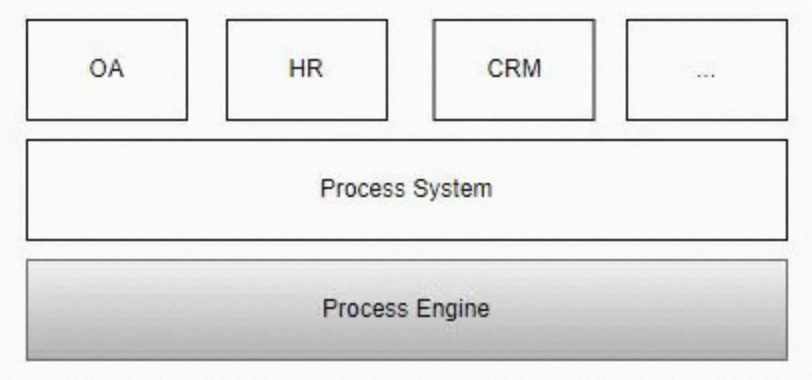
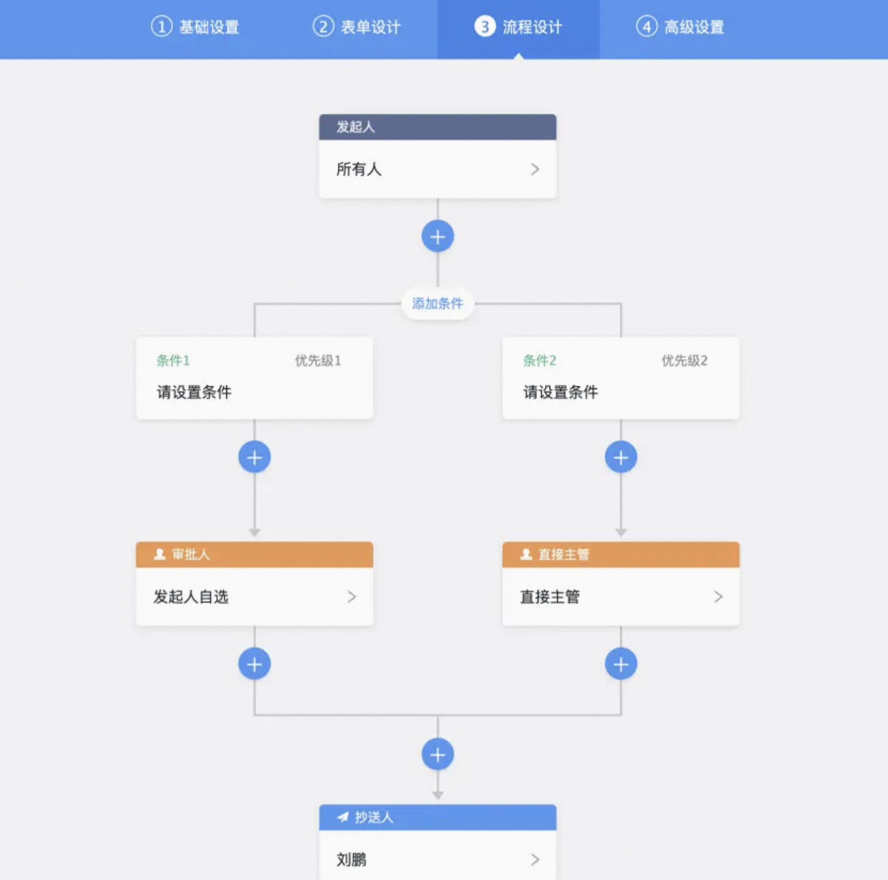
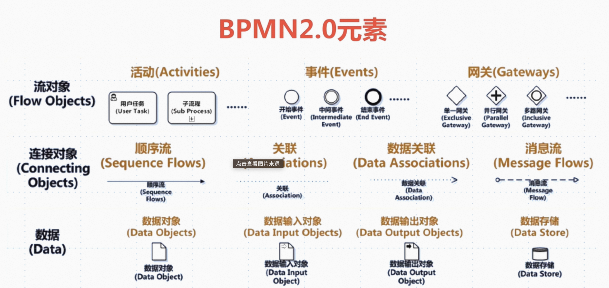
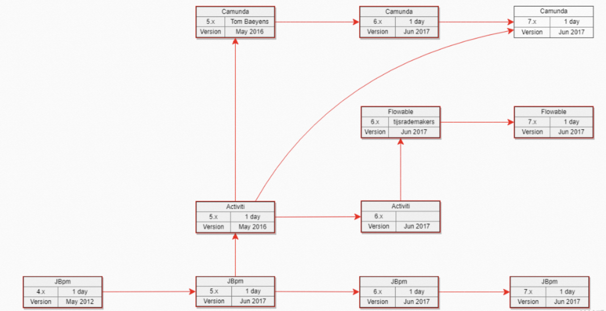
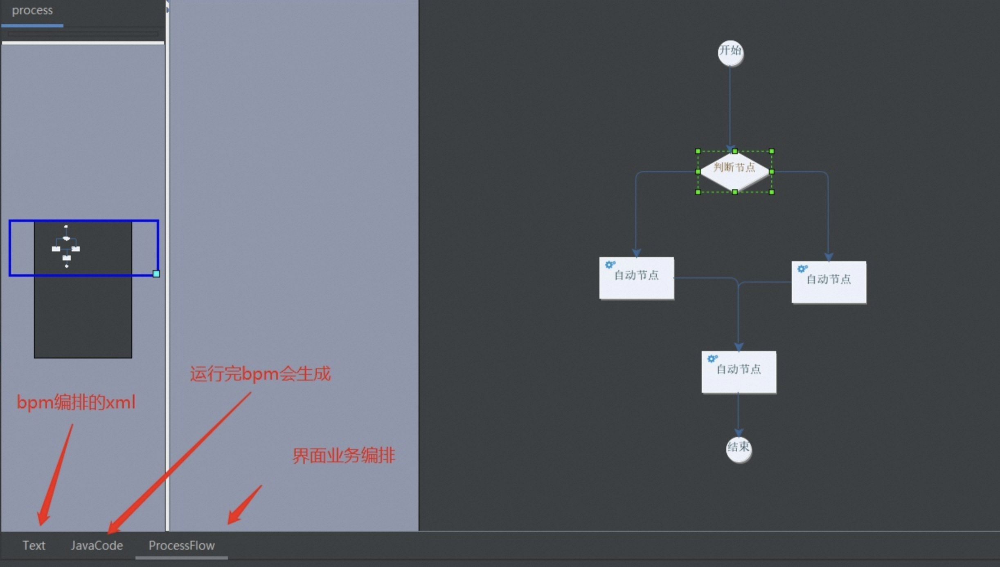
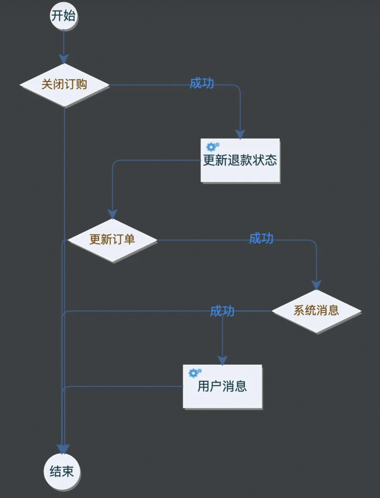

# 流程引擎

# 1 流程引擎是什么

## 1.1 流程是什么

简单来说，**流程就是一系列活动的有序组合**。比如，用于企业办公的 OA 系统中，就存在大量的申请审批类的流程。在生产制造业，有大量的从销售端的订单，到生产制造，再到签收回款的生产销售流程。综上，流程是一个概念，在和具体实现结合时，就产生了不同的流程产品，如 DevOps 流水线、Apache Airflow、Argo Workflows 等。

在流程实现方面，主要可以分为 2 种实现方式，一种是用代码实现，比如：用代码实现一个加班申请，那么就要自己对接 SSO 进行单点登录，通过接口拿到发起人和审批人的信息，同时保存表单数据。另一种方式是使用流程引擎来实现，流程引擎对接应用场景所需数据，如加班申请，流程引擎对接 SSO、OU、审批人配置、权限等，实现这样一个流程，只需要关心流程配置、流程节点和流程表单即可，流程流转以及流程的数据处理，都通过流程引擎来完成。

流程引擎可以快速落地流程实现，这也是流程引擎存在的价值。

## 1.2 引擎是什么

一般而言，引擎是一个程序或一套系统的支持部分。常见的程序引擎有游戏引擎、搜索引擎、杀毒引擎等。**引擎是对脱离具体业务场景的某一类业务场景的高度抽象和封装**。

比如，某 OA 公司，封装了一套审批用的工作流，实施人员只需要配置流程和表单即可使用。再比如，美国某公司做了一个 AI 引擎做 NBA（Next Best Action）推荐，封装了推荐领域的常用算法，在不同的场景自动选择和组合多种算法，进行智能推荐。

## 1.3 工作流是什么

> 工作流（Workflow），是对工作流程及其各操作步骤之间业务规则的抽象、概括描述。工作流建模，即将工作流程中的工作如何前后组织在一起的逻辑和规则，在计算机中以恰当的模型表达并对其实施计算。

简单来说，**工作流就是对业务的流程化抽象**。

之所以被称之为“流”，是因为各个节点通过内外部驱动引起节点的推进，以流式的状态到达业务终点。比如一次用户查看淘宝商品的费用、一次支付成功后的权益开通、一次用户注册、一次调度任务的运行等，都可以是一个工作流。

从代码层面上来说，工作流是**将业务逻辑代码按照指定的流程格式化**。即原来可以用代码直接完成的任务流程，借助工作流工具来进行标准格式化、视图化。

另外要提一点，工作流本身是**一种工程化的设计思想**，在特定场景下，也是**一种业务的实现方式**。对于狭义的通用工程来说，工作流只是一种设计模式，或者说思维方式，不涉及任何的具体编码，即所有业务代码还是需要人工完成，只是用工作流的方式来规划和编排代码运行方式。而对于某些垂直的业务，工作流本身就是业务实现的具体方式，比如审批流的配置，可以直接通过工作流引擎的方式，直接实现配置化编排业务。

现在业务都趋于融合，所以很多工作流提供了默认的实现，也提供了自定义的实现。比如阿里巴巴旗下的“宜搭”就宣称“0 代码搭建应用”。宜搭本身就是一种用工作流的思维提供的应用搭建平台。

## 1.4 流程引擎是什么

流程引擎是一个底层支撑平台，是为提供流程处理而开发设计的。流程引擎和流程应用，以及应用程序的关系如下图所示。

常见的支撑场景有：Workflow、BPM、流程编排等。

成熟的流程引擎一般都包括**图形化配置能力**，即对业务流程进行编排的**拖拽式工具**，有插件式也有 Web 云端式的。

比如上图的审批流，流程引擎底层对接了组织用户关联的功能及调用外部服务的能力，在页面上通过拖拽、点击，就能组装出一套审批流程。

# 2 流程引擎选型

## 2.1 BPMN 规范

**BPMN** 是听得比较多的工作流标准，但工作流的规范其实不止一种，还有 XPDL、BPML 等。甚至它们的出现时间比 BPMN 更早，只是因为一些技术和非技术原因，BPMN 2.0 被普遍使用了，而非 BPMN 2.0 规范的厂商也逐渐转移了，最终，**BPMN 2.0 成为了 BPM（Business Process Management）领域普遍认可的标准**。

BPMN 2.0 全称 `Business Process Model and Notation 2.0`，是一套符合国际标准的业务流程建模符号。BPMN 2.0 由 OMG（对象管理组织）于 2011 年发布，2013 年成为国际标准 ISO/IEC 19510。

BPMN 2.0 规范定义了业务流程的符号以及模型，并且为流程定义设定了转换格式，**目的是为了让流程的定义实现可移植性**，那么用户可以在不同的供应商环境中定义流程，并且这些流程可以移植到其他遵守 BPMN 2.0 规范的供应商环境中。

BPMN 想要在流程设计的易用性和复杂需求之间寻找一个平衡点，既可以让非技术人员建立简单并且易懂的业务流程模型，同时又可以处理高度复杂的业务流程，因此要解决这两个矛盾的要求，需要在 BPMN 规范中定义标准的图形和符号。

## 2.2 产品

### 2.2.1 jBPM

jBPM 由 JBoss（现属 Red Hat）开发，社区版已随 KIE 社区迁入 Apache 软件基金会，目前随 Apache KIE 进入 10.x 版本。不过从 jBPM 5 开始已经跟之前不是同一个产品了，jBPM 5 的代码基础不是 jBPM 4，而是**从 Drools Flow 重新开始**，基于 Drools Flow 的技术在国内市场上用得很少，所以不建议选择 jBPM 5 以后的版本。jBPM 4 诞生得比较早，后来 jBPM 4 创建者 Tom Baeyens 离开 JBoss 加入 Alfresco 后，很快推出了新的基于 jBPM 4 的开源工作流系统 Activiti。另外 jBPM 以 Hibernate 作为数据持久化 ORM 也已不是主流技术。

在当前时间节点选择流程引擎，**jBPM 不是最佳选择**。

### 2.2.2 Activiti

Activiti 由 Alfresco 公司开发（Alfresco 于 2020 年被 Hyland 收购），目前主流版本为 Activiti 7，仍在持续发版（2026 年 10 月发布了 7.21 的 RC 版本）。

选型时有必要先了解一下 Activiti 几个版本的发展历史。

Activiti 5 和 Activiti 6 的核心开发是 Tijs Rademakers，由于团队内部分歧，在 2016 年时 Tijs Rademakers 离开团队，创建了后来的 Flowable。Activiti 6 以及 Activiti 5 代码已经交接给了 Salaboy 团队，Activiti 6 以及 Activiti 5 的代码官方已经暂停维护了。目前 Activiti 7 由 Alfresco/Hyland 团队维护，主打云原生的 Activiti Cloud。Activiti 7 内核使用的还是 Activiti 6，并没有为引擎注入更多的新特性，只是在 Activiti 之外的上层封装了一些应用。

综上，**Activiti 可用，但是不推荐**。

### 2.2.3 Flowable

Flowable 是一个使用 Java 编写的轻量级业务流程引擎，是基于 Activiti 6 衍生出来的版本，目前最新的大版本是 Flowable 7（基于 Java 17 和 Spring Boot 3）。其开发团队是从 Activiti 中分裂出来的，修复了一众 Activiti 6 的 bug，并在其基础上研发了 DMN 支持、CMMN 支持等等，相对开源版，其商业版的功能会更强大。

Flowable 项目中包括 BPMN（Business Process Model and Notation）引擎、CMMN（Case Management Model and Notation）引擎、DMN（Decision Model and Notation）引擎等模块，6.x 版本中还包括表单引擎（Form Engine）和内容引擎（Content Engine）。

从 Flowable 6.4.1 起，Flowable 大力发展其商业版产品，开源版本维护不及时，部分功能只在商业版中提供，比如历史数据同步至其他数据源、ES 等。2023 年 9 月发布的开源版 7.0 更进一步，移除了全部 UI 应用（Modeler、Task、Admin、IDM）以及表单引擎和内容引擎，开源版基本只保留引擎本身。商业版则改用 2025.x、2026.1 这样的版本号，与开源版分开演进。

Flowable 的事件注册表（Event Registry）可以直接对接 Kafka、RabbitMQ 等消息队列，同时对 DMN 和 CMMN 的研究也比较多，作为纯引擎使用**是个不错的选择**，但建模和管理界面需要自己构建或采购商业版。

### 2.2.4 Camunda

Camunda 基于 Activiti 5，所以其保留了 PVM，开发团队也是从 Activiti 中分裂出来的，发展轨迹与 Flowable 相似，同时也提供了商业版。需要注意的是，Camunda 7 社区版已于 2025 年 10 月随 7.24 版本停止维护，官方主推基于 Zeebe 的 Camunda 8，而 Camunda 8 自 8.6 起自托管生产使用需要商业授权，选型前要评估许可成本。如果想继续使用 Camunda 7 的开源引擎，可以关注社区分叉 Operaton 和 CIB seven，它们都在 Camunda 7 社区版的基础上继续维护。

通过上面的介绍可以发现，Activiti、Flowable、Camunda 同宗同源，祖先都是 jBPM 4。

选择 Camunda 的理由：

* 据部分压测报告，Camunda BPMN 引擎的性能和稳定性更好。
* 功能比较完善，除了 BPMN，Camunda 还支持企业和社区版本中的 CMMN（案例管理）和 DMN（决策自动化）。Camunda 不仅带有引擎，还带有建模（Modeler）、任务管理（Tasklist）、操作监控（Cockpit）和用户管理（Admin）等工具。其中 Modeler 和这些 Web 应用的基础功能是开源的，但 Cockpit 的高级功能、Optimize 等工具一直是企业版专属，Camunda 8 自托管用于生产还需要商业授权。

### 2.2.5 CompileFlow

CompileFlow 是基于淘宝工作流 TBBPM 开源的、专注于**纯内存执行**、**无状态**的流程引擎，通过**将流程文件转换生成 Java 代码编译执行**，简洁高效。它在阿里巴巴中台解决方案中广泛使用，支撑了导购、交易、履约、资金等多个业务场景。

CompileFlow 目前有 IntelliJ IDEA、Eclipse 可视化编排插件，并可以在流程设计中实时动态生成 Java 代码并预览，所见即所得。

CompileFlow 的优势是很容易上手，可以与 Spring 集成，降低了工作流学习的难度。

劣势是 CompileFlow 原生只支持淘宝 BPM 规范，为兼容 BPMN 2.0 规范，做了一定适配，但**仅支持部分 BPMN 2.0 元素**，如需其他元素支持，需要在原来基础上自行扩展。

# 3 流程引擎的优缺点

## 3.1 优点

### 3.1.1 业务可视化

首先，最大的优点，就是可以借助流程引擎，让业务可视化，可以通过视图看到整个业务流程，每个节点执行什么业务逻辑一目了然，分支处理、异常处理也非常清晰。

随着业务的不断发展，代码的执行链路难免会变得越来越长，分支也变得越来越多，到最后，最熟悉这块业务的开发，也很难描述出完整的视图是什么样子的。这种情况下，**可视化也是一种生产力**。

### 3.1.2 业务可编排

如果业务永远不变化，那么我们硬编码在一个方法里也无所谓。但是我们知道业务是千变万化的，软件设计很重要的一个指标就是灵活可扩展。工作流程的重编排，则可以使得业务进一步在代码层面增加灵活性。可以通过节点的调整来快速调整业务流程，可以灵活增删节点，而不至于对整个流程有影响。

还是以上面的流程为例，如果要增加一个【关闭用户权益】的节点，或者删除【用户消息】，那么我们很容易利用工作流增删原有流程。这里实现了代码可维护里最核心的两点：**改动代码最简单**和**改动代码最快**。

### 3.1.3 自动重试

对于某些工作流来说，工作流引擎提供了框架层面持久化和自动重试的能力。

## 3.2 缺点

* 对于使用者来说，如果需要精通流程引擎，必须同时掌握 Java 语言、BPMN XML 语法和图形符号，需要在这三者之间做到一一对应。对参与人员的逻辑能力要求非常高，因为这些都是语言符号，只是表达逻辑的形式而已，不如直接用 Java 开发更简单方便。

* 流程引擎耦合了业务和技术架构，将可靠性（事务）、高性能（Job 执行）和业务流程捆绑在一起，比如 Job 执行的方式就很难拓展到分布式弹性 Job 方式。流程事务和技术事务混淆在一起。随着 Serverless 和云原生的普及，技术架构逐渐变成了云平台的一部分。近年来更流行的是 Durable Execution（持久化执行）这类“代码即流程”的方案，如 Temporal、Cadence，以及 AWS Step Functions 等云托管编排服务。它们把状态持久化、重试、超时等可靠性能力交给平台，业务流程直接用代码表达，更具扩展性和可伸缩性。

* 工作流引擎违背六边形架构，按照六边形架构，业务核心不应该依赖 REST、JMS、数据库或界面等外围。一些工作流引擎无法像 Spring 那样对权限等多切面进行解耦，比如如今流行的 OAuth 和 JWT 其实已经剥离了权限，但是很难结合到现有工作流引擎中。同理，有些工作流引擎依赖于分层架构，比如表单对象，其实表单对象应该是一个领域模型对象，但是因为某些原因在实际中要么会依赖 UI 层，要么依赖 JPA 层，有的人会将其耦合到 Spring MVC 的 Controller，这导致整个系统的扩展性完全丧失，几乎很难过渡到 Spring Boot 的微服务架构。

* 将领域模型变成 Map 里面的数据，是先有领域边界？有界上下文？还是先有在这些上下文之间流动的流程呢？流程引擎默认是坚持后者，否定了有界上下文边界，将领域边界内的领域模型任意肢解成数据库的数据，通过 Java 的 Map 携带，这种不尊重领域模型的极端做法未来必然行不通，只要动态流程，不要静态结构了，没有结构，就没有不变，整个系统好像都可以变。思路应该是：以聚合根为主，在不同聚合根之间采取异步的事件通信，将这种事件通信和流程管理器整合在一起，如 Saga 模式。

工作流引擎其实都是某个阶段技术和业务的组装者，但是由于技术不断发展，工作流引擎如果没有实现模块化或分层化，那么很难避免随着技术发展不断被淘汰，用户也是先尝甜头后再尝苦头，掉进坑里，这也是工作流引擎不断更新迭代，但是鲜有恒强者的原因。但是由于诱人的市场需求存在，用户渴望不依赖开发人员，以为自己动动鼠标就能搞定政务系统或办公系统。

在一个分布式服务环境下，如何整合调度服务走向？Spring Cloud 代表的微服务网关只解决了路由问题，无法像 BPMN 那样组合各种流程逻辑。目前业界的答案主要有两类：一是前面提到的 Temporal、Cadence 等 Durable Execution 引擎，用普通代码编写流程，由引擎负责持久化和故障恢复；二是 Netflix Conductor 这类基于 JSON DSL 的微服务编排引擎（Netflix 已于 2023 年 12 月归档原仓库，社区版在 conductor-oss 继续维护）。BPMN 本身的思路方向可能有问题，希望抛弃代码和配置，用一套全新的语言表达整个业务流程概念，这种方式必然导致业务和技术的深度耦合。

# 4 适用场景

那么适合用工作流的业务有什么特点？

## 4.1 领域业务高复杂度

对于偏向业务系统的逻辑，并且具备一定的领域专业性，比如进销存、CRM、订单管理等具备一定的领域复杂度的业务，可以用工作流模式，来实现业务的可视化。从全局的业务视角来观察整体系统架构，而不至于在代码大山面前无从下手。

## 4.2 多节点、长链路

比如询价需要经过加载用户信息、加载商品、加载优惠、计费等多个节点，每个节点都相对独立。此类业务就比较适合用无状态的内存工作流。

## 4.3 状态持久化和自动重试

对于异步的调度流程，例如订单支付成功后，驱动下游业务系统开通、发送用户提醒消息、扣减库存等异步流程节点，需要持久化每个节点的执行状态，同时在流程失败的情况下系统框架能进行重试恢复。

# 5 流程引擎与规则引擎

流程引擎与规则引擎都属于中间件的范畴，都是**将应用中复杂、易变的关注点分离出来，独立管理**。

不同点在于：

* 流程引擎是将应用中“什么人/系统、什么时间、完成什么工作/任务”进行分离，解决的是**复杂的流程**；
* 规则引擎是将应用中“什么场景、什么条件、做什么决策”进行分离，解决的是**复杂的决策逻辑**。
